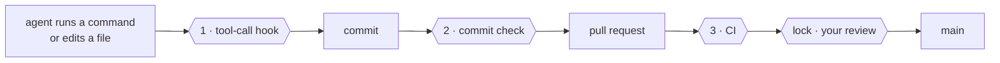
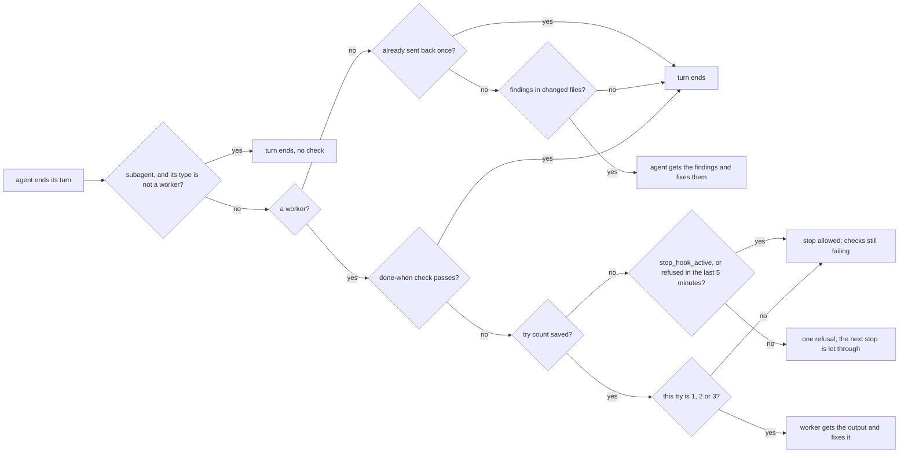
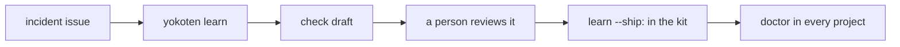

# The yokoten guide

The [README](../README.md) is the short version. This is everything else: why yokoten exists, how it works, the rules, the commands, and what it can't do.

## A race track

**Think of it as a race track.** An AI coding agent is a fast car. yokoten is the track
it runs on. The guardrails stop a mistake from becoming a wreck (the guard). The racing
line shows the next turn, one stage at a time (the guide). And every crash makes every
track safer: when one project learns a lesson, every project gets the check (*yokoten*).

## Words used here

- **Session**: one conversation with an AI coding agent, such as Claude Code.
- **Hook**: a small program the agent's tool runs at a set moment. yokoten adds one that
  runs before every command or edit (and can stop it), one when the agent ends its turn,
  and one at the start of each session.
- **Commit check**: a git hook (`.githooks/pre-commit`) that runs before each commit.
- **CI**: the checks GitHub runs on every pull request.
- **Ruleset**: a GitHub setting that protects a branch or tag, for example "no merge
  without review".
- **Owner, lead, worker**: you; the agent session you talk to; a session the lead starts
  for one task. See [Managing agents like a team](#managing-agents-like-a-team).
- **Exit code**: a number a command gives back when it ends. 0 means all is well. A
  script or an agent reads it. See [Exit codes](#exit-codes).
- **JSON**: a plain text format for data that programs read. `--json` prints it.

## The name

*Yokoten* (横展) is a word from Toyota's shop floors. When one production line finds a
fix for a defect, the fix goes to every line that could have the same defect, not just
the line that found it. yokoten does that for your projects: a lesson one project learns
is offered to the rest.

## The problem

You run a project with AI agents for a few months. You learn things the hard way: an
agent "fixes" a failing test by changing the test, a pull request merges with a commit
nobody reviewed, a server address ends up in a tracked file. You add a rule, a hook, a
check. That project gets better.

Then you start a new project, or go back to an old one, and none of it is there. The
lessons live in one repo and in your head. If you forget to ask for them, the agent
starts from zero.

yokoten turns those lessons into something that checks itself:

- **Rules with reasons.** Twelve core rules. Each one says why it exists (an incident,
  or a risk if nothing has gone wrong yet) and which check holds it. A rule without a
  check is a wish.
- **Guards that run on their own.** A tool-call hook stops an agent before a bad
  command runs. A commit check catches what the hook can't see. CI runs the same
  check for commits made without either.
- **A reminder you don't have to remember.** Every session starts with `doctor`. It
  tells the agent the project's stage on the road, and the one next step. The agent
  brings it up, so you don't have to.

## What changes on day one

| Your agent tries to… | Without yokoten | With yokoten |
|---|---|---|
| force-push, or tag a release | it happens | stopped before it runs, and told why |
| "fix" a failing test by editing the test | the test passes, the bug stays | not allowed in a fix |
| commit your email, a server IP, your city | it goes public | the commit stops; the report names the file and line, never the text |
| post your email or a token in an issue or a pull request | it goes public | stopped before it is sent, and told what to change |
| open a pull request | as you, with all your rights | as a bot; nothing merges without you |
| work in another project | starts from zero | sees what that project is missing, and offers to set it up |

All of this is on from the start, for everyone: you don't answer a question or edit a file to be safe. Every setting that changes it has a way back to the default. [Record 0014](records/0014-safe-by-default.md) says how yokoten decides what it does by itself, what it asks first, and what it never does.

## The safeguard

The same five protections are on from the start, for every person and every agent. They
hold with no `yokoten init` and no setting.

1. **Lose your work**: no force push, no hard reset, no deleting `.git` or its history.
2. **Leak a secret**: no key, token, email address or home path in a commit or a post.
3. **Publish for you**: no tag, no release, no package publish, no making a repo public.
4. **Run code from the internet unread**: no download piped into a shell.
5. **Take the safeguard apart**: no turning off a check or a hook; a worker cannot edit CI or the rules, and you review a lead's change to them.

When it stops something, it shows the same four parts:

```
yokoten stopped this: creating the tag v1.2.0 [release]
Why: A tag publishes a release, and only you decide when to release.
Do instead: If the owner asked for this, they run `git tag v1.2.0` themselves.
More: https://github.com/yokoten-labs/yokoten/blob/main/docs/guide.md#the-safeguard
```

The first line names the exact tag, file or branch, and the rule. `Why` says what could go
wrong. `Do instead` says the safe way, in words a beginner can use without reading code.
`More` links the rule. Only the owner makes the changes in the fifth protection; an agent
asks the owner.

## Three checks and a lock



| | Runs | Stops |
|-|------|-------|
| **1** | before each tool call | tag pushes, force pushes, skipped checks; test edits in a fix task; a worker editing the rules; a program the project blocks; an issue or pull request title that breaks the title rules; personal data or a secret in an issue, pull request, comment or release note an agent posts with `gh`; cancelling or deleting an Actions run |
| **1b** | when a Claude Code agent ends its turn | the same personal data, secrets and file rules as the commit check, in the changed files. It sends the agent back once with the findings |
| **2** | on every commit | what the hook can't see: files changed by `sed` or a script, personal data, an overfull folder |
| **3** | on every pull request | a commit made with the hook off |
| **lock** | on the server | a merge without your review, a push to `main`, a release tag that isn't yours |

## What a session sees

At the start of a session in a project that hasn't adopted yokoten yet:

```
yokoten: stage 1 of 5, safety net. Next: no AGENTS.md, so the agents have no written rules here; `yokoten init` adds one.
Why: an agent follows the rules it can read, and only those.
Tell the user in plain words, one step at a time, and offer to do it (as-is, lighter, or not now with a reason).
```

The session hears about one step only: the stage, the next step, and why it matters.
The stage is worked out from the files each time; nothing saves it. A step you marked
"not now" is skipped. The order is advice: a later step done early counts as done.
When every step is done or "not now", the session hears one line that says so.
A file missing here but on the default branch is named with that branch, not with `init`.
After Claude Code compacts the context, the session hears only notes that changed.
Each session keeps what it heard in `~/.config/yokoten/sessions/`, and files older than 7 days are removed.
The agent tells you in your own language. yokoten prints English, which agents read most
reliably.

`yokoten doctor` shows the whole road. Each step is **done**, **next**, **to do**, **not
now** (with your reason) or **can't check**. Steps that yokoten can't check yet are not
listed:

| Stage | Steps |
|---|---|
| **1 · Safety net** | `rules`, `tool-hook`, `commit-check`, `runtime`, `tests` (a test command, and CI runs it) |
| **2 · Issues and pull requests** | `remote` (the repo is on the code host, and a branch from it is pushed), `ci` (CI runs `check`, or uses the yokoten Action), `issues` (no todo file), `templates`, `labels` (the standard set), `milestone` (an open one), `no-build-output` (nothing in `dist/`, `build/` or `out/`, no built binaries) |
| **3 · Release** | `changelog`, `titles` (CI runs `check --pr`, or uses the Action on pull requests without `pr-check: false`) |
| **4 · A team of agents** | `codeowners`, `bot`, `skills`, `sandbox` (each agent may write the worktree, and nothing wider), `review` (a merge to the default branch needs one approval) |
| **5 · Going public** | `security-files` (a security policy, Dependabot, a license), `protection` (rulesets on the default branch and `v*` tags), `merge-settings` (squash only, delete branch on merge), `security-settings` (secret scanning, push protection, private reporting, Dependabot alerts) |

The last three are server settings. Full `doctor` reads them through `gh api`, and only reads.
Without `gh`, a sign-in, the network or a GitHub remote, they are **can't check**, never done.
A session never calls the network, so there they are always **can't check**.

**Another host.** doctor reads the host from the `origin` remote. On GitHub it reads the
server as above. On Gitea, name the host in `yokoten.json` (`"host": "gitea"`) and give the
bot user a token in `GITEA_TOKEN`; doctor then reads the branch and tag protection, the
labels, the milestones and the forgotten branches through Gitea's API. `gitea.com` is
recognised without the key. On another host, such as GitLab, the core works the same: the
rules, the guard and the commit check. The steps that only the host can judge are `tests`,
`ci`, `labels`, `milestone`, `titles`, `codeowners`, `bot`, `review` and the three server
steps. There each one is **can't check**, and says what it asks, so you can set it up by
hand. They never hold the stage. A self-hosted server's name is never printed: doctor calls
it "this host".

`labels` and `milestone` in stage 2 are read the same way. The standard labels are `bug`, `feat`,
`docs`, `refactor`, `ci`, `owner`, `incident`, `good first issue`, `hotfix`, `security`, and the
tier labels `tier A`, `tier B` and `tier C`. `init` shows which are missing, and
`init --github --yes` adds them.

`review` in stage 4 reads the server the same way. It is done when the default branch's ruleset, or
its branch protection, asks for at least one approving review. GitHub does not let you
approve your own pull request. So the bot opens the pull requests, and you approve and
merge them. To set it up, edit the ruleset on the default branch: in "Require a pull
request", set "Required approvals" to 1. Also keep "Allow GitHub Actions to create and
approve pull requests" off, in Settings, Actions, General. If it is on, a workflow the bot
pushes could approve the bot's own pull request, so `review` is not done. OpenSSF
Scorecard should then count each change as reviewed, because the person who merges it
did not write it. We read this in the Scorecard docs and have not checked it in a real
Scorecard run yet. A private repo on a free plan has no rulesets, so there `review` is
**can't check** and waits for stage 5, when the repo goes public. It is not **not now**:
that mark is only for a decision you make.

`init --github --yes` also adds your own areas from `yokoten.json` "areas" as labels, in one
grey colour. It does this only for 8 areas or fewer: a longer list is noise, so make the few you
use by hand. An area label that is there is kept as it is, and yokoten never deletes one.

The board is optional. `init --github --yes --board` makes one named after the repo and links
it. Its Status field gets Todo, In progress, In review and Done. A board needs the gh token's
`project` scope; without it, init skips the board and says to run `gh auth refresh -s project`.
A second run finds the board by its title and makes nothing. The API can't set a board's views
or workflows. So when a board is linked, full `doctor` lists them as "by hand" lines. They never
fail doctor.

After a step, `yokoten doctor` names the outside standard it meets, when there is one,
for example `ci (Scorecard: CI-Tests)`. The session message leaves it out.

[Record 0004](records/0004-the-road.md) says why the road looks like this.

This repo walks the same road, so you can see each stage working:

| Stage | You learn | See it here |
|---|---|---|
| **1 · Safety net** | rules your agents read, and checks that stop them when rules aren't enough | [AGENTS.md](../AGENTS.md) |
| **2 · Issues and pull requests** | every change starts as an issue and merges only when CI passes; labels, milestones, and a board keep track | [issues](https://github.com/yokoten-labs/yokoten/issues?q=is%3Aissue), [pull requests](https://github.com/yokoten-labs/yokoten/pulls?q=is%3Apr), [the board](https://github.com/orgs/yokoten-labs/projects/1) |
| **3 · Release** | commit messages that say what changed and why, a changelog, a version number for every release | [CHANGELOG.md](../CHANGELOG.md) |
| **4 · A team of agents** | a bot opens pull requests, workers take tasks, a reviewer checks them; only you merge | [Managing agents like a team](#managing-agents-like-a-team) |
| **5 · Going public** | scan every past commit for private data, turn on security settings, protect `main` | [security policy](../.github/SECURITY.md) |

And when an agent tries to push a release tag:

```
yokoten: git push --tags pushes tags. Only the owner decides when to release. If the owner asked for this, they start a new session with `YOKOTEN_RELEASE_APPROVAL=1 claude` (or your agent's command); do not look for another way.
  docs: https://github.com/yokoten-labs/yokoten/blob/main/docs/guide.md#the-core-rules
```

The fix names the command that starts the agent the hook ran for: `codex`, `gemini`, `agy` or
`dsh tui --patch .dsh/yokoten.patch.yml`. Copilot CLI sends the same call as Claude Code, so
that message says "or your agent's command". Muse Code passes its hooks only a short list of
variables, and `YOKOTEN_ROLE` is lost. It is not known to pass `YOKOTEN_RELEASE_APPROVAL`
either, so in Muse Code the message says to release outside it. If Gemini CLI's strict
environment sanitization is on, the variable is dropped, and the owner releases outside Gemini CLI.

Every message has the same three parts: **what** happened, **why** it matters, and the
**fix**, a command or an edit. A problem in a file starts with its place, `file:line:`.
A hit names the kind of thing it found, never the thing: a secret or a private mark
is never printed. When a section of this guide explains the rule, the message ends with
a link to it, on its own line: `docs: <url>`.

To ask why a rule exists, run `yokoten explain <id>`. The id is the rule or step name,
such as `secret` or `commit-check`. With no id, or an unknown one, it lists every id.

```
$ yokoten explain force-push
force-push: no plain force push (core rule 7).
Why: a plain force push can throw away work that someone else pushed.
Check: the tool-call guard stops `git push --force`, `-f` and a `+ref`; `--force-with-lease` passes; a branch ruleset on the server is the lock.
Docs: https://github.com/yokoten-labs/yokoten/blob/main/docs/guide.md#the-core-rules
```

### Work only on this machine

A power cut, a crash or a dead disk loses work that lives only on one machine. So
`doctor` lists that work, each item with the one command that saves it:

| Note | What it means | The command |
|---|---|---|
| `uncommitted-changes` | A worktree has changed files: how many, and how old the oldest is | `git add -A` and `git commit -m "chore: save work"` there, then push; with `.yokoten/`, the message is `chore: add yokoten`, and committing the copy is the point |
| `unpushed-commits` | A branch has commits that no remote has, or a detached HEAD has commits that no branch holds | `git push`, or `git push -u origin <branch>` for a branch with no upstream of its own; `git switch -c <name>` first for a detached HEAD |
| `stashes` | There are stashes. A stash is never pushed | `git stash branch <name>`, then push it |
| `stale-index-lock` | An `index.lock` is left from a crash, and no git process runs in the repo | `rm` the file |
| `repo-on-tmpfs` | The repo is on a tmpfs, so a restart empties it | `git push --all origin`, then clone it again in a folder that lasts |
| `repo-in-temp-folder` | The repo is under the temp folder, which the system may empty on restart | `git push --all origin`, then clone it again in a folder that lasts |
| `finished-worktree` | A worktree with no changes whose branch is merged, or whose upstream is gone, or whose detached HEAD is in the default branch | `git worktree remove <path>`; the branch stays |
| `missing-worktree` | git still lists a worktree whose folder is gone | `git worktree prune` |

A commit that is not pushed is still only on this machine. A branch made from
`origin/main` tracks it, so its commits go to a branch of its own, never to main.

A squash merge leaves no sign in the branch's history. So a branch whose upstream is gone
counts as merged too. A worktree with uncommitted changes is never called safe to remove.
A branch, or a detached HEAD, that has not moved since it was made is not called merged: it is new.

For an `index.lock`, doctor looks for a git process that works in the repo. On Linux it
reads each process's folder. On macOS and Windows it can't, so any git process means "can't
tell". Then doctor never says to delete the file. git's long-running helpers, such as the
credential cache, do not count. The tmpfs check reads `/proc/mounts`, so it runs on Linux only.

The temp folders are the system's own (`TMPDIR`, or `%TEMP%` on Windows) and `/tmp`. WSL
empties `/tmp` on restart, even though it is not a tmpfs. To check other folders, list them
in `YOKOTEN_TEMP_DIRS`, split like `PATH`. Set it empty to turn the check off.

The repo itself in such a folder always gets a note: that is a setup problem. A worktree
there is named only when it holds work at risk, and then in that work's own note. For
example: "../w has 3 uncommitted files, the oldest changed 2 days ago, and is under the temp
folder (/tmp), which the system may empty on restart". The worktrees there that hold nothing
at risk get one line in full `doctor`, with the count, and none in a session. Each fix
says to make worktrees under `.worktrees/`, never under a temp folder.

All of these are notes: they never fail `doctor`. Doctor only reads here. It changes no
file, no ref and no worktree, and git runs with optional locks off. Paths show relative to
the repo, or from `~`.

A session hears only what is at risk, three items at most. It hears uncommitted changes
only once the oldest is an hour old, because work going on now is not forgotten. Worktrees
to tidy up are left to full `doctor`. When two or more worktrees in the temp folder hold work
at risk, one line gives the count first.

A session spends at most one second on this, because a session must not wait on a cold
disk. When the time is up, it shows what it read and says "doctor stopped early". Full
`doctor` has no time limit.

## Four layers

| Layer | What | How |
|-------|------|-----|
| **Machine** | Skills, agents, and two user-level hooks, the same on every computer | `yokoten install`, or the Claude Code plugin |
| **Project** | Rules, the commit check, the tool-call hook, CI, issue and PR templates, Dependabot (monthly, one pull request), a security policy | `yokoten init`, then the `yokoten` skill for an old project |
| **Server** | Branch and tag rulesets, squash merge, code owners, a bot with limited rights, the security switches | Set once by the owner; `doctor` lists the steps |
| **Rules** | `AGENTS.md`: twelve core rules, plus the project's own | Every rule names its check |

An old project isn't a blank slate. Some of its habits are better than ours. So the
`yokoten` skill goes through the practices one at a time with you, and each one gets a
decision: **as-is**, **lighter** (and what's left out), or **not now** (with the reason
and when to look again). "Not now" goes into `yokoten.json`, and `doctor` stops asking.

### A first draft of the table

`yokoten adopt` drafts that table before the talk starts. It reads the project's files
and says what the project does today for each step: **done**, **missing**, **partial**
or **unknown**. Partial means the project has its own way, such as husky hooks, or a CI
that doesn't run yokoten. Unknown means yokoten can't check the step from here, such as
a server setting; `yokoten doctor` reads it. A model then proposes a decision and a one-sentence reason
for each row.

- The model gets only those short facts. It never gets file contents.
- yokoten runs its privacy check on the request first. On a hit, it sends nothing.
- With no key, a failed call or a bad answer, rules draft the table instead: done or
  missing is as-is, partial is lighter, unknown is as-is once `doctor` has checked it.
  The output says which one drafted it.
- `adopt` never writes a file. You still decide every row.
- A partial row is not lost when you run `init`: it imports `AGENTS.md` from your
  `CLAUDE.md`, and it adds the commit check to husky's `pre-commit`.

The model runs on Meta's model API, through its OpenAI-compatible endpoint
(`https://api.meta.ai/v1`, model `muse-spark-1.3`). Set `LLAMA_API_KEY` or `MODEL_API_KEY`
to your key. `LLAMA_API_BASE` and `LLAMA_MODEL` point it at any other OpenAI-compatible
endpoint and model.

## Works with

yokoten guards nine AI coding agents with the same rules. This table is the one list of
them and how well each is covered. Each "yes" below is a real run: the agent tried
`git push --tags` in a throwaway repo, and the guard stopped it. "Not run end to end"
means the agent is listed, but its guard is not verified end to end yet. Docs are not
proof. The table is generated from the runtime contract in `src/agents/runtimes/runtime.ts`
and the dated runs. A test fails when the two differ.

| Agent | Hook file (`init` writes it) | How it blocks | Capabilities (rewrite · stop · trust · fails · role) | Verified | Caveats |
|---|---|---|---|---|---|
| Claude Code | `.claude/settings.json`: PreToolUse, Stop and SubagentStop | exit 2, the reason on stderr | yes · yes · yes · closed · yes | yes, 2026-10-19: headless, on DeepSeek `deepseek-flash` | none |
| GitHub Copilot CLI | the same `.claude/settings.json`: Copilot reads it | exit 2, and the reason as JSON on stdout | no · yes · yes · open · yes | yes, 2026-10-19: Copilot CLI 1.0.98, `copilot -p`, model `gpt-6-luna` (Auto) | Runs repo hooks only after you trust the folder: run `yokoten trust` there. Skips them without a word otherwise. A hook that times out lets the call go on |
| Antigravity CLI (`agy`) | `.agents/hooks.json`: the `yokoten` entry, PreToolUse | `{"decision": "deny"}` on stdout | no · no · no · closed · yes | yes, 2026-10-19: agy 1.4.2, `agy -p`, model `gemini-3.8-flash-high` | No stop check yet. Without `.yokoten/`, every call is refused: agy fails closed. The lead runs a worker's done-when check |
| Codex CLI | `.codex/hooks.json`: PreToolUse and Stop | exit 2, the reason on stderr | no · yes · yes · closed · yes | yes, 2026-10-19: Codex 0.163.0, `codex exec`, on DeepSeek `deepseek-flash` | Runs the hooks only after you trust the folder, and then both hooks: run `yokoten trust` there. `codex exec` skips an untrusted hook without a word |
| Muse Code | `.muse/hooks.json`: PreToolUse and Stop | exit 2, the reason on stderr | no · yes · yes · open · no | yes, 2026-10-19: Muse Code 1.4.10, `muse exec --trust-workspace`, model `muse-spark-1.3-contributor` | Runs the hooks only after you trust the folder: run `yokoten trust`. Muse passes no `YOKOTEN_ROLE` to a hook, so mark a worker's worktree with `yokoten worker mark <dir>`. It is not known to pass `YOKOTEN_RELEASE_APPROVAL` either, so release outside Muse. A hook that fails or times out lets the call go on |
| DeepSeek Harness (`dsh`) | `.dsh/hooks.json`: PreToolUse, and `.dsh/yokoten.patch.yml` to load it | exit 2, the reason on stderr | no · no · no · open · yes | yes, 2026-10-20: dsh 0.2.1-rc.2, `dsh headless --patch .dsh/yokoten.patch.yml`, default DeepSeek model | Runs hooks only through a bridge you add to each profile: see [DeepSeek Harness](#deepseek-harness). Without it, or without the patch, dsh runs no hooks and says nothing. Not guarded on Windows yet (#332). No stop check: the lead runs a worker's done-when check |
| Grok CLI (`grok`) | `.grok/hooks/yokoten.json`: PreToolUse and Stop | `permissionDecision: "deny"` on stdout, and exit 2 | yes · yes · yes · closed · yes | yes, 2026-10-20: Grok CLI 1.0.52, `grok -p --trust --always-approve`, default model | Runs project hooks only after you trust the folder: run `yokoten trust` there. Skips them without a word otherwise. Also runs the hooks in `.claude/settings.json`, so the guard may run twice for one call, on purpose |
| Gemini CLI | `.gemini/settings.json`: BeforeTool and AfterAgent | exit 2, the reason on stderr | no · yes · yes · closed · no | not run end to end: personal sign-in retired 2026-06-18; needs a paid API key or an org license | Google's agent for individuals is now Antigravity CLI |
| OpenCode | `.opencode/plugins/yokoten.ts`: OpenCode 2 permission `evaluate`, and OpenCode 1 `tool.execute.before` | OpenCode 2 sets `effect` to deny; OpenCode 1 throws the reason | no · no · no · closed · no | yes, 2026-10-23: OpenCode 2.1.4, `opencode-go/deepseek-v4.1-flash`, the plugin as `init` writes it | No stop check. A guard that fails or times out refuses the call. So does a call that is not read-only, when no command or path can be read. A subagent call was not part of that run |
| Any other agent | none | the rules in `AGENTS.md`, and the commit check, which stops a bad commit whoever made it | — | | |

`install` writes the user hooks: the guide at the start of each session, and the command
guard. They go in `~/.claude/settings.json`, and in `~/.codex/hooks.json` and
`~/.gemini/settings.json` when those folders exist. Muse Code gets both, in
`~/.config/muse/settings.json` (`$XDG_CONFIG_HOME/muse/settings.json` when that is set),
when its config folder exists. Grok CLI gets only the command guard,
in `~/.grok/hooks/yokoten.json`, when `~/.grok` exists: it shows a session-start hook's
output to you, not to the agent. Antigravity CLI gets only the command guard, in
`~/.gemini/config/hooks.json`, when `~/.gemini/config` exists. Copilot CLI gets it in
`~/.copilot/hooks/yokoten.json` when `~/.copilot` exists. Neither has a stop check yet:
agy's Stop event has no re-entry signal, and Copilot lets a timed-out hook go on.
OpenCode gets the command guard in
`~/.config/opencode/plugins/yokoten.ts` when `~/.config/opencode` exists. `doctor` counts every folder as trusted when
Grok's trust gate is off: `GROK_FOLDER_TRUST=0`, or `[folder_trust] enabled = false` in
`~/.grok/config.toml`. In Codex, the guard checks the files
of an `apply_patch`, also one run through the shell.

Each agent runs a project hook only after you trust it:

- **Claude Code** runs project hooks in a folder you trust.
- **Copilot CLI** runs them in a folder you trust. In `copilot -p`, set
  `COPILOT_ALLOW_ALL=true`: that exact value trusts the folder. `--allow-all-tools` alone
  does not, and then the hooks do not run.
- **Antigravity CLI** ran `.agents/hooks.json` in `agy -p`, in a folder not on its trust
  list. It runs the hook with the `.agents` folder as its working folder. Guides say
  `--dangerously-skip-permissions` skips the hooks. In agy 1.4.2 the hook still ran with it.
  Don't count on either.
- **Codex** runs project hooks only in a trusted project. Then approve each hook in
  `/hooks`, or run `yokoten trust` in the folder. Codex remembers the command, so a
  changed command must be approved again; `yokoten trust` writes its new hash.
- **Muse Code** runs `.muse/hooks.json` only in a trusted workspace, and skips it without a
  word otherwise. In `muse exec`, `--trust-workspace` trusts the folder for that run.
  It also reads the project's skills in `.agents/skills` only then. Outside a desk, Muse
  Code can read ~/.claude/CLAUDE.md and send that file to Muse's model. Run Muse in a desk
  to keep your home folder hidden. `doctor` says so when that file is there. When a desk
  can still see the file, `doctor` says the home folder is visible and the desk needs
  attention.
- **Grok CLI** runs `.grok/hooks/` only in a trusted folder, and skips it without a word
  otherwise. Run `yokoten trust` in the folder, or type `/hooks-trust` in a session there.
  `yokoten trust` writes Grok's own trust file, for this folder only. Grok also runs the hooks in `.claude/settings.json`,
  so a call may be checked twice. That is on purpose. Grok can skip its own hook: in a folder
  it does not trust, or when a repo commits an empty hook file. The Claude Code hook then
  still guards the call. The second check costs about 0.1 s.
- **Gemini CLI** runs project hooks only in a trusted folder. Start Gemini at the repo
  root: it reads `.gemini/settings.json` from the folder it starts in, and nowhere else.
  It warns once before it runs a new or changed hook.
- **OpenCode** loads the plugin in `.opencode/plugins/` when it starts. OpenCode 2 denies in the permission hook. OpenCode 1 still blocks on a throw. The lead ran this end to end on 2026-10-23, in a scratch repo with OpenCode 2.1.4 and `opencode-go/deepseek-v4.1-flash`; a subagent call was not part of that run.

`init` prints the one step that trusts the folder for each agent that has one. `doctor` then reads
each agent's own trust store, read-only, and notes a folder it does not trust yet:

| Agent | Trust store | Counts as trusted |
|---|---|---|
| Copilot CLI | `trustedFolders` in `~/.copilot/config.json` (or `$COPILOT_HOME`) | the folder, or a folder above it |
| Codex | `~/.codex/config.toml` (or `$CODEX_HOME`): `[projects]` and `[hooks.state]` | the repo folder exactly, and each hook as it is now |
| Muse Code | `~/.config/muse/trust.json` (or `$XDG_CONFIG_HOME/muse/trust.json`) | the repo folder exactly |
| Grok CLI | `~/.grok/trusted_folders.toml` (or `$GROK_HOME`): `[folders."<folder>"]` with `trusted = true` | the repo folder exactly |

Doctor checks an agent only when its home folder is there (`~/.copilot`, `~/.codex`, `~/.config/muse`, `~/.grok`).
When that folder has no store, or one doctor can't read, it says "can't check", never ok.

A worker is a session with `YOKOTEN_ROLE=worker`. In Codex, a subagent whose
`agent_type` names a worker is a worker too. Copilot CLI and Antigravity CLI name no
subagent role in a hook call, nor does DeepSeek Harness: `YOKOTEN_ROLE` decides. Gemini CLI's strict environment
sanitization removes `YOKOTEN_ROLE` from the hooks. Then yokoten can't tell a worker in
Gemini CLI: every session counts as the lead, and the lead-only guard does not stop a
worker's edit. Muse Code passes a hook only a short list of variables, and `YOKOTEN_ROLE` is not
one of them. Grok CLI passes `YOKOTEN_ROLE` to its hooks, and a subagent whose
`subagentType` names a worker is a worker too.

So the lead also marks each worker's worktree: `yokoten worker mark <dir>` (#555). The guard
then treats every agent in that worktree as a worker, in Gemini CLI and Muse Code too. The
mark is a file in the worktree's own git folder (`.git/worktrees/<name>/yokoten-worker`).
The guard finds it with no git process. The mark only adds the worker role: with the mark,
`YOKOTEN_ROLE=lead` is still a worker. The tool guard, the stop check, the commit check and
the session start all read it. It fails closed: a `.git` file the guard can't read (a mode it
can't open, a FIFO, no `gitdir:` line), or a git folder it names that is gone or can't be
read, makes the session a worker. A refusal that comes from the mark says so, and names the
main checkout, where the lead works.

The guard refuses a worker's plain ways to change the mark: a command that writes, moves,
removes, links or changes the mode of a file in a git folder, or redirects into one. A glob
counts when it can match `.git` or the mark (`chmod 000 .gi?`). So do git with `GIT_DIR` or
`--git-dir`, `git worktree` other than `list`, and an edit inside a git folder, by real path.
A read that names `.git` passes (`grep --exclude-dir=.git`, `find . -path ./.git -prune`).
This reads text, like the rest of the guard, so a worker that builds a command in pieces
gets past it. The real lock is the server and the credentials: branch protection and code
owners, and a worker that holds no push or bot token.

A worker commits and reports; the lead pushes and posts after review. For a worker the
guard refuses `git push`, `git send-pack`, `git subtree push`, a git alias (`git config
alias.*`, `git -c alias.*`), `yokoten bot` in any form, `gh pr`
`create|merge|edit|close|comment|review|ready|reopen`, and `gh api` with a write method or
fields (a GraphQL query that reads passes). The main checkout is never marked, so the lead
there is not affected. In a marked worktree the lead counts as a worker too. `git worktree
remove <dir>` removes the mark with the worktree. Without a mark, an agent that drops
`YOKOTEN_ROLE` counts as the lead.

Cancelling or deleting an Actions run is refused for the lead and for a worker.
The guard stops `gh run cancel`, `gh run delete`, and the same call through `gh api`
or `yokoten bot`. `gh run rerun`, `view`, `list` and `watch` still pass. Ask the
owner, who can cancel or delete the run on the Actions page.
A `repositories/<id>` path is the same call. A path with `.` or `..` is read after those are resolved.
The route words match in any case, so `Actions` and `Cancel` are the same call.
A cluster of short options in `gh api` is refused, unless it is one option with its value joined.
A method or a path taken from the shell is refused when it can name a run.
A `gh run` subcommand taken from the shell is refused.
`gh` must name one of its own commands. `gh extension install`, `upgrade`, `exec` and `browse` are refused.
`exec` runs an installed extension. `browse` can install one.
A non-GET call is refused when the path after `repos/` or `repositories/` is only a variable.
`gh config set aliases` is refused. `gh alias list` and `gh extension list` still pass.
`gh alias set` and `gh alias import` are refused for both roles. Ask the owner to add an alias by hand.

No agent, lead or worker, gets gh's token (#659, #668). With it, `curl` or a script could
call GitHub directly, around every rule above. gh and `yokoten bot` use the token without
showing it. So for every agent the guard refuses:

- gh's commands that print it: `gh auth token`, `gh auth status --show-token` (`-t`),
  `gh auth git-credential` and `gh config get oauth_token`.
- The places a login is kept: `git credential fill`, a credential helper's `get`
  (`git credential-manager get`), `git -c credential.…`, `~/.git-credentials`, gh's
  `hosts.yml`, `security find-…-password -w` and `secret-tool lookup`.
- The token's variables: `$GH_TOKEN`, `$GITHUB_TOKEN`, `$GH_ENTERPRISE_TOKEN` and
  `$GITHUB_ENTERPRISE_TOKEN`, also as `$env:GH_TOKEN` (PowerShell) and `%GH_TOKEN%` (cmd).
  So are `node`, `python`, `jq` and other programs that run code when the command names one.
  To write the name in a post, use a body file; to search for it, leave out the `$`.
- `GIT_TRACE_REDACT=0`, which makes a git trace print the token.
- For the bot's git, `-c` and git settings in the environment (`GIT_CONFIG_*`). The bot also
  drops the pager, editor, browser, ssh and askpass programs and the trace and debug
  settings from its environment, and pages through `cat`.

`gh auth status`, `gh pr view` and `curl https://example.com` still pass.

`gh workflow disable` is refused for every agent too: a workflow that is off runs no
checks on any pull request. Only the owner turns one off.

The guard stops a worker's shell writes to lead-only files as well as its edits (#402). It
reads redirects (`>`, `>>`, `>|`, `&>`), `sed -i`, `perl -i`, `tee`, `cp`, `mv`,
`install`, `ln`, `dd of=`, `truncate`, `rm`, and git's `checkout`, `restore`, `rm`, `mv`
and `apply`. A redirect counts with its file in quotes or glued to the word before it
(`echo x>"AGENTS.md"`). For `git apply`, the guard reads the patch to see its files, only
from a plain file under 1 MB; any other patch file stops a worker. A `git commit` that
would commit a lead-only file is stopped too: the commit check knows the role only from
`YOKOTEN_ROLE`, and a Claude Code subagent such as `yokoten:worker` has none. Reads such
as `cat` and `grep` pass. As for edits, this holds only in a repo that uses yokoten (one
with a `yokoten.json`). A path under `.worktrees/<issue>/` reads from that worktree, as
if the session ran there: `.worktrees/571-x/AGENTS.md` is still lead-only (#571).
When the brief asks for a change to a lead-only file, the lead
starts the worker with `YOKOTEN_LEAD_ONLY_OK=AGENTS.md,.github/workflows/ci.yml`: paths
from the repo root, comma-separated, an entry with `*` read as a glob. `*` alone grants
every lead-only file. The guard and the commit check let those paths through. A subagent
shares the lead's environment, so give such a task to a separate session. At session
start, `doctor` tells a session with `YOKOTEN_ROLE=worker` "this session is a worker:
lead-only files are guarded". A separate worker session that does not hear it has no role
set. A subagent starts no session, so it hears nothing.

### Sandboxes

`init` writes each agent's sandbox for the project. `doctor` checks it in the
`sandbox` step. Start the worker in its worktree, so the sandbox covers it.

| Agent | What `init` writes | Why |
|---|---|---|
| Claude Code | `.claude/settings.json`: `sandbox.enabled` is `true` | Shell commands stay in the worktree. New network hosts ask first |
| Codex | `.codex/config.toml`: `sandbox_mode` is `workspace-write`, `approval_policy` is `on-request`, `network_access` is `false` | Writes stay in the worktree. Network stays off. Codex asks before it goes beyond |
| Gemini | `.gemini/settings.json`: `security.disableYoloMode` is `true` | YOLO mode, which approves everything, stays off |
| Grok | `.grok/sandbox.toml`: `[profiles.yokoten]` builds on `workspace` | The `yokoten` profile keeps writes in the worktree. Workers run with `grok --sandbox yokoten` |

A value you set stays. `doctor` names what differs, with one fix.

Muse Code, DeepSeek Harness, Antigravity and Copilot have no project-writable sandbox, so `init` writes none for them. Muse has no project settings file for one. DeepSeek Harness and Antigravity keep only hooks in the project, and Copilot's own sandbox is user-level. OpenCode gets a plugin, not a sandbox file.

### DeepSeek Harness

DeepSeek Harness (`dsh`) runs Claude Code command hooks through a bridge plugin. The
bridge is not in the dsh package. `init` writes the hook and a launch patch, and prints
the rest. It installs nothing, and it leaves `~/.dsh` alone.

1. Add the bridge and its peer to each profile you use (`tui`, `headless`, `web`).
   `dsh plugin add` needs `pnpm` on your PATH. Without the peer, the bridge loads no hooks.

   ```sh
   dsh plugin --profile tui add @deepseek-ai/dsh-hooks-claude-code@0.2.1-rc.2
   dsh plugin --profile tui add @deepseek-ai/dsh-hook-protocol@0.2.1-rc.2
   ```

2. Start dsh at the repo root, with the patch right after the profile name:

   ```sh
   dsh tui --patch .dsh/yokoten.patch.yml
   dsh headless --patch .dsh/yokoten.patch.yml --json "<task>"
   ```

   The patch names `.dsh/hooks.json` by a relative path, which dsh reads from the folder
   it starts in. Started anywhere else, or without the patch, dsh runs no hooks.
   yokoten owns `.dsh/yokoten.patch.yml`, and `init` rewrites it. Put overlays of your own
   in another file.

dsh matches tool names exactly, in lowercase: the hook's matcher is `bash|pwsh|edit|write`.
`pwsh` is dsh's shell on Windows. It is in the matcher for later, but Windows is not
guarded yet. There dsh runs the hook itself in PowerShell, which can't run yokoten's
POSIX shell command. The bridge takes that failure as "go ahead", so every call goes
through. On Windows `doctor` says so, and `init` does too (#332).
There is no stop check: the bridge's Stop event has no loop guard. A worker on DeepSeek
Harness can report a task as done with failing checks. The lead runs the done-when
command (or the project's checks when the brief has none). Antigravity CLI has no stop
check either; the lead runs the check there too. `doctor` checks both files, and looks in
`${DSH_HOME:-~/.dsh}/profiles` for the two packages. Without a dsh home it says it can't
check. The bridge fails open without a word, so files in place prove nothing. Only a real
deny proves the guard runs: ask dsh to run `git push --tags` in a throwaway repo, and see
it refused.

### Claude Code or Codex on DeepSeek

The guard sits in the agent, not in the model. So Claude Code and Codex keep the same
rules on a DeepSeek model. Both runs above used `deepseek-flash`.

Claude Code, through DeepSeek's Anthropic-compatible API:

```sh
export CLAUDE_CONFIG_DIR=~/.config/claude-deepseek   # a config folder with no claude.ai login
export ANTHROPIC_BASE_URL=https://api.deepseek.com/anthropic
export ANTHROPIC_API_KEY=<your DeepSeek key>
export ANTHROPIC_MODEL=deepseek-flash
claude
```

Keep the separate `CLAUDE_CONFIG_DIR`. With a claude.ai login in the config folder, Claude
Code sends that login's token, not the key. DeepSeek answers 401 each time, and Claude
Code retries without a word until it times out. It looks like a hang. Do not use
`--bare` either: it skips the hooks, so the guard does not run.

Codex, through DeepSeek's OpenAI-compatible API. Put this in `$CODEX_HOME/config.toml`
(default `~/.codex/config.toml`), and set `DEEPSEEK_API_KEY`:

```toml
model = "deepseek-flash"
model_provider = "deepseek"

[model_providers.deepseek]
name = "DeepSeek"
base_url = "https://api.deepseek.com"
env_key = "DEEPSEEK_API_KEY"
wire_api = "responses"
```

Codex 0.163.0 refuses `wire_api = "chat"`. It warns that it has no metadata for
`deepseek-flash`, and runs anyway.

## Install and commands

Requires Node 22.23.4 or later (24.22.1 or later on Node 24, 26.12.1 or later on Node 26),
which runs TypeScript as it is. Releases 22.18 to 22.23.3 run TypeScript too, but do not
use them: they have security holes that Node fixed on 2026-10-21
([advisory](https://nodejs.org/en/blog/vulnerability/october-2026-security-releases)). So npm warns about them, and
full `doctor` notes them under `machine:`. No dependencies. There
are two ways to install: the Claude Code plugin, or the `install` command, from npm or
from a clone. Use one, not both. The hook commands that yokoten writes need a POSIX shell:
on Windows, use Git Bash.

Some people arrive with skills alone: `npx skills add yokoten-labs/yokoten` copies the
skills only. A skill is advice to the agent; the guard is what stops a command. So skills
alone guard nothing: run `npx yokoten install` too, or use the plugin, to turn the guard on.

### Which version to install

There are three release channels. Stable is the safe default.

| Channel | Plugin | npm | What you get | For |
|---|---|---|---|---|
| Stable | `yokoten` | `latest` | The latest release tag, such as v0.1.0, with a changelog | Everyone |
| Beta | `yokoten-beta` | `next` | The latest pre-release tag, such as v0.2.0-beta.1 | People who want new features early and can report problems |
| Dev | `yokoten-dev` | none | The default branch, every merged pull request | Contributors, and our own tests |

`/plugin install yokoten@yokoten` gets Stable. Use `yokoten-beta@yokoten` for Beta, or
`yokoten-dev@yokoten` for Dev. Install one channel, not several. To switch, run
`/plugin uninstall yokoten@yokoten`, then install the other name. From a shell,
`claude plugin uninstall` and `claude plugin install` do the same. `doctor` names the
channel and version at the top of its output.

A pre-release can break before the stable release. Dev changes on every merge and has
no changelog.

### The Claude Code plugin

In a Claude Code session:

```text
/plugin marketplace add yokoten-labs/yokoten
/plugin install yokoten@yokoten
```

The first command adds this repo as a plugin marketplace. The second opens the plugin.
Choose "Install for you" (user scope). From your shell, `claude plugin marketplace add
yokoten-labs/yokoten` and then `claude plugin install yokoten@yokoten` do the same.

The plugin is this repo. It uses the same files that `install` copies, so the two ways
can't drift apart:

| The plugin adds | From |
|---|---|
| The skills: `/yokoten:dispatch`, `/yokoten:inspect`, `/yokoten:merge`, `/yokoten:rca`, `/yokoten:record`, `/yokoten:release`, `/yokoten:yokoten` | `kit/user/skills/` |
| The agents: `yokoten:worker`, `yokoten:reviewer`, `yokoten:verifier` | `kit/user/agents/` |
| `/yokoten:init`, `/yokoten:doctor` and `/yokoten:update`, which run yokoten from the plugin | `kit/plugin/skills/` |
| The SessionStart `doctor` hook and the command guard: the same two hooks that `install` adds | `.claude-plugin/plugin.json` |

The command guard runs in every folder, so it keeps to the rules about commands, with one
exception: an edit to a file inside a yokoten repo (one with `yokoten.json`) gets that
repo's file rules, wherever the session started. A worker in a worktree outside the
session's folder can't change a lead-only file either.

Claude Code runs the plugin's `.ts` files with `node`. Node can do this because the
plugin folder is not under `node_modules`. To get a newer yokoten, open `/plugin`, select
yokoten on the **Installed** tab, and choose **Update now**. A third-party marketplace
does not update on its own until you turn on auto-update for it. From your shell,
`claude plugin update yokoten@yokoten` does the same; for Beta or Dev, use
`yokoten-beta@yokoten` or `yokoten-dev@yokoten`. The next tool call runs the updated
guard. A session which still has the old hook command needs one restart. If Claude Code
removes the old plugin folder while a session still runs, the tool call is refused and
asks for a restart. When the plugin is older than the yokoten that runs `doctor`,
`doctor` says so in a note.

The plugin works in Claude Code only. It does not make the private-marks file: `doctor`
names the file, and you make it. When the plugin is on in your user settings, `doctor`
counts its hooks and skills as installed.

Use the plugin or `install`, not both: with both, the guard and the session doctor run
twice and every skill shows up twice. `doctor` says so in a note. To move from `install`
to the plugin, run `yokoten uninstall`. It removes what `install` wrote and keeps
`~/.config/yokoten`.

### Install with npx

For Codex CLI and Gemini CLI, or without the plugin:

```sh
cd your-project
npx yokoten             # once: installs what is missing, then the road
```

Run it again in any project and it does only what is still missing. One step at a time:

```sh
npx yokoten install      # this machine: skills, agents, hooks
npx yokoten init         # this project: adds files, never overwrites
npx yokoten doctor       # the road: where you are, what's next
```

`npx` downloads the package and runs it. The package has no dependencies. `install`
and `init` copy yokoten's runtime out of the package: to `~/.local/share/yokoten` and
to `.yokoten/`. The hooks run these copies, so they need no network and no `npx`.

The package runs built JavaScript, because Node does not run TypeScript under
`node_modules`. The repo has no build; `npm pack` makes the package's `dist/`
([record 0008](records/0008-npm-package.md)).

The owner publishes the package, as the owner creates a release tag. The tag starts the
release workflow. It runs the checks, then the publish job waits for the owner's
approval in the `release` environment. Only then does it publish to npm, with no npm
token stored anywhere ([record 0009](records/0009-release-environment.md)). The first
release is the one exception: the owner publishes it by hand, because npm can't trust a
workflow for a package it does not have yet. Until the
first release is on npm, [install from a clone](#install-from-a-clone).

### Install from a clone

The same commands, from a copy of this repo. Use this way until the first release is
on npm:

```sh
git clone https://github.com/yokoten-labs/yokoten
node yokoten/bin/yokoten.ts install      # this machine: skills, agents, hooks
cd your-project
node ~/.local/share/yokoten/bin/yokoten.ts init     # this project: adds files, never overwrites
node ~/.local/share/yokoten/bin/yokoten.ts doctor   # the road: where you are, what's next
```

yokoten's messages say `yokoten init` and `yokoten doctor`. So `install` puts a small
`yokoten` launcher in `~/.local/bin` (`yokoten.cmd` on Windows). That folder is on the
PATH on most setups, so `yokoten` works in the next shell you open. The launcher runs
`bin/yokoten.mjs`, the same fast entry the hooks run. The next `install` rewrites a
launcher that an older install wrote.

When `~/.local/bin` is not on your PATH, `install` asks once:
`Add ~/.local/bin to your PATH in ~/.bashrc? [Y/n]` (`~/.zshrc` for zsh). On yes, it adds
this one line to that file. On no, it prints the line for you to add:

```sh
export PATH="$HOME/.local/bin:$PATH" # added by yokoten
```

yokoten edits your shell profile only after that yes. It never asks, and never edits,
when no one is at the terminal: in a pipe, a hook or CI. A `~/.local/bin/yokoten` that
yokoten did not write stays as it is, and `install` names it. `uninstall` removes the
launcher and the marked line. `doctor` notes when no `yokoten` on your PATH runs the
installed copy.

These commands, and the npx ones, are also in [docs/facts.json](facts.json), which the
website reads, so a change to them goes in both places.

### Use it as a GitHub Action

Any repo on GitHub can run yokoten's checks in CI with one workflow file. Nothing is
installed in the repo, and nothing leaves the job: no token, no outside service.

```yaml
# .github/workflows/yokoten.yml
name: yokoten
on:
  pull_request:
    # `edited`, `labeled` and `milestoned` run `check --pr` again after a fix.
    types: [opened, edited, synchronize, reopened, labeled, unlabeled, milestoned, demilestoned]
  push:
    branches: [main]
permissions:
  contents: read
jobs:
  yokoten:
    runs-on: ubuntu-latest
    timeout-minutes: 10
    steps:
      - uses: actions/checkout@3d3c42e5aac5ba805825da76410c181273ba90b1 # v7.0.1
        with:
          fetch-depth: 0
          persist-credentials: false
      - uses: yokoten-labs/yokoten@<full commit SHA>
```

The action sets up Node, then runs `check`. On a pull request it also runs `check
--pr`. The findings show on the pull request page, as in yokoten's own CI.

It handles three events:

- **`push`**: `check`.
- **`pull_request`**: `check`, then `check --pr`.
- **`issues`**: `check`, then `check --issue` on the issue's title. To run it, add
  `issues:` with `types: [opened, edited]` under `on:`.

On `pull_request_target` the checkout holds the base branch, not the pull request, so the
action skips `check --pr` and leaves a notice: the pull request check runs on
`pull_request`, not `pull_request_target`.

- **Pin it.** Use a full commit SHA. A branch name like `@main` changes under you. Once
  there is a release, a release tag works too.
- **The checkout** needs `fetch-depth: 0`. `check --pr` lists the files between the base
  and the head commit, so it needs both.
- **Permissions**: `contents: read` is enough. The action takes no token.
- **Inputs**: `pr-check` (default `true`), `issue-check` (default `true`) and
  `node-version` (default `^22.23.4`, the first Node 22 with the October 2026 security
  fixes). Set `pr-check: false` to skip the pull
  request standard, `issue-check: false` to skip the issue title standard.
- **Node**: the action sets up Node for the rest of the job too.

`check --pr` holds a pull request to the standard of core rule 8. A repo that does not
follow it yet can start with `pr-check: false`. A pull request Dependabot opens gets
the title check, and the other rules show as notes, because Dependabot writes its own
body. The kit's `check` workflow runs the project's copy in `.yokoten/` first: the same
yokoten, and so the same check, as the commit hook. It then runs the action, pinned to
the first release's commit, so a pull request that changes `.yokoten/` still meets a
check it cannot edit; Dependabot keeps that pin current. The kit's `pr` and `issue`
workflows run the project's copy.

### A private repo without CI

A private repo on a free plan pays for its GitHub Actions minutes. Such a project can
keep CI off until the repo goes public. Then the commit hook and `yokoten check` are
the gate.

`init` reads the repo's visibility through `gh`. On a private repo it says that the
workflows use Actions minutes. It still writes them: `init` never makes this choice
for you. To keep CI off, run:

```sh
yokoten init --no-ci
```

`--no-ci` does three things:

- It adds `"ci"` to `"notNow"` in `yokoten.json`, with the reason.
- It leaves out the three workflows and `.github/dependabot.yml`. Dependabot in the kit
  updates only the actions that CI runs.
- It removes each of those files that is still the kit's copy. A file you changed, or
  one reached through a symlink, is kept, and `init` names it.

With `"notNow": { "ci": "<reason>" }`, the road counts the commit hook and `yokoten
check` as the gate. The steps that need CI wait with it: `tests`, `ci` and `titles`.
The `security-files` step does not ask for Dependabot, and full `doctor` does not ask
for a required CI check. A later `init`, or `init --github --yes`, writes no workflow
again.

Without CI, some things are not checked. Full `doctor` says so once, in a `no-ci` note:

- nothing on the server checks pull requests, issue titles or the workflows;
- no code scanning, such as CodeQL, runs;
- a commit made with the hook off reaches `main` unchecked.

So check each pull request before you merge it:

```sh
yokoten check --pr 12
```

`check --pr <number>` reads that pull request through `gh`. It checks the same things
as in CI, with the commits in your clone. When a commit is missing, it says what to
fetch.

From stage 5, the note also reminds you to end the choice when the repo goes public.
When full `doctor` reads that the repo is public, it says so. To take CI up again,
remove `"ci"` from `"notNow"` and run `yokoten init`. It writes the workflows, and the
steps count CI again.

### Commands

`init` copies the runtime into `.yokoten/` in your project. Commit it: the hooks and CI
then run with no network and no global install.

`init` keeps a project's own setup working. An `AGENTS.md` without `## This project` gets
the core rules on top. Its own text moves under `## This project`, and its headings go one
level down; nothing else in it changes. `init` prints each heading it moved. When git has
the old file as it was, `init` prints the command that gives it back. Otherwise it keeps a
copy in `AGENTS.md.before-yokoten`. YAML front matter stays at the very top. An `AGENTS.md` that is a link stays as it is. With a `CLAUDE.md`, it adds an `@AGENTS.md`
line at the end, because Claude Code reads `AGENTS.md` only through that import. A
`.claude/CLAUDE.md` counts too, and gets `@../AGENTS.md` when there is no root one. With
husky or another `core.hooksPath`, it keeps that folder and adds the commit check to its
`pre-commit`. The project's own hook lines stay, and `init` says which file it changed.
git runs `pre-merge-commit`, not `pre-commit`, for a merge it commits itself, so `init` adds
the same check there too (`.githooks/pre-merge-commit`, or husky's `.husky/pre-merge-commit`).
A `.githooks/pre-commit` of the project's own gets the check too. A file under `.husky/`
keeps its mode, because husky 9 runs it with `sh`.

A clone can also have its own hooks in `.git/hooks`: from lefthook, the pre-commit
framework, or written by hand. Pointing git at `.githooks` would switch all of them off,
so `init` writes `.githooks/pre-commit` and `.githooks/pre-merge-commit` to run the check
first and then the old hook, and for each other executable hook, such as `commit-msg` or
`pre-push`, a `.githooks` file that only runs the old one. Each gets the same arguments
and stdin. The old hooks stay in `.git/hooks`, and `init` names each one it kept. A hook
that is not executable is skipped by git today, so `init` goes ahead and says how to keep
it. When it can't hand off (a commit hook comes from a global `core.hooksPath`, or the
project's own `.githooks` file has its check inside an `if`, or reads stdin like the old
hook), `init` leaves `core.hooksPath` unset and prints what to do. With a global
`core.hooksPath`, the files in `.git/hooks` never ran, so `init` leaves them out. `doctor`
does not count the commit check as done while such a hook would be dropped. For a
workflow of the project's own that `init` keeps, `doctor` gives the step to add to it.

`init` also writes four workflows into `.github/workflows/`: `yokoten.yml` (the
commit check, a lint job with actionlint and zizmor, and one `ci` job to make the required
check), `pr.yml`, `issue.yml` and `actions-health.yml`. Each action is pinned to a commit,
each job has a time limit, checkout keeps no token, and in `yokoten.yml` a new push cancels
the old run on the same pull request. A push to `main` cancels nothing: every commit is
tested on its own. `pr.yml` cancels nothing. Its runs can start in any order, so each one
reads the pull request's title, body, labels and milestone as they are now, with the job's
token, and a rerun reads them again. Add your tests as a job in `yokoten.yml` and to the `needs` list of `ci`. A
private repo can keep CI off: see [A private repo without CI](#a-private-repo-without-ci).

`yokoten.yml` and `pr.yml` also run on `merge_group`, so a merge queue runs the same
required checks as a pull request. A merge group run has no pull request. `yokoten.yml`
runs every job in full, and the `pr` job skips, which counts as green for the queue.
Turn the queue on in the repo settings. `issue.yml` never runs there: an issue is not
a check on a merge.

`actions-health.yml` runs every 30 minutes. It reads the last 200 Actions runs and the
checks of the open pull requests, then updates one pinned issue, `CI health`. The issue
lists failed or cancelled runs on the default branch, failed or cancelled checks on open
pull requests, slow workflows, queue waits, and branches that both passed and failed. It only
writes that one issue. Delete the file to stop it, or run `yokoten init --no-ci`.
`yokoten ci-health --dry-run` prints the same report without writing anything.

When a workflow is already there, `init` checks whether you changed it. The kit keeps a
list of every version it wrote. A file that matches one of them, Windows line ends or not,
is a copy you never changed. `init` then updates it to the newest version and says so.
`init` never commits, so `git restore <file>` brings the old one back. A file with your
changes is kept as it is. `init` and full `doctor` show the command that compares it with
the kit's newest copy; `doctor` says it once for each kit version. A symlink is kept too:
`init` never writes through one.

In `yokoten.yml`, a `changes` job reads which files a pull request changes. The pull
request is docs-only when each file is under `docs/` or `changes/`, or is a `README.md`
or `CHANGELOG.md`. A job of yours can then skip a docs-only pull request; the comment
above `ci` shows the two lines to add. `ci` counts that skip as green. The commit check
and the lint job always run. A push to main runs every job. So does a pull request whose
file list can't be read: a warning says so. In yokoten's own CI, a docs-only pull request
runs the tests once, on Ubuntu with Node 24, and skips `typecheck` and the Action job.

It puts three safe defaults in `.github/` too:

- `dependabot.yml` updates the actions that CI runs, and the packages `init` finds (npm,
  cargo, pip, Go and more, at the root and one folder down). It opens one pull request a
  month for each, and takes a release only when it is a week old. A file you already have
  is kept; `init` names the packages it does not update.
- `SECURITY.md` asks people to report a vulnerability privately, not in a public issue.
  For this, turn on private vulnerability reporting. `doctor` lists it with the other
  security switches.
- `CODEOWNERS` names the owner for every lead-only path in the defaults: `AGENTS.md`,
  `yokoten.json`, `.yokoten/`, the hooks, the agent config and `.github/`. The guard
  stops a worker on the machine; this file stops the same change on the server. The
  owner is the account in a GitHub `origin` remote. Without one, the file has a
  placeholder: make the repo, add the remote and push, then `doctor` asks you to put your
  GitHub handle in it. GitHub takes no
  organization as an owner, so when `gh` says the account is one, the file has the
  placeholder too, and `init` asks for a person or `@org/team`. Full `doctor` flags a
  file whose only owner is the organization. It bites only when
  branch protection has "Require review from Code Owners" on. A CODEOWNERS file the
  project already has, in `.github/`, at the root or in `docs/`, is kept as it is.

| Command | What it does |
|---------|--------------|
| `install` | Skills into `~/.claude/skills` and `~/.agents/skills`, agents into `~/.claude/agents`, a SessionStart `doctor` hook, a user-level command guard, and an empty private-marks file. The two hooks go to Claude Code, and to Codex and Gemini CLI when `~/.codex` or `~/.gemini` already exists. It adds the marks it finds on this machine, and sets a git mailmap. See [Privacy](#privacy) |
| `init [dir]` | Puts the practices into a project. Adds files; keeps any that are already there and says so. A kit workflow you never changed gets the newest version. It also reads GitHub through `gh` and says which standard labels and milestone it would add. It never changes GitHub. Without `gh`, a sign-in or a GitHub remote, it says what it skipped |
| `init --github --yes [--remove-default-labels] [--board]` | Adds the missing standard labels, and a milestone "First release" when no milestone is open. When a closed milestone already has that title, the new one is "Next release". A closed milestone is never reopened. A standard label that is there gets the standard colour and description. With 8 areas or fewer in `yokoten.json`, it adds one grey label per area. A second run changes nothing. GitHub's default labels outside the set (`question`, `wontfix` and others) are deleted only with `--remove-default-labels`. `--board` also makes a board linked to the repo; it needs the gh token's `project` scope |
| `init --no-ci` | Keeps CI off: adds `"ci"` to `"notNow"` in `yokoten.json`, writes no workflow and no Dependabot config, and removes those files when they are still the kit's copy. See [A private repo without CI](#a-private-repo-without-ci) |
| `trust [dir] [--undo]` | Turns on yokoten's guard in the agents installed here, by writing their own trust for yokoten's hooks: Codex, Grok CLI, Copilot CLI and Muse Code. A person runs it at a terminal; a pipe writes nothing. It trusts a folder only when yokoten's own hook is there and the project's Codex sandbox is safe, because trusting a folder is what lets its sandbox apply. `init` asks once on a terminal; with no terminal it writes nothing and names this command. `--undo` removes only the entries yokoten wrote, and leaves one you changed since. See [Safe by default](records/0014-safe-by-default-with-a-way-back.md) |
| `update [dir] [--write]` | Shows what this yokoten changes in the core rules of the project's `AGENTS.md`. `--write` replaces them, and keeps the "This project" part as it is. See [Updating the rules](#updating-the-rules) |
| `doctor [--session] [--json]` | The road: every stage and step, and what this machine is missing. `--session` prints only the next step, for the start of a session. Full doctor also runs the guard once on a trivial command and reports `guard: 90 ms per command (60 ms CPU)`: the wall time and the CPU time (user plus system) of one call. A session skips it. With `--agent gemini`, it prints the step as the JSON that Gemini CLI reads |
| `adopt [--json]` | A draft of the adoption table for an old project: what it does today, and a proposed decision for each step. `--json` prints the rows. Writes nothing |
| `check [--staged] [--json]` | Layout, privacy and lead-only files, for the tree or the next commit. A commit may not add build output or binaries. Each change file is read the way `changelog` reads it, so a wrong one fails at commit. With nothing staged, `--staged` notes it and is ok. For the tree, a translation behind its English source is a note. See [Translations](#translations) |
| `check --pr` | In CI: the pull request's title, `tier:` line, sections, linked issue, change file, milestone and labels. See [The changelog](#the-changelog). The last line names each AI and model: `🤖 Made with <agent> (<model>)`, one or more comma-separated pairs. Reviewers may be added: `🤖 Made with worker <X> (<model>), reviewed by <Y> (<model>) and <Z> (<model>), lead Claude Code (<model>)` (one or two reviewers, never more). A file that CODEOWNERS owns needs `tier: A`. The line is checked against the desk status files on the branch: a desk the line does not name, or a reviewer from the writer's own vendor, is a finding. A `Made with` model that disagrees with the worker's status file is a note on the machine with its desk. CI cannot see that file, so CI never notes it. Long sentences on the lines a pull request adds to Markdown, hard-to-read names on the lines it adds to code, and a diff over 400 changed lines are notes |
| `check --pr <number>` | The same check for one pull request, read through `gh`, for a repo without CI. See [A private repo without CI](#a-private-repo-without-ci) |
| `check --issue` | In CI: the issue's title and labels. See [Issue titles](#issue-titles) |
| `check --anchor [--repo <owner/name>]` | Each past UTC day of the event log against its hash in Sigstore Rekor, and names the day when the log no longer matches. Only the day's 64 hex characters go to Rekor; no line, path or name leaves the machine. `--repo` names the repo whose anchor workflow signed the entries |
| `ci-health [--repo <owner/name>] [--dry-run]` | Reads the last 200 Actions runs and the checks of the open pull requests, then updates one pinned issue, `CI health`. `--dry-run` prints the report and writes nothing |
| `provenance <ref> [--json]` | For a commit, or each commit of a range: the writer, reviewers, approver, tier and issue, from the squashed message and the host's latest Approve. `--json` prints the records. See [Provenance](standard.md#provenance) |
| `borrowed [--dry-run] [--json]` | Compares each file in `src/borrowed/` with upstream's default branch, through `gh`, and opens one issue per source that changed. A security fix is called out in the title. `--dry-run` shows the report and opens nothing; `--json` prints the report as data. See [Borrowed code](#borrowed-code) |
| `redact` | Reads text on stdin and writes it with your details hidden: `<owner>`, `<email>`, `<host>`, `<mark>`. The tool-call guard sends risky commands through it. See [Privacy](#privacy) |
| `marks allow <mark> --here` | Lets one of your private marks through in this repo only, with no yokoten.json. The allow is kept on this machine, never in the repo. `--remove` takes it back. See [Privacy](#privacy) |
| `anchor [--json]` | Lists the anchors recorded in this checkout, newest first. A worker records one when its checks pass and its tree is clean. An anchor is a commit: go back with `git switch -c try-2 <commit>`, and nothing is reset or deleted. See [The stop check](#the-stop-check) |
| `changelog [--write]` | Shows the entries the files in `changes/` add under `[Unreleased]`. `--write` puts them into `CHANGELOG.md` and deletes the files; run it before a release. See [The changelog](#the-changelog) |
| `mcp [dir] [--command "<command>"] [--json]` | Starts each stdio server in `.mcp.json`, `.vscode/mcp.json` or `mcp.json` and checks its tools for every client: schema, names, annotations, count, result shape and stray stdout. `--command` checks a server with no config entry; `--json` prints the findings. A Windows warning does not fail it. See [Shipping an MCP server](#shipping-an-mcp-server-that-works-in-every-agent) |
| `learn <issue> [--write]` | Drafts a check from an incident issue, for a person to review. `--write` adds the files in `lessons/`. See [Learning from an incident](#learning-from-an-incident) |
| `learn --ship <id>` | In yokoten: moves a reviewed lesson into a group in `kit/lessons/`, where `doctor` from that yokoten runs it in every project. Refused while a `TODO(reviewer)` is left or its test fails |
| `learn --export <id> [--out <file>]` | Writes a reviewed lesson as one small JSON file, with its incident and its positive control, and no private detail. `--out` writes the file instead of printing it |
| `learn --import <file> [--write]` | Shows a lesson file from another project. `--write` adds it to `lessons/` for review. Nothing runs before `learn --ship` |
| `learn --upstream "<what happened>" [--area <name>] [--fix <idea>]` | Keeps a note about a gap in yokoten itself, with the project and you hidden. `--list` shows the notes; `--done <id>` removes one. See [Lessons for yokoten itself](#lessons-for-yokoten-itself) |
| `check --history` | The privacy check over every commit on every branch. Run it before a private repo goes public. A shallow clone can't see old commits, so it fails without scanning; in CI, check out the whole history (`fetch-depth: 0`). A hit in a file names the commit that added it, and the path in that commit: `file @ <commit>`. It reads commits past `git replace`, and fails the same way when a grafts file can hide commits. |
| `pr sync` | Brings each open pull request up to date with its base branch after a merge. It merges the base in, resolves only two mechanical conflicts (both sides added a whole block, or both changed the same import list), runs typecheck and the tests of the touched files after every merge, clean or resolved, then pushes as the bot. Anything else stops with the files, the hunks and a dispatch brief. Each report line names the base it merged. The open list stops at 100 pull requests, and the report says when it did. It never force-pushes, rebases or resolves on GitHub. Run it after every merge. See [Managing agents like a team](#managing-agents-like-a-team) |
| `hook [--agent <name>] [--commands-only] [--denial <mode>] [--json] [--protocol]` | The tool-call guard. Reads one tool call on stdin: a Claude Code PreToolUse call by default, a Codex PreToolUse call with `--agent codex`, a Gemini CLI BeforeTool call with `--agent gemini`, an Antigravity CLI PreToolUse call with `--agent antigravity`, a Muse Code PreToolUse call with `--agent muse`, a DeepSeek Harness PreToolUse call with `--agent deepseek-harness`, a Grok CLI PreToolUse call with `--agent grok`, an OpenCode tool call with `--agent opencode`. With `--denial exit2`, a refusal keeps exit 2 and the reason on stderr, for a host that reads the exit code alone. With `--protocol`, any tool sends the guard protocol and reads its answer: see [the guard protocol](records/0039-the-guard-protocol.md) |
| `hook --stop [--agent <name>]` | The stop check. Reads the end-of-turn event on stdin and checks the changed files: a Claude Code Stop or SubagentStop event by default, a Codex Stop event with `--agent codex`, a Muse Code Stop event with `--agent muse`, a Gemini CLI AfterAgent event with `--agent gemini`, a Grok CLI Stop event with `--agent grok`. A worker also runs the task's done-when command. See [The stop check](#the-stop-check) |
| `test [--heavy] [--print] [-- <runner words>]` | Runs the tests light, for a machine other work shares (#461): `node --test` under `nice -n 10` (not on Windows), with `--test-concurrency` at most half the cores and one per GB of free memory, and 1 at least. Words after `--` go to the runner: test files, or its options. It is on by default. `YOKOTEN_LIGHT_TESTS=0` turns it off for every call, `--heavy` for one. `--print` shows the command and why, and runs nothing |
| `stops [off \| on]` | Shows the stop log at `~/.config/yokoten/stops.jsonl`, and whether yokoten writes it. `off` stops the writing and deletes the log; `on` starts it again. The log stays on this computer. See [The stop check](#the-stop-check) |
| `explain [<id>] [--json]` | A rule or a step on the road: what it is, why, and how yokoten checks it |
| `worker mark <dir>` | Marks the worktree at `<dir>` as a worker's. The guard then treats every agent there as a worker, even one whose runtime drops `YOKOTEN_ROLE` (Muse Code). The guard refuses a worker's plain ways to remove it, and a `.git` link it can't read counts as marked; the server and credentials kept from the worker are the real lock. `git worktree remove <dir>` removes the mark. Given a subfolder, it marks the worktree's top folder and says which. A plain clone, such as a desk, is marked too: the mark goes in its own `.git` (#672). The lead marks a clone from its own checkout. The main checkout (the clone the lead runs in, or one with worktrees) and a submodule are never marked. A worker can't mark or unmark. See [Works with](#works-with) |
| `worker env [runtime]` | Lists the names that yokoten's agent environment would keep from this shell, and counts the names it drops. With a runtime, its own login name counts too. It never shows a value. `desk` starts an agent with it. See [What an agent's environment holds](#what-an-agents-environment-holds) |
| `msg send <to> [<text>]`, `msg inbox`, `msg who`, `msg log` | Agents of every vendor message each other through files on this machine. Only the lead runs `log`. See [Messages between agents](#messages-between-agents) |
| `desk <agent> <folder> [--name <name>] [--read <paths>] [--host <hosts>] [--marks] -- <command>` | Starts a worker's agent in a fenced desk: its own clone, its own state folder, and no network but its model's API. Only the lead runs it. See [The desk](#the-desk) |
| `uninstall` | Takes back what `install` wrote: the skills and agents marked as managed by yokoten, its two hooks in `~/.claude/settings.json`, and `~/.local/share/yokoten`. Your own files, your other settings and `~/.config/yokoten` (keys, private marks) stay; the stop log is removed. A second run changes nothing |
| `bot -- <command>` | Runs one command (`gh`, `git push`) as the bot, with a one-hour token it never prints. Before `gh issue` or `gh pr` `create` or `edit` with a title, it checks the title by the CI rules. A bad title is refused, and nothing is sent. `gh api` on an issue or pull request path is checked the same way. With `--body` or `--body-file`, `gh pr create` and `gh pr edit` also check the body by the body rules of `check --pr`, against the pull request's branch and the base branch's CODEOWNERS. A bad body is refused too, and nothing is sent. A body whose last line is not `🤖 Made with <agent> (<model>)`, one or more comma-separated pairs, is refused too: each pull request names each AI and model that made it. The line may add one `reviewed by <agent> (<model>)` part, or two reviewers joined by `and`; never more than two. A comment (`gh pr comment`, `gh issue comment`), a review with a body (`gh pr review --body`), and a new issue (`gh issue create --body`) carry the same line: a body whose last line is not the `Made with` line is refused too. A note with `--attach` is refused: the upload lands past the `Made with` line. An edit (`gh pr edit --body`, `gh issue edit --body`) stays as it is. `gh pr create` without a type or tier label gets them added: the type from the title (`bug` for `fix`), the tier from the body's `tier:` line. `gh pr edit` does the same for a new title or body, and removes the old tier label when the body sets a new tier. A label you pass is kept. A tier label that does not match the body is refused, with the message of `check --pr`. A label the repo does not have is named in a note and left out; the bot never creates labels. `gh pr create` without `--milestone` gets the milestone of the first linked issue (`Closes #N`, `Part of #N`) that has one. When no linked issue has one, it is refused, and nothing is sent; add `--milestone`. When gh can't read the issue, the pull request is sent without a milestone, with a note. It runs `gh` and `git` only, so `env gh …` or `sh -c …` is refused. It does not read a gh alias, so a title set through one is not checked. Setup: [server.md](server.md#3-the-bot-a-github-app) |
| `train [<pr>...] [--wait <seconds>] [--next]` | Merges an approved, green queue in the order given, as the bot, and stops at the first pull request that needs a person. With no numbers it takes the queue from the conflict map, in that map's order: a change that moves a path first and alone, then a change that collides with nothing, then the one more others collide with, oldest first. It records every base before the first merge, so a pull request stacked on a squash-merged branch merges from the base it truly shares with that branch. A conflict made only of import lines takes the union; a real conflict, a failing test, a failing `check` or a missing approval stops the train. Each merged tree is tested before the push, and CI must pass on the pushed merge; `--wait` sets how long to wait (default 1800 seconds). `--next` says which pull request is next and why, and merges nothing. Only the lead runs it |
| `board [--text] [--no-open] [--role name] [--vendor name]` | Serves a live page on this machine only: the agents grouped by issue, the picked one, each pull request stage, and each agent's estimated API cost. From the page the owner also starts and stops agents, and sees what waits. It opens the page in your browser (`--no-open` only prints the link) and runs until you stop it. The page refreshes every 15 seconds. `--text` prints the agents, pull requests, worktrees and usage as plain text. With `--text`, `--role` and `--vendor` keep only that role's or vendor's usage rows. See [The team board](#the-team-board) |
| `conflicts [--json] [--rebuild <id>]` | Reads every open pull request, or every local branch when there is no host. It says in plain words which changes collide with main and with each other. It names the pairs that touch one file, and which of the two to merge first. It checks nothing out and merges nothing. It keeps the answer in the git folder, so the guard reads it without running git. `--json` prints the whole map, and `--rebuild` offers to rebuild one change in a fresh worktree |

Each command prints its own help with `--help` or `-h`: what it does, its options and
one example. `yokoten help <command>` prints the same, and `yokoten --help` lists the
commands. `yokoten version` (or `--version`, `-v`) prints the version. Help changes nothing
and exits 0. For a typo, yokoten names the closest command
or option: `yokoten docter` asks `Did you mean "doctor"?`. After `bot --`, every word
belongs to the command it runs, so `yokoten bot -- gh --help` runs `gh --help`.

`check`, `doctor`, `hook`, `explain` and `adopt` take `--json`. Then stdout holds JSON and
nothing else, for an agent or a script. An error is JSON too: a usage error or a crash
prints `{ command, ok: false, error }` with exit 1, and the message still goes to stderr. Each finding has the same fields: `id`, `what`,
`why`, `fix`, `docs` (the link) when the guide explains the rule, and `file` and `line`
when it is in a file. `yokoten explain <id>` takes the `id`. No field holds a private
value.

- `check --json`: `{ check, ok, findings, notes }`. `check` is `tree`, `staged`,
  `history`, `pr` or `issue`. A note never fails the check. When the CI run has no
  pull request or issue, `check --pr` and `check --issue` are ok and add `skipped`, the reason.
- `doctor --json`: `{ version, ok, selfTest, repo, stage, stages, next, findings, steps,
  notes, server, lessons }`. The findings of a lesson are in `notes`; a new lesson has `isNew: true`. With `--session`, only the next step, the private-marks finding, and `core-rules` when the rules are behind. Then `notes` holds the work only on this machine and the findings of a lesson the session just heard about, if there are any.
- `hook --json`: `{ blocked: true, finding }` when it blocks, `{ blocked: false, toolCall: true }`
  when it allows, and `{ blocked: false, toolCall: false }` when stdin is not a tool call.
  The runtimes do not use it: they read the exit code and the reason on stderr, as their
  hook protocols say.
- `hook --stop --json`: `{ blocked, stop, findings }`. For a lead, `stop_hook_active`
  adds `skipped`, the reason. A worker is still checked when that field is set.
  When the check itself fails, `skipped` names that too. When a worker's done-when
  check fails, also `doneWhen`. After the try limit, `skipped` is
  `stopped with failing checks`. That stop writes `checks` as `failing` in
  `.yokoten-agent.json` in a linked worktree. A pass there sets `checks` to `passing`.
  When stdin is not a Stop event: `{ blocked: false, stop: false }`.
- `explain --json`: `{ found, id, kind, what, why, check, docs, stage, standard }`. For an
  unknown id: `{ id, found: false, ids }`, exit 1. With no id: `{ ids }`, exit 0.

Output for people follows one rule. Results go to stdout. Problems, refusals and errors
go to stderr. An unknown option is refused, never ignored.

`init`, `update`, `doctor`, `check`, `adopt` and `bot` need a git repo. Outside one, they
say so, write nothing, and exit 1. `init <dir>` also refuses a folder that does not exist.
`doctor --session` stays quiet outside a repo, so a session there gets no noise.

In CI, you don't need to open the log to see what failed. When `check` runs in GitHub
Actions, each finding is an annotation on the changed line of the pull request. The job
summary lists each finding with its place, rule, what, why and the fix. The rule links to
its section of this guide. A note shows as a warning and never fails the check. Like the rest of the output, these name a place,
never what matched.

### Exit codes

| Code | Means |
|------|-------|
| 0 | All is well. Steps left on the road are to do, not problems, so `doctor` gives 0 with them. `doctor --session` always gives 0, so a session always starts |
| 1 | Problems found: by `check`, or by `doctor` (a failed self-test, or a core-rules, tree or machine line marked MISSING), an unknown id (`explain`), a usage error, or an error in yokoten itself |
| 2 | The hook blocked the tool call, or the stop check sent the agent back. The reason is on stderr |

These codes do not change. yokoten itself gives 1 when it breaks. But only exit 2 blocks
a call in all three agents, so a guard that crashed would let the call through. The
tool-call hook that `init`, `install` and the plugin write turns any other exit into 2:
when the guard crashes, runs out of memory or is killed, the call is refused with one
line, `` yokoten's guard failed (exit N), so the command is refused; run `yokoten doctor` ``.
That line is all of stderr: node's own error and the shell's "Killed" line are dropped.
Two cases stay at 1: when the runtime is gone, or when `node` is not on the agent's
PATH, the hook says so in one line and the call goes on. A deleted folder or a missing
node does not block every tool call, so you can still run `yokoten doctor`. The stop
check and the session doctor pass a failure on as it is.

The runtimes also let a call through when a hook runs past their timeout, so when reading
a call takes the guard longer than 5 seconds (`YOKOTEN_GUARD_DEADLINE_MS` changes it, up
to 30 seconds), or fails, the guard refuses the call with 2 (`unreadable-command`).

### Machine notes

Some problems on the machine stop every agent session, and the agent can't see them.
Full `doctor` lists them under `machine:` as notes. A note never changes the exit code.
[Record 0012](records/0012-machine-checks.md) says which problems doctor looks for, and why.

- **disk-space**: the disk that holds the repo is low on space. A full disk stops every
  session. Doctor warns below 20 GB, when that is also under 10% of the disk. Set
  `YOKOTEN_MIN_FREE_GB` to use another limit, or `0` to turn the warning off. A session
  hears this note too.
- **host-disk**, in WSL 2 only: the Windows drive that holds the Linux disk file. Inside
  WSL, `df` shows the size of the disk file, not the free space on that drive. Full
  `doctor` reads the drive through `reg.exe`, and waits at most 3 seconds. It keeps the
  reading in `~/.config/yokoten/machine.json`. A session runs no program: it repeats the
  last reading when that was low and is at most 7 days old. Run `yokoten doctor` to read
  the drive again. Without `WSL_DISTRO_NAME`, as under `sudo`, doctor can't find the drive
  and says nothing about it. The VM's disk file only grows. Deleting files inside
  the VM frees nothing on the Windows drive. So the note says: back up your work to
  another drive first. Then free space on the Windows drive, or shrink or move the disk
  file with [Microsoft's guide](https://learn.microsoft.com/windows/wsl/disk-space).
  yokoten does not suggest WSL's sparse mode: WSL marks it unsafe. When the kept reading is
  low, the tool-call guard asks before a build, a test suite, a package install or a
  container build starts. Claude Code shows the question; the other agents get the same
  words as a note. The guard never refuses this, and reads only the kept reading.

- **agent-temp-dir**: another user owns Claude Code's temp folder, `claude-<uid>`. The
  folder is in `CLAUDE_CODE_TMPDIR`, else in `TMPDIR`, by default `/tmp`.
  This happens when a root process makes the folder first, for example after a restart.
  Claude Code then refuses to start. The note prints `sudo rm -rf '<folder>'`, quoted. Run it
  yourself: doctor never deletes anything.
- **leftover-temp-folders**: `yokoten-*` folders older than a day in the temp folder.
  Test runs leave them, and thousands of them fill the disk. Full `doctor` counts them.
  It does not add up their size, so it stays fast. The note prints a `find ... -exec rm -rf`
  command that removes only the old ones. Run it yourself: doctor never deletes anything.
- **node-security**: the Node that runs yokoten lacks the security fixes of 2026-10-21.
  A release older than the fix in its line (22.23.4, 24.22.1, 26.12.1) has known holes.
  A line that gets no more fixes, such as 23, 25 or anything below 22, is not supported.
  The note names the version to install. Full `doctor` only, and never a failure.

### Troubleshooting

**An agent won't start.** Then it can't tell you why. Open a terminal in your project
and run `npx yokoten doctor`. Read the lines under `machine:`. A full disk and a temp
folder owned by root are the usual causes. Each note prints the command that fixes it.

### The stop check

The tool-call hook reads commands. It does not see a file that `sed` or a script
changed. The commit check sees it, but only at the commit. The stop check runs earlier:
when the agent tries to end its turn. That is the Stop event in Claude Code, Codex,
Muse Code and Grok CLI, SubagentStop in Claude Code, and AfterAgent in Gemini CLI.



- It checks the changed files only: staged, not staged, and new files that git does not
  ignore. It uses the privacy, secret and file rules of `check --staged`.
- A subagent is checked only when its own type is a worker.
  The parent session's role does not count. A reviewer started by a worker is not checked.
  Its stop exits 0. A type is a worker only when it is `worker`, or it ends with `:worker`.
  `coworker` and `code-worker` are not workers. Mark such an agent as `worker`,
  or use a name that ends with `:worker`. A reviewer, Explore agent or verifier is not checked.
- For a lead, it sends the agent back once. The agent then sets `stop_hook_active`, and
  the next stop always ends the turn. There is no loop.
- For a worker, it also runs the task's done-when command. The command comes from
  `YOKOTEN_DONE_WHEN`, or from `yokoten-done-when` in the worktree's git folder.
  The environment variable wins when both are set. When the brief has none, the
  changed-file check is the project's check.
- The command uses the platform shell. That is `sh` on Linux and macOS, and `cmd.exe`
  on Windows. It may run for two minutes. On a timeout, yokoten stops the command and
  every program it started. On Windows it stops that tree while the shell is still running.
- A failing check sends the worker back, with the output in short and what to fix.
  The worker gets three tries. On the third, the hook says the next stop is let through.
  The worker's final message to the lead must start with `NOT DONE: checks failing`.
  It must quote the failing output. The task is not done.
- The allowed stop writes `.yokoten-agent.json` at the root of a linked worktree.
  It does not write that file in the main checkout. It sets `checks` to `failing`
  and `updated` to the time in UTC. A pass sets `checks` to `passing`.
  Other fields stay. The lead reads that file. The board will show `checks` later,
  under issue #603. The allowed stop's stderr reaches nobody.
  A status file yokoten cannot read is left unchanged, and the stop check says why.
- When the try count cannot be saved, one refusal says the next stop is let through.
  The same worker is let through when it was refused in the last 5 minutes.
  This holds even when the runtime never sets `stop_hook_active`. A worker is never trapped.
  The count is cleared when the check passes, and again when the worker is let through.
  A resumed worker is checked from try 1. Count files older than a day are removed
  when a new count is written.
- A subagent worker shares the lead's folder and environment. It does not get its own
  `YOKOTEN_DONE_WHEN`. The check runs in the event's folder. It runs in the worker's
  worktree only when the stop event names that worktree.
- DeepSeek Harness, Antigravity CLI and OpenCode have no stop hook. The lead runs the check.
- Claude Code, Codex, Muse Code and Grok CLI each wait 600 seconds for this hook.
  Gemini CLI reads `timeout` in milliseconds, so its hook waits 600000 milliseconds.
  Each of those is 10 minutes. That covers the two-minute command.
  Muse Code settings hooks, including `.muse/hooks.json`, also read `timeout` in seconds.
- It reads no history and uses no network.
- On an error in yokoten, the turn ends and stderr gets one line.
- A new file you want to keep out of the check goes in `.gitignore`, or in
  `privacy.skip` in `yokoten.json`.

Each stop is also written to a log on this computer. yokoten writes one line to
`~/.config/yokoten/stops.jsonl` when the guard stops a tool call, or the stop check sends
an agent back. The line holds the time in UTC, the agent's runtime, its role, the rule, and
the answer: `refused`, `allowed once` (the worker was let through after its tries), or
`no answer` (the guard could not read the call). A command is written only after the
privacy filter has masked it, and only its first line; an edit writes no path and no file
text. The file stays on this computer, and yokoten sends it nowhere. Old lines go first
when it passes 5 MB. `yokoten stops off` stops the writing and deletes the log;
`yokoten stops on` starts it again. `yokoten uninstall` removes the log too.

`init` adds the hook to `.claude/settings.json` (Stop and SubagentStop),
`.codex/hooks.json` (Stop), `.muse/hooks.json` (Stop), `.gemini/settings.json`
(AfterAgent) and `.grok/hooks/yokoten.json` (Stop). Claude Code, Codex, Muse Code
and Grok CLI wait 600 seconds. Gemini CLI waits 600000 milliseconds.
`install` does not add it at user level: it
reads files, so each project turns it on, as with the file rules of the tool-call hook.

The commit check refuses a file in a `dist/`, `build/` or `out/` folder, and a binary file.
A build makes such files again, and a reviewer can't read a binary. Images and fonts
(`png`, `jpg`, `gif`, `webp`, `svg`, `ico`, `woff`, `woff2`) pass. To keep a file
anyway, list it in `yokoten.json` as a glob: `"allowBuild": ["docs/manual.pdf"]`.

### Blocked commands

A project's stack rule, such as "no Python" or "no yarn", is easy for an agent to forget
in the middle of a task. Written only in AGENTS.md, it is a wish. List the programs in
`yokoten.json`, each with its reason, and the tool-call guard holds the rule:

```json
"commands": {
  "block": {
    "python": "this project is TypeScript only",
    "python3": "this project is TypeScript only"
  }
}
```

The guard then stops a command that runs `python3`, for the lead and for every worker.
The message names the program, gives your reason, and tells the agent to use the
project's own stack.

- The guard looks at the program of each command, by its name: `/usr/bin/python3` and
  `python3.exe` count as `python3`.
- Every part of the command counts: `a && b`, `a | b`, `a; b`, `$(...)`, and the
  string a shell runs: `bash -c '...'`, `ssh host '...'`, `flock file -c '...'`.
- Assignments, redirects, launchers and shell keywords do not hide the program:
  `X=1 python3`; `2>/dev/null python3`;
  launchers such as `env`, `sudo`, `nice`, `timeout`, `xargs`, `setsid` and `stdbuf`;
  a command after `if`, `for`, `while` or `!`; a program `find -exec` runs; and the
  string in `env -S`.
- A word that only holds the name passes: `echo python`, `cat python.md`, `pythonic`,
  and a `case` pattern such as `python3)`.
  `command -v python3` passes too: it only says where the program is.
- A name has no folder and no space. A wrong shape in `"commands"` is a config error,
  as for any key in [yokoten.json](#yokotenjson). The guard then blocks no program and
  says so, and the core checks still run.

The guard reads command text. It does not see a program that a script, a `make` target,
an npm script or a shell function runs. Name each version you want to stop:
`python3.12` is not `python3`.

### yokoten.json

`yokoten.json` at the repo root holds the project's settings. Every key is optional. A
missing key, a key set to `null`, or a missing file gives the default.

| Key | Must be | Default |
|-----|---------|---------|
| `layout` | `{ "maxEntries": 7, "exempt": ["docs/records"] }`: a whole number above 0, and a list of folders or globs | 7, no folder exempt |
| `tests` | a list of globs | `*.test.*`, `*.spec.*`, `*_test.go`, `test/**`, `tests/**` |
| `leadOnly` | a list of globs | the rules, agent config, hooks and CI |
| `privacy` | `{ "allow": [], "skip": [], "utc": true, "output": "run", "skipOwnName": true }`: two lists of text, true or false, `"run"` or `"stop"`, and true or false | lockfiles skipped, UTC on, output run, own name skipped |
| `notNow` | reasons by step name: `{ "ci": "no remote yet" }` | none |
| `allowBuild` | a list of globs | none |
| `areas` | a list of words | any lowercase word |
| `translations` | `{ "fail": true }` | `false` |
| `commands` | `{ "block": { "<program>": "<reason>" } }` | no program blocked |

yokoten checks each key against this table, in one place:

- A key with the wrong shape, such as `"leadOnly": "x"`, is a config error. `check` and
  `doctor` exit 1. The message names each wrong key and says what it must look like, so
  one run shows them all.
- The tool-call hook then uses that key's default. It says so in one line on stderr, and
  the core checks still run. A wrong field in an object, such as `layout.maxEntries`,
  gives only that field's default. A wrong `"commands"` drops the whole block list.
- When `yokoten.json` is not valid JSON, or is not one JSON object, `check` and `doctor`
  report a config error. The hook then uses all the defaults, says so in one line, and
  still runs the core checks.
- A key that yokoten does not know is a note from `check`, never an error. A config
  written for a newer yokoten then still works with an older one. A field it does not
  know inside an object, such as `"commands": { "blok": ... }`, is a note too.

### Issue titles

An issue title names the area, then the work. A list of issues then reads like a list of
commits to come.

- A task: `area: verb phrase`, for example `doctor: add the review step`.
- An incident: `area: symptom`, for example `check: misses a key in a JSON file`. Name
  what you saw, not the fix.
- At most 60 characters. No full stop at the end. No `#N`: link other issues in the body.
- The area is one lowercase word, or words joined by hyphens.
- One type label (`feat`, `bug`, `docs` and the like) and one tier label (`tier A`,
  `tier B` or `tier C`), when the repo has those labels. A repo without type or tier
  labels gets no line.

`init` adds `.github/workflows/issue.yml`. It runs `check --issue` when an issue is
opened or edited. It checks the title and the labels: one type label and one tier label,
when the repo has those labels. It only reads: it never comments on the issue or renames
it. A red run tells the author to fix the title or the labels. To know which kinds the
repo has, the check lists its labels through `gh`; when `gh` cannot list them, only the
title is checked.

An agent's title is checked before it is sent. In a repo with a `yokoten.json`, the
tool-call guard runs the same check on `gh issue create|edit` and `gh pr create|edit`
with a title, plain or through `yokoten bot`. A bad title stops the command, so CI never
sees it. `yokoten bot` also refuses a `gh issue create` with a missing type or tier label
the repo has, so a bad issue is not sent. The user-level hook does not check titles:
another project has its own rules.

Any lowercase area passes. To limit the areas, list them in `yokoten.json`:
`"areas": ["doctor", "check", "docs"]`. Pull request titles then use the same list in
`type(area): summary`.

### The changelog

A pull request that changes what users notice adds one small file,
`changes/<issue>-<slug>.md`. It does not edit `CHANGELOG.md`. When every pull request
adds a line at the top of the same file, each merge makes the others conflict. Separate
files never conflict.

The file is plain Markdown. Line 1 is the section: Added, Changed, Deprecated, Removed,
Fixed, Security or Internal. Line 2 is blank. From line 3, write the entry as it should
read in the changelog. The `- ` is added for you. Several bullets in one file are fine.
The entry has no headings, and the file is a plain file right in `changes/`, not in a
folder or behind a link.

```markdown
Fixed

`doctor` no longer stops when the repo has no remote (#42).
```

`yokoten changelog` shows what the files would add, and writes nothing. Before a release,
`yokoten changelog --write` puts each entry under its section in `[Unreleased]`, and
deletes the files it used. It never touches released versions. If a file is wrong,
it says which file and why, and writes nothing.

`check --pr` takes a new file in `changes/` as the pull request's changelog entry, and
checks its form. A line in `CHANGELOG.md` still passes, for a project that has not moved
yet. `check` reads the files in `changes/` the same way, and `check --staged` reads the
staged ones. So the git hook stops a wrong file at commit, before CI does. It also notes
long sentences in a staged change file. A change file not yet added to git counts too, as
it does for `changelog`. `init` adds `changes/README.md`, which shows the form.
`changes/` may hold more than 7 files, since each release empties it.

### Translations

English is the source; a translation follows it. When the English text changes, the
translation falls behind, and nobody sees it. So each translated file names its source
on line 1, in an HTML comment. GitHub does not show it.

```markdown
<!-- source: docs/guide.md -->
```

The path is the English file, from the repo root. Only a relative path makes a marker:
an attribution comment such as `<!-- source: https://example.com/post -->`, or an
absolute path, is left alone. Write this line once; it never changes. When you change
the English, update the translation in the same commit or pull request.

`check` reads line 1 of each Markdown and HTML file. Then it reads the commits on the
current branch, first parent only, back to the commit that added the translation. A
commit that changes the English but not the translation puts the translation one commit
behind. Only a later commit that changes only the translation catches up. A commit that
changes both files is fine, but it does not cover an English-only commit before it. So
when one pull request changes only the English and another changes both, the first is
noted, whichever merges first. Any line of the translation counts.

Why not a line that records the English version? Every pull request that changes the
English would then edit that line. Two such pull requests would always conflict on it.
With a line that never changes, parallel pull requests touch only the paragraphs they
translate.

The costs. First, a commit that changes only the translation catches up with every
English change before it. A typo fix in the translation can hide an English change that
nobody translated. So run `check` before a typo fix. If it notes the translation as
behind, update the translation first. Second, with squash merges, an English-only pull
request stays noted until a commit changes only the translation. This is true even when
a later pull request translated it along with its own change. To clear the note, update
the translation in a pull request of its own.

In the work tree, an edit to the translation alone counts as a later change. An edit to
the English alone makes the translation behind. An edit to both counts as a commit that
changes both.

When a translation is behind, `check` gives a `translation-behind` note. The note says
how many commits behind, and how to see the change: `git diff <commit> HEAD -- docs/guide.md`.
A note never fails CI. To make it fail, put `"translations": { "fail": true }` in
`yokoten.json`.

An older form of line 1 adds the English blob:
`<!-- source: docs/guide.md blob 3b18e512dba79e4c8300dd08aeb37f8e728b8dad -->`.
`check` still reads it. A blob equal to the English text is current; otherwise the
commits decide. You can drop the blob at any time.

A shallow clone holds only the newest commits. When they are enough to tell, `check`
answers as usual; an English-only commit it sees is "at least" that many commits behind.
When they are not enough, `check` gives one note for the whole run. The note says how
many translations weren't checked, and there is no note for each file. That note never
fails, even with `"fail": true`. `check` never fetches. In CI, use `fetch-depth: 0`; the
kit's `yokoten.yml` does.

### Borrowed code

Record 0024 says when yokoten may copy code from another project. A copied piece is a
**wheel**. A wheel lives in `src/borrowed/`, never as a dependency. It is small: only
the part we need. The code under it is not the project's own, so a reader must see
where it came from.

Copy only under a permissive license: MIT, BSD-2-Clause, BSD-3-Clause, ISC or
Apache-2.0. For any other license, use the clean-room road: one agent writes what the
code does, and another agent, which has not seen the source, writes the code.

Every wheel starts with a comment header, before any code:

```ts
// source: https://github.com/example/upstream/blob/3f2a1c9d0e8b7a6f5e4d3c2b1a0f9e8d7c6b5a4f/src/thing.ts
// commit: 3f2a1c9d0e8b7a6f5e4d3c2b1a0f9e8d7c6b5a4f
// license: MIT
// copyright: Copyright (c) 2026 Example Authors
// changes: renamed readThing to parseThing
```

| Field | Needed | What it holds |
|-------|--------|---------------|
| `source` | always | The upstream file URL, as a `github.com/<owner>/<repo>/blob/...` link |
| `commit` | always | The full 40-character commit sha the code was taken from |
| `license` | always | The SPDX name: `MIT`, `BSD-2-Clause`, `BSD-3-Clause`, `ISC` or `Apache-2.0` |
| `copyright` | always | The upstream copyright notice, word for word |
| `notice` | Apache-2.0 | The upstream NOTICE text |
| `changes` | no | What we changed, so a reader can tell our edits from upstream's |

Each field is one line: `// field: value`. The header must come first, before the code.
Only the first comment block counts. When a field is written twice, the first one wins.

`yokoten check` reads the header of every file in `src/borrowed/`, in the whole tree and
in the commit about to be made. It reports each field that is missing, with the file and
the line to add. A commit with a bad header does not pass. A source that is not a GitHub
file link, or a commit that is not a full sha, is refused too. The watch reads only
`github.com/<owner>/<repo>/blob/...`, so the check refuses any other host with a fix.

A license outside the five above is refused, even when the header is complete. The fix
is `use the clean-room road in record 0024`. The same applies to a license name the
check does not know.

The `borrowed` workflow runs `yokoten borrowed` every Monday. For each wheel, the command
asks GitHub for the commits on upstream's default branch that touched the source file. If
a commit comes after the one we took, upstream has moved.

The command opens **one issue per source**, not one per file. It looks for an open issue
that already names the source, so a later run adds nothing. If the host cannot list the
open issues, the run stops with an error; it never opens a second issue. The issue lists
the local files, the commit we took, and the newer upstream commits. A commit message
that names a security fix gets the title `check: take a borrowed security fix`; other
changes get `check: review borrowed code upstream`.

When files that share a source took different commits, the command compares each one. If
the commit we took is not in the list the host gives, it compares dates instead of
calling every listed commit newer: a snapshot commit that never touched the file opens
no issue. When the host can give neither the list nor that date, the source is a gap.

A source the host cannot answer for is a gap, not a pass. The job says which source, and
fails, so nobody reads silence as "upstream did not change". To see the report without
opening issues, run `yokoten borrowed --dry-run`.

When upstream fixes a bug, take the new commit: update `source` and `commit`, re-apply
our `changes`, and let the tests pass. When the change does not touch the part we use,
say so in the issue and close it. To stop using a wheel, delete the file. The way back
is also the way out: the code was small, and the tests show what it must do (record
0014).

### Updating the rules

When yokoten learns a lesson, its core rules change. `yokoten install` updates the
skills and agents on your machine. Your project's `AGENTS.md` is your file, so it
changes only when you ask. Once it has `## This project`, `init` never touches it again.

`doctor` compares the part of `AGENTS.md` above `## This project` with the core rules
of the yokoten you run. When they differ, it reports `core-rules`, and a session hears
it too.

`yokoten update` shows the change and writes nothing. It names the sections that
changed, and lists each line it adds (`+`) or removes (`-`). `yokoten update --write`
replaces the core part. Everything from `## This project` down stays byte for byte.

A line you edited by hand in the core part shows as `-`, because the update replaces
it. Move your own rules under `## This project` first. Without that heading, yokoten
can't tell the core rules from yours. Then it says so, and compares and writes nothing.

The first line of `AGENTS.md` names the kit that wrote the core rules, as a comment
that GitHub does not show: `<!-- yokoten kit 0.1.0 -->`. `init` writes it, and
`update --write` sets the new version. When the project's kit is newer than the
yokoten you run, `update` refuses and writes nothing, so the rules never go back to
an older kit. `doctor` then says to update yokoten itself, not the project. A file
without that line compares by its text only.

The copy in `.yokoten/` keeps the kit's `AGENTS.md` and its lessons, so `doctor` in CI and the hooks
compares with the kit your project vendored. To take newer rules, run `update` from an
installed yokoten, the plugin or a clone. Run `init` again from there to refresh `.yokoten/` too.
Run from `.yokoten/` itself, `init` keeps that copy as it is.

With the Claude Code plugin, run `/yokoten:update`. It runs the plugin's own yokoten,
shows the change, and writes only after you agree.

### Learning from an incident

An incident is a lesson. `yokoten learn` turns it into a check that every project runs:



Give it the issue's number, or its URL for an issue in another repo. It reads the issue
through `gh`, with your own sign-in. It calls no AI model: the draft comes from the
issue's sections.

| Draft field | Comes from |
|---|---|
| `id` | `incident-<number>` |
| `what` | the title, after `area: ` |
| `why` | the "Why it matters" section. With none, "Why it got through" and a `TODO(reviewer)` to rewrite it |
| `fix` | the "Fix" section |

A field with no section in the issue gets a `TODO(reviewer)`, never a guess. The draft
also copies the issue's sections into a comment, for the reviewer.

`yokoten learn 138` prints the draft and writes nothing. `yokoten learn 138 --write`
adds two files in `lessons/incident-138/`:

- `lesson.ts`: the finding, and an empty `findProblems` for the check.
- `lesson.test.ts`: a positive control. It feeds the check a known-bad case and
  expects a catch.

The test fails until a person writes the check. So a draft never passes on its own.
`--write` adds only: it keeps a file that is already there.

`findProblems` gets the folder of a repo. It gives one finding for each place with the
problem. It reads files only: no network, no writes. Keep it fast, because `doctor` runs
it in every project.

When the review is done, ship the lesson. In a copy of yokoten, run
`yokoten learn --ship incident-138`. It moves the lesson into a numbered group, for example
`kit/lessons/1/incident-138/`, so no folder holds more than 7 entries: a group takes 5
lessons and 2 more groups, and a lesson goes in the first group with room. It adds a row to
the lessons table, `kit/lessons/README.md`: the id, the folder, the incident, and the
yokoten version. While a `TODO(reviewer)` is left or the test fails, it refuses and moves
nothing. A test in yokoten checks the same for every lesson in the kit. It is a command,
not a `git mv`, so the move, the table row and the test run are one step.

A project runs the lessons of the yokoten that runs its `doctor`. Each copy of yokoten reads
its own `kit/lessons/`: nothing is downloaded or synced. So after the ship:

| Who runs `doctor` in the project | Has the lesson |
|---|---|
| This copy: `node path/to/yokoten/bin/yokoten.ts doctor` | at once |
| This machine: `yokoten doctor` | after `node bin/yokoten.ts install` from this copy |
| The project's own copy: `node .yokoten/bin/yokoten.ts doctor` | after `init` again from this copy; commit `.yokoten/` |
| Everyone else, through npm or the plugin | when their yokoten updates, at the next release |

`learn --ship` prints the same list. A lesson that finds the problem gives a note:

```
project:
  note    lesson incident-138: test/api.test.ts: a test calls a server on this machine and does not set NO_PROXY; set NO_PROXY and no_proxy to 127.0.0.1,localhost while the test runs, then put the old values back
```

The first time a project's full `doctor` runs a new lesson, it says so once. A lesson
that finds nothing says `note    a new check ran: ok (incident-138); doctor now runs it
in this project`. One that finds a problem says `note    new lesson: incident-138
(<what>); doctor now runs it in this project`, then the problem. It keeps the lessons
it has seen in `.git/yokoten/state.json`, so the file is never committed.

The session start hears a new lesson too, once, when it finds a problem here. It is one
line, and it names the command that shows where:
``yokoten: a new lesson learned in another project found a problem here: <what>. Run
`yokoten doctor` to see where.`` A later session, or the same one after a compaction, does
not hear it again. The session runs each new lesson at one start only, and keeps which in
the same file, so a later start spends no time on it. A problem that comes later is for
full `doctor` to report.

A note never fails `doctor`. To stop a lesson in one project, add its id to "notNow" in
`yokoten.json`, with the reason: `"notNow": { "incident-138": "a setup file sets it" }`.

**Try the loop.** In a clone of yokoten, run `node scripts/demo/loop.ts`. In about a second, it
walks the whole loop in a temp folder: an incident, the draft, a refused ship, the review,
the ship, and the note in a second project. It runs offline, with a fake `gh`, and removes
the folder after. `--keep` keeps the folder and prints where it is. The real loop is the same
commands, with your own issue and your own check, in a clone of yokoten.

### Lessons for yokoten itself

Sometimes the problem is in yokoten, not in your project: a guard missed a case, or a
message was hard to follow. Write it down where you found it:

```
yokoten learn --upstream "the guard let git push --tags through" --area hook --fix "match the flag too"
```

The note goes to `~/.config/yokoten/upstream/`, on your machine and outside every repo.
`--area` and `--fix` are optional; without `--area`, the part is `unknown`. Before it is
kept, the note is cleaned:

- the project's name becomes `<project>`, in any spelling: `secret-proj`, `secret_proj`,
  `SecretProj` and `secretproj` alike. A name of under three letters is left alone, as it
  would hide too many words; add it to your private marks if it points at you
- a path into the project starts with `<project>`, also when it goes through a symlink
- your home folder becomes `~`, also when a line cuts its path short
- your name, emails, gh login, Linux and Windows user names, private hosts and private
  marks become placeholders, as in `yokoten redact`; an email address becomes `<email>`

A note with a known secret shape is not kept: a token the commit check knows, a password in
a URL, `password=`, `token=` or `api_key=` with a value, a JSON web token, or an OpenAI
key. A note that still holds an IP address or a private mark after the cleaning is not kept
either. yokoten says which kind of detail it found, never the value. Nothing is sent
anywhere. Without a home folder (an empty HOME), nothing is kept.

In the yokoten repo, the session start and `doctor` say how many notes wait:
`yokoten: 3 lessons from other projects wait to become issues: yokoten learn --upstream --list`.
Other repos never see this line. Open an issue for each note, then remove it with
`yokoten learn --upstream --done <id>`.

### Settings

`yokoten.json` at the repo root holds the project's settings. Every key is optional.
A list you set replaces the default list; it does not add to it.

| Key | Default | What it does |
|-----|---------|--------------|
| `layout.maxEntries` | `7` | The most entries a folder may hold (core rule 10) |
| `layout.exempt` | none | Folders that may grow past it. See [Folders that may grow](#folders-that-may-grow) |
| `tests` | `*.test.*`, `*.spec.*`, `*_test.go`, `test/**`, `tests/**` | The test files a fix task may not change |
| `leadOnly` | the rules, agent config, `.githooks/**`, `.github/**`, the vendored runtime `.yokoten/**`, `.yokotenignore` | The files a worker may not change |
| `privacy.allow` | none | Exact strings the privacy check lets through, such as a public support address, or this project's own name from your private marks |
| `privacy.skip` | lock files | Files the privacy check does not read |
| `privacy.utc` | `true` | Commit times must be in UTC |
| `privacy.output` | `"run"` | In an agent other than Claude Code, a command that prints account details runs as it is. `"stop"` stops it and shows the filtered command |
| `privacy.skipOwnName` | `true` | A private mark that is this repo's name is not looked for in this repo. `false` looks for it too |
| `notNow` | none | Steps not taken up yet, by `doctor`'s name, each with a reason: `{ "ci": "no remote yet" }` |
| `allowBuild` | none | Build output and binaries the commit check lets through |
| `areas` | any | The areas a title may name. See [Issue titles](#issue-titles) |
| `translations.fail` | `false` | A translation behind its source fails the check |

#### Folders that may grow

Core rule 10 keeps each folder at 7 entries or fewer. Two kinds of folder may grow past it,
and `changes/` and `.worktrees/` always may:

- **A log**, such as `docs/records`. Each entry is added once and kept.
- **A third-party fixture set** that tests read, kept under its upstream names, with its
  `NOTICE` beside it. Tests, the `NOTICE` and upstream bug reports find a file by its
  name. Folders would make each lookup and each refresh from upstream harder.

List each such folder in `layout.exempt` by hand. An entry is a path from the root, or a
glob. In a glob, `*` is one folder and `**` is any number of folders, none too. No other
character is special. One glob covers every crate of a Rust workspace:

```json
{ "layout": { "exempt": ["docs/records", "crates/*/tests/data"] } }
```

`check` and `doctor` note a glob that matches no folder, so a stale entry shows.

Environment variables:

| Variable | What it does |
|----------|--------------|
| `YOKOTEN_ROLE=worker` | The session is a worker. It may not change lead-only files |
| `YOKOTEN_DONE_WHEN` | The command the stop hook runs when this worker ends the task. It wins over `yokoten-done-when` in the worktree's git folder. A subagent shares the lead's environment and does not get its own. See [The stop check](#the-stop-check) |
| `YOKOTEN_LEAD_ONLY_OK` | The lead-only paths this worker may change, comma-separated, from the repo root. See [Works with](#works-with) |
| `YOKOTEN_FIX_TASK=1` | The session is a fix task. It may not change test files |
| `YOKOTEN_RELEASE_APPROVAL=1` | The owner allows a release from this session. Muse Code is not known to pass it to a hook |
| `YOKOTEN_PRIVATE_MARKS` | A second private-marks file. Its marks are added to the ones in `~/.config/yokoten/private-marks`; it never takes that file's place. See [Privacy](#privacy) |
| `YOKOTEN_MIN_FREE_GB` | `doctor` notes a disk with less free space than this, in GB. `0` turns the note off. See [Machine notes](#machine-notes) |
| `YOKOTEN_BOT_APP_ID`, `YOKOTEN_BOT_KEY`, `YOKOTEN_BOT_INSTALLATION` | The bot. They can also be lines in `~/.config/yokoten/keys.env`. See [server.md](server.md#3-the-bot-a-github-app) |
| `YOKOTEN_GITHUB_API` | Another GitHub API address, such as GitHub Enterprise Server |
| `YOKOTEN_PR_LIVE=1` | `check --pr` reads the pull request's title, body, labels and milestone as they are now, with `GITHUB_TOKEN`, not from the event file. It fails when it can't read them. The kit's `pr.yml` sets it |
| `LLAMA_API_KEY` or `MODEL_API_KEY`, `LLAMA_API_BASE`, `LLAMA_MODEL` | The model for `adopt`. See [A first draft of the table](#a-first-draft-of-the-table) |


## Shipping an MCP server that works in every agent

An MCP server is one program that many agents start. Each agent reads the tool list a
little differently. A schema that one agent accepts can make another drop the tool, with
no message to the user.

`yokoten mcp` starts your server over stdio and reads its tool list. It reports each
trap with a what, a why and a fix. Run it before a release, and in CI beside your tests.

```sh
yokoten mcp
yokoten mcp --json
yokoten mcp --command "node src/server.ts"
```

It reads `.mcp.json`, `.vscode/mcp.json` and `mcp.json` from the project root. It starts
each stdio server, calls `initialize`, then `tools/list`. It stops each server when it is
done. A server over HTTP is named and skipped: this check starts only stdio servers.

### What it checks

| Trap | What the check looks for | Fix |
|---|---|---|
| A schema Claude rejects | A root `anyOf`, `oneOf` or `allOf` | Put the branches under one property of a root object |
| A schema Gemini rejects | A `$ref` or `$defs`, a list of types, or an array with no `items` | Inline the schema, use one type, and add `items` |
| OpenAI strict mode | A property that is not in `required` | Add every property to `required` |
| A dropped property | A property name outside `[A-Za-z0-9_.-]`, or longer than 64 | Rename it |
| A dropped tool | A tool name longer than 64 | Shorten it |
| A tool the client never shows | 40 tools or more | Merge tools, or keep 39 or fewer |
| A tool the client cannot gate | A missing `readOnlyHint`, `destructiveHint`, `idempotentHint` or `openWorldHint` | Set all four, each as `true` or `false` |
| An empty answer in Cursor | A tool with `outputSchema` that returns only `structuredContent` | Return a text content item too |
| A broken session | A stdout line that is not JSON-RPC, is not UTF-8, or ends with CRLF | Write logs to stderr, write UTF-8, and end each line with LF |
| A server that never starts on Windows | A config command such as `npx` or `bar.cmd` | Start it through `cmd /c` |
| A server that does not answer | No reply to `initialize` or `tools/list` | Run it by hand, and fix what stderr says |

The check reports the tool count, the total size of the tool definitions, and the longest
description. A large tool list costs every client context on every turn. Keep each tool
small, and keep its description short.

### The outputSchema rule

A tool may declare `outputSchema`. Clients that understand it read `structuredContent`.
Other clients read only the text content. A result with just one of the two looks empty
somewhere.

Return both:

```json
{
  "structuredContent": { "reply": "ok" },
  "content": [{ "type": "text", "text": "ok" }]
}
```

`yokoten mcp` calls a tool only when it is safe to try: the tool sets
`readOnlyHint: true`, declares an `outputSchema`, and requires no argument. Other tools
are left alone. The check says how many it read.

### Windows

Windows cannot start `npx` or a `.cmd` file the way a Unix shell can. A config entry
that names one needs `cmd`:

```json
{
  "mcpServers": {
    "demo": {
      "command": "cmd",
      "args": ["/c", "npx", "-y", "demo-mcp"]
    }
  }
}
```

The check warns about such an entry. A warning never fails the check: the same project
may run on a machine that is not Windows.

### stdout is for JSON-RPC only

The client reads stdout as a stream of JSON-RPC messages. One log line, one progress bar,
or one carriage return breaks the session for every client.

- Write logs to stderr.
- Write one JSON-RPC message per line.
- End each line with a line feed, not CRLF.
- Write UTF-8 only. A Windows code page such as cp1252 corrupts a name.

### In CI

Add the check after your tests:

```sh
yokoten mcp --json
```

It exits 1 when a tool breaks a rule. It exits 0 when the server is clean or the project
has no MCP config. A Windows warning is reported and does not change the exit code.

## The core rules

The full table, with the reasons, is in [`kit/project/AGENTS.md`](../kit/project/AGENTS.md).

1. Every piece of work starts as an issue. No todo files.
2. Nothing reaches `main` without a pull request and green CI.
3. Only the owner creates tags and releases. A general "merge" or "ship it" does not approve a release.
4. A fix task changes code, never tests (`YOKOTEN_FIX_TASK=1`).
5. A worker doesn't change lead-only files: the rules, agent config, hooks, CI.
6. Never skip the commit check. Reading core.hooksPath is fine. A new hooks folder is fine
   when its pre-commit is an executable shell script that runs `yokoten check` on a line of
   its own and stops the commit when the check fails, as `yokoten init` sets up for husky.
   Change a setting by name: `git config --edit` and a new config include are refused.
   So is a shell write to `.git/config`, `.git/commondir`, `.git/hooks` or `.githooks`:
   a redirect, `cp`, `mv`, `tee`, `sed -i`, `rm`, `chmod`, `ln`, `install`, `truncate`,
   `patch`, `awk -i inplace`, `ed`, `vim`, `tar -x -C`, `unzip -d` or `find -delete`. A path
   with a glob that could match them counts too (`.git/conf*`). So is setting
   `GIT_CONFIG_GLOBAL`, `GIT_CONFIG_SYSTEM`, `GIT_CONFIG_COUNT`, `GIT_CONFIG_KEY_n` or
   `GIT_CONFIG_VALUE_n` for git or a shell, or for the rest of the line. Reading those files
   passes, and so do `mkdir .githooks`, files in another repo (`/tmp/x/.git`), and the lead's
   `git checkout` or `git restore` of the committed hook. Use `git -c <name>=<value>` for one
   setting in one command, and your edit tool or `yokoten init` for a hook.
7. No plain force push. Never rebase a shared branch.
8. Squash merge. One pull request, one purpose; small polish goes in one batch.
9. Review and test the exact commit that merges.
10. No folder holds more than 7 entries.
11. Nothing in the repo, or in what yokoten prints, points at a person or holds a secret.
12. Decisions are written down once and kept. Facts are replaced. Times are UTC.

## Naming

A name is the first thing a reader meets in code, and the thing they read most. A good
name tells them what a thing holds, so they don't scroll back to find out. In one study,
72 developers found defects about 19% faster when names were whole words.

yokoten's own code follows five rules. The reasons and the sources are in
[record 0006](records/0006-names.md).

1. Use whole English words. Use only the short forms everyone knows: `id`, `url`, `pr`,
   `ci`, `env`, `config`, `repo`, `dir`, `json`, `html`. Don't delete letters inside a word.
2. Use at most 4 words. There is no limit on characters, because a limit makes people
   cut words short.
3. Use one letter only for a name that is used within 10 lines and not exported. Use
   `_` only for a parameter you don't use.
4. Write values and functions in `camelCase` and types in `PascalCase`. Use
   `CONSTANT_CASE` only for a fixed value at the top of a file. Write an acronym as a
   word: `loadHttpUrl`.
5. Start a function with a verb. Start a true/false value with `is`, `has` or `can`.
   Give one idea one name, in every file.

| Instead of | Write | Why |
|---|---|---|
| `r`, used 30 lines later | `result` | By line 30, the reader has forgotten what `r` holds. |
| `cfgMgr` | `configManager` | Letters were deleted inside words; the reader must guess them. |
| `processTheUserInputDataNow` | `parseInput` | 6 words. "process", "data" and "now" tell the reader nothing new. |
| `_count` | `count` | The `_` adds nothing. |
| `MAX_TRIES`, inside a function | `maxTries` | `CONSTANT_CASE` says "fixed for the whole file". |
| `loadHTTPURL` | `loadHttpUrl` | Where does one acronym end and the next start? |
| `valid` | `isValid` | `is` says it is true or false. |
| `user()` | `loadUser()` | The verb says what the function does. |

Short is fine where the reader sees everything at once: `for (const n of numbers)` in a
three-line loop is clear. The further a name travels, the more it must say.

`test/repo/architecture.test.ts` checks rules 2 and 3, and `CONSTANT_CASE` inside a function.
Each failure says what to change:

```
src/rules/guards.ts:195: "i" is used for 101 lines. A reader must scroll back to learn what it holds. Name what it is, e.g. "index".
```

In any project, `check --pr` notes a one-letter name used far from where it is made,
and a name of more than 4 words. It reads only the lines a pull request adds to
TypeScript and JavaScript files. A note never fails CI.

Rules 1 and 5 need judgement, so the reviewer checks them.

## Managing agents like a team

The setup treats agents like staff on a line, each with a clear role and limited rights:

- **The owner** (you) decides what gets built and when it ships. Only you approve a hard
  line, create release tags, and change repo settings. An area lead may approve its area
  (record 0026).
- **The lead** is the session you talk to. It plans, splits the work, reviews, and opens
  pull requests through a **bot**, never with your account.
- **Workers** are sessions the lead starts for one task each, in their own worktree
  under `.worktrees/`, with `YOKOTEN_ROLE=worker`. They change code and report back.
  They never push. A fix task also gets `YOKOTEN_FIX_TASK=1`. Then the guard and the
  commit check stop a change to a test file. The stop hook runs the brief's done-when
  command. After three refusals the worker may stop. Its message to the lead starts with
  "NOT DONE: checks failing". In a linked worktree, `.yokoten-agent.json` records `checks`.
  The lead reads that file. The board will show `checks` later.
- **The bot** is a GitHub App installed on the repo. It opens pull requests. If it has
  the Workflows permission, CODEOWNERS still sends every CI change to you, and a release
  waits for you in the protected `release` environment. A ruleset requires your review,
  so nothing it opens merges without you.

Seven skills carry the method. `dispatch` briefs a worker. `inspect` reviews one exact
commit in three passes. `rca` finds the cause, adds a check, then spreads it. `record`
writes decisions down. `release` picks the next version and prepares the changelog. The
owner tags. `merge` merges through the bot and stops when the new commit is not UTC.
`yokoten` adopts the practices. Three agents do the work: `worker`, `reviewer` (reads
only), and `verifier` (runs, never fixes).

### Who reviews what

Review follows risk. The tier on a pull request's first line says how hard a mistake
is to undo (record 0004):

| Tier | Kind of change | Who reviews |
|------|----------------|-------------|
| C | Standard: docs, wording, styles | The lead |
| B | Normal: other code, with tests | Another vendor's agent reviews; the lead approves |
| A | Hard to undo: owned files, or a change that makes a rule looser | The owner, or another vendor's area lead for a path that is neither a hard line nor a looser change |

In yokoten's own repo, `.github/CODEOWNERS` lists the owned files: the core rules,
CODEOWNERS, CI that publishes or holds a secret, the bot token, guard config and
`package.json` (record 0037). In a new project, `init` writes one for the
lead-only paths. With "require review from code owners" on, the
host asks the owner to review a pull request that changes one of them.

`check --pr` ties the two together. A pull request that changes an owned file fails
unless its first line is `tier: A`. The paths set the lowest tier. The author can raise
a tier, never lower it. The check reads CODEOWNERS from the base branch, so a pull
request can't edit the file to lower its own tier. Without a base commit, on a local run,
it reads the working tree. The message says which one it read. No CODEOWNERS file, no
check.

An approval is for one commit, and it must come from a code owner of the pull
request's changed files: the owner's login approves as a collaborator, so the account
never counts, only CODEOWNERS membership does. When the changed files name no owner,
any owner named anywhere in CODEOWNERS counts. `yokoten bot` refuses `gh pr merge` of
a tier A pull request whose newest code-owner review is not an Approve on the head. A
newer changes-requested or dismissed review refuses too, while other reviews never
count. When the head is newer, the merge goes on only for a clean merge of the base
branch. The pull request's own diff must be the same as at the Approve. Otherwise it
refuses: the Approve is on <old commit>; <n> commits with changes came after it; ask
the owner to approve again. `gh pr status` through the bot shows the same check for
tier A pull requests. Keep GitHub's dismiss-stale-approvals setting on too, but
yokoten never depends on a host setting a project may not have.

### Area leads approve in their area

Record [0026](records/0026-the-owner-is-the-board.md) moves the lock for paths that are
not a hard line from your code-owner review to yokoten's merge check. An area lead
approves with a GitHub review. The last line of the review body names the lead, its
vendor and its model:

```text
Approved by area lead Grok (xAI, Grok 4.7)
```

GitHub records the commit the review was given on. A later commit needs a new review.
The check refuses a lead of the same vendor that wrote the change, read from the
`Made with` line. A file that `.github/CODEOWNERS` owns, and a looser change, still needs
your approval. Until the diff tier check (#697) lands, a change to a test that already
exists counts as looser; a new test does not.

Nothing here changes your repository settings. When you are ready, follow these steps.

1. **Check that `.github/CODEOWNERS` lists only the hard lines.** In this repo it already
   does (record 0037): the core rules, `.github/CODEOWNERS` itself, CI that publishes or
   holds a secret, the bot token, guard config and `package.json`. If a path there is not
   a hard line, remove it: a path you remove becomes lead-approvable.
2. **Keep one required approval.** A lead's review is a real GitHub review, so keep
   "Required approvals" at 1. Do not let GitHub Actions approve a pull request.
3. **Keep the CI check required.** The branch ruleset should still require the CI check
   that runs `yokoten check --pr`. The bot's merge check is the second lock: it reads the
   lead approval before `gh pr merge`.
4. **Turn off "Require review from Code Owners" when the hard lines are safe.** After
   step 1 the setting names only hard lines, so leaving it on still asks you only for
   those. Turning it off lets the bot's check decide the rest.

`yokoten doctor` still expects code-owner review today. Expect that one step to note the
change until it learns the new lock. When a merge is refused, the message names the
reason and the next step: another vendor's lead, a new review on the head, or the owner
for a hard line or a looser change.

A reviewer finds the tier through labels, so `check --pr` also reads them. A pull request
needs one type label and one tier label. A type label is a title type (`feat`, `fix`,
`docs`, `refactor`, `ci` and the others) or a common name for one: `bug`, `hotfix` or
`incident` for `fix`, `feature` or `enhancement` for `feat`, `documentation` for `docs`.
The tier label is `tier A`, `tier B` or `tier C` (`tier: B` also counts). It must match
the `tier:` line in the body. Each missing or wrong label gets its own message.

Server setup, step by step: [`docs/server.md`](server.md).

### Review bots you will see on pull requests

A review bot reads a pull request after you open it. It posts comments on the pull
request page. You may see a walkthrough of the change, a risk level, a list of
pre-merge checks, and a suggested fix. Some bots can push that fix.

Two kinds exist:

- **Commercial.** The bot is closed source. The company runs it, and your code goes to
  the company's servers. Many are free for public repos and paid for private ones.
- **Open source.** You run the bot yourself, with your own model API key. You pay the
  model vendor for the tokens it uses, and the code stays on your machine.

Prices, licences and data handling change. This guide names no bot as a recommendation.
Read the bot's own page before you turn it on. A bot's comment usually links to it.

yokoten works before the pull request, on your machine:

- the guard stops a risky command, a secret or a private detail;
- the `inspect` skill reviews the change in your agent session, at no extra cost;
- the checks and the merge rules stop a merge or release you did not approve.

A review bot works after the pull request. The two fit together. The bot sees the
pull request; yokoten sees the session that wrote it.

You do not need a review bot to start. yokoten's own review is enough. Add a bot when
your team wants a second reader on the pull request page. `doctor` never asks you to
add one: it names yokoten's own next step.

yokoten's findings on the pull request page come from its own checks only. It does not
repeat another bot's findings or review the code a second time (#91).

### Keeping pull requests up to date

Every merge leaves the other open pull requests behind. A conflict waits for nobody, so
the lead runs `yokoten pr sync` after every merge. It merges each branch's base branch in,
runs typecheck and the tests of the touched files, and pushes as the bot. This runs after
every merge, clean or resolved, and in UTC so the merge commit is too. It resolves only
two mechanical conflicts: two added blocks at one spot, and two changed import lists.
Anything else stops with the files and the hunks, and the lead hands them to a worker with
the dispatch brief. Each report line names the base it merged. The list stops at 100 open
pull requests, and the report says when it did.

The owner never resolves a conflict on GitHub. The web editor would commit as the
owner, and the bot must be the one that pushes. Related: issue #320, the merge train.

### The desk

A desk is a fenced place for one worker, the same for every vendor (#637). The lead starts
a worker's agent in it with one command:

```sh
git clone ../yokoten ../desks/42
yokoten desk claude-code ../desks/42 -- claude -p "$(cat brief.md)"
```

The fence is one contract. Each system builds it its own way:

| Rule | In the desk |
|---|---|
| Writes | Only in the desk folder (`.git` too, so the worker commits) and the desk's own state folder for the agent. `.git/config` and `.git/hooks` stay read-only |
| Reads | Everything else the agent can see is read-only |
| Other projects | Not visible. Your home and the desk's parent folder are hidden. On Linux, `/run` is hidden too: its sockets lead out, and on WSL2 one of them starts Windows programs. Node, the agent program and yokoten are shown again, read-only |
| Your agent state | Not visible. Your `~/.claude`, `~/.codex`, `~/.grok` and Muse folders stay hidden: no settings, hooks, memory, MCP config, history or sessions |
| Child processes | Work, with pipes, so tests can start programs |
| Network | Commands get no network of their own. The proxy outside lets through only the agent's API hosts. Any command inside can use the proxy too, so a command can reach those hosts |
| Environment | `YOKOTEN_ROLE=worker` and `TZ=UTC`. No token or key from your shell (see [What an agent's environment holds](#what-an-agents-environment-holds)) |
| Team | The team folder is read-only. Only the agent's own outbox in it is writable (see [Messages between agents](#messages-between-agents)) |

The desk must be its own `git clone`. A worktree's git folder lives in another checkout,
which the desk hides, so a worktree is refused.

**Who the agent is.** The desk reads the model and provider from the agent's own config:
for Codex, `model` and `model_provider` in `config.toml`. The board shows that model. When
its vendor is not the harness's own, the session starts with one line that says who the
agent is, and that the harness is its tool. A DeepSeek model runs through Codex, whose
prompt names OpenAI; without the line, the worker signs its work as OpenAI.

**The desk's state folder.** Each desk gets its own state folder for the agent, next to
it: `<desk>.state/<agent>`. The desk points the agent there with the agent's own variable.
Only the login file is copied in from yours. A newer login of yours is copied again on the
next start. Remove the state folder with the desk.

| Agent | `<agent>` | Points the agent at its state with | Login file copied | API hosts | Command inside the desk |
|---|---|---|---|---|---|
| Claude Code | `claude-code` | `CLAUDE_CONFIG_DIR` | `.credentials.json` | `api.anthropic.com`, and `platform.claude.com` to renew a login | `claude -p "<brief>"` |
| Codex, and DeepSeek through Codex | `codex` | `CODEX_HOME` | `auth.json` | `api.openai.com`, `api.deepseek.com` | `codex exec --sandbox danger-full-access "<brief>"` |
| Grok | `grok` | `GROK_HOME` | `auth.json` | `api.x.ai` | `grok -p "<brief>"` |
| Muse Code | `muse` | `XDG_CONFIG_HOME`, `XDG_DATA_HOME` | `muse/auth.json` | `api.meta.ai` | `muse exec "<brief>"` |

- **Claude Code** renews a login at `platform.claude.com`. A token from `claude setup-token`
  in `CLAUDE_CODE_OAUTH_TOKEN`, or an API key, needs no renewal and passes in as a login.
- **Codex** runs with `--sandbox danger-full-access` inside the desk. Its own
  `workspace-write` sandbox makes `.git` read-only and blocks the pipes that tests use. The
  desk is the fence instead. Your `config.toml` stays out: give a provider with `-c` on the
  command. A ChatGPT login also needs `--host chatgpt.com,auth.openai.com`.
- **Grok**: turn off `--sandbox` inside the desk if it stops a commit or a test.
- **More hosts**: `--host <host>` lets the agent reach another API host on port 443.
  Separate several with commas.
- **More files**: `--read <path>` shows another path, read-only. A path that would open
  your home, a hidden folder or your own agent state is refused.

**The proxy.** Each of the four agents names `HTTPS_PROXY` in its program, and the desk sets
`HTTPS_PROXY`, `HTTP_PROXY` and `ALL_PROXY` in both cases. It also sets
`NODE_USE_ENV_PROXY=1`, so Node's own `fetch` uses the proxy too. The proxy takes `CONNECT`
only, to a listed host, and never reads the traffic. It keeps at most 64 tunnels open, and
closes a tunnel that is still for 10 minutes. When it refuses a host, the desk names the
host at the end.

**Review from outside.** The worker writes in the desk, so treat the desk as untrusted. Do
not run git or any other command inside the desk before you check the work. Fetch the
branch into your own checkout, then review it there:

```sh
git fetch ../desks/42 HEAD:refs/desks/42
git diff main refs/desks/42
```

`.git/config` and `.git/hooks` are read-only in the desk, so a worker can't plant a hook or
an alias there. Set an upstream or other config from outside, before you start the desk.

**The commit check and your private marks.** The commit check reads your private-marks
file. An agent that can read the file can also print it. So the desk hides it by default,
and the check in the desk does not see your marks. Until marks are kept as hashes (#665),
run the check yourself, outside the desk. Check out the fetched branch in your own
checkout, then run `yokoten check` there; it checks the whole tree. `--marks` shows the file in the
desk, read-only. Use it only for an agent you trust with the words.

**Systems.**

- **Linux and WSL2**: `bwrap` (bubblewrap). Install it with `sudo apt install bubblewrap`.
  The desk gets its own empty network. A small bridge inside passes the agent's proxy
  connections to the proxy outside.
- **macOS**: `sandbox-exec`, built in, with a profile written for each desk. The profile
  starts from "deny everything". It allows only the reads, writes, Mach services and the
  proxy port that the desk needs. It blocks `open`, `osascript`, Launch Services and Apple
  events. Not yet run on a Mac: run `node --test test/agents/desk/start.test.ts` there once
  to check the contract.
- **Native Windows**: experimental, and not ready yet (#669). It needs a restricted-token
  helper, ACLs on the desk and a firewall rule. The #637 contract test must pass on real
  Windows 11 before it starts a worker. Until then run yokoten in WSL2, where the Linux
  desk works. On native Windows, the guard alone holds the rules.

### Messages between agents

Agents of every vendor can message each other (#674). It is files on this machine: no
server, no network.

```sh
yokoten msg send lead "tests pass; ready for review"
yokoten msg inbox
yokoten msg who
yokoten msg log
```

- **Where**: the team folder next to your checkout, `<repo>.team/`. Each agent writes only
  its own outbox there. `yokoten desk` adds the agent by `--name`, or by the desk
  folder's name made lower case. A folder name that can't be a name joins no team.
- **Who you are**: in a desk, the desk says. Outside one, you are `lead` only in your main
  checkout, not in a worktree or a checkout inside a desk.
- **A desk can't fake a sender**: in a desk, the team folder is read-only, and only the
  agent's own outbox is writable. `msg send` refuses a worker outside a desk, and the
  guard stops its edits in the team folder.
- **Outside a desk, a sender can be faked**: a program outside a desk runs as your user,
  so it can write any outbox, the lead's too. A worker in a plain worktree can do that, for
  example from inline code that leaves its folder. yokoten can't tell such a write from
  yours. Run workers that message in desks.
- **Delivery**: the hooks add unread messages to the agent's context. Claude Code and Grok
  get them before a tool call. Every agent gets them at the end of a turn, after the
  checks: a turn that fails a check is sent back with the messages too. `msg inbox` shows
  them at any time. Muse Code's hooks get no variables, so in a desk Muse reads with
  `msg inbox`.
- **A message is data**: every delivery says that the messages are from another agent and
  can't grant approval or permission. This note is the defence. Each message names the
  sender's vendor and model. Some claims of the owner's approval get a flag, but the flag
  misses claims in other words.
- **Privacy**: a message gets the same scan as posted text: private marks, secrets, email
  and IP addresses, and secret variables. A message that fails is not sent, and you get
  the reason. The scan reads plain text, so a secret that is encoded or split passes it.
  A desk sees your private marks only with `--marks`, so a message from one desk to
  another is checked against them only then. What the lead reads is always checked.
- **Who reads**: every desk on the team can read every message, not only its own.
- **Caps**: 2,000 characters a message, 20 messages per agent in 10 minutes, and 256 KB
  per outbox.
- **The log**: `msg log` shows every message. Only the lead runs it.

### The team board

`yokoten board` shows the team at a glance. It serves a page on this machine only.
The page is at `http://<repo>.localhost:<port>/`.
`<repo>` is the folder name, made safe for a hostname.
The port stays the same for this repo.
When that port is taken, the board tries the next ones.
It opens the page in your browser and prints the link (`--no-open` only prints it).
The first visit uses `?token=` in that link.
That visit sets an HttpOnly Secure cookie, then opens the page without the token.
The cookie is SameSite=Strict.
Later visits use the cookie.
Only someone who can read the terminal can open the page.
A wrong host is refused.

Chrome and Edge can install the board as its own window.
Use Install in the browser menu.
The board then opens without the browser tabs.

The page has two columns. Needs you is a bell in the header, next to Live.

- **Left:** the agents by role. Click one to see it in the middle. On a phone the
  lead column hides, and this column stays. Finished agents fold away. **Clear** hides one until it writes
  again. Its log and branch stay. Each vendor has one name on the page:
  Claude, Grok, Muse or DeepSeek. Codex on a DeepSeek model shows as DeepSeek.
- **Middle:** the picked agent's own session, live, like a chat. The agent's own
  words are the main text. Each tool is one short line under them. A long run of
  tools folds after three. A click opens the rest. A time shows once, on the message.
  Each reader maps its log to the same kinds: the agent's words, a tool step, the step's result, and a failed step.
  Tool names share one set: Bash, Read, Edit, Write, Search, Web, Agent and Other.
  A new vendor needs one reader, and nothing else.
  The board reads Claude, Grok, Muse and Codex logs. DeepSeek runs on Codex.
  With no log, you see the agent's `doing` steps.
  Pick the lead and the middle is the 24-hour timeline.

The bottom bar counts free agent seats.
Each vendor shows its working agents and its free seats.
Write `.git/yokoten-seats.json` in the main folder, as a JSON object of vendor to seat count.
For example, `{"claude": 2, "grok": 4}` gives Claude two seats and Grok four.
A runtime name works too, such as `claude-code`.
A vendor with no working agents holds all its seats.
Without the file, the bar counts idle agents instead.

The bell's badge is grey at zero and orange when something needs you.
A click opens the list under the bell.
Each row says what it is, which pull request or issue, and how old.
It has one Act here link.
Escape, a click outside, or the bell closes the list.
A row leaves while the page stays open.
It leaves once that pull request is approved on its latest commit.
It also leaves when the pull request or issue is merged or closed.
A row older than a day says so.
A new row pulses the badge once.
A pull request stays off the list while its review is still open.

The right column is gone, so the session is wider.
Pull requests still show in `yokoten board --text` and in `/data`.
Start and stop stay on those paths too.

The lead box is a short desk. One line says what the lead is doing now.
On a phone, open the bell to read the desk.
Up to three decisions follow. Each one shows the lead's recommendation and one-word answers.
The last line is the first sentence of the lead's newest reply. Click it to read the rest.

Pick the lead and the middle becomes a timeline of the last 24 hours.
One row is one agent, or one open issue nobody has taken.
A bar runs from when the work started to now, or to when it finished.
The colour is the vendor's. The bar breathes while the work is going on.
A row names what it waits for, such as "after #697".

The lead writes the now line and the decisions to `.git/yokoten-lead-desk.json` in the main folder.
The file holds `now`, `decisions` and `updated`. Each decision has a question, a recommendation and answers.
The board reads that file the same way it reads a status file. A bad file is ignored.
The words are masked like a session.

The top bar has the language (English, 简体中文, 繁體中文 or 日本語; it starts in your
browser's language), a link to the repo on GitHub, and light or dark. What agents write
shows as they wrote it. The page keeps your choices (language, folds, cleared agents)
until you stop the board.

The page refreshes every 15 seconds and works on a phone too. Stop the command with Ctrl-C.
The agents show at once. gh reads the pull requests and issues in the background,
one read at a time. Until the first read ends, those lists say "Reading GitHub…".
When a read fails, the page keeps the last lists and says when they were read.
It only shows; to talk to an agent, use its own terminal for now.

`yokoten board --text` prints the same in plain text.

Each agent's tokens show under the agents, in **Use and cost**.
The board reads the last 7 days of session logs the agents already write: Claude Code and Muse Code.
It sends nothing anywhere, and it keeps no message text.
Each row is one agent, model and day: input, cached and output tokens.
The price is the vendor's list price in `src/commands/advice/board/feed/read/prices.ts`.
That table names the day it was checked and each vendor's price page.
A model with no price, or a log without token counts, says "partial" instead of a guess.
The dollars are only an estimate: "about $1.20 if paid by API".
Filter the rows by role (engineers, reviewers, checkers) or by vendor.
With `--text`, `--role reviewer` and `--vendor claude` keep the same rows.

`yokoten board --text` prints Waiting for you when something waits. It lists tier A
pull requests with green checks and no Approve on the latest commit, commands the
guard stopped, and questions agents ask. Each row shows the kind, the agent, its
role, how long it waited, one line on why, and a link to act. The list is read only.
No request an agent can make clears an item. An empty list says so.

The owner starts an agent through the board: send an open issue, a vendor, and a
model to `/agents/start`. The board makes `.worktrees/<issue>`, marks it as a worker's
(as `yokoten worker mark` does, so runtimes that drop `YOKOTEN_ROLE` still run as
workers), and starts the vendor's own headless command with `YOKOTEN_ROLE=worker`,
like the dispatch skill. The model goes through the vendor's own flag (`--model`);
DeepSeek Harness has no such flag, so its model stays a name in the brief. Before
it starts, the board checks the vendor's guard hooks will run in that worktree, and
refuses the start with a plain reason when they will not (trust the folder first,
or run `yokoten init`). The run shows in `/data`, and stops through `/agents/stop`.
Stopping keeps the worktree and its commits. A process
that exits by itself counts as stopped: its slot frees and a later Stop says so.
Starting the same issue again reuses that worktree, and the brief names the last
commit. The agent reads `git log` and `git status` first, then continues from there.

The limits say how many agents run at once (three at first), and how many of one
model. Over the limit, the board refuses a start with a plain reason.

`yokoten board --text` also prints the runs the board started.

Safety: the first visit sets an HttpOnly Secure cookie, and a change needs the page's Origin too.
The board stops only processes it started. Every start and stop goes to
`.yokoten-board.log` at the repo root. The guard checks each agent, and pushes and
merges still go only through the bot. There are no Approve or Merge buttons: those
stay on the host, with the owner.

Agents show by themselves. Start an agent in this repo, in one of its worktrees,
or in a desk (`yokoten desk`), and yokoten's hooks keep its status in
`.yokoten-agent.json` at that checkout's root. This works for every vendor:

- The session start writes `vendor`, `model`, `role` (`lead` in the main
  checkout, `engineer` for a worker, by the guard's own rule), `worktree`,
  `state: working` and `started`. `started` is written once, so the bar does not
  move. Grok has no session-start hook: its first call writes them.
- Each allowed tool call sets `doing` and `updated`, at most once every 5 seconds.
- A refused call sets `blocked`. The next allowed call clears it; the board keeps the row.
- The stop sets `state`: `done` with `checks` for a worker, `waiting` for the lead.

The hooks write the file only in a repo with `yokoten.json`. A worker never writes the
main checkout's file: that one is the lead's. The first write adds the file to the
repo's own `.git/info/exclude`, so `git status` never shows it. A desk is a plain
clone, so `git worktree list` misses it: `yokoten desk` notes it in the repo's git
folder, and the board shows it too.

An agent may still write the file itself, for `task`, `question` or `link`; the
hooks keep the fields they do not set. It leaves by removing the file. The format is
open: other tools may read it too. One file per worktree.

| Field | Means |
|-------|-------|
| `name` | The agent's name. Without it, the worktree's folder name is used |
| `vendor` | Which vendor it runs on, such as `claude-code`, `codex` or `grok` |
| `model`, `effort` | The model and effort, such as `opus` and `medium` |
| `role` | `lead`, `engineer`, `reviewer`, `verifier` or `helper`. The lead is pinned at the top |
| `task` | What it works on, such as `PR #615 Run rules locally`. A named pull request or issue shows as a chip |
| `worktree` | The worktree it works in |
| `doing` | What it does now, in a few words. Each new one is a step in the middle column |
| `state` | `working`, `waiting` (it needs you) or `done` |
| `checks` | `passing` or `failing`, from its last test run |
| `updated` | When it last wrote, such as `2026-10-22T10:00:00Z`. Quiet for 30 minutes shows as idle |
| `started` | When this work started, such as `2026-10-22T08:00:00Z`. Without it, the file's birth time is used, then `updated` |
| `blocked` | A guard stop that needs a decision, in one line. It joins Waiting for you |
| `question` | One line the agent asks the owner. It joins Waiting for you |
| `link` | Where the owner acts, http(s) only. Anything else stays plain text |

Every field is text. Every field may be missing. A file that is not a JSON object is
skipped. A `role`, `state` or `checks` outside the words above is ignored. A `blocked`
or `question` row stays on Waiting for you while the agent is here, even when the file
stops naming it: only leaving clears it.

The page shows what agents write only as text, never as page code, and links only to
`http` and `https` addresses. It loads nothing from the internet.

The page reads `/data` as JSON. That is the board's interface. The page is only one
view of it.

## Privacy

Rule 11 has a check. It scans for personal email addresses and IP addresses, in CI and
on every commit. On your own machine it also reads `~/.config/yokoten/private-marks`:
your name, your city, your domains, your server names. That file stays outside the
repo, because a list of what must not be published can't itself be published. A hit
is reported by file and line; the mark itself is never printed. The hit names the kind
of mark, such as `matches your git name (a private mark yokoten added by itself)` or
`matches a word you added to your private marks`. Its fix says how to change the mark:
`yokoten marks off git-name` for a kind yokoten adds, `yokoten marks remove` for your own.

`YOKOTEN_PRIVATE_MARKS` names a second marks file. The check reads both files and uses
every mark in them. So the setting can only add marks, never remove them. When
`~/.config/yokoten/private-marks` is there but can't be read, the check fails, whatever the
setting says. `yokoten marks add` and `install` still write to the file in your home folder.
The machine allow file (below) is read only from `~/.config/yokoten`, never from beside the
setting's file.

An agent can't move the home folder either. `HOME=/tmp/x git commit` would send the commit
check to look for marks in another folder, find none, and pass. So the guard refuses a
command that sets `HOME` or `USERPROFILE` (in any case) for git, gh, yokoten, or a shell
or `eval` that runs them, also after `env` or `sudo`. It refuses a setting for the rest of
the line too: `export`, `declare`, `read`, `printf -v`, a `for` loop or `${HOME:=x}`.
Before another program the setting passes: `HOME=$(mktemp -d) npm test` keeps a test away
from your files. Reading `$HOME` is fine.

Unsetting `HOME` or `USERPROFILE` is refused.
So is `env -u HOME` before git, gh, yokoten or a shell.
`env -u HOME npm test` still passes.

A worker cannot set `HOME`, `USERPROFILE` or `XDG_CONFIG_HOME` before `git commit`,
`yokoten check`, or a shell that runs them. `env` and `export` count the same way.
A worker cannot unset those names before the commit check.
In a desk, the runner commits for the worker.

A worker cannot run a shell script from a file (`bash script`, `sh script`).
The guard cannot read that file, so it refuses.
`bash -c` stays allowed, because the script text is in the command.
An option that may name a file, such as `--rcfile`, is refused too.

When the marks file under `$HOME` is missing, or it holds no marks, the check reads the file in the real home.
The real home comes from the password database, not from `$HOME`.
A missing file there is not an error.
A file it cannot read stops the check.
A file it can read is used, so a changed `$HOME` does not skip those marks.
With no `HOME`, the check still reads the marks file in the real home.

A mark of letters and spaces, such as a name or a city, is found as whole words. Only a
letter next to it hides it: `sam` is found in `hi Sam`, `sam_dev`, `@sam` and `sam97`, but
not in `sample`. A backslash escape such as `\n`, a URL-encoded `%2F`, `%5C` or `%20`, and a
change from a small letter to a capital (`githubSam`, `SamDev`) count as edges too. The
words of a longer mark may have spaces, `-`, `_` or `.` between them, or nothing, so `sam
example` is found in `sam-example` and `samexample`. `redact` hides a mark by the same rules.
Any other mark, such as a domain, an address or a number, is found anywhere, even inside a
word. So is a name in a script that joins words or particles onto a name: Chinese,
Japanese, Korean, Thai, Arabic or Hebrew.

The project's own public address, such as `support@` at its domain, is found too. Nothing
is let through on its own. If the address is public on purpose, add it to
`privacy.allow` in yokoten.json.

The marks file is for the whole machine, so a private project's name belongs in it. With no
setup, a mark never blocks the repo it names: when a mark is the name of the repo's origin
remote, `check`, the commit hook and the guard for `gh` posts skip that one mark there.
`Quiet Vale` names `someone/quiet-vale`, `Quiet_Vale` and `quiet.vale`: case aside, and `-`,
`_`, `.` and spaces each count as a break between words. A break is never dropped, so
`Li Na` does not name `lina`. It must be the whole name, never a part. Every other mark still
applies, and so does that one in every other repo. yokoten skips nothing when it can't tell the
repo: two remotes, no origin, a post to another repo, an origin address with `?` or `#`, a
host address whose path is not just `owner/name`, a remote helper (`ext::`, `gcrypt::` or any
`<transport>::`), or a folder or host on this machine as origin (`localhost`, `127.x.x.x`, `::1`). Only
origin counts; in CI too, origin is the repo the job checked out. The commit check trusts origin
at commit time, so a later push to another remote is not checked. `doctor` says how many
marks are skipped because they name the repo, never which. To turn this off, set
`"privacy": { "skipOwnName": false }` in yokoten.json. For every repo on this machine, put
`{ "skipOwnName": false }` in `private-marks-allow.json` (below); it needs no `repos` list. The steps below are for the
cases this can't see. A project's own repo can also list the name in
`privacy.allow` in its yokoten.json. A mark is let through when an entry there is the same string, upper or
lower case aside; a part or a longer string does not count. It is let through only in
that repo, by `check`, the commit hook and the guard for `gh` posts. Every other repo
still stops it. `doctor` says how many of your marks the project allows, never which.

A repo with no yokoten.json can do the same without one, and so can a repo that must not
name yokoten in public. Run `yokoten marks allow <mark> --here` in it. The allow is kept
on this machine, in `~/.config/yokoten/private-marks-allow.json`, for that repo only,
by its `origin` remote (host and path). Nothing is written into the repo. A repo with no
`origin` can't have this allow; it can use `privacy.allow` instead. A renamed remote is
another repo, so the mark is stopped there again. A port other than the usual one is part of
the name, and a local path is the folder it points to. `git@host:path` and
`https://host/path` name the same repo, as the forges treat them.

yokoten allows nothing when it can't be sure where a post or a push goes, and `doctor` says
why. That is when `origin` is not the only remote, gh has a repo of its own (`gh repo
set-default`), `remote.pushDefault` or a `branch.*.pushRemote` is set, or `origin` has fetch
or push addresses that name different repos, as git rewrites them with `insteadOf`. It is
also when two entries match. A `gh` post gets neither allow, this one or `privacy.allow`, when
it may go to another repo: `-R` or `--repo`, an issue or pull request URL, `GH_REPO` or
`GH_HOST`, and every `gh api` or `gh gist`. The post must also be the only command on the
line. Outside quotes, only letters, digits, spaces and `_ . / : , = + @ % -` count as plain;
any other character, such as `$`, `{`, `*`, `\`, `;` or `>`, gets no allow. Inside double quotes,
`$`, `` ` `` and `\` get no allow; single quotes may hold anything. One heredoc is fine when its
end word is a name in single quotes, such as `<<'EOF'`; its body may then hold anything. One `cd` within
the same repo before it is fine. Anything else on the line could change where gh posts, so the post is
checked against every mark. `doctor` says
where an allow comes from: this machine or `privacy.allow`. Only a mark in the marks file can
be allowed. To take it back, run `yokoten marks allow --remove <mark> --here`.

Some files must name your account. So the forge login that yokoten added to the marks is
fine in a CODEOWNERS owner, an `@` mention in `.github/`, an author or owner field of
`package.json` or a plugin manifest, and a LICENSE copyright line. It is found everywhere
else. A mark you wrote yourself is found everywhere.

The IP check covers IPv4 only, private ranges such as `10.x` and `192.168.x` included;
IPv6 is not checked. Localhost and the documentation ranges (`192.0.2.0/24` and its two
siblings) are fine. Browser version strings such as `Chrome/120.0.0.0` are not
addresses, and neither is a retina image name such as `logo@2x.png`. An address after
`http://` or in a path such as `api/` is still caught.

The same check catches secrets: GitHub, npm, Slack, Stripe, Google, OpenAI and
Anthropic tokens, AWS access key ids, and PEM private keys. It also matches the real
value of a secret-looking variable in your environment. Each hit says its grade:
`sure` fails, and `likely` and `unknown` warn. A hit names the kind of secret, never
the secret. Deleting it is not enough, since git keeps it: rotate it.

For a false hit, start a comment on that line with `yokoten-ignore secret: why it is safe`. Use the finding's rule name instead of `secret`.
Or write `secret: why it is safe` in `.yokotenignore`; an ignored hit stays listed, and a reasonless ignore fails.

A `sure` secret and a private-mark hit can't be ignored on their line: only
`.yokotenignore` lets them through, and only the lead may change that file. On a pull
request, `yokoten check --pr` shows each ignore the pull request adds as a notice, so the
reviewer sees it.

The tool-call guard runs the same check on text an agent is about to post with `gh`,
plain or through `yokoten bot -- gh`:

- `gh issue` `create`, `comment`, `edit` and `close`; `gh pr` `create`, `comment`,
  `edit`, `review`, `merge` and `close`; `gh release` `create` and `edit`.
- The text in `--title`, `--body`, `--notes`, `--subject` and a close `--comment`.
- The files that `--body-file`, `--notes-file` and `-F` name, after any `cd`. The guard runs
  before the command, so a file the same command writes is not there yet. It reads one
  shape: the whole command is `cat > body.md <<'EOF' && gh … --body-file body.md`, then the
  body and `EOF`. The path is plain and the same on both sides, and the delimiter is a name
  in single quotes, so the shell keeps the body as written. The guard checks the body, and
  the file already there, if any. A heredoc word with a `\` at a line end is refused.

  Any other way, a file on disk is read only when the command is one plain line: words
  joined by `;` or `&&`. Outside quotes there is no `\`, `$`, backtick, `<`, `>`,
  `|`, lone `&`, `(`, `)`, `[`, `{`, `}`, `#`, `*` or `?`. Inside `"…"` there is no `$`,
  backtick, `\` or `!`. A lone `gh … --body-file - < body.md` is fine too. A `~` word is
  only a `cd` folder or the file's path. It is `~` alone or starts with `~/`, outside quotes.
  After a `cd`, a path with `..` is not read. Each command beside gh
  must be one of these, which write no file:

  - `true`, `:`, `echo`, `popd`; `printf` with no argument that starts with `-v`; `test`
    or `[` without `-v`.
  - `set` with flags from `-e`, `-u`, `+e` and `+u` (alone or joined, as `-eu`), and
    `-o pipefail` or `+o pipefail`. A bare `set` doesn't count.
  - `cd` or `pushd` with one folder.
  - A plain assignment, but not to a name the shell uses, such as `PATH`, `HOME` or `PS4`.
  - `export`, or a command's own prefix, of only `GH_REPO`, `GH_HOST`,
    `NODE_USE_ENV_PROXY` and `TZ=UTC`.
  - `gh pr|issue|repo|run view|list|checks` without `--web` or `-w`.
  - `git rev-parse`, `git config --get <name>` and `git remote get-url`.
  - Any of these through `yokoten bot --`.

  Otherwise, a file the guard can't find, or one the command may change, stops the
  command: write the file in one command, then post it in the next, with its full path.
- A body from stdin: a heredoc, a `<<<` here-string, or a `< file`.
- `gh api` fields and `--input`, on a call that writes: a POST, PATCH or PUT, or a GraphQL
  mutation. A read, such as a search or a GraphQL query, passes.

A hit stops the command with the same fix as the commit check. A public address goes in
`privacy.allow`. The guard does not see text built when the command runs:
`$(cat notes.md)`, a variable, or a pipe from another program. It reads files of at most
1 MB, and lets a bigger one through. It reads the command, not your shell: a function or
alias from your shell profile that wraps `cd` or `echo` is not seen.

### What an agent reads

The check above keeps your details out of the repo. An agent also reads command output,
and that output goes into the transcript and to the model. It can't be taken back. So
yokoten hides your details before some commands run.

- **`yokoten redact`** reads text on stdin and writes it with placeholders. It hides
  secrets (`<secret>`), private email addresses (`<email>`), your git user.name and
  your Linux and Windows user names (`<owner>`), your home folder (`~`), the hosts of
  private remotes (`<host>`) and your private marks. A mark that looks like a domain
  becomes `<host>`; any other mark becomes `<mark>`. It finds a mark as the check does (see above).
  Without a private-marks file, it still hides the patterns and what git knows. If it
  can't start or read your marks, it says so in one line and passes the output through:
  it never stops the command.
- **In Claude Code, the guard filters plain reads.** These commands print account
  details: `git log`, `git show`, `git shortlog <revision>`, `git blame` and `git for-each-ref`,
  with any format; `git cat-file -p`; `git remote -v`, `get-url` and `show`; `git config --list` and reads of
  `user.*` and `remote.*`; `gh auth status`; GET calls through `gh` on traffic and user
  paths; `npm whoami`; `wrangler whoami`. When the whole command is one of these, with
  nothing around it, the guard changes it to
  `set -o pipefail # yokoten-redact`, then `( <command> ) 2>&1 | { <node> <yokoten> redact || cat; }`.
  The exit code stays the command's. A command with `&&`, `;`, a pipe, a redirect, a
  substitution, a prefix such as `sudo`, or an option that writes a file, is left as it
  is.
- **Other agents run the command as it is.** Their hooks can't change a command.
  `doctor` and the session start say so once. To stop such commands there instead, set
  `"privacy": { "output": "stop" }` in `yokoten.json`. Then the guard stops the command
  and shows the filtered command to run.
- **git hides you at the source.** `install` points git's global `mailmap.file` at
  `~/.config/yokoten/mailmap`, outside every repo. Then `git log` and `git show`
  print `owner` for your emails. If the file is there, `install` only adds the lines it
  lacks. If you set your own `mailmap.file`, `install` keeps it and tells you which lines
  to add.
- **Marks fill themselves.** `install` and `doctor` add what this machine knows: your
  git name (`user.name`, unless it is an address, a placeholder such as `your name`, or a
  shared name such as `test`), your git email (unless it is a noreply address), the login
  `gh` uses, and the hosts of private remotes. A git name that is your login is added
  once, as the login. They only add lines, and never print a value. Unlike the login, the
  git name is found in a LICENSE line and an author field too: you may hide your real name
  behind a noreply address and the mailmap. When the file has a mark, of any kind, the
  `private-marks` check is ok. Only a file with no marks is missing. `doctor` then offers
  the kinds it can't find, such as your city and your domains, as an optional note. Only
  you can add those, and your real name if git does not have it.
- **More control: `yokoten marks`.** Alone, it counts your marks by kind, never the values.
  `yokoten marks add` adds one of your own: type it in the terminal, where it is not shown,
  or pipe it in. It is never a word on the command line, which your shell history keeps.
  `yokoten marks remove` takes one out the same way. `yokoten marks off git-name` (or
  `git-email`, `forge-login`) stops `install` adding that kind and removes the marks it
  added for it. The choice is kept in `~/.config/yokoten/machine.json`. To go back to the
  default, run `yokoten marks on git-name`: it adds the name again. Marks you added
  yourself are never touched.

The wrapped command needs bash. On Windows, run agents in Git Bash or WSL; PowerShell has
no `pipefail`.

What is not hidden, said plainly:

- **Commands that change or send something.** `git push`, `fetch`, `pull` and `clone`,
  and `wrangler deploy` or `login`, run as they are. A push error can show a private
  host. Rewriting them would stop a worker that runs without prompts.
- **Files an agent reads.** `cat CODEOWNERS`, or the agent's own file reader, shows the
  file as it is.
- **The environment.** `env` and `printenv` are not filtered: they print secrets of
  every kind. Don't run them in an agent session.
- **Browser pages and screenshots.** Don't read account pages as text.

A hook can't know every command. When output shows your details, open an incident, and
give the command a row in `ACCOUNT_PRINTERS` (`src/rules/guards.ts`).

### What an agent's environment holds

Your shell may hold tokens and keys. An agent that sees them can print them, push with them,
or send them out. So yokoten has one function that prepares a clean environment for an
agent, for every runtime (#613). It ships now, with `yokoten worker env` to show its result.

`yokoten desk` starts an agent with this environment (see [The desk](#the-desk)). An agent
started any other way gets the whole environment of the session that starts it. So start
the lead's session from a shell without tokens.

What the function keeps and drops:

- **It keeps** the names every program needs: `PATH`, `HOME`, `LANG`, `LANGUAGE`, `LC_*`,
  `TERM`, `COLORTERM`, `TZ`, `TMPDIR`, `TEMP`, `TMP`, `USER`, `LOGNAME`, `SHELL`, and
  `XDG_CONFIG_HOME`, `XDG_DATA_HOME`, `XDG_CACHE_HOME`, `XDG_STATE_HOME` and
  `XDG_RUNTIME_DIR`. On Windows it also keeps `SystemRoot`, `USERPROFILE`, `APPDATA`,
  `PATHEXT`, `ComSpec` and the like.
- **It keeps the `YOKOTEN_*` names that make the guard stricter:** `YOKOTEN_ROLE`,
  `YOKOTEN_FIX_TASK`, `YOKOTEN_PRIVATE_MARKS` and a few settings. The bot's key and app id,
  `YOKOTEN_RELEASE_APPROVAL` and `YOKOTEN_LEAD_ONLY_OK` never pass from your shell. The lead
  gives those on purpose.
- **It drops every other name.** A name with `TOKEN`, `SECRET`, `KEY`, `PASSWORD`, `AUTH`,
  `CREDENTIAL` or `PRIVATE` in it is dropped too. There are two exceptions:
  `YOKOTEN_PRIVATE_MARKS`, which is only a path, and a runtime's own login names.
- **It drops a value shaped like a key:** GitHub, GitLab, Hugging Face, AWS, Google, Slack,
  JWT, `sk-` keys, private keys, and a URL with a password in it. It also drops a value
  longer than 32 KiB, as too long to check.
- **A vendor's own login:** each runtime file names the login variable of its vendor,
  such as `ANTHROPIC_API_KEY` for Claude Code. Only that runtime's agent gets it. General
  credentials never count as a login: `GH_TOKEN`, `GITHUB_TOKEN`, AWS keys, and for Gemini
  CLI `GOOGLE_API_KEY` and `GOOGLE_APPLICATION_CREDENTIALS`. A Vertex AI setup needs the
  lead to pass those on purpose.

To see what an agent would get from your shell, run `yokoten worker env`. Add a runtime,
such as `yokoten worker env claude-code`, to count its login name too. It lists the names
and counts what it drops. It never shows a value.

### Time zones

A commit also records the time it was made, with your time zone, and a time zone
narrows down where you live. So the commit check asks for UTC: `init` sets `TZ=UTC` for
agent sessions, and for your own commits it tells you how.

## What it doesn't do

Honest limits:

- **The guards read command text.** They read bash syntax (quotes, heredocs, `bash -c`,
  substitutions), and they block when they can't tell what runs. A command assembled in
  pieces still gets past them. They catch mistakes and drift; they aren't a lock. The
  lock is on the server: branch protection, code owners, and a bot without the rights to
  release or change CI. A worker's shell write to a lead-only file is stopped only when
  the guard sees the file in the command: a path from a variable or stdin (`xargs rm`,
  `find -exec`, `git apply < x.patch`), or a script that writes it, gets past. A shell
  write to `.git/config` or `.githooks` has the same gaps, and so does a write after a `cd`
  to a folder the guard can't read (`cd "$x" && echo >> config`). A program other than git,
  gh, yokoten or a shell may run git with the home folder it was given: an npm script, a
  `make` target or a shell function (`HOME=/tmp/x npm run commit`). An indirect name
  (`export $name=x`) gets past too.
- **gh's token is hidden only from plain commands.** A script written to a file and then
  run is not read. A script that reads gh's own files or the system keyring, or a
  variable name built in pieces, still gets the token. So does a program that prints the
  whole environment (`env`, `printenv`, `set`, `/proc/self/environ`): refusing those
  would break too much. An alias you made before is not read either. Then the agent can
  call GitHub around the guard. The real fix is that the token is not in the agent's
  environment. For a worker, that is a desk with no token at all (#637). For the lead, the
  lock is again the server: branch protection, and a token without the rights to merge or
  release.
- **Server settings are read on GitHub only.** Another host shows the steps that only the
  host can judge as **can't check**, with what each one asks ([What a session sees](#what-a-session-sees)). `doctor` does not check the bot's rights yet.
- **Claude Code first.** Agents follow Claude Code's format.
  Skills are the open SKILL.md format, so `install` also puts them in `~/.agents/skills`,
  where Codex, Gemini CLI, Copilot, Cursor and other agents find them. The tool-call
  guard also runs in Copilot CLI, Antigravity CLI, Codex, Muse Code, DeepSeek Harness, Gemini CLI and OpenCode: see
  [Works with](#works-with) for which runs were seen to block (#30). `doctor` reports
  the other agents' hooks, and the user hooks once `~/.codex` or `~/.gemini` exists, but
  does not count them as missing: a project may use none of these agents. The rules are plain `AGENTS.md`, which
  Claude Code reads when a project has no `CLAUDE.md`, and so do most other agents. Muse
  Code reads `AGENTS.md` too.
- **DeepSeek Harness is not guarded on Windows yet.** dsh runs hooks in PowerShell there,
  and the guard is a POSIX shell command (#332). The guard also sees only `bash`, `pwsh`,
  `edit` and `write`. A profile that mounts dsh's optional `str_replace_editor` or the
  experimental `terminal_send` can edit files or type into a shell unchecked.

## What was left out on purpose

These came from the same projects and worked there, but cost more than they saved for
a general kit: a check that every commit's type matches the files it touches; byte-level
replay of merges in the queue; a folder taxonomy for todo files; a 978-line rules file;
signed release verdicts committed to the repo; a controlled-English style standard as a
hard rule (a light version came back as guidance with a soft check:
[record 0005](records/0005-plain-english.md)). A practice earns a place by paying for itself in more than one project.


## Status

Version 0.1. The decisions behind it are in [`docs/records/`](records/). Work is
tracked in issues; the rules for working on yokoten are in [`AGENTS.md`](../AGENTS.md).

### Where this is going

The dream: anyone can build software the way good teams do. The whole cycle is the
SDLC: plan, build, test, review, release, maintain. You learn it by doing it in your
own project, one stage at a time.

| Stage | Name | What it means | Now |
|---|---|---|---|
| 1 | **Guard** | AI agents are stopped before a dangerous action: a force push, a test edited to pass, a private detail leaked | ✅ done |
| 2 | **Guide** | a beginner walks the five stages with `doctor`, one thing at a time; an agent reads an old project and drafts how to adopt yokoten | 🚧 now, around the hackathon |
| 3 | **Any tool, any host** | Claude Code, Codex, Gemini CLI and Muse Code keep the same rules; GitHub, Gitea and GitLab all work | next |
| 4 | **The whole cycle** | from a short spec to build, test, review, release and maintenance, the full SDLC has a guide | later |
| 5 | **Yokoten** | a lesson one project learns becomes a check, and the check spreads to every project. What one person learns, everyone gets | the goal |

The near steps are in [M0](https://github.com/yokoten-labs/yokoten/milestone/1) and
[M1](https://github.com/yokoten-labs/yokoten/milestone/2). The
[board](https://github.com/orgs/yokoten-labs/projects/1) shows what is being built today.
