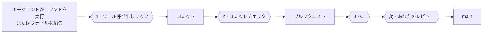
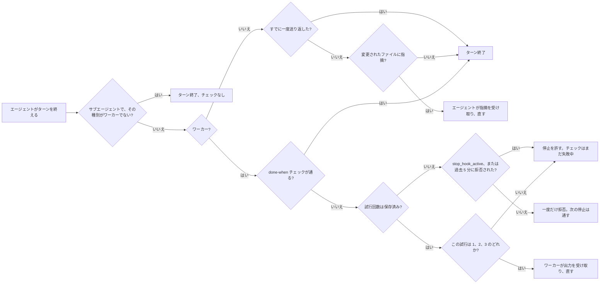
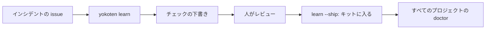

<!-- source: docs/guide.md -->
# yokoten 使用ガイド

[README](README.md) は短い版です。ここには残りすべてがあります。yokoten がなぜあるのか、どう動くのか、ルール、コマンド、そしてできないことです。

<sub>このページは英語版からの翻訳です。不自然な表現や誤りに気づいたら、issue や pull request で教えてください。</sub>

## サーキット

**サーキットだと考えてください。** AI コーディングエージェントは速い車です。yokoten は、それが走るコースです。ガードレールは、ミスが大事故にならないように止めます（番人）。レーシングラインは、次のカーブを一関所ずつ示します（ガイド）。そして、事故が起きるたびに、すべてのコースが安全になります。あるプロジェクトが教訓を得ると、すべてのプロジェクトがそのチェックを受け取ります（*横展*）。

## ここで使う言葉

- **セッション**: AI コーディングエージェント（Claude Code など）との一つの会話です。
- **フック**: エージェントのツールが決まった時点で走らせる小さなプログラムです。yokoten は三つ足します。すべてのコマンドや編集の前に走るもの（止められます）、エージェントがターンを終えるときに走るもの、各セッションの始めに走るものです。
- **コミットチェック**: 各コミットの前に走る git フック（`.githooks/pre-commit`）です。
- **CI**: GitHub が各プルリクエストで走らせるチェックです。
- **ルールセット**: ブランチやタグを守る GitHub の設定です。たとえば「レビューなしではマージしない」です。
- **オーナー、リード、ワーカー**: あなたと、あなたが話すエージェントのセッションと、リードが一つのタスクのために始めるセッションです。[エージェントをチームのように動かす](#エージェントをチームのように動かす)を見てください。
- **終了コード**: コマンドが終わったときに返す数字です。0 はすべて問題なしを意味します。スクリプトやエージェントがこれを読みます。[終了コード](#終了コード)を見てください。
- **JSON**: プログラムが読む、データの純粋なテキスト形式です。`--json` を付けると、この形式で出力します。

## 名前の由来

*Yokoten*（横展）は、トヨタの工場から来た言葉です。ある生産ラインが欠陥の直し方を見つけると、その直し方は、同じ欠陥が起こりうるすべてのラインに広がります。見つけたラインだけではありません。yokoten は、それをあなたのプロジェクトで行います。あるプロジェクトが学んだ教訓を、ほかのプロジェクトにも提供します。

## 問題

AI エージェントと数か月プロジェクトを進めると、いろいろなことを痛い目で学びます。エージェントが、失敗するテストを「直す」ためにテストのほうを変える。誰もレビューしていないコミットがプルリクエストでマージされる。サーバーのアドレスが追跡対象のファイルに入る。そこでルールを一つ、フックを一つ、チェックを一つ足します。そのプロジェクトは良くなります。

そのあと新しいプロジェクトを始めると、あるいは古いプロジェクトに戻ると、そのどれもありません。教訓は一つのリポジトリと、あなたの頭の中にだけあります。思い出して頼まなければ、エージェントはゼロから始めます。

yokoten は、その教訓を、自分でチェックするものに変えます。

- **理由のあるルール。** 十二の核心ルールがあります。どれも、なぜあるのか（インシデント、まだ何も起きていなければリスク）と、どのチェックがそれを保つかを書いています。チェックのないルールは、願いです。
- **自分で走る番人。** ツール呼び出しのフックが、悪いコマンドの実行前にエージェントを止めます。コミットチェックが、フックに見えないものを捕まえます。CI は、どちらも通らずに作られたコミットに対して、同じチェックを走らせます。
- **覚えていなくても済むリマインダー。** すべてのセッションは `doctor` から始まります。プロジェクトが道のどの関所にいるかと、次の一手を一つ伝えます。エージェントがそれを出してくれるので、あなたが覚える必要はありません。

## 初日に変わること

| エージェントがしようとする… | yokoten なし | yokoten あり |
|---|---|---|
| force push する、リリースのタグを打つ | そのまま実行される | 実行前に止まり、理由を伝えられる |
| 失敗するテストを「直す」ためにテストを編集する | テストは通り、バグは残る | 修正タスクでは許されない |
| あなたのメール、サーバーの IP、住んでいる街をコミットする | 公開される | コミットが止まる。報告はファイルと行を示し、本文は決して示さない |
| issue やプルリクエストに、あなたのメールやトークンを投稿する | 公開される | 送信前に止まり、何を変えるかを伝えられる |
| プルリクエストを開く | あなたとして、すべての権限で開く | ボットとして開く。あなたなしでは何もマージされない |
| 別のプロジェクトで働く | ゼロから始める | そのプロジェクトに足りないものを見て、設定を申し出る |

これはすべて、最初から全員に対して有効です。安全のために質問に答えたり、ファイルを編集したりする必要はありません。これを変える設定には、どれも既定に戻る道があります。[記録 0014](../../records/0014-safe-by-default.md) が、yokoten が何を自分で行い、何を先に聞き、何を決してしないかを、どう決めるかを書いています。

## 三つのチェックと一つの錠



| | 走る時 | 止めるもの |
|-|------|-------|
| **1** | 各ツール呼び出しの前 | タグの push、force push、チェックの省略、修正タスクでのテスト編集、ルールを編集するワーカー、プロジェクトが止めるプログラム、タイトルのルールを破る issue やプルリクエストのタイトル、エージェントが `gh` で投稿する issue、プルリクエスト、コメント、リリースノートの中の個人情報や秘密情報、Actions の実行の取り消しや削除 |
| **1b** | Claude Code のエージェントがターンを終えるとき | コミットチェックと同じ個人情報、秘密情報、ファイルのルールを、変更されたファイルに対して。指摘とともに、エージェントを一度だけ送り返す |
| **2** | 各コミット | フックに見えないもの。`sed` やスクリプトが変えたファイル、個人情報、上限を超えたフォルダ |
| **3** | 各プルリクエスト | フックを切って作られたコミット |
| **錠** | サーバー上 | あなたのレビューなしのマージ、`main` への push、あなたのものでないリリースタグ |

## セッションに見えるもの

まだ yokoten を導入していないプロジェクトで、セッションの始めにはこう出ます。

```
yokoten: stage 1 of 5, safety net. Next: no AGENTS.md, so the agents have no written rules here; `yokoten init` adds one.
Why: an agent follows the rules it can read, and only those.
Tell the user in plain words, one step at a time, and offer to do it (as-is, lighter, or not now with a reason).
```

セッションが聞くのは一つのステップだけです。関所、次のステップ、そしてそれがなぜ大事かです。関所は毎回ファイルから計算され、何も保存されません。「今はしない」と印を付けたステップは飛ばします。順番は助言です。後のステップを先に終えても、終わったものと数えます。すべてのステップが終わったか「今はしない」になると、セッションはそう伝える一行を聞きます。ここにないのに既定ブランチにはあるファイルは、`init` ではなく、そのブランチの名前で示します。Claude Code がコンテキストを圧縮したあとは、セッションは変わった注意だけを聞きます。各セッションは聞いた内容を `~/.config/yokoten/sessions/` に保ち、7 日より古いファイルは消します。エージェントはあなたの言語で伝えます。yokoten は英語を出力します。エージェントが最も確実に読む言語だからです。

`yokoten doctor` は道の全体を示します。各ステップは **done**、**next**、**to do**、**not now**（あなたの理由つき）、**can't check** のどれかです。yokoten がまだチェックできないステップは一覧に出ません。

| 関所 | ステップ |
|---|---|
| **1 · 安全網** | `rules`、`tool-hook`、`commit-check`、`runtime`、`tests`（テストのコマンドがあり、CI がそれを走らせる） |
| **2 · issue とプルリクエスト** | `remote`（リポジトリがコードホストにあり、そこからブランチが push されている）、`ci`（CI が `check` を走らせるか、yokoten Action を使う）、`issues`（todo ファイルがない）、`templates`、`labels`（標準の一式）、`milestone`（開いているもの）、`no-build-output`（`dist/`、`build/`、`out/` に何もなく、ビルド済みバイナリもない） |
| **3 · リリース** | `changelog`、`titles`（CI が `check --pr` を走らせるか、`pr-check: false` なしでプルリクエストに Action を使う） |
| **4 · エージェントのチーム** | `codeowners`、`bot`、`skills`、`sandbox`（各エージェントはワークツリーに書け、それより広くは書けない）、`review`（既定ブランチへのマージに承認が一つ必要） |
| **5 · 公開** | `security-files`（セキュリティポリシー、Dependabot、ライセンス）、`protection`（既定ブランチと `v*` タグのルールセット）、`merge-settings`（squash のみ、マージ時にブランチ削除）、`security-settings`（秘密のスキャン、push の保護、非公開での報告、Dependabot の警告） |

最後の三つはサーバーの設定です。完全な `doctor` は `gh api` で読み、読むだけです。`gh`、サインイン、ネットワーク、GitHub のリモートがないときは、**can't check** であり、done にはなりません。セッションはネットワークを決して呼ばないので、そこでは常に **can't check** です。

**別のホスト。** doctor はホストを `origin` リモートから読みます。GitHub では上のとおりサーバーを読みます。Gitea では、`yokoten.json` にホストを書いて（`"host": "gitea"`）、bot ユーザーのトークンを `GITEA_TOKEN` に入れます。すると doctor は Gitea の API で、ブランチとタグの保護、ラベル、マイルストーン、忘れられたブランチを読みます。`gitea.com` はキーなしで分かります。GitLab など別のホストでも、中核は同じに動きます。ルール、番人、コミットチェックです。ホストだけが判断できるステップは、`tests`、`ci`、`labels`、`milestone`、`titles`、`codeowners`、`bot`、`review` と、サーバーの三つのステップです。そこではどれも **can't check** になり、何を尋ねるかを言うので、手で設定できます。それらが関所を止めることはありません。自前のサーバーの名前は決して出力しません。doctor は「このホスト」と呼びます。

関所 2 の `labels` と `milestone` も同じように読みます。標準のラベルは `bug`、`feat`、`docs`、`refactor`、`ci`、`owner`、`incident`、`good first issue`、`hotfix`、`security` と、ティアのラベル `tier A`、`tier B`、`tier C` です。`init` は足りないものを示し、`init --github --yes` が追加します。

関所 4 の `review` も同じようにサーバーを読みます。既定ブランチのルールセット、またはブランチ保護が、承認レビューを一つ以上求めていれば done です。GitHub では自分のプルリクエストを自分で承認できません。だからボットがプルリクエストを開き、あなたが承認してマージします。設定するには、既定ブランチのルールセットを編集します。「Require a pull request」で「Required approvals」を 1 にします。また、Settings、Actions、General で「Allow GitHub Actions to create and approve pull requests」をオフにしておきます。オンだと、ボットが push したワークフローがボット自身のプルリクエストを承認できるので、`review` は done になりません。そうすれば OpenSSF Scorecard は、各変更をレビュー済みと数えるはずです。マージした人が書いた人ではないからです。これは Scorecard の文書で読みましたが、実際の Scorecard の実行ではまだ確かめていません。無料プランの非公開リポジトリにはルールセットがないので、そこでは `review` は **can't check** になり、リポジトリが公開される関所 5 を待ちます。**not now** ではありません。その印は、あなたがする決断にだけ使います。

`init --github --yes` は、`yokoten.json` の「areas」にあるあなたの領域も、一つの灰色でラベルに追加します。8 領域以下のときだけです。それより長い一覧は雑音なので、使う少数を手で作ってください。すでにある領域のラベルはそのまま保ち、yokoten は決して削除しません。

ボードは任意です。`init --github --yes --board` は、リポジトリの名前のボードを作り、リンクします。その Status フィールドには Todo、In progress、In review、Done が入ります。ボードには gh トークンの `project` スコープが必要です。ないときは init はボードを飛ばし、`gh auth refresh -s project` を実行するよう伝えます。二回目の実行はタイトルでボードを見つけ、何も作りません。API ではボードのビューやワークフローを設定できません。だからボードがリンクされていると、完全な `doctor` はそれらを「手で」の行として一覧します。それらが doctor を失敗させることはありません。

ステップのあと、`yokoten doctor` は、あれば満たしている外部標準を名指しします。たとえば `ci (Scorecard: CI-Tests)` です。セッションのメッセージには出しません。

[記録 0004](../../records/0004-the-road.md) が、なぜ道がこうなっているかを書いています。

このリポジトリも同じ道を歩いているので、各関所が動くのを見られます。

| 関所 | 学べること | ここで見る |
|---|---|---|
| **1 · 安全網** | エージェントが読むルールと、ルールで足りないときに止めるチェック | [AGENTS.md](../../../AGENTS.md) |
| **2 · issue とプルリクエスト** | すべての変更は issue として始まり、CI が通ったときだけマージされる。ラベル、マイルストーン、ボードがそれを保つ | [issue](https://github.com/yokoten-labs/yokoten/issues?q=is%3Aissue)、[プルリクエスト](https://github.com/yokoten-labs/yokoten/pulls?q=is%3Apr)、[ボード](https://github.com/orgs/yokoten-labs/projects/1) |
| **3 · リリース** | 何がなぜ変わったかを言うコミットメッセージ、変更履歴、リリースごとのバージョン番号 | [CHANGELOG.md](../../../CHANGELOG.md) |
| **4 · エージェントのチーム** | ボットがプルリクエストを開き、ワーカーがタスクを受け、レビュアーが確認する。マージするのはあなただけ | [エージェントをチームのように動かす](#エージェントをチームのように動かす) |
| **5 · 公開** | 過去のすべてのコミットを個人情報について調べ、セキュリティ設定を入れ、`main` を守る | [セキュリティポリシー](../../../.github/SECURITY.md) |

そして、エージェントがリリースのタグを push しようとすると、こう出ます。

```
yokoten: git push --tags pushes tags. Only the owner decides when to release. If the owner asked for this, they start a new session with `YOKOTEN_RELEASE_APPROVAL=1 claude` (or your agent's command); do not look for another way.
  docs: https://github.com/yokoten-labs/yokoten/blob/main/docs/guide.md#the-core-rules
```

直し方は、フックが走らせたエージェントを始めるコマンドを名指しします。`codex`、`gemini`、`agy`、または `dsh tui --patch .dsh/yokoten.patch.yml` です。Copilot CLI は Claude Code と同じ呼び出しを送るので、そのメッセージは「またはあなたのエージェントのコマンド」と言います。Muse Code はフックに短い変数の一覧しか渡さず、`YOKOTEN_ROLE` は失われます。`YOKOTEN_RELEASE_APPROVAL` も渡すかは分かっていないので、Muse Code ではメッセージはその外でリリースするよう伝えます。Gemini CLI の厳しい環境の消毒がオンのときは変数が落ち、オーナーは Gemini CLI の外でリリースします。

どのメッセージも同じ三つの部分を持ちます。何が起きたか（**what**）、なぜ大事か（**why**）、そして直し方（**fix**）です。コマンドか編集です。ファイルの問題はその場所 `file:line:` から始まります。見つけたものは種類だけを名指しし、そのもの自体は決して出しません。秘密情報や個人情報の印は決して出力しません。このガイドのある節がルールを説明しているとき、メッセージはその節へのリンクを最後の行に付けます。`docs: <url>` です。

ルールがなぜあるかを聞くには、`yokoten explain <id>` を実行します。id はルールかステップの名前で、たとえば `secret` や `commit-check` です。id なし、または知らない id なら、すべての id を一覧します。

```
$ yokoten explain force-push
force-push: no plain force push (core rule 7).
Why: a plain force push can throw away work that someone else pushed.
Check: the tool-call guard stops `git push --force`, `-f` and a `+ref`; `--force-with-lease` passes; a branch ruleset on the server is the lock.
Docs: https://github.com/yokoten-labs/yokoten/blob/main/docs/guide.md#the-core-rules
```

### このマシンだけで作業する

停電、クラッシュ、壊れたディスクは、一つのマシンだけにある作業を失わせます。だから `doctor` はその作業を一覧し、各項目に、それを救う一つのコマンドを付けます。

| 注意 | 意味 | コマンド |
|---|---|---|
| `uncommitted-changes` | ワークツリーに変更されたファイルがある。いくつか、一番古いものはどれくらい前か | そこで `git add -A` と `git commit -m "chore: save work"` を実行し、push する。`.yokoten/` があるときはメッセージを `chore: add yokoten` にし、その複製をコミットすることが目的になる |
| `unpushed-commits` | ブランチに、どのリモートにもないコミットがある。または切り離された HEAD に、どのブランチにもないコミットがある | `git push`、上流のないブランチなら `git push -u origin <branch>`。切り離された HEAD なら先に `git switch -c <name>` |
| `stashes` | stash がある。stash は決して push されない | `git stash branch <name>` を実行し、そのブランチを push する |
| `stale-index-lock` | クラッシュで `index.lock` が残っていて、リポジトリで git のプロセスが走っていない | そのファイルを `rm` する |
| `repo-on-tmpfs` | リポジトリが tmpfs 上にあり、再起動で空になる | `git push --all origin` を実行し、長持ちするフォルダにもう一度 clone する |
| `repo-in-temp-folder` | リポジトリが一時フォルダの下にあり、システムが再起動で空にすることがある | `git push --all origin` を実行し、長持ちするフォルダにもう一度 clone する |
| `finished-worktree` | 変更のないワークツリーで、ブランチがマージ済みか、上流が消えているか、切り離された HEAD が既定ブランチにある | `git worktree remove <path>`。ブランチは残る |
| `missing-worktree` | git がまだ一覧するワークツリーのフォルダが消えている | `git worktree prune` |

push されていないコミットは、まだこのマシンだけにあります。`origin/main` から作ったブランチはそれを追うので、そのコミットは自分のブランチへ行き、main へは決して行きません。

squash マージはブランチの履歴に印を残しません。だから上流が消えたブランチもマージ済みと数えます。変更のないワークツリーを、削除して安全とは決して言いません。作られてから動いていないブランチや切り離された HEAD は、マージ済みとは言いません。新しいのです。

`index.lock` について、doctor はリポジトリで作業する git のプロセスを探します。Linux では各プロセスのフォルダを読みます。macOS と Windows では読めないので、git のプロセスがあれば「分からない」とします。すると doctor はそのファイルを消すよう決して言いません。資格情報のキャッシュなど、git の長く走る補助プロセスは数えません。tmpfs のチェックは `/proc/mounts` を読むので、Linux でだけ走ります。

一時フォルダは、システム自身のもの（`TMPDIR`、Windows では `%TEMP%`）と `/tmp` です。WSL は再起動で `/tmp` を空にします。tmpfs でなくてもです。ほかのフォルダを調べるには、`YOKOTEN_TEMP_DIRS` に一覧します。区切りは `PATH` と同じです。空にするとチェックを切ります。

そのようなフォルダにあるリポジトリ自体には、常に注意が出ます。設定の問題だからです。そこのワークツリーは、危険にある作業を持つときだけ名指しされ、その作業自身の注意の中で示されます。たとえば「../w has 3 uncommitted files, the oldest changed 2 days ago, and is under the temp folder (/tmp), which the system may empty on restart」です。危険なものを持たないワークツリーは、完全な `doctor` で件数つきの一行になり、セッションでは何も出ません。各直し方は、ワークツリーを `.worktrees/` の下に作り、一時フォルダの下には作らないよう伝えます。

これらはすべて注意です。`doctor` を失敗させることはありません。doctor はここでは読むだけです。ファイルも ref もワークツリーも変えず、git は任意ロックを切って走ります。パスはリポジトリからの相対、または `~` から示します。

セッションが聞くのは、危険にあるものだけです。多くても三つです。コミットされていない変更は、一番古いものが一時間たってから初めて聞きます。今進んでいる作業は忘れられないからです。片付けるワークツリーは完全な `doctor` に任せます。一時フォルダの二つ以上のワークツリーが危険な作業を持つときは、最初に件数の一行を出します。

セッションはこれに多くても一秒しか使いません。セッションが冷たいディスクを待ってはいけないからです。時間が来ると、読んだものを見せて「doctor stopped early」と言います。完全な `doctor` に時間の制限はありません。
## 四つの層

| 層 | 何を | どうやって |
|-------|------|-----|
| **マシン** | スキル、エージェント、二つのユーザーレベルのフック。どのコンピューターでも同じ | `yokoten install`、または Claude Code のプラグイン |
| **プロジェクト** | ルール、コミットチェック、ツール呼び出しフック、CI、issue と PR のテンプレート、Dependabot（毎月、プルリクエスト一つ）、セキュリティポリシー | `yokoten init`、そして古いプロジェクトでは `yokoten` スキル |
| **サーバー** | ブランチとタグのルールセット、squash マージ、コードオーナー、権限を絞ったボット、セキュリティのスイッチ | オーナーが一度設定する。`doctor` がステップを一覧する |
| **ルール** | `AGENTS.md`。十二の核心ルールと、プロジェクト自身のルール | どのルールも、それを保つチェックを名指しする |

古いプロジェクトは白紙ではありません。その習慣のいくつかは、私たちのものより良いものです。だから `yokoten` スキルは、実践を一つずつあなたと見ていき、それぞれに決断を付けます。**そのまま**、**軽く**（何を省くかも）、**今はしない**（理由と、いつまた見るかも）です。「今はしない」は `yokoten.json` に入り、`doctor` は尋ねるのをやめます。

### 表の最初の下書き

`yokoten adopt` は、話し合いが始まる前にその表を下書きします。プロジェクトのファイルを読み、各ステップについて、プロジェクトが今日どうしているかを言います。**done**、**missing**、**partial**、**unknown** です。partial は、プロジェクトに自分のやり方があることです。husky のフックや、yokoten を走らせない CI などです。unknown は、yokoten がここからそのステップをチェックできないことです。サーバーの設定などで、`yokoten doctor` が読みます。そのあとモデルが、各行に決断と一行の理由を提案します。

- モデルが受け取るのは、その短い事実だけです。ファイルの中身は決して受け取りません。
- yokoten は先に、その要求に自分のプライバシーチェックを走らせます。当たれば何も送りません。
- 鍵がないとき、呼び出しが失敗したとき、答えが悪いときは、代わりにルールが表を下書きします。done か missing はそのまま、partial は軽く、unknown は `doctor` が確かめたあとならそのままです。出力は、どちらが下書きしたかを言います。
- `adopt` は決してファイルを書きません。すべての行を決めるのは、まだあなたです。
- partial の行は、`init` を実行しても失われません。あなたの `CLAUDE.md` から `AGENTS.md` を取り込み、husky の `pre-commit` にコミットチェックを足します。

モデルは Meta のモデル API で、OpenAI 互換のエンドポイント（`https://api.meta.ai/v1`、モデル `muse-spark-1.3`）を通して走ります。`LLAMA_API_KEY` か `MODEL_API_KEY` にあなたの鍵を設定します。`LLAMA_API_BASE` と `LLAMA_MODEL` は、ほかの OpenAI 互換のエンドポイントとモデルに向けます。
## 対応しているもの

yokoten は九つの AI コーディングエージェントを、同じルールで守ります。この表が、その一覧と、それぞれをどこまで覆えているかの唯一の一覧です。下の「yes」はどれも実際の実行です。使い捨てのリポジトリでエージェントが `git push --tags` を試み、番人が止めました。「端から端までは未実行」は、エージェントが一覧にはあるが、番人がまだ端から端まで確かめられていないという意味です。文書は証拠ではありません。

| エージェント | フックのファイル（`init` が書く） | どう止めるか | 確認済み | 注意点 |
|---|---|---|---|---|
| Claude Code | `.claude/settings.json`: PreToolUse、Stop、SubagentStop | 終了コード 2、理由は stderr へ | yes、2026-10-19: ヘッドレス、DeepSeek `deepseek-flash` 上 | なし |
| GitHub Copilot CLI | 同じ `.claude/settings.json`: Copilot が読む | 終了コード 2、理由は JSON で stdout へ | yes、2026-10-19: Copilot CLI 1.0.98、`copilot -p`、モデル `gpt-6-luna`（Auto） | リポジトリのフックは、あなたがフォルダを信頼したあとだけ走る。そこで `copilot` を実行し、「Yes, and remember this folder for future sessions」を選ぶ。そうしないと、何も言わずに飛ばす。タイムアウトしたフックは、呼び出しを通す |
| Antigravity CLI（`agy`） | `.agents/hooks.json`: `yokoten` の項目、PreToolUse | `{"decision": "deny"}` を stdout へ | yes、2026-10-19: agy 1.4.2、`agy -p`、モデル `gemini-3.8-flash-high` | 停止チェックはまだない。`.yokoten/` がないと、すべての呼び出しが拒否される。agy は安全側に倒れる。ワーカーの done-when チェックはリードが走らせる |
| Codex CLI | `.codex/hooks.json`: PreToolUse と Stop | 終了コード 2、理由は stderr へ | yes、2026-10-19: Codex 0.163.0、`codex exec`、DeepSeek `deepseek-flash` 上 | プロジェクトのフックは、あなたがフォルダを信頼したあとだけ走り、そのあと `/hooks` で各フックを承認する。`codex exec` は信頼していないフックを何も言わずに飛ばす |
| Muse Code | `.muse/hooks.json`: PreToolUse と Stop | 終了コード 2、理由は stderr へ | yes、2026-10-19: Muse Code 1.4.10、`muse exec --trust-workspace`、モデル `muse-spark-1.3-contributor` | フックは、あなたがフォルダを信頼したあとだけ走る。そこで `muse` を実行し、「Trust and continue」を選ぶ。Muse はフックに `YOKOTEN_ROLE` を渡さないので、ワーカーのワークツリーは `yokoten worker mark <dir>` で印を付ける。`YOKOTEN_RELEASE_APPROVAL` も渡すかは分かっていないので、Muse の外でリリースする。失敗したフックやタイムアウトしたフックは、呼び出しを通す |
| DeepSeek Harness（`dsh`） | `.dsh/hooks.json`: PreToolUse、そして読み込むための `.dsh/yokoten.patch.yml` | 終了コード 2、理由は stderr へ | yes、2026-10-20: dsh 0.2.1-rc.2、`dsh headless --patch .dsh/yokoten.patch.yml`、既定の DeepSeek モデル | フックは、各プロファイルにあなたが足すブリッジを通してだけ走る。[DeepSeek Harness](#deepseek-harness)を見てください。それがなく、パッチもないと、dsh はフックを走らせず、何も言わない。Windows ではまだ守られていない（#332）。停止チェックはない。ワーカーの done-when チェックはリードが走らせる |
| Grok CLI（`grok`） | `.grok/hooks/yokoten.json`: PreToolUse と Stop | `permissionDecision: "deny"` を stdout へ、そして終了コード 2 | yes、2026-10-20: Grok CLI 1.0.52、`grok -p --trust --always-approve`、既定のモデル | プロジェクトのフックは、あなたがフォルダを信頼したあとだけ走る。そこで `grok` を実行し、`/hooks-trust` と入力する。そうしないと、何も言わずに飛ばす。`.claude/settings.json` のフックも走らせるので、一つの呼び出しで番人が二回走ることがある。意図的だ |
| Gemini CLI | `.gemini/settings.json`: BeforeTool と AfterAgent | 終了コード 2、理由は stderr へ | 端から端までは未実行: 個人のサインインは 2026-06-18 に終わった。有料の API 鍵か組織のライセンスが要る | 個人向けの Google のエージェントは、いま Antigravity CLI だ |
| OpenCode | `.opencode/plugins/yokoten.ts`: OpenCode 2 のパーミッション `evaluate` と OpenCode 1 の `tool.execute.before` | OpenCode 2 は `effect` を deny にする。OpenCode 1 は理由を投げる | 端から端までは未実行 | 停止チェックはない。失敗した番人やタイムアウトした番人は、呼び出しを拒否する。読み取り専用でない呼び出しで、コマンドもパスも読めないときも拒否する |
| ほかのエージェント | なし | `AGENTS.md` のルールと、コミットチェック。誰が作った悪いコミットでも止める | | |

`install` はユーザーのフックを書きます。各セッションの始めのガイドと、コマンドの番人です。それらは `~/.claude/settings.json` に入り、`~/.codex/hooks.json` と `~/.gemini/settings.json` にも、そのフォルダがあるときに入ります。Muse Code は両方を `~/.config/muse/settings.json` に（設定されているときは `$XDG_CONFIG_HOME/muse/settings.json`）、その設定フォルダがあるときだけ受け取ります。Grok CLI はコマンドの番人だけを、`~/.grok` があるとき `~/.grok/hooks/yokoten.json` に受け取ります。セッション開始フックの出力は、エージェントではなくあなたに見せるからです。OpenCode はコマンドの番人を、`~/.config/opencode` があるとき `~/.config/opencode/plugins/yokoten.ts` に受け取ります。Grok の信頼の関門が切れているとき（`GROK_FOLDER_TRUST=0`、または `~/.grok/config.toml` の `[folder_trust] enabled = false`）、`doctor` はすべてのフォルダを信頼済みと数えます。Codex では、番人は `apply_patch` のファイルを確かめ、シェルを通した実行も確かめます。

どのエージェントも、あなたが信頼したあとだけプロジェクトのフックを走らせます。

- **Claude Code** は、信頼したフォルダでプロジェクトのフックを走らせます。
- **Copilot CLI** は、信頼したフォルダで走らせます。`copilot -p` では `COPILOT_ALLOW_ALL=true` を設定します。その正確な値がフォルダを信頼します。`--allow-all-tools` だけでは信頼せず、フックは走りません。
- **Antigravity CLI** は、信頼一覧にないフォルダでも、`agy -p` で `.agents/hooks.json` を走らせました。フックは `.agents` フォルダを作業フォルダとして走ります。ガイドには、`--dangerously-skip-permissions` がフックを飛ばすと書いてあります。agy 1.4.2 では、それを付けてもフックは走りました。どちらも当てにしないでください。
- **Codex** は、信頼したプロジェクトでだけプロジェクトのフックを走らせます。そのあと `/hooks` で各フックを承認します。Codex はコマンドを覚えるので、コマンドが変わったらまた承認が必要です。
- **Muse Code** は、信頼したワークスペースでだけ `.muse/hooks.json` を走らせ、そうでなければ何も言わずに飛ばします。`muse exec` では、`--trust-workspace` がその実行でフォルダを信頼します。そのときだけ、`.agents/skills` のプロジェクトのスキルも読みます。デスクの外では、Muse Code は ~/.claude/CLAUDE.md を読み、そのファイルを Muse のモデルに送ることがあります。ホームフォルダを隠すには、デスクで Muse を走らせてください。そのファイルがあるときは `doctor` がそう言います。デスクからまだそのファイルが見えるときは、`doctor` はホームフォルダが見えることと、デスクに手当てが要ることを言います。
- **Grok CLI** は、信頼したフォルダでだけ `.grok/hooks/` を走らせ、そうでなければ何も言わずに飛ばします。そこでセッション中に `/hooks-trust` と入力するか、一度 `grok --trust` で始めます。yokoten があなたの代わりにフォルダを信頼することは決してありません。Grok は `.claude/settings.json` のフックも走らせるので、一つの呼び出しが二回チェックされることがあります。意図的です。Grok は自分のフックを飛ばせます。信頼していないフォルダのとき、またはリポジトリが空のフックファイルをコミットしたときです。そのときも Claude Code のフックが呼び出しを守ります。二回目のチェックは約 0.1 秒かかります。
- **Gemini CLI** は、信頼したフォルダでだけプロジェクトのフックを走らせます。リポジトリのルートで Gemini を始めてください。`.gemini/settings.json` は、始めたフォルダからだけ読み、ほかでは読みません。新しいフックや変わったフックを走らせる前に、一度警告します。
- **OpenCode** は、始まるときに `.opencode/plugins/` のプラグインを読みます。OpenCode 2 はパーミッションのフックで拒否します。OpenCode 1 はまだ例外で止めます。この道は端から端までは未実行です。

`init` は、フォルダを信頼するステップが一つあるエージェントごとに、その一つのステップを出力します。そのあと `doctor` は、各エージェント自身の信頼の記録を読み取り専用で読み、まだ信頼していないフォルダに注意します。

| エージェント | 信頼の記録 | 信頼済みと数える条件 |
|---|---|---|
| Copilot CLI | `~/.copilot/config.json`（または `$COPILOT_HOME`）の `trustedFolders` | そのフォルダ、またはその上のフォルダ |
| Codex | `~/.codex/config.toml`（または `$CODEX_HOME`）: `[projects]` と `[hooks.state]` | リポジトリのフォルダと正確に一致し、各フックが今のままであること |
| Muse Code | `~/.config/muse/trust.json`（または `$XDG_CONFIG_HOME/muse/trust.json`） | リポジトリのフォルダと正確に一致すること |
| Grok CLI | `~/.grok/trusted_folders.toml`（または `$GROK_HOME`）: `[folders."<folder>"]` で `trusted = true` | リポジトリのフォルダと正確に一致すること |

Doctor は、そのホームフォルダがあるときだけエージェントを調べます（`~/.copilot`、`~/.codex`、`~/.config/muse`、`~/.grok`）。そのフォルダに記録がないとき、または doctor が読めない記録のときは、「can't check」と言い、決して ok とは言いません。

ワーカーは `YOKOTEN_ROLE=worker` のセッションです。Codex では、`agent_type` がワーカーを名指しするサブエージェントもワーカーです。Copilot CLI と Antigravity CLI は、フックの呼び出しでサブエージェントの役割を名指しせず、DeepSeek Harness も同じです。決めるのは `YOKOTEN_ROLE` です。Gemini CLI の厳しい環境の消毒は、フックから `YOKOTEN_ROLE` を消します。すると yokoten は Gemini CLI のワーカーを見分けられません。すべてのセッションがリードと数えられ、リード専用の番人がワーカーの編集を止めません。Muse Code はフックに短い変数の一覧しか渡さず、`YOKOTEN_ROLE` はその中にありません。Grok CLI は `YOKOTEN_ROLE` をフックに渡し、`subagentType` がワーカーを名指しするサブエージェントもワーカーです。

だからリードは、各ワーカーのワークツリーにも印を付けます。`yokoten worker mark <dir>` です（#555）。すると番人は、そのワークツリーのすべてのエージェントをワーカーとして扱います。Gemini CLI と Muse Code でも同じです。印は、ワークツリー自身の git フォルダ（`.git/worktrees/<name>/yokoten-worker`）のファイルです。番人は git のプロセスなしでそれを見つけます。印はワーカーの役割を足すだけです。印があると、`YOKOTEN_ROLE=lead` でもワーカーです。ツールの番人、停止チェック、コミットチェック、セッションの開始が、どれもそれを読みます。安全側に倒れます。番人が読めない `.git` ファイル（開けないモード、FIFO、`gitdir:` の行がない）、またはそれが名指す git フォルダが消えているか読めないときは、そのセッションをワーカーにします。印から来た拒否はそう言い、リードが働くメインのチェックアウトを名指しします。

番人は、ワーカーが印を変える素朴な方法を拒否します。git フォルダのファイルに書き込み、移動し、削除し、リンクし、モードを変えるコマンド、またはそこへリダイレクトするコマンドです。`.git` や印に一致しうるグロブも数えます（`chmod 000 .gi?`）。`GIT_DIR` や `--git-dir` を付けた git、`list` 以外の `git worktree`、git フォルダの中を実パスで編集するものも同じです。`.git` を名指しする読み取りは通ります（`grep --exclude-dir=.git`、`find . -path ./.git -prune`）。これは番人のほかの部分と同じくテキストを読むので、コマンドを部品に分けて組み立てるワーカーは通り抜けます。本当の錠はサーバーと資格情報です。ブランチ保護とコードオーナー、そして push のトークンもボットのトークンも持たないワーカーです。

ワーカーはコミットして報告します。リードがレビューのあと push して投稿します。ワーカーに対して番人は、`git push`、`git send-pack`、`git subtree push`、git のエイリアス（`git config alias.*`、`git -c alias.*`）、どの形の `yokoten bot` も、`gh pr` の `create|merge|edit|close|comment|review|ready|reopen`、そして書き込みのメソッドかフィールドを持つ `gh api` を拒否します（読む GraphQL の問い合わせは通ります）。メインのチェックアウトには決して印を付けないので、そこのリードは影響を受けません。印を付けたワークツリーでは、リードもワーカーと数えます。`git worktree remove <dir>` はワークツリーと一緒に印を消します。印がなく、`YOKOTEN_ROLE` を落としたエージェントはリードと数えます。

Actions の実行の取り消しと削除は、リードにもワーカーにも拒否されます。番人は `gh run cancel`、`gh run delete`、そして `gh api` や `yokoten bot` を通した同じ呼び出しを止めます。`gh run rerun`、`view`、`list`、`watch` はまだ通ります。Actions のページで実行を取り消せるオーナーに聞いてください。`repositories/<id>` のパスも同じ呼び出しです。`.` や `..` を含むパスは、それらを解決したあとに読みます。経路の語 は大文字小文字を区別せずに一致するので、`Actions` と `Cancel` は同じ呼び出しです。`gh api` の短いオプションの集まりは拒否されます。値をくっつけた一つのオプションは別です。シェルから取ったメソッドやパスは、実行を名指ししうるときに拒否されます。シェルから取った `gh run` のサブコマンドは拒否されます。`gh` は自分のコマンドの一つを名指ししなければなりません。`gh extension install`、`upgrade`、`exec`、`browse` は拒否されます。`exec` は入れた拡張を走らせます。`browse` は拡張を入れられます。GET でない呼び出しは、`repos/` や `repositories/` のあとのパスが変数だけのときに拒否されます。`gh config set aliases` は拒否されます。`gh alias list` と `gh extension list` はまだ通ります。`gh alias set` と `gh alias import` は両方の役割で拒否されます。エイリアスはオーナーに手で足してもらってください。

どのエージェントも、リードもワーカーも、gh のトークンを受け取りません（#659、#668）。それがあれば、`curl` やスクリプトが、上のすべてのルールを回って GitHub を直接呼べます。gh と `yokoten bot` は、トークンを見せずに使います。だからすべてのエージェントに対して、番人は次を拒否します。

- トークンを出力する gh のコマンド: `gh auth token`、`gh auth status --show-token`（`-t`）、`gh auth git-credential`、`gh config get oauth_token`。
- ログインが保たれる場所: `git credential fill`、資格情報ヘルパーの `get`（`git credential-manager get`）、`git -c credential.…`、`~/.git-credentials`、gh の `hosts.yml`、`security find-…-password -w`、`secret-tool lookup`。
- トークンの変数: `$GH_TOKEN`、`$GITHUB_TOKEN`、`$GH_ENTERPRISE_TOKEN`、`$GITHUB_ENTERPRISE_TOKEN`。`$env:GH_TOKEN`（PowerShell）と `%GH_TOKEN%`（cmd）も同じです。コマンドがそれを名指しするとき、コードを走らせる `node`、`python`、`jq` などのプログラムも同じです。投稿にその名前を書くには本文のファイルを使い、検索するには `$` を省きます。
- `GIT_TRACE_REDACT=0`。git のトレースがトークンを出力するようになります。
- ボットの git では、`-c` と環境の git 設定（`GIT_CONFIG_*`）。ボットはさらに、ページャー、エディター、ブラウザー、ssh、askpass のプログラムと、トレースとデバッグの設定を環境から落とし、`cat` でページ送りします。

`gh auth status`、`gh pr view`、`curl https://example.com` はまだ通ります。

`gh workflow disable` も、すべてのエージェントに対して拒否されます。オフのワークフローは、どのプルリクエストでもチェックを走らせないからです。オフにするのはオーナーだけです。

番人は、ワーカーのシェルによるリード専用ファイルへの書き込みも、その編集と同じく止めます（#402）。読み取るのは、リダイレクト（`>`, `>>`, `>|`, `&>`）、`sed -i`、`perl -i`、`tee`、`cp`、`mv`、`install`、`ln`、`dd of=`、`truncate`、`rm`、そして git の `checkout`、`restore`、`rm`、`mv`、`apply` です。リダイレクトは、ファイルが引用符つきでも、前の語にくっついていても数えます（`echo x>"AGENTS.md"`）。`git apply` では、番人はパッチを読んでそのファイルを見ます。1 MB 未満の普通のファイルからだけです。ほかのパッチファイルはワーカーを止めます。リード専用ファイルをコミットする `git commit` も止まります。コミットチェックは役割を `YOKOTEN_ROLE` からだけ知り、`yokoten:worker` のような Claude Code のサブエージェントにはそれがありません。`cat` や `grep` のような読み取りは通ります。編集と同じく、これは yokoten を使うリポジトリ（`yokoten.json` があるもの）でだけ成り立ちます。`.worktrees/<issue>/` の下のパスは、そのワークツリーから読み、セッションがそこで走ったかのように扱います。`.worktrees/571-x/AGENTS.md` はまだリード専用です（#571）。ブリーフがリード専用ファイルの変更を求めたときは、リードがワーカーを `YOKOTEN_LEAD_ONLY_OK=AGENTS.md,.github/workflows/ci.yml` で始めます。リポジトリのルートからのパスをカンマで区切り、`*` を含む項目はグロブとして読みます。`*` だけならすべてのリード専用ファイルを許します。番人とコミットチェックがそのパスを通します。サブエージェントはリードの環境を共有するので、そのようなタスクは別のセッションに渡してください。セッションの開始時に、`doctor` は `YOKOTEN_ROLE=worker` のセッションに「このセッションはワーカーです。リード専用ファイルは守られています」と伝えます。それを聞かない別のワーカーのセッションには、役割が設定されていません。サブエージェントはセッションを始めないので、何も聞きません。

### サンドボックス

`init` は、プロジェクトのために各エージェントのサンドボックスを書きます。`doctor` は `sandbox` ステップでそれを確かめます。ワーカーはそのワークツリーで始めてください。サンドボックスがそれを覆うようにです。

| エージェント | `init` が書くもの | なぜ |
|---|---|---|
| Claude Code | `.claude/settings.json`: `sandbox.enabled` が `true` | シェルのコマンドはワークツリーにとどまる。新しいネットワークのホストは先に聞く |
| Codex | `.codex/config.toml`: `sandbox_mode` が `workspace-write`、`approval_policy` が `on-request`、`network_access` が `false` | 書き込みはワークツリーにとどまる。ネットワークは切ったまま。その外へ出る前に Codex が聞く |
| Gemini | `.gemini/settings.json`: `security.disableYoloMode` が `true` | すべてを承認する YOLO モードは切ったまま |
| Grok | `.grok/sandbox.toml`: `[profiles.yokoten]` が `workspace` の上に作られる | `yokoten` プロファイルが書き込みをワークツリーに保つ。ワーカーは `grok --sandbox yokoten` で走る |

あなたが設定した値は残ります。`doctor` は違うものを名指しし、直し方を一つ示します。

Muse Code、DeepSeek Harness、Antigravity、Copilot には、プロジェクトに書けるサンドボックスがありません。だから `init` はそれらに何も書きません。Muse にはそのためのプロジェクト設定ファイルがありません。DeepSeek Harness と Antigravity はプロジェクトにフックだけを保ち、Copilot 自身のサンドボックスはユーザーレベルです。OpenCode はプラグインを受け取り、サンドボックスのファイルは受け取りません。
### DeepSeek Harness

DeepSeek Harness（`dsh`）は、ブリッジのプラグインを通して Claude Code のコマンドフックを走らせます。ブリッジは dsh のパッケージには入っていません。`init` はフックと起動のパッチを書き、残りを出力します。何もインストールせず、`~/.dsh` には触れません。

1. 使う各プロファイル（`tui`、`headless`、`web`）に、ブリッジとそのピアを足します。`dsh plugin add` には PATH の `pnpm` が要ります。ピアがないと、ブリッジはフックを読み込みません。

   ```sh
   dsh plugin --profile tui add @deepseek-ai/dsh-hooks-claude-code@0.2.1-rc.2
   dsh plugin --profile tui add @deepseek-ai/dsh-hook-protocol@0.2.1-rc.2
   ```

2. dsh をリポジトリのルートで、プロファイル名のすぐあとにパッチを付けて始めます。

   ```sh
   dsh tui --patch .dsh/yokoten.patch.yml
   dsh headless --patch .dsh/yokoten.patch.yml --json "<task>"
   ```

   パッチは `.dsh/hooks.json` を相対パスで名指しし、dsh はそれを始めたフォルダから読みます。ほかで始めたとき、またはパッチなしでは、dsh はフックを走らせません。`.dsh/yokoten.patch.yml` は yokoten が所有し、`init` が書き直します。自分の上書きは別のファイルに置いてください。

dsh はツール名を小文字で正確に一致させます。フックの matcher は `bash|pwsh|edit|write` です。`pwsh` は Windows での dsh のシェルです。後に備えて matcher に入っていますが、Windows はまだ守られていません。そこでは dsh がフック自体を PowerShell で走らせ、yokoten の POSIX シェルのコマンドを走らせられません。ブリッジはその失敗を「進んでよい」と受け取るので、すべての呼び出しが通ります。Windows では `doctor` がそう言い、`init` も言います（#332）。停止チェックはありません。ブリッジの Stop イベントにはループの守りがないからです。DeepSeek Harness のワーカーは、チェックが失敗したままタスクを done と報告できます。リードが done-when のコマンド（ブリーフになければプロジェクトのチェック）を走らせます。Antigravity CLI にも停止チェックはなく、そこでもリードがチェックを走らせます。`doctor` は両方のファイルを確かめ、`${DSH_HOME:-~/.dsh}/profiles` で二つのパッケージを探します。dsh のホームがないときは、確かめられないと言います。ブリッジは何も言わずに開いたまま失敗するので、ファイルがあることは何の証拠にもなりません。番人が走ることの証拠は、実際の拒否だけです。使い捨てのリポジトリで `git push --tags` を走らせるよう dsh に頼み、拒否されるのを見てください。

### DeepSeek 上の Claude Code と Codex

番人はエージェントの中にあり、モデルの中にはありません。だから Claude Code と Codex は、DeepSeek のモデルでも同じルールを保ちます。上の実行はどちらも `deepseek-flash` を使いました。

Claude Code を、DeepSeek の Anthropic 互換 API で使うには、こうします。

```sh
export CLAUDE_CONFIG_DIR=~/.config/claude-deepseek   # a config folder with no claude.ai login
export ANTHROPIC_BASE_URL=https://api.deepseek.com/anthropic
export ANTHROPIC_API_KEY=<your DeepSeek key>
export ANTHROPIC_MODEL=deepseek-flash
claude
```

`CLAUDE_CONFIG_DIR` は別にしてください。設定フォルダに claude.ai のログインがあると、Claude Code は鍵ではなくそのログインのトークンを送ります。DeepSeek は毎回 401 を返し、Claude Code は何も言わずに再試行してタイムアウトします。止まったように見えます。`--bare` も使わないでください。フックを飛ばすので、番人が走りません。

Codex を、DeepSeek の OpenAI 互換 API で使うには、これを `$CODEX_HOME/config.toml`（既定は `~/.codex/config.toml`）に置き、`DEEPSEEK_API_KEY` を設定します。

```toml
model = "deepseek-flash"
model_provider = "deepseek"

[model_providers.deepseek]
name = "DeepSeek"
base_url = "https://api.deepseek.com"
env_key = "DEEPSEEK_API_KEY"
wire_api = "responses"
```

Codex 0.163.0 は `wire_api = "chat"` を拒否します。`deepseek-flash` のメタデータがないと警告し、そのまま走ります。

## インストールとコマンド

Node 22.23.4 以降（Node 24 は 24.22.1 以降、Node 26 は 26.12.1 以降）が要ります。TypeScript をそのまま走らせるからです。22.18 から 22.23.3 のリリースも TypeScript を走らせますが、使わないでください。Node が 2026-10-21 に直したセキュリティの穴があります（[advisory](https://nodejs.org/en/blog/vulnerability/october-2026-security-releases)）。だから npm はそれらに警告し、完全な `doctor` は `machine:` の下に注意します。依存はありません。インストールの方法は二つです。Claude Code のプラグインか、npm またはクローンからの `install` コマンドです。片方だけ使ってください。yokoten が書くフックのコマンドには POSIX シェルが要ります。Windows では Git Bash を使ってください。

### Claude Code のプラグイン

Claude Code のセッションで、こうします。

```text
/plugin marketplace add yokoten-labs/yokoten
/plugin install yokoten@yokoten
```

最初のコマンドは、このリポジトリをプラグインのマーケットプレイスとして足します。二つ目はプラグインを開きます。「Install for you」（ユーザースコープ）を選んでください。シェルからなら、`claude plugin marketplace add yokoten-labs/yokoten` のあと `claude plugin install yokoten@yokoten` でも同じです。

プラグインはこのリポジトリです。`install` がコピーするのと同じファイルを使うので、二つの方法が離れることはありません。

| プラグインが足すもの | 出どころ |
|---|---|
| スキル: `/yokoten:dispatch`、`/yokoten:inspect`、`/yokoten:merge`、`/yokoten:rca`、`/yokoten:record`、`/yokoten:release`、`/yokoten:yokoten` | `kit/user/skills/` |
| エージェント: `yokoten:worker`、`yokoten:reviewer`、`yokoten:verifier` | `kit/user/agents/` |
| `/yokoten:init`、`/yokoten:doctor`、`/yokoten:update`。プラグインから yokoten を走らせる | `kit/plugin/skills/` |
| SessionStart の `doctor` フックとコマンドの番人。`install` が足すのと同じ二つのフック | `.claude-plugin/plugin.json` |

コマンドの番人はどのフォルダでも走るので、コマンドのルールに従います。例外が一つあります。yokoten のリポジトリ（`yokoten.json` があるもの）の中のファイルへの編集には、セッションをどこで始めても、そのリポジトリのファイルのルールが付きます。セッションのフォルダの外のワークツリーにいるワーカーも、リード専用ファイルを変えられません。

Claude Code は、プラグインの `.ts` ファイルを `node` で走らせます。プラグインのフォルダが `node_modules` の下にないので、Node はそれができます。新しい yokoten にするには、`/plugin` を開き、**Installed** タブで yokoten を選び、**Update now** を選びます。第三者のマーケットプレイスは、あなたが自動更新をオンにするまで、自分では更新しません。シェルからなら `claude plugin update yokoten@yokoten` でも同じです。そのあと Claude Code を再起動してください。プラグインが `doctor` を走らせる yokoten より古いときは、`doctor` が注意でそう言います。

プラグインは Claude Code でだけ動きます。非公開の印のファイルは作りません。`doctor` がそのファイルを名指しし、あなたが作ります。ユーザー設定でプラグインがオンのときは、`doctor` はそのフックとスキルをインストール済みと数えます。

プラグインか `install` の片方だけを使ってください。両方だと、番人とセッションの doctor が二回走り、すべてのスキルが二回出ます。`doctor` が注意でそう言います。`install` からプラグインに移るには、`yokoten uninstall` を実行します。`install` が書いたものを消し、`~/.config/yokoten` は残します。

### npx でインストールする

Codex CLI と Gemini CLI のため、またはプラグインなしで、こうします。

```sh
npx yokoten install      # このマシン: スキル、エージェント、フック
cd your-project
npx yokoten init         # このプロジェクト: ファイルを足し、決して上書きしない
npx yokoten doctor       # 道: どこにいて、次は何か
```

`npx` はパッケージをダウンロードして走らせます。パッケージに依存はありません。`install` と `init` は、yokoten の実行時ファイルをパッケージからコピーします。`~/.local/share/yokoten` と `.yokoten/` へです。フックはそのコピーを走らせるので、ネットワークも `npx` も要りません。

パッケージはビルド済みの JavaScript を走らせます。Node は `node_modules` の下の TypeScript を走らせないからです。リポジトリにビルドはなく、`npm pack` がパッケージの `dist/` を作ります（[記録 0008](../../records/0008-npm-package.md)）。

パッケージを公開するのはオーナーです。オーナーがリリースのタグを作るのと同じです。タグがリリースのワークフローを始めます。チェックが走ったあと、公開のジョブが `release` 環境でオーナーの承認を待ちます。そのときだけ npm に公開し、npm のトークンはどこにも保存しません（[記録 0009](../../records/0009-release-environment.md)）。最初のリリースだけは例外です。オーナーが手で公開します。npm は、まだ持っていないパッケージのワークフローを信頼できないからです。最初のリリースが npm に載るまでは、[クローンからインストール](#クローンからインストールする)してください。

### クローンからインストールする

同じコマンドを、このリポジトリの複製から使います。最初のリリースが npm に載るまでは、この方法を使ってください。

```sh
git clone https://github.com/yokoten-labs/yokoten
node yokoten/bin/yokoten.ts install      # このマシン: スキル、エージェント、フック
cd your-project
node ~/.local/share/yokoten/bin/yokoten.ts init     # このプロジェクト: ファイルを足し、決して上書きしない
node ~/.local/share/yokoten/bin/yokoten.ts doctor   # 道: どこにいて、次は何か
```

yokoten のメッセージは `yokoten init` と `yokoten doctor` と言います。だから `install` は、小さな `yokoten` の起動役を `~/.local/bin` に置きます（Windows では `yokoten.cmd`）。そのフォルダはほとんどの環境で PATH にあり、次に開くシェルで `yokoten` が動きます。起動役は `bin/yokoten.mjs` を走らせます。フックが走らせるのと同じ速い入口です。次の `install` は、古い install が書いた起動役を書き直します。

`~/.local/bin` が PATH にないとき、`install` は一度だけ聞きます。`Add ~/.local/bin to your PATH in ~/.bashrc? [Y/n]` です（zsh なら `~/.zshrc`）。はいなら、そのファイルにこの一行を足します。いいえなら、あなたが足すための行を出力します。

```sh
export PATH="$HOME/.local/bin:$PATH" # added by yokoten
```

yokoten がシェルの設定を編集するのは、その「はい」のあとだけです。ターミナルに誰もいないとき（パイプ、フック、CI）は、決して聞かず、決して編集しません。yokoten が書いていない `~/.local/bin/yokoten` はそのまま残り、`install` がそれを名指しします。`uninstall` は起動役と印を付けた行を消します。PATH の `yokoten` がインストール済みのコピーを走らせないときは、`doctor` が注意します。

これらのコマンドと npx のコマンドは、ウェブサイトが読む [docs/facts.json](../../facts.json) にもあります。だから変更は両方に入れます。

### GitHub Action として使う
GitHub のどのリポジトリでも、ワークフローのファイル一つで yokoten のチェックを CI で走らせられます。リポジトリには何もインストールせず、何もジョブの外へ出ません。トークンも、外部のサービスもありません。

```yaml
# .github/workflows/yokoten.yml
name: yokoten
on:
  pull_request:
    # `edited`、`labeled`、`milestoned` は、修正のあと `check --pr` をもう一度走らせる。
    types: [opened, edited, synchronize, reopened, labeled, unlabeled, milestoned, demilestoned]
  push:
    branches: [main]
permissions:
  contents: read
jobs:
  yokoten:
    runs-on: ubuntu-latest
    timeout-minutes: 10
    steps:
      - uses: actions/checkout@3d3c42e5aac5ba805825da76410c181273ba90b1 # v7.0.1
        with:
          fetch-depth: 0
          persist-credentials: false
      - uses: yokoten-labs/yokoten@<full commit SHA>
```

アクションは Node を用意し、そのあと `check` を走らせます。プルリクエストでは `check --pr` も走らせます。指摘は、yokoten 自身の CI と同じく、プルリクエストのページに出ます。

三つのイベントを扱います。

- **`push`**: `check`。
- **`pull_request`**: `check`、そのあと `check --pr`。
- **`issues`**: `check`、そのあと issue のタイトルに `check --issue`。走らせるには、`on:` の下に `issues:` と `types: [opened, edited]` を足します。

`pull_request_target` では、チェックアウトがプルリクエストではなく基底ブランチを持つので、アクションは `check --pr` を飛ばし、注意を残します。プルリクエストのチェックは `pull_request` で走り、`pull_request_target` では走りません。

- **固定する。** 完全なコミットの SHA を使ってください。`@main` のようなブランチ名は、あなたの下で変わります。リリースが出たあとは、リリースのタグも使えます。
- **チェックアウト**には `fetch-depth: 0` が要ります。`check --pr` は基底と head のコミットの間のファイルを一覧するので、両方が要ります。
- **権限**: `contents: read` で足ります。アクションはトークンを取りません。
- **入力**: `pr-check`（既定は `true`）、`issue-check`（既定は `true`）、`node-version`（既定は `^22.23.4`。2026 年 10 月のセキュリティ修正を含む最初の Node 22）です。`pr-check: false` でプルリクエストの標準を飛ばし、`issue-check: false` で issue タイトルの標準を飛ばします。
- **Node**: アクションは、ジョブの残りのためにも Node を用意します。

`check --pr` は、プルリクエストを核心ルール 8 の標準に保ちます。まだそれに従っていないリポジトリは、`pr-check: false` で始められます。Dependabot が開くプルリクエストにはタイトルのチェックが付き、ほかのルールは注意として出ます。Dependabot が自分の本文を書くからです。キットの `check` ワークフローは、まずプロジェクトの `.yokoten/` のコピーを走らせます。コミットフックと同じ yokoten なので、同じチェックです。そのあとこのアクションを最初のリリースのコミットに固定して走らせるので、`.yokoten/` を変えたプルリクエストも、書き換えられないチェックを受けます。Dependabot がこの固定を新しいリリースのコミットに更新します。キットの `pr` と `issue` のワークフローは、プロジェクトの `.yokoten/` のコピーを走らせます。

### CI なしの非公開リポジトリ

無料プランの非公開リポジトリは、GitHub Actions の分数を払います。そのようなプロジェクトは、リポジトリが公開されるまで CI を切っておけます。そのときはコミットフックと `yokoten check` が関門です。

`init` はリポジトリの公開範囲を `gh` から読みます。非公開リポジトリでは、ワークフローが Actions の分数を使うと伝えます。それでも書きます。`init` がこの選択をあなたの代わりにすることは決してありません。CI を切っておくには、こうします。

```sh
yokoten init --no-ci
```

`--no-ci` は三つのことをします。

- `yokoten.json` の `"notNow"` に、理由つきで `"ci"` を足します。
- 三つのワークフローと `.github/dependabot.yml` を省きます。キットの Dependabot は、CI が走らせるアクションだけを更新します。
- それらのファイルがまだキットの複製なら、それぞれを消します。あなたが変えたファイルや、シンボリックリンクを通して届くファイルは残し、`init` がそれを名指しします。

`"notNow": { "ci": "<reason>" }` があると、道はコミットフックと `yokoten check` を関門と数えます。CI が要るステップは一緒に待ちます。`tests`、`ci`、`titles` です。`security-files` のステップは Dependabot を求めず、完全な `doctor` も必須の CI チェックを求めません。あとで `init` や `init --github --yes` を実行しても、ワークフローはもう書きません。

CI がないと、チェックされないものがあります。完全な `doctor` が `no-ci` の注意で一度だけそう言います。

- サーバーでは、プルリクエスト、issue のタイトル、ワークフローをチェックするものが何もありません。
- CodeQL のようなコードのスキャンは走りません。
- フックを切って作られたコミットは、チェックされずに `main` へ届きます。

だからマージする前に、各プルリクエストをチェックしてください。

```sh
yokoten check --pr 12
```

`check --pr <number>` は、そのプルリクエストを `gh` を通して読みます。CI と同じことを、あなたのクローンのコミットでチェックします。コミットが足りないときは、何を取り込むべきかを言います。

関所 5 からは、リポジトリが公開されたらこの選択を終えるよう、注意が思い出させます。完全な `doctor` がリポジトリの公開を読むと、そう言います。CI を再び使うには、`"notNow"` から `"ci"` を消して `yokoten init` を実行します。ワークフローが書かれ、ステップが CI を再び数えます。

### コマンド

`init` は実行時ファイルを、あなたのプロジェクトの `.yokoten/` にコピーします。それをコミットしてください。フックと CI が、ネットワークもグローバルなインストールもなしで走ります。

`init` はプロジェクト自身の設定を動き続けさせます。`## This project` のない `AGENTS.md` には、核心ルールが上に付きます。自分のテキストは `## This project` の下に移り、その見出しは一段下がります。ほかは何も変わりません。`init` は移した各見出しを出力します。git が古いファイルをそのまま持っているときは、`init` はそれを戻すコマンドを出力します。そうでなければ `AGENTS.md.before-yokoten` に複製を保ちます。YAML のフロントマターは一番上にとどまります。リンクである `AGENTS.md` はそのまま残ります。`CLAUDE.md` があると、末尾に `@AGENTS.md` の行を足します。Claude Code はその取り込みを通してだけ `AGENTS.md` を読むからです。`.claude/CLAUDE.md` も数え、ルートにないときは `@../AGENTS.md` を受け取ります。husky などの `core.hooksPath` があると、そのフォルダを保ち、コミットチェックをそこに足します。
クローンは `.git/hooks` に自分のフックを持つこともあります。lefthook、pre-commit フレームワーク、または手書きのものです。git を `.githooks` に向けるとそれらがすべて切れるので、`init` は `.githooks/pre-commit` と `.githooks/pre-merge-commit` を書き、先にチェックを走らせてから古いフックを走らせます。ほかの実行可能なフック（`commit-msg` や `pre-push` など）には、古いものだけを走らせる `.githooks` のファイルを書きます。どれも同じ引数と stdin を受け取ります。古いフックは `.git/hooks` に残り、`init` は残したものを一つずつ名指しします。実行可能でないフックは今日の git が飛ばすので、`init` は先に進み、どう残すかを言います。渡せないとき（コミットフックがグローバルの `core.hooksPath` から来る、プロジェクト自身の `.githooks` ファイルがチェックを `if` の中に持つ、古いフックのように stdin を読む）は、`init` は `core.hooksPath` を設定せずに残し、何をすべきかを出力します。グローバルの `core.hooksPath` があると `.git/hooks` のファイルは決して走らなかったので、`init` はそれらを省きます。そのようなフックが落とされる間は、`doctor` はコミットチェックを done と数えません。`init` が残すプロジェクト自身のワークフローには、`doctor` が足すべきステップを与えます。

`init` は三つのワークフローを `.github/workflows/` にも書きます。`yokoten.yml`（コミットチェック、actionlint と zizmor の lint ジョブ、必須チェックを作る `ci` ジョブ一つ）、`pr.yml`、`issue.yml` です。各アクションはコミットに固定され、各ジョブに時間制限があり、チェックアウトはトークンを保たず、`yokoten.yml` では同じプルリクエストへの新しい push が古い実行を取り消します。`main` への push は何も取り消しません。どのコミットも単独でテストされます。`pr.yml` は何も取り消しません。その実行はどの順でも始められるので、各実行はジョブのトークンで、プルリクエストのタイトル、本文、ラベル、マイルストーンを今のまま読み、再実行はまた読みます。あなたのテストは `yokoten.yml` のジョブとして足し、`ci` の `needs` 一覧にも足してください。非公開リポジトリは CI を切っておけます。[CI なしの非公開リポジトリ](#ci-なしの非公開リポジトリ)を見てください。

`yokoten.yml` と `pr.yml` は `merge_group` でも走るので、マージキューはプルリクエストと同じ必須チェックを走らせます。マージグループの実行にはプルリクエストがありません。`yokoten.yml` はすべてのジョブを完全に走らせ、`pr` ジョブは飛ばします。キューには緑と数えます。キューはリポジトリの設定でオンにします。`issue.yml` はそこで決して走りません。issue はマージのチェックではないからです。

ワークフローがすでにあるとき、`init` はあなたが変えたかを確かめます。キットは書いたすべての版の一覧を保ちます。そのどれかと一致するファイルは、Windows の行末でもそうでなくても、あなたが変えていない複製です。`init` はそれを最新版に更新し、そう言います。`init` は決してコミットしないので、`git restore <file>` で古いものを戻せます。あなたの変更があるファイルはそのまま残ります。`init` と完全な `doctor` は、キットの最新の複製と比べるコマンドを示します。`doctor` はキットの版ごとに一度そう言います。シンボリックリンクもそのまま残ります。`init` は決してリンクを通して書きません。

`yokoten.yml` では、`changes` ジョブがプルリクエストの変えるファイルを読みます。各ファイルが `docs/` か `changes/` の下、または `README.md` か `CHANGELOG.md` なら、そのプルリクエストは docs のみです。あなたのジョブは docs のみのプルリクエストを飛ばせます。`ci` の上のコメントが、足す二行を示します。`ci` はその飛ばしを緑と数えます。コミットチェックと lint ジョブは常に走ります。main への push はすべてのジョブを走らせます。ファイルの一覧を読めないプルリクエストも同じです。警告がそう言います。yokoten 自身の CI では、docs のみのプルリクエストは Ubuntu と Node 24 でテストを一度だけ走らせ、`typecheck` と Action のジョブを飛ばします。

`.github/` にも三つの安全な既定を置きます。

- `dependabot.yml` は、CI が走らせるアクションと、`init` が見つけたパッケージ（npm、cargo、pip、Go など。ルートと一つ下のフォルダ）を更新します。それぞれに月一つのプルリクエストを開き、リリースは一週間たってからだけ取り込みます。すでにあるファイルは残し、`init` は更新しないパッケージを名指しします。
- `SECURITY.md` は、脆弱性を公開の issue ではなく非公開で報告するよう求めます。そのために非公開の脆弱性報告をオンにしてください。`doctor` がそれをほかのセキュリティのスイッチと一緒に一覧します。
- `CODEOWNERS` は、既定でリード専用のすべてのパスにオーナーを名指しします。`AGENTS.md`、`yokoten.json`、`.yokoten/`、フック、エージェントの設定、`.github/` です。番人はマシン上でワーカーを止め、このファイルは同じ変更をサーバー上で止めます。オーナーは GitHub の `origin` リモートのアカウントです。それがなければ、ファイルには仮の値が入ります。リポジトリを作り、リモートを足して push すると、`doctor` があなたの GitHub のハンドルを入れるよう頼みます。GitHub は組織をオーナーに取らないので、`gh` がアカウントを組織と言うときもファイルには仮の値が入り、`init` は人か `@org/team` を求めます。完全な `doctor` は、オーナーが組織だけのファイルに印を付けます。それが効くのは、ブランチ保護で「Require review from Code Owners」がオンのときだけです。プロジェクトがすでに持つ CODEOWNERS ファイル（`.github/`、ルート、`docs/` のどれか）はそのまま残ります。

| コマンド | すること |
|---------|--------------|
| `install` | スキルを `~/.claude/skills` と `~/.agents/skills` に、エージェントを `~/.claude/agents` に、SessionStart の `doctor` フックとユーザーレベルのコマンドの番人と空の非公開の印のファイルを入れます。二つのフックは Claude Code に入り、`~/.codex` や `~/.gemini` がすでにあるときは Codex と Gemini CLI にも入ります。このマシンで見つけた印を足し、git の mailmap を設定します。[プライバシー](#プライバシー)を見てください |
| `init [dir]` | 実践をプロジェクトに入れます。ファイルを足し、すでにあるものは残してそう言います。あなたが変えていないキットのワークフローは最新版になります。GitHub も `gh` を通して読み、足す標準のラベルとマイルストーンを言います。GitHub は決して変えません。`gh`、サインイン、GitHub のリモートがないときは、飛ばしたものを言います |
| `init --github --yes [--remove-default-labels] [--board]` | 足りない標準のラベルと、開いているマイルストーンがないときは「First release」を足します。閉じたマイルストーンがすでにそのタイトルを持つときは、新しいものは「Next release」です。閉じたマイルストーンは決して開き直しません。すでにある標準のラベルは標準の色と説明になります。`yokoten.json` の領域が 8 つ以下なら、領域ごとに灰色のラベルを一つ足します。二回目の実行は何も変えません。その集合の外の GitHub の既定のラベル（`question`、`wontfix` など）は `--remove-default-labels` のときだけ消します。`--board` はリポジトリにリンクしたボードも作ります。gh トークンの `project` スコープが要ります |
| `init --no-ci` | CI を切っておきます。`yokoten.json` の `"notNow"` に `"ci"` を足し、ワークフローも Dependabot の設定も書かず、それらがまだキットの複製なら消します。[CI なしの非公開リポジトリ](#ci-なしの非公開リポジトリ)を見てください |
| `update [dir] [--write]` | この yokoten がプロジェクトの `AGENTS.md` の核心ルールに何を変えるかを示します。`--write` はそれを置き換え、「This project」の部分はそのまま保ちます。[ルールを更新する](#ルールを更新する)を見てください |
| `doctor [--session] [--json]` | 道: すべての関所とステップ、そしてこのマシンに足りないもの。`--session` はセッションの始めのために次のステップだけを出力します。`--agent gemini` を付けると、Gemini CLI が読む JSON としてステップを出力します |
| `adopt [--json]` | 古いプロジェクトの導入の表の下書き: 今日どうしているかと、各ステップへの提案された決断。`--json` は行を出力します。何も書きません |
| `check [--staged] [--json]` | ツリーまたは次のコミットの、レイアウト、プライバシー、リード専用ファイル。コミットはビルドの出力やバイナリを足せません。各変更ファイルは `changelog` が読むように読むので、間違ったものはコミットで失敗します。何もステージしていないとき、`--staged` はそう注意し、問題なしとします。ツリーでは、英語の元より遅れた翻訳は注意です。[翻訳](#翻訳)を見てください |
| `check --pr` | CI で: プルリクエストのタイトル、`tier:` の行、節、リンクした issue、変更ファイル、マイルストーン、ラベル。最後の行は各 AI とモデルを名指しします。`🤖 Made with <agent> (<model>)` で、一つ以上のカンマ区切りの組です。レビュアーを足せます。`🤖 Made with worker <X> (<model>), reviewed by <Y> (<model>) and <Z> (<model>), lead Claude Code (<model>)`（レビュアーは一人か二人、決してそれ以上ではない）。CODEOWNERS が持つファイルには `tier: A` が要ります。変更された Markdown の長い文、変更されたコードの読みにくい名前、400 行を超える差分は注意です |
| `check --pr <number>` | CI のないリポジトリのために、`gh` を通して一つのプルリクエストに同じチェックをします。[CI なしの非公開リポジトリ](#ci-なしの非公開リポジトリ)を見てください |
| `check --issue` | CI で: issue のタイトルとラベル。[issue のタイトル](#issue-のタイトル)を見てください |
| `redact` | stdin のテキストを読み、あなたの詳細を隠して書きます。`<owner>`、`<email>`、`<host>`、`<mark>` です。ツール呼び出しの番人は危険なコマンドをこれに通します。[プライバシー](#プライバシー)を見てください |
| `marks allow <mark> --here` | あなたの非公開の印の一つを、このリポジトリでだけ通します。`yokoten.json` は要りません。許可はこのマシンに保ち、リポジトリには決して入れません。`--remove` で取り消します。[プライバシー](#プライバシー)を見てください |
| `changelog [--write]` | `changes/` のファイルが `[Unreleased]` の下に足す項目を示します。`--write` はそれらを `CHANGELOG.md` に入れてファイルを消します。リリースの前に走らせてください。[変更履歴](#変更履歴)を見てください |
| `learn <issue> [--write]` | インシデントの issue からチェックを下書きし、人がレビューします。`--write` は `lessons/` にファイルを足します。[インシデントから学ぶ](#インシデントから学ぶ)を見てください |
| `learn --ship <id>` | yokoten で: レビュー済みの教訓を `kit/lessons/` のグループに移し、そこから走る yokoten の `doctor` がすべてのプロジェクトでそれを走らせます。`TODO(reviewer)` が残っていたり、そのテストが失敗したりする間は拒否されます |
| `learn --upstream "<what happened>" [--area <name>] [--fix <idea>]` | yokoten 自身の隙間についての注意を、プロジェクトとあなたを隠して保ちます。`--list` は注意を一覧し、`--done <id>` は一つを消します。[yokoten 自身のための教訓](#yokoten-自身のための教訓)を見てください |
| `check --history` | すべてのブランチのすべてのコミットへのプライバシーチェック。非公開リポジトリを公開する前に走らせてください。浅いクローンは古いコミットを見られないので、スキャンせずに失敗します。CI では履歴全体をチェックアウトしてください（`fetch-depth: 0`）。ファイルの当たりは、それを足したコミットと、そのコミットでのパスを名指しします。`file @ <commit>` です。`git replace` より先のコミットも読み、grafts のファイルがコミットを隠しうるときも同じように失敗します。 |
| `hook [--agent <name>] [--commands-only] [--json]` | ツール呼び出しの番人。stdin で一つのツール呼び出しを読みます。既定は Claude Code の PreToolUse 呼び出し、`--agent codex` で Codex の PreToolUse 呼び出し、`--agent gemini` で Gemini CLI の BeforeTool 呼び出し、`--agent antigravity` で Antigravity CLI の PreToolUse 呼び出し、`--agent muse` で Muse Code の PreToolUse 呼び出し、`--agent deepseek-harness` で DeepSeek Harness の PreToolUse 呼び出し、`--agent grok` で Grok CLI の PreToolUse 呼び出し、`--agent opencode` で OpenCode のツール呼び出し |
| `hook --stop [--agent <name>]` | 停止チェック。stdin でターン終了のイベントを読み、変更されたファイルをチェックします。既定は Claude Code の Stop か SubagentStop のイベント、`--agent codex` で Codex の Stop イベント、`--agent muse` で Muse Code の Stop イベント、`--agent gemini` で Gemini CLI の AfterAgent イベント、`--agent grok` で Grok CLI の Stop イベント。ワーカーはタスクの done-when のコマンドも走らせます。[停止チェック](#停止チェック)を見てください |
| `explain [<id>] [--json]` | ルールか道のステップ: 何か、なぜか、yokoten がどうチェックするか |
| `worker mark <dir>` | `<dir>` のワークツリーをワーカーのものとして印を付けます。すると番人はそこにいるすべてのエージェントをワーカーとして扱います。`YOKOTEN_ROLE` を落とす実行環境（Muse Code）のエージェントもです。番人はワーカーが印を消す素朴な方法を拒否し、読めない `.git` のリンクは印ありと数えます。本当の錠はサーバーとワーカーから保たれる資格情報です。`git worktree remove <dir>` が印を消します。サブフォルダを渡すと、ワークツリーの一番上のフォルダに印を付け、どれかを言います。デスクのような普通のクローンにも印を付けます。印はその `.git` に入ります（#672）。リードは自分のチェックアウトからクローンに印を付けます。メインのチェックアウト（リードが走るクローン、またはワークツリーを持つもの）とサブモジュールには決して印を付けません。ワーカーは印を付けられず、外せません。[対応しているもの](#対応しているもの)を見てください |
| `worker env [runtime]` | yokoten のエージェント環境がこのシェルから保つ名前を一覧し、落とす名前を数えます。実行環境を渡すと、そのログイン名も数えます。値は決して見せません。`desk` はこれを使ってエージェントを始めます。[エージェントの環境が持つもの](#エージェントの環境が持つもの)を見てください |
| `msg send <to> [<text>]`、`msg inbox`、`msg who`、`msg log` | どのベンダーのエージェントも、このマシンのファイルを通して互いにメッセージを送ります。`log` はリードだけが走らせます。[エージェント同士のメッセージ](#エージェント同士のメッセージ)を見てください |
| `desk <agent> <folder> [--name <name>] [--read <paths>] [--host <hosts>] [--marks] -- <command>` | ワーカーのエージェントを囲われたデスクで始めます。自分のクローン、自分の状態フォルダ、そして自分のモデルの API 以外のネットワークなしです。走らせるのはリードだけです。[デスク](#デスク)を見てください |
| `uninstall` | `install` が書いたものを取り消します。yokoten が管理すると印を付けたスキルとエージェント、`~/.claude/settings.json` の二つのフック、`~/.local/share/yokoten` です。あなた自身のファイル、ほかの設定、`~/.config/yokoten`（鍵、非公開の印）は残ります。二回目の実行は何も変えません |
| `bot -- <command>` | 一つのコマンド（`gh`、`git push`）を、決して出力しない一時間のトークンでボットとして走らせます。`gh issue` や `gh pr` の `create` か `edit` にタイトルがあるときは、CI のルールでタイトルをチェックします。悪いタイトルは拒否され、何も送られません。issue やプルリクエストのパスへの `gh api` も同じようにチェックします。`--body` か `--body-file` があると、`gh pr create` と `gh pr edit` は、`check --pr` の本文のルールで本文もチェックします。プルリクエストのブランチと、基底ブランチの CODEOWNERS に対してです。悪い本文も拒否され、何も送られません。最後の行が `🤖 Made with <agent> (<model>)`（一つ以上のカンマ区切りの組）でない本文も拒否されます。各プルリクエストは、それを作った各 AI とモデルを名指しするからです。その行には `reviewed by <agent> (<model>)` を一つ、または `and` でつないだレビュアー二人まで足せます。決して三人以上ではありません。コメント（`gh pr comment`、`gh issue comment`）、本文のあるレビュー（`gh pr review --body`）、新しい issue（`gh issue create --body`）も同じ行を持ちます。最後の行が `Made with` の行でない本文は拒否されます。`--attach` のある注意は拒否されます。アップロードが `Made with` の行より後ろに着くからです。編集（`gh pr edit --body`、`gh issue edit --body`）はそのままです。タイプかティアのラベルのない `gh pr create` にはそれらを足します。タイプはタイトルから（`fix` なら `bug`）、ティアは本文の `tier:` の行からです。`gh pr edit` も、新しいタイトルや本文について同じことをし、本文が新しいティアを設定したときは古いティアのラベルを外します。あなたが渡したラベルは残ります。本文と一致しないティアのラベルは、`check --pr` のメッセージとともに拒否されます。リポジトリが持たないラベルは注意で名指しされ、省かれます。ボットは決してラベルを作りません。`--milestone` のない `gh pr create` は、最初のリンクした issue（`Closes #N`、`Part of #N`）のマイルストーンを受け取ります。リンクした issue がどれも持たないときは拒否され、何も送られません。`--milestone` を足してください。gh が issue を読めないときは、プルリクエストは注意つきでマイルストーンなしに送られます。走らせるのは `gh` と `git` だけなので、`env gh …` や `sh -c …` は拒否されます。gh のエイリアスは読まないので、それを通して設定したタイトルはチェックされません。設定: [server.md](../../server.md#3-the-bot-a-github-app) |
| `board [--text] [--no-open]` | このマシンでだけ動くページを出します。issue ごとにまとめたエージェント、選ばれたもの、各プルリクエストの段階です。ページからオーナーはエージェントを始めたり止めたりし、何が待っているかも見ます。ブラウザーでページを開き（`--no-open` はリンクを出力するだけ）、あなたが止めるまで走ります。ページは 15 秒ごとに更新されます。`--text` はエージェント、プルリクエスト、ワークツリーを素のテキストで出力します。[チームのボード](#チームのボード)を見てください |

各コマンドは `--help` か `-h` で自分のヘルプを出力します。何をするか、オプション、例一つです。`yokoten help <command>` も同じものを出力し、`yokoten --help` はコマンドを一覧します。`yokoten version`（または `--version`、`-v`）はバージョンを出力します。ヘルプは何も変えず、0 で終わります。打ち間違いには、yokoten が一番近いコマンドかオプションを名指しします。`yokoten docter` は `Did you mean "doctor"?` と聞きます。`bot --` のあとは、すべての語がそれが走らせるコマンドのものです。だから `yokoten bot -- gh --help` は `gh --help` を走らせます。

`check`、`doctor`、`hook`、`explain`、`adopt` は `--json` を受け取ります。すると stdout は JSON だけを持ち、エージェントやスクリプトのためのものになります。エラーも JSON です。使用法のエラーやクラッシュは `{ command, ok: false, error }` を出力して終了コード 1 になり、メッセージはまだ stderr へ行きます。各指摘は同じフィールドを持ちます。`id`、`what`、`why`、`fix`、`docs`（ガイドがルールを説明しているときのリンク）、そしてファイルの中なら `file` と `line` です。`yokoten explain <id>` はその `id` を取ります。どのフィールドも非公開の値を持ちません。

- `check --json`: `{ check, ok, findings, notes }`。`check` は `tree`、`staged`、`history`、`pr`、`issue` のどれかです。注意がチェックを失敗させることは決してありません。CI の実行にプルリクエストも issue もないとき、`check --pr` と `check --issue` は ok で、`skipped` に理由を足します。
- `doctor --json`: `{ version, ok, selfTest, repo, stage, stages, next, findings, steps, notes, server, lessons }`。教訓の指摘は `notes` にあります。新しい教訓は `isNew: true` を持ちます。`--session` では、次のステップ、非公開の印の指摘、そしてルールが遅れているときの `core-rules` だけです。そのとき `notes` は、このマシンだけで作業する件と、セッションが今聞いた教訓の指摘（あれば）を持ちます。
- `hook --json`: 止めるとき `{ blocked: true, finding }`、通すとき `{ blocked: false, toolCall: true }`、stdin がツール呼び出しでないとき `{ blocked: false, toolCall: false }`。実行環境はこれを使いません。フックのプロトコルが言うとおり、終了コードと stderr の理由を読みます。
- `hook --stop --json`: `{ blocked, stop, findings }`。リードでは、`stop_hook_active` が `skipped` に理由を足します。ワーカーはそのフィールドがあってもチェックされます。チェック自体が失敗したときも `skipped` がそう名指しします。ワーカーの done-when チェックが失敗したときは `doneWhen` もです。試行の上限のあと、`skipped` は `stopped with failing checks` です。その停止は、リンクしたワークツリーの `.yokoten-agent.json` に `checks` を `failing` として書きます。そこの通過は `checks` を `passing` にします。stdin が Stop イベントでないときは `{ blocked: false, stop: false }`。
- `explain --json`: `{ found, id, kind, what, why, check, docs, stage, standard }`。知らない id では `{ id, found: false, ids }` で終了コード 1。id なしでは `{ ids }` で終了コード 0。

人向けの出力は一つのルールに従います。結果は stdout へ。問題、拒否、エラーは stderr へ。知らないオプションは拒否され、決して無視されません。

`init`、`update`、`doctor`、`check`、`adopt`、`bot` は git のリポジトリが要ります。外ではそう言い、何も書かず、終了コード 1 になります。`init <dir>` は存在しないフォルダも拒否します。`doctor --session` はリポジトリの外では静かにしています。そこのセッションが雑音を受け取らないようにです。

CI では、何が失敗したかを見るのにログを開く必要はありません。`check` が GitHub Actions で走るとき、各指摘はプルリクエストの変更行への注釈になります。ジョブの概要は各指摘を、場所、ルール、何が、なぜ、直し方とともに一覧します。ルールはこのガイドのその節へリンクします。注意は警告として出て、決してチェックを失敗させません。ほかの出力と同じく、これらは場所を名指しし、一致したもの自体は決して出しません。

### 終了コード

| コード | 意味 |
|------|-------|
| 0 | すべて問題なし。道に残ったステップは to do であり問題ではないので、`doctor` はそれらがあっても 0 を返します。`doctor --session` は常に 0 を返すので、セッションは常に始まります |
| 1 | 問題が見つかった: `check`、または `doctor`（失敗した自己テスト、MISSING と印を付けた core-rules、ツリー、マシンの行）、知らない id（`explain`）、使用法のエラー、yokoten 自身のエラー |
| 2 | フックがツール呼び出しを止めた、または停止チェックがエージェントを送り返した。理由は stderr にある |

これらのコードは変わりません。yokoten 自身は壊れたとき 1 を返します。しかし三つのエージェントすべてで呼び出しを止めるのは終了コード 2 だけなので、壊れた番人は呼び出しを通してしまいます。`init`、`install`、プラグインが書くツール呼び出しのフックは、ほかの終了を 2 に変えます。番人がクラッシュし、メモリを使い果たし、殺されたとき、呼び出しは一行で拒否されます。`` yokoten's guard failed (exit N), so the command is refused; run `yokoten doctor` `` です。その行が stderr のすべてです。node 自身のエラーとシェルの「Killed」の行は落とされます。二つの場合は 1 のままです。実行環境が消えたとき、または `node` がエージェントの PATH にないときは、フックが一行でそう言い、呼び出しは進みます。消えたフォルダや足りない node がすべてのツール呼び出しを止めるわけではないので、まだ `yokoten doctor` を走らせられます。停止チェックとセッションの doctor は失敗をそのまま渡します。

実行環境は、フックがタイムアウトを過ぎて走ったときも呼び出しを通します。だから呼び出しの読み取りに番人が 5 秒より長くかかる（`YOKOTEN_GUARD_DEADLINE_MS` で変えられ、最大 30 秒）か失敗すると、番人は呼び出しを 2 で拒否します（`unreadable-command`）。

### マシンについての注意

マシン上のいくつかの問題は、すべてのエージェントのセッションを止め、エージェントには見えません。完全な `doctor` はそれらを `machine:` の下に注意として一覧します。注意が終了コードを変えることは決してありません。[記録 0012](../../records/0012-machine-checks.md) が、doctor がどの問題を探すかと、なぜかを書いています。

- **disk-space**: リポジトリのあるディスクの空きが少ない。満杯のディスクはすべてのセッションを止めます。doctor は 20 GB を下回り、かつディスクの 10% を下回るときに警告します。`YOKOTEN_MIN_FREE_GB` で別の上限にし、`0` で警告を切れます。セッションもこの注意を聞きます。
- **host-disk**、WSL 2 でだけ: Linux のディスクファイルのある Windows のドライブ。WSL の中では、`df` はディスクファイルの大きさを見せ、そのドライブの空きは見せません。完全な `doctor` は `reg.exe` を通してドライブを読み、多くても 3 秒待ちます。読み取りは `~/.config/yokoten/machine.json` に保ちます。セッションはプログラムを走らせません。最後の読み取りが低く、それが 7 日以内なら、それを繰り返します。ドライブをもう一度読むには `yokoten doctor` を走らせてください。`WSL_DISTRO_NAME` がないと（`sudo` の下など）、doctor はドライブを見つけられず、何も言いません。VM のディスクファイルは大きくなるだけです。VM の中でファイルを消しても、Windows のドライブは空きません。だから注意はこう言います。まず作業を別のドライブにバックアップしてください。そのあと Windows のドライブを空けるか、[Microsoft のガイド](https://learn.microsoft.com/windows/wsl/disk-space)でディスクファイルを縮めるか移してください。yokoten は WSL の疎なモードを勧めません。WSL が安全でないと印を付けるからです。
- **agent-temp-dir**: Claude Code の一時フォルダ `claude-<uid>` を別のユーザーが所有している。フォルダは `CLAUDE_CODE_TMPDIR`、なければ `TMPDIR`、既定では `/tmp` にあります。root のプロセスが先にフォルダを作ったとき（再起動のあとなど）に起こります。すると Claude Code は始まりません。注意は引用符つきで `sudo rm -rf '<folder>'` を出力します。あなた自身で走らせてください。doctor は決して何も消しません。
- **leftover-temp-folders**: 一時フォルダにある一日より古い `yokoten-*` のフォルダ。テストの実行がそれらを残し、何千もたまるとディスクが満杯になります。完全な `doctor` がそれらを数えます。大きさは足し上げないので、速いままです。注意は古いものだけを消す `find ... -exec rm -rf` のコマンドを出力します。あなた自身で走らせてください。doctor は決して何も消しません。
- **node-security**: yokoten を走らせる Node に、2026-10-21 のセキュリティ修正がない。その系統の修正（22.23.4、24.22.1、26.12.1）より古いリリースには知られた穴があります。修正が来なくなった系統（23、25、22 より下など）はサポートされません。注意は入れるべきバージョンを名指しします。完全な `doctor` でだけ、そして決して失敗にはしません。

### トラブルシューティング

**エージェントが始まらない。** そのときは理由を言えません。プロジェクトのターミナルを開き、`npx yokoten doctor` を走らせてください。`machine:` の下の行を読んでください。満杯のディスクと、root が所有する一時フォルダがよくある原因です。各注意が、直すコマンドを出力します。
### 停止チェック

ツール呼び出しのフックはコマンドを読みます。`sed` やスクリプトが変えたファイルは見えません。コミットチェックはそれを見ますが、コミットのときだけです。停止チェックはもっと早く走ります。エージェントがターンを終えようとするときです。Claude Code、Codex、Muse Code、Grok CLI では Stop イベント、Claude Code では SubagentStop、Gemini CLI では AfterAgent です。



- 変更されたファイルだけをチェックします。ステージ済み、未ステージ、そして git が無視しない新しいファイルです。`check --staged` のプライバシー、秘密情報、ファイルのルールを使います。
- サブエージェントは、その種別がワーカーのときだけチェックされます。親セッションの役割は数えません。ワーカーが始めたレビュアーはチェックされません。その停止は 0 で終わります。種別がワーカーなのは、`worker` のとき、または `:worker` で終わるときだけです。`coworker` と `code-worker` はワーカーではありません。そのようなエージェントには `worker` と印を付けるか、`:worker` で終わる名前を使ってください。レビュアー、Explore エージェント、検証役はチェックされません。
- リードでは、エージェントを一度だけ送り返します。エージェントはそのあと `stop_hook_active` を設定し、次の停止は必ずターンを終えます。ループはありません。
- ワーカーでは、タスクの done-when のコマンドも走らせます。コマンドは `YOKOTEN_DONE_WHEN`、またはワークツリーの git フォルダの `yokoten-done-when` から来ます。両方あるときは環境変数が勝ちます。ブリーフにないときは、変更されたファイルのチェックがプロジェクトのチェックです。
- コマンドはその環境のシェルを使います。Linux と macOS では `sh`、Windows では `cmd.exe` です。二分会走ることがあります。タイムアウトでは、yokoten はコマンドと、それが始めたすべてのプログラムを止めます。Windows では、シェルがまだ走っている間にその木を止めます。
- 失敗したチェックはワーカーを送り返し、出力を短く、何を直すかとともに渡します。ワーカーには三回の試行があります。三回目で、フックは次の停止を通すと言います。ワーカーのリードへの最後のメッセージは `NOT DONE: checks failing` で始まらなければなりません。失敗した出力を引用しなければなりません。タスクは done ではありません。
- 許された停止は、リンクしたワークツリーのルートに `.yokoten-agent.json` を書きます。メインのチェックアウトではそのファイルを書きません。`checks` を `failing` に、`updated` を UTC の時刻にします。通過は `checks` を `passing` にします。ほかのフィールドは残ります。リードがそのファイルを読みます。ボードは `checks` を後で、issue #603 の下に示します。許された停止の stderr は誰にも届きません。yokoten が読めない状態ファイルは変えずに残し、停止チェックが理由を言います。
- 試行回数を保存できないときは、一度の拒否が次の停止を通すと言います。同じワーカーは、過去 5 分に拒否されていても通されます。実行環境が `stop_hook_active` を決して設定しないときもです。ワーカーが罠にかかることは決してありません。回数はチェックが通ったとき消え、ワーカーが通されたときにもまた消えます。再開したワーカーは試行 1 からチェックされます。一日より古い回数のファイルは、新しい回数を書くときに消します。
- サブエージェントのワーカーは、リードのフォルダと環境を共有します。自分の `YOKOTEN_DONE_WHEN` は受け取りません。チェックはイベントのフォルダで走ります。ワーカーのワークツリーで走るのは、停止イベントがそのワークツリーを名指しするときだけです。
- DeepSeek Harness、Antigravity CLI、OpenCode には停止フックがありません。リードがチェックを走らせます。
- Claude Code、Codex、Muse Code、Grok CLI は、このフックを 600 秒待ちます。Gemini CLI は `timeout` をミリ秒で読むので、そのフックは 600000 ミリ秒待ちます。どれも 10 分です。二分のコマンドを覆います。Muse Code の設定のフック（`.muse/hooks.json` を含む）も `timeout` を秒で読みます。
- 履歴を読まず、ネットワークを使いません。
- yokoten のエラーでは、ターンが終わり、stderr に一行が出ます。
- チェックから外したい新しいファイルは `.gitignore` か、`yokoten.json` の `privacy.skip` に入れます。

`init` はフックを `.claude/settings.json`（Stop と SubagentStop）、`.codex/hooks.json`（Stop）、`.muse/hooks.json`（Stop）、`.gemini/settings.json`（AfterAgent）、`.grok/hooks/yokoten.json`（Stop）に足します。Claude Code、Codex、Muse Code、Grok CLI は 600 秒待ちます。Gemini CLI は 600000 ミリ秒待ちます。`install` はユーザーレベルでは足しません。ファイルを読むので、ツール呼び出しのフックのファイルのルールと同じく、各プロジェクトがオンにします。

コミットチェックは、`dist/`、`build/`、`out/` フォルダのファイルと、バイナリのファイルを拒否します。ビルドはそのようなファイルをまた作り、レビュアーはバイナリを読めません。画像とフォント（`png`、`jpg`、`gif`、`webp`、`svg`、`ico`、`woff`、`woff2`）は通ります。それでもファイルを残すには、`yokoten.json` にグロブとして並べます。`"allowBuild": ["docs/manual.pdf"]` です。

### 止められるコマンド

プロジェクトの技術スタックのルール、たとえば「Python 禁止」や「yarn 禁止」は、エージェントがタスクの途中で忘れがちです。AGENTS.md にだけ書いてあれば、それは願いです。プログラムを `yokoten.json` に理由つきで並べれば、ツール呼び出しの番人がそのルールを保ちます。

```json
"commands": {
  "block": {
    "python": "this project is TypeScript only",
    "python3": "this project is TypeScript only"
  }
}
```

すると番人は `python3` を走らせるコマンドを、リードにもすべてのワーカーにも止めます。メッセージはプログラムを名指しし、あなたの理由を与え、プロジェクト自身のスタックを使うようエージェントに伝えます。

- 番人は各コマンドのプログラムを、その名前で見ます。`/usr/bin/python3` と `python3.exe` は `python3` と数えます。
- コマンドのすべての部分を数えます。`a && b`、`a | b`、`a; b`、`$(...)`、そしてシェルが走らせる文字列です。`bash -c '...'`、`ssh host '...'`、`flock file -c '...'` です。
- 代入、リダイレクト、起動役、シェルのキーワードはプログラムを隠しません。`X=1 python3`、`2>/dev/null python3`、`env`、`sudo`、`nice`、`timeout`、`xargs`、`setsid`、`stdbuf` のような起動役、`if`、`for`、`while`、`!` のあとのコマンド、`find -exec` が走らせるプログラム、`env -S` の文字列です。
- 名前を持つだけの語は通ります。`echo python`、`cat python.md`、`pythonic`、`python3)` のような `case` のパターンです。`command -v python3` も通ります。プログラムがどこにあるかを言うだけだからです。
- 名前にフォルダも空白もありません。`"commands"` の間違った形は、[yokoten.json](#yokotenjson) のどのキーと同じく設定のエラーです。すると番人はどのプログラムも止めず、そう言い、核心のチェックはまだ走ります。

番人はコマンドのテキストを読みます。スクリプト、`make` のターゲット、npm のスクリプト、シェル関数が走らせるプログラムは見えません。止めたい各版を名指ししてください。`python3.12` は `python3` ではありません。

### yokoten.json

リポジトリのルートの `yokoten.json` がプロジェクトの設定を持ちます。どのキーも任意です。キーがない、キーが `null`、ファイルがない、のどれでも既定になります。

| キー | でなければならないもの | 既定 |
|-----|---------|---------|
| `layout` | `{ "maxEntries": 7, "exempt": ["docs/records"] }`: 0 より大きい整数と、フォルダかグロブの一覧 | 7、除外するフォルダなし |
| `tests` | グロブの一覧 | `*.test.*`、`*.spec.*`、`*_test.go`、`test/**`、`tests/**` |
| `leadOnly` | グロブの一覧 | ルール、エージェントの設定、フック、CI |
| `privacy` | `{ "allow": [], "skip": [], "utc": true, "output": "run", "skipOwnName": true }`: テキストの一覧二つ、true か false、`"run"` か `"stop"`、true か false | ロックファイルを飛ばし、UTC はオン、output は run、自分の名前は飛ばす |
| `notNow` | ステップ名ごとの理由: `{ "ci": "no remote yet" }` | なし |
| `allowBuild` | グロブの一覧 | なし |
| `areas` | 語の一覧 | 小文字の任意の語 |
| `translations` | `{ "fail": true }` | `false` |
| `commands` | `{ "block": { "<program>": "<reason>" } }` | 止めるプログラムなし |

yokoten は各キーをこの表と、一か所で照らします。

- 形の間違ったキー（`"leadOnly": "x"` など）は設定のエラーです。`check` と `doctor` は終了コード 1 になります。メッセージは間違ったキーを一つずつ名指しし、どうあるべきかを言うので、一度の実行ですべて分かります。
- ツール呼び出しのフックは、そのあとそのキーの既定を使います。stderr に一行でそう言い、核心のチェックはまだ走ります。オブジェクトの中の間違ったフィールド（`layout.maxEntries` など）は、そのフィールドだけ既定になります。間違った `"commands"` は止める一覧全体を落とします。
- `yokoten.json` が正しい JSON でないとき、または一つの JSON オブジェクトでないときは、`check` と `doctor` が設定のエラーを報告します。フックはそのあとすべての既定を使い、一行でそう言い、核心のチェックはまだ走ります。
- yokoten が知らないキーは `check` の注意で、決してエラーではありません。新しい yokoten のために書いた設定が、古い yokoten でも動くようにです。オブジェクトの中の知らないフィールド（`"commands": { "blok": ... }` など）も注意です。

### issue のタイトル

issue のタイトルは領域を名指しし、そのあと作業を名指しします。すると issue の一覧が、これからのコミットの一覧のように読めます。

- タスク: `area: verb phrase`。たとえば `doctor: add the review step` です。
- インシデント: `area: symptom`。たとえば `check: misses a key in a JSON file` です。直し方ではなく、見たものを名指ししてください。
- 60 文字まで。最後にピリオドを付けません。`#N` を入れません。ほかの issue は本文でリンクします。
- 領域は小文字の一語か、ハイフンでつないだ語です。
- タイプのラベル一つ（`feat`、`bug`、`docs` など）と、ティアのラベル一つ（`tier A`、`tier B`、`tier C`）。リポジトリにそのラベルがあるときだけです。タイプもティアもないリポジトリには行を足しません。

`init` は `.github/workflows/issue.yml` を足します。issue が開かれたり編集されたりしたときに `check --issue` を走らせます。タイトルとラベルをチェックします。タイプのラベル一つとティアのラベル一つで、リポジトリにそのラベルがあるときだけです。読むだけで、issue にコメントしたり名前を変えたりは決してしません。赤い実行は、著者にタイトルかラベルを直すよう伝えます。リポジトリがどの種類を持つかは、チェックが `gh` を通してラベルを一覧して知ります。`gh` が一覧できないときは、タイトルだけをチェックします。

エージェントのタイトルは、送られる前にチェックされます。`yokoten.json` のあるリポジトリでは、ツール呼び出しの番人が `gh issue create|edit` と、タイトルのある `gh pr create|edit` に同じチェックを走らせます。直接でも `yokoten bot` を通してもです。悪いタイトルはコマンドを止めるので、CI がそれを見ることは決してありません。`yokoten bot` は、リポジトリが持つタイプかティアのラベルのない `gh issue create` も拒否します。悪い issue が送られないようにです。ユーザーレベルのフックはタイトルをチェックしません。ほかのプロジェクトには自分のルールがあるからです。

小文字の領域なら何でも通ります。領域を限るには、`yokoten.json` に並べます。`"areas": ["doctor", "check", "docs"]` です。プルリクエストのタイトルも同じ一覧を `type(area): summary` で使います。

### 変更履歴

ユーザーが気づくものを変えるプルリクエストは、小さなファイルを一つ足します。`changes/<issue>-<slug>.md` です。`CHANGELOG.md` は編集しません。どのプルリクエストも同じファイルの先頭に行を足すと、マージのたびにほかが衝突します。別々のファイルは決して衝突しません。

ファイルは素の Markdown です。1 行目は節です。Added、Changed、Deprecated、Removed、Fixed、Security、Internal のどれかです。2 行目は空です。3 行目から、変更履歴に載るべき形で項目を書きます。`- ` はこちらで足します。一つのファイルに複数の箇条書きを入れても構いません。項目に見出しはなく、ファイルは `changes/` の直下の素のファイルです。フォルダの中やリンクの先ではありません。

```markdown
Fixed

`doctor` no longer stops when the repo has no remote (#42).
```

`yokoten changelog` はファイルが足すものを示し、何も書きません。リリースの前に、`yokoten changelog --write` が各項目を `[Unreleased]` のその節の下に入れ、使ったファイルを消します。リリース済みの版には決して触れません。ファイルが間違っていれば、どのファイルがなぜかを言い、何も書きません。

`check --pr` は `changes/` の新しいファイルをプルリクエストの変更履歴の項目として受け取り、その形をチェックします。`CHANGELOG.md` の行もまだ通ります。まだ移っていないプロジェクトのためです。`check` は `changes/` のファイルを同じように読み、`check --staged` はステージされたものを読みます。だから git のフックが、CI より先に、コミットで間違ったファイルを止めます。ステージされた変更ファイルの長い文にも注意します。まだ git に足していない変更ファイルも数えます。`changelog` と同じです。`init` は形を示す `changes/README.md` を足します。`changes/` は 7 ファイルより多く持てます。リリースのたびに空になるからです。

### 翻訳

英語が元で、翻訳はそれに従います。英語のテキストが変わると翻訳は遅れ、誰もそれを見ません。だから翻訳された各ファイルは、1 行目に元を名指しします。HTML のコメントで、GitHub は表示しません。

```markdown
<!-- source: docs/guide.md -->
```

パスはリポジトリのルートからの英語のファイルです。相対パスだけが印です。`<!-- source: https://example.com/post -->` のような帰属のコメントや、絶対パスはそのままにします。この行は一度だけ書き、決して変えません。英語を変えたら、同じコミットかプルリクエストで翻訳を更新します。

`check` は各 Markdown と HTML ファイルの 1 行目を読みます。そのあと現在のブランチのコミットを、最初の親だけを、翻訳を足したコミットまでさかのぼって読みます。英語を変えて翻訳を変えないコミットは、翻訳を一つ後ろにします。あとで翻訳だけを変えるコミットが追いつきます。両方を変えるコミットは問題ありませんが、その前の英語だけのコミットを覆うことはありません。だから、あるプルリクエストが英語だけを変え、別のものが両方を変えると、どちらが先にマージされても最初のものが注意されます。翻訳のどの行も数えます。

なぜ英語の版を記録する行にしないのか。英語を変えるすべてのプルリクエストが、その行を編集することになるからです。そのような二つのプルリクエストは、必ずそこで衝突します。決して変わらない行なら、並行するプルリクエストは自分が翻訳する段落だけに触れます。

代償です。第一に、翻訳だけを変えるコミットは、その前のすべての英語の変更に追いつきます。翻訳の誤字の修正が、誰も翻訳していない英語の変更を隠せます。だから誤字を直す前に `check` を走らせてください。翻訳が遅れていると注意されたら、先に翻訳を更新します。第二に、squash マージでは、英語だけのプルリクエストは、翻訳だけを変えるコミットが来るまで注意されたままです。あとで別のプルリクエストが自分の変更と一緒に翻訳してもです。注意を消すには、翻訳をそれだけのプルリクエストで更新してください。

作業ツリーでは、翻訳だけの編集は後の変更と数えます。英語だけの編集は翻訳を遅れさせます。両方の編集は両方を変えるコミットと数えます。

翻訳が遅れているとき、`check` は `translation-behind` の注意を出します。注意は何コミット遅れかと、変更の見方 `git diff <commit> HEAD -- docs/guide.md` を言います。注意が CI を失敗させることは決してありません。失敗させるには、`yokoten.json` に `"translations": { "fail": true }` を入れます。

1 行目の古い形は英語の blob を足します。`<!-- source: docs/guide.md blob 3b18e512dba79e4c8300dd08aeb37f8e728b8dad -->` です。`check` はまだそれを読みます。英語のテキストと同じ blob なら現在です。そうでなければコミットが決めます。blob はいつでも落とせます。

浅いクローンは新しいコミットだけを持ちます。それで分かるなら、`check` はいつもどおり答えます。見える英語だけのコミットは「少なくとも」その数だけ遅れています。分からないときは、`check` は実行全体に一つの注意を出します。注意はチェックされなかった翻訳の数を言い、ファイルごとの注意はありません。その注意は `"fail": true` でも決して失敗しません。`check` は決してフェッチしません。CI では `fetch-depth: 0` を使います。キットの `yokoten.yml` はそうしています。
### ルールを更新する

yokoten が教訓を学ぶと、核心ルールが変わります。`yokoten install` はあなたのマシンのスキルとエージェントを更新します。あなたのプロジェクトの `AGENTS.md` はあなたのファイルなので、あなたが頼んだときだけ変わります。`## This project` が一度できると、`init` は決してそれに触れません。

`doctor` は `AGENTS.md` の `## This project` より上の部分を、あなたが走らせる yokoten の核心ルールと比べます。違うときは `core-rules` を報告し、セッションもそれを聞きます。

`yokoten update` は変更を示し、何も書きません。変わった節を名指しし、足す行（`+`）と消す行（`-`）を一つずつ並べます。`yokoten update --write` は核心の部分を置き換えます。`## This project` から下はバイト単位でそのまま残ります。

核心の部分であなたが手で編集した行は `-` として出ます。更新がそれを置き換えるからです。自分のルールは先に `## This project` の下へ移してください。その見出しがないと、yokoten は核心ルールとあなたのルールを見分けられません。そのときはそう言い、何も比べず、何も書きません。

`AGENTS.md` の 1 行目は、核心ルールを書いたキットを名指しします。GitHub が表示しないコメントで、`<!-- yokoten kit 0.1.0 -->` です。`init` がそれを書き、`update --write` が新しい版にします。プロジェクトのキットが、あなたの走らせる yokoten より新しいときは、`update` は拒否して何も書きません。ルールが古いキットに戻ることは決してありません。そのとき `doctor` は、プロジェクトではなく yokoten 自身を更新するよう言います。その行のないファイルは、テキストだけで比べます。

`.yokoten/` のコピーは、キットの `AGENTS.md` とその教訓を保つので、CI の `doctor` とフックは、あなたのプロジェクトが取り込んだキットと比べます。新しいルールを取るには、インストール済みの yokoten、プラグイン、またはクローンから `update` を走らせます。`.yokoten/` も新しくするには、そこからもう一度 `init` を走らせます。`.yokoten/` 自身から走らせた `init` は、そのコピーをそのまま保ちます。

Claude Code のプラグインでは、`/yokoten:update` を走らせます。プラグイン自身の yokoten を走らせ、変更を示し、あなたが同意したあとだけ書きます。

### インシデントから学ぶ

インシデントは教訓です。`yokoten learn` はそれを、すべてのプロジェクトが走らせるチェックに変えます。



issue の番号か、別のリポジトリの issue ならその URL を渡します。あなた自身のサインインで、`gh` を通して issue を読みます。AI モデルは呼びません。下書きは issue の節から来ます。

| 下書きのフィールド | 出どころ |
|---|---|
| `id` | `incident-<number>` |
| `what` | `area: ` のあとのタイトル |
| `why` | 「Why it matters」の節。なければ「Why it got through」と、書き直すための `TODO(reviewer)` |
| `fix` | 「Fix」の節 |

issue にその節がないフィールドは `TODO(reviewer)` になり、決して推測しません。下書きはレビュアーのために、issue の節をコメントにも写します。

`yokoten learn 138` は下書きを出力し、何も書きません。`yokoten learn 138 --write` は `lessons/incident-138/` に二つのファイルを足します。

- `lesson.ts`: 指摘と、チェックのための空の `findProblems`。
- `lesson.test.ts`: 陽性の対照。チェックに知られた悪い入力を与え、捕まえることを期待します。

人がチェックを書くまで、テストは失敗します。だから下書きが自分だけで通ることは決してありません。`--write` は足すだけで、すでにあるファイルは残します。

`findProblems` はリポジトリのフォルダを受け取ります。問題のある場所ごとに一つの指摘を返します。ファイルを読むだけで、ネットワークも書き込みもしません。`doctor` がすべてのプロジェクトで走らせるので、速く保ってください。

レビューが終わったら、教訓を出荷します。yokoten の複製で `yokoten learn --ship incident-138` を走らせます。教訓を番号つきのグループ、たとえば `kit/lessons/1/incident-138/` に移します。どのフォルダも 7 項目を超えないようにです。一つのグループは教訓を 5 つと、さらにグループを 2 つ持ち、教訓は空きのある最初のグループに入ります。教訓の表 `kit/lessons/README.md` に行を足します。id、フォルダ、インシデント、yokoten の版です。`TODO(reviewer)` が残っていたり、テストが失敗したりする間は拒否し、何も移しません。yokoten のテストが、キットのすべての教訓に同じことを確かめます。`git mv` ではなくコマンドなので、移動、表の行、テストの実行が一つのステップです。

プロジェクトは、その `doctor` を走らせる yokoten の教訓を走らせます。yokoten の各コピーは自分の `kit/lessons/` を読み、何もダウンロードも同期もしません。だから出荷のあとはこうなります。

| プロジェクトで `doctor` を走らせる人 | 教訓を持つ |
|---|---|
| このコピー: `node path/to/yokoten/bin/yokoten.ts doctor` | すぐに |
| このマシン: `yokoten doctor` | このコピーから `node bin/yokoten.ts install` を走らせたあと |
| プロジェクト自身のコピー: `node .yokoten/bin/yokoten.ts doctor` | このコピーからもう一度 `init` を走らせ、`.yokoten/` をコミットしたあと |
| ほかの全員、npm かプラグインを通して | 次のリリースで、自分の yokoten が更新されたとき |

`learn --ship` は同じ一覧を出力します。問題を見つけた教訓は注意を出します。

```
project:
  note    lesson incident-138: test/api.test.ts: a test calls a server on this machine and does not set NO_PROXY; set NO_PROXY and no_proxy to 127.0.0.1,localhost while the test runs, then put the old values back
```

プロジェクトの完全な `doctor` が新しい教訓を初めて走らせたときは、一度だけそう言います。何も見つけない教訓は `note    a new check ran: ok (incident-138); doctor now runs it in this project` と言います。問題を見つけたものは `note    new lesson: incident-138 (<what>); doctor now runs it in this project` と言い、そのあと問題を出します。見た教訓は `.git/yokoten/state.json` に保つので、そのファイルがコミットされることは決してありません。

セッションの開始も、ここで問題を見つけたときは、新しい教訓を一度だけ聞きます。一行で、どこを見るかのコマンドを名指しします。``yokoten: a new lesson learned in another project found a problem here: <what>. Run `yokoten doctor` to see where.`` あとのセッション、または圧縮のあとの同じセッションは、もうそれを聞きません。セッションは各新しい教訓を一つの開始でだけ走らせ、どれを走らせたかを同じファイルに保つので、あとの開始はそれに時間を使いません。あとで出てくる問題は、完全な `doctor` が報告します。

注意が `doctor` を失敗させることは決してありません。一つのプロジェクトで教訓を止めるには、その id を `yokoten.json` の「notNow」に理由つきで足します。`"notNow": { "incident-138": "a setup file sets it" }` です。

**ループを試す。** yokoten のクローンで `node scripts/demo/loop.ts` を走らせます。約一秒で、一時フォルダの中のループ全体を歩きます。インシデント、下書き、拒否された出荷、レビュー、出荷、そして二つ目のプロジェクトの注意です。偽の `gh` で、オフラインで走り、あとでフォルダを消します。`--keep` はフォルダを保ち、どこにあるかを出力します。本当のループも同じコマンドで、あなた自身の issue とあなた自身のチェックを、yokoten のクローンで使います。

### yokoten 自身のための教訓

ときには問題が、あなたのプロジェクトではなく yokoten にあることがあります。番人が場合を見落とした、メッセージが分かりにくかった。見つけた場所に書き留めてください。

```
yokoten learn --upstream "the guard let git push --tags through" --area hook --fix "match the flag too"
```

注意は `~/.config/yokoten/upstream/` へ行きます。あなたのマシンで、どのリポジトリの外です。`--area` と `--fix` は任意です。`--area` がなければ、部分は `unknown` です。保たれる前に、注意は掃除されます。

- プロジェクトの名前は `<project>` になります。つづりは問いません。`secret-proj`、`secret_proj`、`SecretProj`、`secretproj` は同じです。三文字未満の名前はそのままにします。あまりに多くの語を隠してしまうからです。あなたを指すなら、非公開の印に足してください。
- プロジェクトへのパスは `<project>` で始まります。シンボリックリンクを通るときもです。
- あなたのホームフォルダは `~` になります。行がそのパスを短く切っているときもです。
- あなたの名前、メール、gh のログイン、Linux と Windows のユーザー名、非公開のホスト、非公開の印は仮の値になります。`yokoten redact` と同じです。メールアドレスは `<email>` になります。

知られた秘密の形を持つ注意は保ちません。コミットチェックが知るトークン、URL の中のパスワード、値のある `password=`、`token=`、`api_key=`、JSON web token、OpenAI の鍵です。掃除のあとも IP アドレスや非公開の印を持つ注意も保ちません。yokoten は見つけた詳細の種類を言い、値を決して言いません。どこにも何も送りません。ホームフォルダがないとき（空の HOME）は、何も保ちません。

yokoten のリポジトリでは、セッションの開始と `doctor` が、待っている注意の数を言います。`yokoten: 3 lessons from other projects wait to become issues: yokoten learn --upstream --list` です。ほかのリポジトリはこの行を決して見ません。注意ごとに issue を開き、`yokoten learn --upstream --done <id>` でそれを消します。

### 設定

リポジトリのルートの `yokoten.json` がプロジェクトの設定を持ちます。どのキーも任意です。あなたが設定した一覧は既定の一覧を置き換え、足しはしません。

| キー | 既定 | すること |
|-----|---------|--------------|
| `layout.maxEntries` | `7` | 一つのフォルダが持てる項目の最大数（核心ルール 10） |
| `layout.exempt` | なし | それを超えて育ってよいフォルダ。[大きくなってよいフォルダ](#大きくなってよいフォルダ)を見てください |
| `tests` | `*.test.*`、`*.spec.*`、`*_test.go`、`test/**`、`tests/**` | 修正タスクが変えてはいけないテストのファイル |
| `leadOnly` | ルール、エージェントの設定、`.githooks/**`、`.github/**`、取り込んだ実行時ファイル `.yokoten/**`、`.yokotenignore` | ワーカーが変えてはいけないファイル |
| `privacy.allow` | なし | プライバシーチェックが通す正確な文字列。公開のサポートアドレスや、非公開の印にあるこのプロジェクト自身の名前など |
| `privacy.skip` | ロックファイル | プライバシーチェックが読まないファイル |
| `privacy.utc` | `true` | コミットの時刻は UTC でなければならない |
| `privacy.output` | `"run"` | Claude Code 以外のエージェントで、アカウントの詳細を出力するコマンドをそのまま走らせる。`"stop"` は止め、絞り込んだコマンドを見せる |
| `privacy.skipOwnName` | `true` | このリポジトリの名前である非公開の印を、このリポジトリで探さない。`false` ならそれも探す |
| `notNow` | なし | まだ取り組んでいないステップ。`doctor` の名前ごとに理由を付ける: `{ "ci": "no remote yet" }` |
| `allowBuild` | なし | コミットチェックが通すビルドの出力とバイナリ |
| `areas` | 任意 | タイトルが名指ししてよい領域。[issue のタイトル](#issue-のタイトル)を見てください |
| `translations.fail` | `false` | 元より遅れた翻訳がチェックを失敗させる |

#### 大きくなってよいフォルダ

核心ルール 10 は、各フォルダを 7 項目以下に保ちます。二種類のフォルダはそれを超えて育ってよく、`changes/` と `.worktrees/` は常に育ってよいです。

- **記録**、たとえば `docs/records`。各項目は一度足され、保たれます。
- **第三者のフィクスチャの一式**で、テストが読むもの。上流の名前のまま、`NOTICE` をそばに置いて保ちます。テスト、`NOTICE`、上流のバグ報告は、ファイルをその名前で見つけます。フォルダにすると、各検索と上流からの更新が難しくなります。

そのようなフォルダを `layout.exempt` に手で並べます。項目はルートからのパスか、グロブです。グロブでは `*` が一つのフォルダ、`**` が何個でもフォルダ（0 個でもよい）です。ほかの文字に特別な意味はありません。一つのグロブが Rust ワークスペースのすべてのクレートを覆います。

```json
{ "layout": { "exempt": ["docs/records", "crates/*/tests/data"] } }
```

`check` と `doctor` は、どのフォルダにも一致しないグロブに注意します。古い項目が見えるようにです。

環境変数:

| 変数 | すること |
|----------|--------------|
| `YOKOTEN_ROLE=worker` | セッションはワーカー。リード専用ファイルを変えてはいけない |
| `YOKOTEN_DONE_WHEN` | このワーカーがタスクを終えるとき、停止フックが走らせるコマンド。ワークツリーの git フォルダの `yokoten-done-when` より勝つ。サブエージェントはリードの環境を共有し、自分のものを受け取らない。[停止チェック](#停止チェック)を見てください |
| `YOKOTEN_LEAD_ONLY_OK` | このワーカーが変えてよいリード専用のパス。リポジトリのルートから、カンマ区切り。[対応しているもの](#対応しているもの)を見てください |
| `YOKOTEN_FIX_TASK=1` | セッションは修正タスク。テストのファイルを変えてはいけない |
| `YOKOTEN_RELEASE_APPROVAL=1` | オーナーがこのセッションからのリリースを許す。Muse Code がフックに渡すかは分かっていない |
| `YOKOTEN_PRIVATE_MARKS` | 二つ目の非公開の印のファイル。印は `~/.config/yokoten/private-marks` のものに足され、そのファイルを置き換えることは決してない。[プライバシー](#プライバシー)を見てください |
| `YOKOTEN_MIN_FREE_GB` | 空きがこれより少ないディスクに `doctor` が注意する。GB 単位。`0` で注意を切る。[マシンについての注意](#マシンについての注意)を見てください |
| `YOKOTEN_BOT_APP_ID`、`YOKOTEN_BOT_KEY`、`YOKOTEN_BOT_INSTALLATION` | ボット。`~/.config/yokoten/keys.env` の行にもできる。[server.md](../../server.md#3-the-bot-a-github-app)を見てください |
| `YOKOTEN_GITHUB_API` | 別の GitHub API のアドレス。GitHub Enterprise Server など |
| `YOKOTEN_PR_LIVE=1` | `check --pr` が、イベントのファイルではなく、`GITHUB_TOKEN` でプルリクエストのタイトル、本文、ラベル、マイルストーンを今のまま読む。読めないときは失敗する。キットの `pr.yml` が設定する |
| `LLAMA_API_KEY` か `MODEL_API_KEY`、`LLAMA_API_BASE`、`LLAMA_MODEL` | `adopt` のモデル。[表の最初の下書き](#表の最初の下書き)を見てください |


## 核心ルール

理由つきの完全な表は、[`kit/project/AGENTS.md`](../../../kit/project/AGENTS.md) にあります。

1. すべての作業は issue として始まる。todo ファイルはない。
2. プルリクエストと緑の CI なしで `main` に届くものはない。
3. タグとリリースを作るのはオーナーだけ。「merge」や「ship it」のような一般的な言葉はリリースを承認しない。
4. 修正タスクはコードを変え、テストは決して変えない（`YOKOTEN_FIX_TASK=1`）。
5. ワーカーはリード専用ファイルを変えない。ルール、エージェントの設定、フック、CI である。
6. コミットチェックを決して飛ばさない。core.hooksPath を読むのは構わない。新しいフックのフォルダは、その pre-commit が実行可能なシェルスクリプトで、自分の行で `yokoten check` を走らせ、チェックが失敗したときにコミットを止めるなら構わない。`yokoten init` が husky のためにそう設定する。設定は名前で変える。`git config --edit` と新しい設定の include は拒否される。`.git/config`、`.git/commondir`、`.git/hooks`、`.githooks` へのシェルの書き込みも同じ。リダイレクト、`cp`、`mv`、`tee`、`sed -i`、`rm`、`chmod`、`ln`、`install`、`truncate`、`patch`、`awk -i inplace`、`ed`、`vim`、`tar -x -C`、`unzip -d`、`find -delete` である。それらに一致しうるグロブを含むパスも数える（`.git/conf*`）。git やシェル、または行の残りのために `GIT_CONFIG_GLOBAL`、`GIT_CONFIG_SYSTEM`、`GIT_CONFIG_COUNT`、`GIT_CONFIG_KEY_n`、`GIT_CONFIG_VALUE_n` を設定するのも同じ。それらのファイルを読むのは通り、`mkdir .githooks`、別のリポジトリのファイル（`/tmp/x/.git`）、リードのコミット済みフックの `git checkout` や `git restore` も通る。一つのコマンドの一つの設定には `git -c <name>=<value>` を、フックにはあなたの編集ツールか `yokoten init` を使ってください。
7. 素の force push はしない。共有ブランチを決して rebase しない。
8. squash マージ。一つのプルリクエストに一つの目的。小さな仕上げは一度にまとめる。
9. マージされる正確なコミットをレビューし、テストする。
10. どのフォルダも 7 項目より多く持たない。
11. リポジトリの中にも、yokoten が出力するものにも、人を指すものや秘密情報はない。
12. 決断は一度書いて保つ。事実は置き換える。時刻は UTC。

## 命名

名前は、読者がコードで最初に出会うものであり、最も多く読むものです。良い名前は何が入っているかを伝えるので、読者は確かめるためにさかのぼりません。ある研究では、名前が完全な語のとき、72 人の開発者が欠陥を約 19% 速く見つけました。

yokoten 自身のコードは五つのルールに従います。理由と出典は[記録 0006](../../records/0006-names.md)にあります。

1. 完全な英語の語を使う。みんなが知る短い形だけを使う。`id`、`url`、`pr`、`ci`、`env`、`config`、`repo`、`dir`、`json`、`html` である。語の中の文字を削らない。
2. 多くても 4 語。文字数の制限はない。制限があると、人が語を短く切るからである。
3. 一文字は、10 行以内で使われ、輸出されない名前だけに使う。`_` は使わない引数だけに使う。
4. 値と関数は `camelCase`、型は `PascalCase` で書く。`CONSTANT_CASE` はファイルの先頭の固定値だけに使う。頭字語は語として書く。`loadHttpUrl` である。
5. 関数は動詞で始める。真偽値は `is`、`has`、`can` で始める。一つの考えには一つの名前を、どのファイルでも与える。

| こうではなく | こう書く | なぜ |
|---|---|---|
| `r`、30 行あとで使う | `result` | 30 行目までに、読者は `r` が何を持つか忘れている。 |
| `cfgMgr` | `configManager` | 語の中の文字が削られ、読者が推測しなければならない。 |
| `processTheUserInputDataNow` | `parseInput` | 6 語ある。「process」「data」「now」は新しいことを何も伝えない。 |
| `_count` | `count` | `_` は何も足さない。 |
| 関数の中の `MAX_TRIES` | `maxTries` | `CONSTANT_CASE` は「ファイル全体で固定」を意味する。 |
| `loadHTTPURL` | `loadHttpUrl` | 一つの頭字語はどこで終わり、次はどこで始まるのか。 |
| `valid` | `isValid` | `is` は真か偽かを言う。 |
| `user()` | `loadUser()` | 動詞が関数のすることを言う。 |

短い名前は、読者がすべてを一度に見られるときに構いません。三行のループの `for (const n of numbers)` は明快です。名前が遠くへ行くほど、多くを語らなければなりません。

`test/repo/architecture.test.ts` はルール 2 と 3、そして関数の中の `CONSTANT_CASE` をチェックします。失敗はそれぞれ、何を変えるかを言います。

```
src/rules/guards.ts:195: "i" is used for 101 lines. A reader must scroll back to learn what it holds. Name what it is, e.g. "index".
```

どのプロジェクトでも、`check --pr` は作られた場所から遠くで使われる一文字の名前と、4 語より多い名前に注意します。読むのは、プルリクエストが TypeScript と JavaScript のファイルに足す行だけです。注意が CI を失敗させることは決してありません。

ルール 1 と 5 は判断が要るので、レビュアーがチェックします。
## エージェントをチームのように動かす

この仕組みは、エージェントをラインの作業者として扱います。それぞれに明確な役割と、限られた権限があります。

- **オーナー**（あなた）が、何を作り、いつ出すかを決めます。プルリクエストを承認し、リリースのタグを作り、リポジトリの設定を変えるのはあなただけです。
- **リード**は、あなたが話すセッションです。計画を立て、作業を分け、レビューし、**ボット**を通してプルリクエストを開きます。あなたのアカウントでは決して開きません。
- **ワーカー**は、リードがタスク一つずつために始めるセッションです。`.worktrees/` の下の自分のワークツリーで、`YOKOTEN_ROLE=worker` を持ちます。コードを変え、報告します。決して push しません。修正タスクは `YOKOTEN_FIX_TASK=1` も受け取ります。すると番人とコミットチェックが、テストのファイルへの変更を止めます。停止フックがブリーフの done-when のコマンドを走らせます。三回拒否されたあと、ワーカーは止まってよいことになります。リードへのメッセージは「NOT DONE: checks failing」で始まります。リンクしたワークツリーでは、`.yokoten-agent.json` が `checks` を記録します。リードがそのファイルを読みます。ボードは `checks` を後で示します。
- **ボット**は、リポジトリにインストールした GitHub App です。プルリクエストを開きます。Workflows の権限があっても、CODEOWNERS がすべての CI の変更をあなたに送り、リリースは保護された `release` 環境であなたを待ちます。ルールセットがあなたのレビューを求めるので、それが開くものがあなたなしでマージされることはありません。

七つのスキルがこの方法を運びます。`dispatch` はワーカーにブリーフを渡します。`inspect` は一つの正確なコミットを三つの段階でレビューします。`rca` は原因を見つけ、チェックを足し、それを広めます。`record` は決断を書き留めます。`release` は次の版を選び、変更履歴を用意します。タグを打つのはオーナーです。`merge` はボットを通してマージし、新しいコミットが UTC でないときに止まります。`yokoten` は実践を導入します。三つのエージェントが作業します。`worker`、`reviewer`（読むだけ）、`verifier`（走らせるだけで、決して直さない）です。

### 誰が何をレビューするか

レビューはリスクに従います。プルリクエストの 1 行目のティアが、ミスを取り消す難しさを言います（記録 0004）。

| ティア | 変更の種類 | レビューする人 |
|------|----------------|-------------|
| C | 標準: 文書、言葉、スタイル | リード |
| B | 普通: テストのあるほかのコード | リード |
| A | 取り消しにくい: 秘密情報、データ、インストール、リリース、所有するファイル | オーナー |

`.github/CODEOWNERS` は所有するファイルを並べます。ルール、キット、エージェントの設定、CI、記録です。すべてのファイルを並べるのではありません。新しいプロジェクトでは、`init` がリード専用のパスのために一つ書きます。「require review from code owners」がオンのとき、ホストはそれらの一つを変えるプルリクエストをオーナーにレビューさせます。

`check --pr` は二つを結びます。所有するファイルを変えるプルリクエストは、1 行目が `tier: A` でないと失敗します。パスが一番低いティアを決めます。著者はティアを上げられますが、決して下げられません。チェックは基底ブランチから CODEOWNERS を読むので、プルリクエストがファイルを編集して自分のティアを下げることはできません。基底のコミットがないローカルの実行では、作業ツリーを読みます。メッセージはどちらを読んだかを言います。CODEOWNERS のファイルがなければ、チェックもありません。

承認は一つのコミットに対するもので、プルリクエストの変更ファイルのコードオーナーから来なければなりません。オーナーのログインはコラボレーターとして承認するので、アカウントは決して数えず、CODEOWNERS の所属だけが数えます。変更ファイルがオーナーを名指ししないときは、CODEOWNERS のどこかで名指しされたオーナーなら誰でも数えます。`yokoten bot` は、最新のコードオーナーのレビューが head への Approve でないティア A のプルリクエストの `gh pr merge` を拒否します。より新しい changes-requested や dismissed のレビューも拒否し、ほかのレビューは決して数えません。head が新しいときは、基底ブランチのきれいなマージのときだけマージが進みます。プルリクエスト自身の差分が Approve のときと同じでなければなりません。そうでなければ拒否します。the Approve is on <old commit>; <n> commits with changes came after it; ask the owner to approve again です。ボットを通した `gh pr status` は、ティア A のプルリクエストに同じチェックを示します。GitHub の古い承認を dismissed にする設定もオンのままにしてください。ただし yokoten は、プロジェクトが持たないかもしれないホストの設定に決して依存しません。

レビュアーはラベルを通してティアを見つけるので、`check --pr` もラベルを読みます。プルリクエストにはタイプのラベル一つとティアのラベル一つが要ります。タイプのラベルはタイトルのタイプ（`feat`、`fix`、`docs`、`refactor`、`ci` など）か、その一般的な名前です。`fix` には `bug`、`hotfix`、`incident`、`feat` には `feature`、`enhancement`、`docs` には `documentation` です。ティアのラベルは `tier A`、`tier B`、`tier C` です（`tier: B` も数えます）。本文の `tier:` の行と一致しなければなりません。足りないラベルや間違ったラベルは、それぞれ自分のメッセージを受け取ります。

サーバーの設定を、一歩ずつ: [`docs/server.md`](../../server.md)。

### デスク

デスクは一人のワーカーのための囲われた場所で、どのベンダーでも同じです（#637）。リードは一つのコマンドで、その中にワーカーのエージェントを始めます。

```sh
git clone ../yokoten ../desks/42
yokoten desk claude-code ../desks/42 -- claude -p "$(cat brief.md)"
```

囲いは一つの契約です。各システムが自分のやり方で作ります。

| ルール | デスクの中 |
|---|---|
| 書き込み | デスクのフォルダ（`.git` も。ワーカーがコミットできるように）と、エージェントのためのデスク自身の状態フォルダだけ。`.git/config` と `.git/hooks` は読み取り専用のまま |
| 読み取り | エージェントが見られるほかのすべては読み取り専用 |
| ほかのプロジェクト | 見えない。あなたのホームと、デスクの親フォルダは隠れる。Linux では `/run` も隠れる。そのソケットが外へ通じ、WSL2 ではその一つが Windows のプログラムを始めるからだ。Node、エージェントのプログラム、yokoten は読み取り専用で再び見える |
| あなたのエージェントの状態 | 見えない。あなたの `~/.claude`、`~/.codex`、`~/.grok`、Muse のフォルダは隠れたまま。設定、フック、記憶、MCP の設定、履歴、セッションはない |
| 子プロセス | 動く。パイプつきなので、テストがプログラムを始められる |
| ネットワーク | コマンドは自分のネットワークを持たない。外のプロキシはエージェントの API のホストだけを通す。中のどのコマンドもプロキシを使えるので、コマンドはそれらのホストに届きうる |
| 環境 | `YOKOTEN_ROLE=worker` と `TZ=UTC`。あなたのシェルのトークンも鍵もない（[エージェントの環境が持つもの](#エージェントの環境が持つもの)を見てください） |
| チーム | チームのフォルダは読み取り専用。その中のエージェント自身の outbox だけが書き込み可能（[エージェント同士のメッセージ](#エージェント同士のメッセージ)を見てください） |

デスクは自分の `git clone` でなければなりません。ワークツリーの git フォルダは別のチェックアウトにあり、デスクはそれを隠すので、ワークツリーは拒否されます。

**デスクの状態フォルダ。** 各デスクは、エージェントのための自分の状態フォルダを、すぐ横に持ちます。`<desk>.state/<agent>` です。デスクはエージェント自身の変数で、エージェントをそこに向けます。あなたのものからコピーするのはログインのファイルだけです。あなたの新しいログインは、次の開始でまたコピーされます。状態フォルダはデスクと一緒に消してください。

| エージェント | `<agent>` | 状態を指すもの | コピーするログインのファイル | API のホスト | デスクの中のコマンド |
|---|---|---|---|---|---|
| Claude Code | `claude-code` | `CLAUDE_CONFIG_DIR` | `.credentials.json` | `api.anthropic.com`、ログインの更新には `platform.claude.com` | `claude -p "<brief>"` |
| Codex、および Codex を通した DeepSeek | `codex` | `CODEX_HOME` | `auth.json` | `api.openai.com`、`api.deepseek.com` | `codex exec --sandbox danger-full-access "<brief>"` |
| Grok | `grok` | `GROK_HOME` | `auth.json` | `api.x.ai` | `grok -p "<brief>"` |
| Muse Code | `muse` | `XDG_CONFIG_HOME`、`XDG_DATA_HOME` | `muse/auth.json` | `api.meta.ai` | `muse exec "<brief>"` |

- **Claude Code** は `platform.claude.com` でログインを更新します。`claude setup-token` のトークンを `CLAUDE_CODE_OAUTH_TOKEN` に入れるか、API 鍵なら更新は要らず、ログインとして通ります。
- **Codex** はデスクの中で `--sandbox danger-full-access` で走ります。Codex 自身の `workspace-write` のサンドボックスは `.git` を読み取り専用にし、テストが使うパイプを止めるからです。代わりにデスクが囲いです。あなたの `config.toml` は入りません。プロバイダーはコマンドの `-c` で与えてください。ChatGPT のログインには `--host chatgpt.com,auth.openai.com` も要ります。
- **Grok**: コミットやテストを止めるなら、デスクの中で `--sandbox` を切ってください。
- **もっとホスト**: `--host <host>` は、エージェントがポート 443 で別の API のホストに届くようにします。複数はカンマで区切ります。
- **もっとファイル**: `--read <path>` は別のパスを読み取り専用で見せます。あなたのホーム、隠しフォルダ、あなた自身のエージェントの状態を開くパスは拒否されます。

**プロキシ。** 四つのエージェントはどれも自分のプログラムで `HTTPS_PROXY` を名指しし、デスクは `HTTPS_PROXY`、`HTTP_PROXY`、`ALL_PROXY` をどちらの場合にも設定します。`NODE_USE_ENV_PROXY=1` も設定するので、Node 自身の `fetch` もプロキシを使います。プロキシは `CONNECT` だけを、一覧のホストへ受け取り、通信を決して読みません。開くトンネルは多くても 64 で、10 分たっても残るトンネルは閉じます。ホストを拒否するときは、デスクが最後にそのホストを名指しします。

**外からのレビュー。** ワーカーはデスクの中で書くので、デスクを信頼できないものとして扱ってください。作業を確かめる前に、デスクの中で git やほかのコマンドを走らせないでください。ブランチを自分のチェックアウトに取り込み、そこでレビューします。

```sh
git fetch ../desks/42 HEAD:refs/desks/42
git diff main refs/desks/42
```

`.git/config` と `.git/hooks` はデスクの中で読み取り専用なので、ワーカーはそこにフックやエイリアスを仕込めません。上流やほかの設定は、デスクを始める前に外から設定してください。

**コミットチェックとあなたの非公開の印。** コミットチェックはあなたの非公開の印のファイルを読みます。そのファイルを読めるエージェントは、それを出力もできます。だからデスクは既定でそれを隠し、デスクの中のチェックはあなたの印を見ません。印がハッシュとして保たれるまで（#665）、チェックはあなた自身で、デスクの外で走らせてください。取り込んだブランチを自分のチェックアウトにチェックアウトし、そこで `yokoten check` を走らせます。ツリー全体をチェックします。`--marks` はそのファイルをデスクの中で読み取り専用で見せます。その言葉を信頼するエージェントにだけ使ってください。

**システム。**

- **Linux と WSL2**: `bwrap`（bubblewrap）。`sudo apt install bubblewrap` で入れます。デスクは自分の空のネットワークを持ちます。中の小さなブリッジが、エージェントのプロキシの接続を外のプロキシへ渡します。
- **macOS**: 組み込みの `sandbox-exec` に、デスクごとに書いたプロファイルを使います。プロファイルは「すべてを拒否」から始まり、デスクが必要とする読み取り、書き込み、Mach サービス、プロキシのポートだけを許します。`open`、`osascript`、Launch Services、Apple のイベントを止めます。Mac ではまだ走らせていません。そこで一度 `node --test test/agents/desk/start.test.ts` を走らせ、契約を確かめてください。
- **ネイティブの Windows**: 実験的で、まだ準備できていません（#669）。制限付きトークンの補助プログラム、デスクの ACL、ファイアウォールのルールが要ります。本物の Windows 11 で #637 の契約のテストが通るまで、ワーカーを始めません。それまでは WSL2 で yokoten を走らせてください。Linux のデスクがそこでは動きます。ネイティブの Windows では、番人だけがルールを保ちます。
### エージェント同士のメッセージ

どのベンダーのエージェントも、互いにメッセージを送れます（#674）。このマシンのファイルです。サーバーもネットワークもありません。

```sh
yokoten msg send lead "tests pass; ready for review"
yokoten msg inbox
yokoten msg who
yokoten msg log
```

- **どこ**: あなたのチェックアウトの横のチームフォルダ、`<repo>.team/` です。各エージェントはそこに自分の outbox だけを書きます。`yokoten desk` はエージェントを `--name` で、またはデスクのフォルダ名を小文字にしたもので足します。名前にできないフォルダ名は、どのチームにも入りません。
- **あなたが誰か**: デスクの中ではデスクが言います。外では、あなたが `lead` なのはメインのチェックアウトでだけです。ワークツリーや、デスクの中のチェックアウトでは違います。
- **デスクは送信者を偽れない**: デスクの中ではチームのフォルダが読み取り専用で、エージェント自身の outbox だけが書き込み可能です。`msg send` はデスクの外のワーカーを拒否し、番人はチームフォルダへのその編集を止めます。
- **デスクの外では送信者を偽れる**: デスクの外のプログラムはあなたのユーザーとして走るので、どの outbox にも、リードのものにも書けます。普通のワークツリーのワーカーも、たとえば自分のフォルダを出るインラインのコードからそれができます。yokoten はそのような書き込みをあなたのものと見分けられません。メッセージを送るワーカーはデスクで走らせてください。
- **配送**: フックが読んでいないメッセージをエージェントのコンテキストに足します。Claude Code と Grok はツール呼び出しの前に受け取ります。どのエージェントもターンの終わりに、チェックのあとで受け取ります。チェックに失敗したターンは、メッセージと一緒に送り返されます。`msg inbox` はいつでもそれらを見せます。Muse Code のフックは変数を受け取らないので、デスクの Muse は `msg inbox` で読みます。
- **メッセージはデータ**: どの配送も、メッセージは別のエージェントからのもので、承認や許可を与えられないと言います。この注意が防衛です。各メッセージは送信者のベンダーとモデルを名指しします。オーナーの承認という主張のいくつかには印が付きますが、その印は別の言葉での主張を見落とします。
- **プライバシー**: メッセージは投稿されるテキストと同じ走査を受けます。非公開の印、秘密情報、メールと IP アドレス、秘密の変数です。失敗したメッセージは送られず、あなたが理由を受け取ります。走査は素のテキストを読むので、符号化されたり分割されたりした秘密情報は通ります。デスクがあなたの非公開の印を見るのは `--marks` のときだけなので、あるデスクから別のデスクへのメッセージは、そのときだけ印と照らされます。リードが読むものは常にチェックされます。
- **誰が読むか**: チームのどのデスクも、自分のものだけでなく、すべてのメッセージを読めます。
- **上限**: メッセージ一つ 2,000 文字、エージェント一つ 10 分に 20 通、outbox 一つ 256 KB です。
- **ログ**: `msg log` はすべてのメッセージを見せます。走らせるのはリードだけです。

### チームのボード

`yokoten board` はチームを一目で見せます。このマシンでだけ動くページを出します。ページは `http://<repo>.localhost:<port>/` です。`<repo>` はフォルダ名を、ホスト名として安全にしたものです。ポートはこのリポジトリで同じままです。そのポートが使われているときは、ボードは次のものを試します。ブラウザーでページを開き、リンクを出力します（`--no-open` はリンクを出力するだけ）。最初の訪問はそのリンクの `?token=` を使います。その訪問が HttpOnly Secure のクッキーを設定し、そのあとトークンなしでページを開きます。クッキーは SameSite=Strict です。あとの訪問はクッキーを使います。ターミナルを読める人だけがページを開けます。間違ったホストは拒否されます。

Chrome と Edge はボードを独自のウィンドウとしてインストールできます。ブラウザーのメニューの「インストール」を使ってください。するとボードはブラウザーのタブなしで開きます。

ページには二つの列があります。Needs you はヘッダーのベルのことで、Live の隣にあります。

- **左**: 役割ごとのエージェント。一つをクリックすると中央に表示されます。電話ではリードの列が隠れ、この列が残ります。終わったエージェントは折りたたまれます。**Clear** は、また書くまで一つを隠します。そのログとブランチは残ります。各ベンダーはページで一つの名前を持ちます。Claude、Grok、Muse、DeepSeek です。DeepSeek のモデル上の Codex は DeepSeek として出ます。
- **中央**: 選んだエージェント自身のセッションを、チャットのようにライブで。エージェント自身の言葉が主なテキストです。各ツールはその下の短い一行です。長いツールの連なりは三つで折りたたまれます。クリックで残りが開きます。時刻はメッセージに一度だけ出ます。各読み取り役は自分のログを同じ種類に写します。エージェントの言葉、ツールのステップ、ステップの結果、失敗したステップです。ツールの名前は一つの集合を共有します。Bash、Read、Edit、Write、Search、Web、Agent、Other です。新しいベンダーには読み取り役が一つ要るだけで、ほかは何も要りません。ボードは Claude、Grok、Muse、Codex のログを読みます。DeepSeek は Codex で走ります。ログがないときは、エージェントの `doing` のステップを見ます。リードを選ぶと、中央は 24 時間のタイムラインになります。

下のバーは空いているエージェントの席を数えます。各ベンダーは働いているエージェントと空きの席を示します。メインのフォルダに `.git/yokoten-seats.json` を、ベンダーから席の数への JSON オブジェクトとして書きます。たとえば `{"claude": 2, "grok": 4}` は Claude に二席、Grok に四席です。`claude-code` のような実行環境の名前も使えます。働いているエージェントのないベンダーは、すべての席を空けたままです。ファイルがなければ、バーは代わりに空いているエージェントを数えます。

ベルのバッジは 0 では灰色、あなたの対応が要るときはオレンジです。クリックでベルの下の一覧が開きます。各行は何か、どのプルリクエストか issue か、どれくらい前かを言います。Act here のリンクが一つあります。Escape、外のクリック、またはベルで一覧が閉じます。ページを開いたままでも行は消えます。そのプルリクエストが最新のコミットで承認されたときに消えます。プルリクエストや issue がマージされたり閉じられたりしても消えます。一日より古い行はそう言います。新しい行はバッジを一度脈打たせます。プルリクエストは、レビューがまだ開いている間は一覧に出ません。

右の列はなくなったので、セッションは広くなりました。プルリクエストはまだ `yokoten board --text` と `/data` に出ます。開始と停止もそれらの道に残ります。

リードの箱は短いデスクです。一行が、リードが今していることを言います。電話ではベルを開いてデスクを読みます。そのあとに最大三つの決断が続きます。それぞれがリードの推薦と、一語の答えを示します。最後の行はリードの最新の返事の最初の文です。クリックで残りが読めます。

リードを選ぶと、中央は過去 24 時間のタイムラインになります。一行は一つのエージェント、または誰も取っていない開いた issue です。バーは作業が始まったときから今まで、または終わったときまで伸びます。色はベンダーのものです。バーは作業中の間、呼吸します。行は何を待つかを名指しします。たとえば「after #697」です。

リードは now の行と決断を、メインのフォルダの `.git/yokoten-lead-desk.json` に書きます。ファイルは `now`、`decisions`、`updated` を持ちます。各決断には質問、推薦、答えがあります。ボードはそのファイルを、状態ファイルを読むのと同じように読みます。悪いファイルは無視されます。言葉はセッションと同じように伏せられます。

上のバーには言語（English、简体中文、繁體中文、日本語。ブラウザーの言語で始まります）、GitHub のリポジトリへのリンク、明るいか暗いかがあります。エージェントが書いたものは、書いたままに出ます。ページはあなたの選択（言語、折りたたみ、消したエージェント）を、ボードを止めるまで保ちます。

ページは 15 秒ごとに更新され、電話でも動きます。コマンドは Ctrl-C で止めます。エージェントはすぐに出ます。gh はプルリクエストと issue を背後で読み、一度に一つ読みます。最初の読み取りが終わるまで、それらの一覧は「Reading GitHub…」と言います。読み取りが失敗したときは、ページは最後の一覧を保ち、いつ読んだかを言います。見せるだけで、エージェントと話すには今のところそのエージェント自身のターミナルを使ってください。

`yokoten board --text` は同じものを素のテキストで出力します。

`yokoten board --text` は、何かが待っているとき Waiting for you と出力します。チェックが緑で、最新のコミットに Approve のないティア A のプルリクエスト、番人が止めたコマンド、エージェントが尋ねる質問を一覧します。各行は種類、エージェント、役割、どれくらい待ったか、なぜかの一行、行動するためのリンクを示します。一覧は読み取り専用です。エージェントが出せるどんな要求も項目を消しません。空の一覧はそう言います。

オーナーはボードを通してエージェントを始めます。開いた issue、ベンダー、モデルを `/agents/start` に送ります。ボードは `.worktrees/<issue>` を作り、ワーカーのものとして印を付け（`yokoten worker mark` がするように。`YOKOTEN_ROLE` を落とす実行環境もワーカーとして走るためです）、ディスパッチのスキルと同じく `YOKOTEN_ROLE=worker` で、ベンダー自身のヘッドレスのコマンドを始めます。モデルはベンダー自身のフラグ（`--model`）を通ります。DeepSeek Harness にはそのフラグがないので、そのモデルはブリーフの名前のままです。始める前に、ボードはそのベンダーの番人のフックがそのワークツリーで走るかを確かめ、走らないときは平易な理由で開始を拒否します（先にフォルダを信頼するか、`yokoten init` を走らせてください）。実行は `/data` に出て、`/agents/stop` で止まります。停止はワークツリーとそのコミットを保ちます。自分で終了したプロセスも停止と数えます。席が空き、あとの Stop がそう言います。

上限は、同時に走るエージェントの数（最初は三つ）と、一つのモデルの数を言います。上限を超えると、ボードは平易な理由で開始を拒否します。

`yokoten board --text` は、ボードが始めた実行も出力します。

安全: 最初の訪問が HttpOnly Secure のクッキーを設定し、変更にはページの Origin も要ります。ボードは自分が始めたプロセスだけを止めます。すべての開始と停止は、リポジトリのルートの `.yokoten-board.log` へ行きます。番人が各エージェントをチェックし、push とマージはまだボットを通してだけです。Approve や Merge のボタンはありません。それらはホスト上で、オーナーのもとに残ります。

エージェントは自分で出ます。このリポジトリ、そのワークツリーの一つ、またはデスク（`yokoten desk`）でエージェントを始めると、yokoten のフックがそのチェックアウトのルートの `.yokoten-agent.json` に状態を保ちます。どのベンダーでも動きます。

- セッションの開始が `vendor`、`model`、`role`（メインのチェックアウトでは `lead`、ワーカーでは `engineer`。番人自身のルールによる）、`worktree`、`state: working`、`started` を書きます。`started` は一度だけ書くので、バーは動きません。Grok にはセッション開始のフックがないので、最初の呼び出しがそれらを書きます。
- 許された各ツール呼び出しが `doing` と `updated` を設定します。多くても 5 秒に一度です。
- 拒否された呼び出しが `blocked` を設定します。次の許された呼び出しがそれを消します。ボードは行を保ちます。
- 停止が `state` を設定します。ワーカーでは `checks` つきの `done`、リードでは `waiting` です。

フックは `yokoten.json` のあるリポジトリでだけそのファイルを書きます。ワーカーはメインのチェックアウトのファイルを決して書きません。それはリードのものです。最初の書き込みがそのファイルをリポジトリ自身の `.git/info/exclude` に足すので、`git status` がそれを決して見せません。デスクは普通のクローンなので、`git worktree list` はそれを見落とします。`yokoten desk` はリポジトリの git フォルダにそれを記し、ボードもそれを示します。

エージェントは `task`、`question`、`link` のために、そのファイルを自分で書いても構いません。フックは自分が設定しないフィールドを保ちます。ファイルを消すと去ります。形式は開いています。ほかのツールも読んで構いません。ワークツリーごとに一つのファイルです。

| フィールド | 意味 |
|-------|-------|
| `name` | エージェントの名前。なければワークツリーのフォルダ名を使う |
| `vendor` | どのベンダーで走るか。`claude-code`、`codex`、`grok` など |
| `model`、`effort` | モデルと努力の度合い。`opus` と `medium` など |
| `role` | `lead`、`engineer`、`reviewer`、`verifier`、`helper`。リードは一番上に固定される |
| `task` | 何に取り組むか。`PR #615 Run rules locally` など。名指ししたプルリクエストや issue はチップとして出る |
| `worktree` | 働くワークツリー |
| `doing` | 今していること。数語で。新しいものはそれぞれ中央の列のステップになる |
| `state` | `working`、`waiting`（あなたが要る）、`done` |
| `checks` | 最後のテストの実行から、`passing` か `failing` |
| `updated` | 最後に書いたとき。`2026-10-22T10:00:00Z` など。30 分静かだと idle として出る |
| `started` | この作業が始まったとき。`2026-10-22T08:00:00Z` など。なければファイルの生まれた時刻、そのあと `updated` |
| `blocked` | 決断の要る番人の停止。一行で。Waiting for you に入る |
| `question` | エージェントがオーナーに尋ねる一行。Waiting for you に入る |
| `link` | オーナーが行動する場所。http(s) だけ。それ以外は素のテキストのまま |

どのフィールドもテキストです。どのフィールドもなくて構いません。JSON オブジェクトでないファイルは飛ばされます。上の語の外の `role`、`state`、`checks` は無視されます。`blocked` や `question` の行は、エージェントがここにいる間は Waiting for you に残ります。ファイルがそれを名指ししなくなってもです。去ることだけが消します。

ページはエージェントが書いたものをテキストとしてだけ出し、ページのコードとしては決して出しません。リンクは `http` と `https` のアドレスにだけ付けます。インターネットから何も読み込みません。

ページは `/data` を JSON として読みます。それがボードのインターフェースです。ページはその一つの見方にすぎません。
## プライバシー

ルール 11 にはチェックがあります。個人のメールアドレスと IP アドレスを、CI とすべてのコミットで走査します。あなた自身のマシンでは、`~/.config/yokoten/private-marks` も読みます。あなたの名前、住んでいる街、ドメイン、サーバーの名前です。そのファイルはリポジトリの外にあります。公開してはいけないものの一覧は、それ自体を公開できないからです。当たりはファイルと行で報告され、印そのものは決して出力されません。当たりは印の種類を名指しします。`matches your git name (a private mark yokoten added by itself)` や `matches a word you added to your private marks` です。直し方は印の変え方を言います。yokoten が足す種類なら `yokoten marks off git-name`、あなた自身のものなら `yokoten marks remove` です。

`YOKOTEN_PRIVATE_MARKS` は二つ目の印のファイルを名指しします。チェックは両方のファイルを読み、それらのすべての印を使います。だからこの設定は印を足すことだけができ、決して消せません。`~/.config/yokoten/private-marks` があるのに読めないときは、設定が何を言ってもチェックは失敗します。`yokoten marks add` と `install` はまだあなたのホームフォルダのファイルに書きます。マシンの許可のファイル（下）は `~/.config/yokoten` からだけ読み、設定のファイルの横からは決して読みません。

エージェントはホームフォルダも動かせません。`HOME=/tmp/x git commit` は、コミットチェックを別のフォルダの印の探索へ送り、何も見つけさせず、通してしまいます。だから番人は、git、gh、yokoten、またはそれらを走らせるシェルや `eval` に対して `HOME` か `USERPROFILE`（大文字小文字を問わず）を設定するコマンドを拒否します。`env` や `sudo` のあともです。行の残りのための設定も拒否します。`export`、`declare`、`read`、`printf -v`、`for` ループ、`${HOME:=x}` です。ほかのプログラムの前なら設定は通ります。`HOME=$(mktemp -d) npm test` はテストをあなたのファイルから遠ざけます。`$HOME` を読むのは構いません。

`HOME` か `USERPROFILE` を外すのは拒否されます。git、gh、yokoten、シェルの前の `env -u HOME` も同じです。`env -u HOME npm test` はまだ通ります。

ワーカーは、`git commit`、`yokoten check`、またはそれらを走らせるシェルの前に、`HOME`、`USERPROFILE`、`XDG_CONFIG_HOME` を設定できません。`env` と `export` も同じように数えます。ワーカーはコミットチェックの前にそれらの名前を外せません。デスクでは、実行役がワーカーの代わりにコミットします。

ワーカーはファイルからシェルスクリプトを走らせられません（`bash script`、`sh script`）。番人はそのファイルを読めないので拒否します。`bash -c` は許されたままです。スクリプトのテキストがコマンドの中にあるからです。`--rcfile` のようにファイルを名指ししうるオプションも拒否されます。

`$HOME` の下の印のファイルがないとき、または印を一つも持たないとき、チェックは本当のホームのファイルを読みます。本当のホームは `$HOME` ではなく、パスワードのデータベースから来ます。そこにファイルがないのはエラーではありません。読めないファイルはチェックを止めます。読めるファイルは使われるので、変えた `$HOME` がそれらの印を飛ばすことはありません。`HOME` がないときも、チェックは本当のホームの印のファイルを読みます。

文字と空白の印、たとえば名前や街は、完全な語として見つかります。隣の文字だけがそれを隠します。`sam` は `hi Sam`、`sam_dev`、`@sam`、`sam97` で見つかり、`sample` では見つかりません。`\n` のようなバックスラッシュのエスケープ、URL 符号化の `%2F`、`%5C`、`%20`、小文字から大文字への変化（`githubSam`、`SamDev`）も端と数えます。長い印の語の間には空白、`-`、`_`、`.` があっても、何もなくてもよいので、`sam example` は `sam-example` と `samexample` で見つかります。`redact` も同じルールで印を隠します。ほかの印、たとえばドメイン、アドレス、数字は、どこでも、語の中でも見つかります。中国語、日本語、韓国語、タイ語、アラビア語、ヘブライ語で、語や助詞を名前に結合するスクリプトの名前も同じです。

プロジェクト自身の公開アドレス、たとえばそのドメインの `support@` も見つかります。何も自分だけで通ることはありません。そのアドレスが意図的に公開なら、yokoten.json の `privacy.allow` に足してください。

印のファイルはマシン全体のものなので、非公開のプロジェクトの名前はそこに入ります。設定なしでは、印はそれが名指しするリポジトリを決して止めません。印がリポジトリの origin リモートの名前のとき、`check`、コミットフック、`gh` 投稿の番人は、そこでその一つの印を飛ばします。`Quiet Vale` は `someone/quiet-vale`、`Quiet_Vale`、`quiet.vale` を名指しします。大文字小文字は別として、`-`、`_`、`.`、空白はそれぞれ語の間の区切りと数えます。区切りは決して落とさないので、`Li Na` は `lina` を名指ししません。完全な名前でなければならず、一部では決してありません。ほかのすべての印はまだ適用され、その印もほかのすべてのリポジトリで適用されます。yokoten はリポジトリを判別できないときは何も飛ばしません。リモートが二つ、origin がない、別のリポジトリへの投稿、`?` や `#` のある origin のアドレス、パスが `owner/name` だけではないホストのアドレス、リモートのヘルパー（`ext::`、`gcrypt::`、任意の `<transport>::`）、このマシンのフォルダやホストが origin（`localhost`、`127.x.x.x`、`::1`）のときです。数えるのは origin だけです。CI でも、origin はジョブがチェックアウトしたリポジトリです。コミットチェックはコミットの時に origin を信頼するので、あとで別のリモートへの push はチェックされません。`doctor` は、リポジトリを名指しするために飛ばした印の数を言い、どれかは決して言いません。これを切るには、yokoten.json に `"privacy": { "skipOwnName": false }` を設定します。このマシンのすべてのリポジトリには、`private-marks-allow.json`（下）に `{ "skipOwnName": false }` を入れます。`repos` の一覧は要りません。下のステップは、これが見られない場合のためのものです。プロジェクト自身のリポジトリは、その yokoten.json の `privacy.allow` に名前を並べることもできます。そこの項目が同じ文字列（大文字小文字は別）のとき、印は通ります。一部やより長い文字列は数えません。それはそのリポジトリでだけ、`check`、コミットフック、`gh` 投稿の番人によって通ります。ほかのすべてのリポジトリはまだそれを止めます。`doctor` は、プロジェクトが許すあなたの印の数を言い、どれかは決して言いません。

yokoten.json のないリポジトリは、それなしで同じことができます。公開の場で yokoten を名指ししてはいけないリポジトリも同じです。そこで `yokoten marks allow <mark> --here` を走らせます。許可はこのマシンの `~/.config/yokoten/private-marks-allow.json` に、そのリポジトリのためだけに、その `origin` リモート（ホストとパス）で保たれます。リポジトリには何も書きません。`origin` のないリポジトリはこの許可を持てず、代わりに `privacy.allow` を使えます。名前を変えたリモートは別のリポジトリなので、そこで印はまた止まります。いつものものと違うポートは名前の一部で、ローカルのパスはそれが指すフォルダです。`git@host:path` と `https://host/path` は、フォージが扱うとおり同じリポジトリを名指しします。

yokoten は、投稿や push がどこへ行くか確かめられないときは何も許さず、`doctor` が理由を言います。`origin` が唯一のリモートでない、gh が自分のリポジトリを持つ（`gh repo set-default`）、`remote.pushDefault` や `branch.*.pushRemote` が設定されている、`origin` の fetch と push のアドレスが git の `insteadOf` の書き換えで別のリポジトリを名指しする、のどれかです。二つの項目が一致するときもです。`gh` の投稿は、別のリポジトリへ行きうるとき、この許可も `privacy.allow` も受けません。`-R` か `--repo`、issue やプルリクエストの URL、`GH_REPO` か `GH_HOST`、そしてすべての `gh api` と `gh gist` です。投稿はその行の唯一のコマンドでもなければなりません。引用符の外では、文字、数字、空白、`_ . / : , = + @ % -` だけが素のものと数えます。`$`、`{`、`*`、`\`、`;`、`>` のようなほかの文字は許可を受けません。二重引用符の中では `$`、`` ` ``、`\` が許可を受けません。単一引用符は何でも持てます。一つのヒアドキュメントは、終わりの語が単一引用符の名前（`<<'EOF'` など）のときに構いません。その本文は何でも持てます。その前の同じリポジトリ内の `cd` 一つは構いません。行のほかのものは gh の投稿先を変えうるので、投稿はすべての印と照らされます。`doctor` は許可がどこから来るかを言います。このマシンか `privacy.allow` です。許せるのは印のファイルの印だけです。取り消すには、`yokoten marks allow --remove <mark> --here` を走らせます。

あなたのアカウントを名指ししなければならないファイルがあります。だから yokoten が印に足したフォージのログインは、CODEOWNERS のオーナー、`.github/` の `@` の言及、`package.json` やプラグインの manifest の作者かオーナーのフィールド、LICENSE の著作権の行では構いません。ほかのどこでも見つかります。あなた自身が書いた印はどこでも見つかります。

IP のチェックは IPv4 だけを覆い、`10.x` や `192.168.x` のような非公開の範囲も含みます。IPv6 はチェックしません。localhost と文書用の範囲（`192.0.2.0/24` とその二つの兄弟）は構いません。`Chrome/120.0.0.0` のようなブラウザーの版の文字列はアドレスではなく、`logo@2x.png` のような retina の画像の名前もそうです。`http://` のあとのアドレスや、`api/` のようなパスの中のアドレスはまだ捕まります。

同じチェックが秘密情報も捕まえます。GitHub、npm、Slack、Stripe、Google、OpenAI、Anthropic のトークン、AWS のアクセスキー ID、PEM の秘密鍵です。あなたの環境の秘密情報らしい変数の本当の値にも一致します。当たりはそれぞれ等級を言います。`sure` は失敗し、`likely` と `unknown` は警告します。当たりは秘密情報の種類を名指しし、秘密情報は決して言いません。消すだけでは足りません。git がそれを保つからです。取り替えてください。

誤った当たりには、その行のコメントを `yokoten-ignore secret: why it is safe` で始めます。`secret` の代わりに指摘のルール名を使ってください。または `.yokotenignore` に `secret: why it is safe` と書きます。無視した当たりは一覧に残り、理由のない無視は失敗します。

`sure` の秘密情報と非公開の印の当たりは、その行では無視できません。`.yokotenignore` だけがそれらを通し、そのファイルを変えられるのはリードだけです。プルリクエストでは、`yokoten check --pr` がプルリクエストの足す各無視を注意として示すので、レビュアーが見ます。

ツール呼び出しの番人は、エージェントが `gh` で投稿しようとするテキストに同じチェックを走らせます。直接でも `yokoten bot -- gh` を通してもです。

- `gh issue` の `create`、`comment`、`edit`、`close`。`gh pr` の `create`、`comment`、`edit`、`review`、`merge`、`close`。`gh release` の `create` と `edit`。
- `--title`、`--body`、`--notes`、`--subject`、close の `--comment` のテキスト。
- `--body-file`、`--notes-file`、`-F` が名指しするファイル。`cd` のあとです。番人はコマンドの前に走るので、同じコマンドが書くファイルはまだありません。読むのは一つの形だけです。コマンド全体が `cat > body.md <<'EOF' && gh … --body-file body.md` で、そのあとに本文と `EOF` がある形です。パスは素で両側で同じ、区切りは単一引用符の名前なので、シェルは本文を書いたまま保ちます。番人は本文と、あればすでにあるファイルをチェックします。行末に `\` のあるヒアドキュメントの語は拒否されます。ほかの方法では、ディスク上のファイルは、コマンドが素の一行のときだけ読みます。語を `;` か `&&` でつないだものです。引用符の外に `\`、`$`、バッククォート、`<`、`>`、`|`、単独の `&`、`(`、`)`、`[`、`{`、`}`、`#`、`*`、`?` がありません。`"…"` の中に `$`、バッククォート、`\`、`!` がありません。単独の `gh … --body-file - < body.md` も構いません。`~` の語は `cd` のフォルダかファイルのパスだけです。引用符の外の `~` 単独か、`~/` で始まるものです。`cd` のあと、`..` のあるパスは読みません。gh のそばの各コマンドは、ファイルを書かない次のどれかでなければなりません。
  - `true`、`:`、`echo`、`popd`。`-v` で始まる引数のない `printf`。`-v` のない `test` か `[`。
  - `-e`、`-u`、`+e`、`+u` のフラグ（単独でも、`-eu` のように結合しても）と、`-o pipefail` か `+o pipefail` を付けた `set`。引数なしの `set` は数えません。
  - フォルダ一つを付けた `cd` か `pushd`。
  - 素の代入。ただし `PATH`、`HOME`、`PS4` などシェルが使う名前へはできません。
  - `GH_REPO`、`GH_HOST`、`NODE_USE_ENV_PROXY`、`TZ=UTC` だけの `export`、またはコマンド自身の接頭辞。
  - `--web` か `-w` のない `gh pr|issue|repo|run view|list|checks`。
  - `git rev-parse`、`git config --get <name>`、`git remote get-url`。
  - これらのどれかを `yokoten bot --` を通して。
  そうでなければ、番人が見つけられないファイルや、コマンドが変えうるファイルはコマンドを止めます。ファイルを一つのコマンドで書き、次のコマンドでその完全なパスを使って投稿してください。
- stdin からの本文: ヒアドキュメント、`<<<` の here-string、`< file`。
- 書き込みの呼び出しでの `gh api` のフィールドと `--input`。POST、PATCH、PUT、または GraphQL の mutation です。検索や GraphQL の問い合わせのような読み取りは通ります。

当たりはコミットチェックと同じ直し方でコマンドを止めます。公開のアドレスは `privacy.allow` に入れます。番人はコマンドが走るときに組み立てられるテキストを見ません。`$(cat notes.md)`、変数、別のプログラムからのパイプです。読むのは 1 MB までのファイルで、それより大きいものは通します。読むのはコマンドで、あなたのシェルではありません。`cd` や `echo` を包む、シェルの設定の関数やエイリアスは見えません。

### エージェントが読むもの

上のチェックはあなたの詳細をリポジトリの外に保ちます。エージェントはコマンドの出力も読み、その出力は記録に入り、モデルへ行きます。取り消せません。だから yokoten は、いくつかのコマンドが走る前にあなたの詳細を隠します。

- **`yokoten redact`** は stdin のテキストを読み、仮の値にして書きます。秘密情報（`<secret>`）、個人のメールアドレス（`<email>`）、あなたの git の user.name と Linux と Windows のユーザー名（`<owner>`）、あなたのホームフォルダ（`~`）、非公開のリモートのホスト（`<host>`）、あなたの非公開の印を隠します。ドメインのような印は `<host>` になり、ほかの印は `<mark>` になります。印はチェックと同じように見つけます（上を見てください）。印のファイルがなくても、パターンと git が知るものを隠します。あなたの印を始められない、または読めないときは、一行でそう言い、出力をそのまま渡します。コマンドを決して止めません。
- **Claude Code では、番人が素の読み取りを絞り込みます。** これらのコマンドはアカウントの詳細を出力します。`git log`、`git show`、`git shortlog <revision>`、`git blame`、`git for-each-ref`（どの形式でも）、`git cat-file -p`、`git remote -v`、`get-url`、`show`、`git config --list` と `user.*` と `remote.*` の読み取り、`gh auth status`、`gh` を通した通信とユーザーのパスへの GET、`npm whoami`、`wrangler whoami` です。コマンド全体がこれらの一つで、周りに何もないとき、番人はそれを `set -o pipefail # yokoten-redact`、そのあと `( <command> ) 2>&1 | { <node> <yokoten> redact || cat; }` に変えます。終了コードはコマンドのままです。`&&`、`;`、パイプ、リダイレクト、代入、`sudo` のような接頭辞、ファイルを書くオプションのあるコマンドは、そのままにします。
- **ほかのエージェントはコマンドをそのまま走らせます。** それらのフックはコマンドを変えられません。`doctor` とセッションの開始が一度そう言います。そこでそのようなコマンドを止めるには、`yokoten.json` に `"privacy": { "output": "stop" }` を設定します。すると番人はコマンドを止め、絞り込んだコマンドを走らせるために見せます。
- **git は源で隠します。** `install` は git のグローバルの `mailmap.file` を `~/.config/yokoten/mailmap` に向けます。どのリポジトリの外です。すると `git log` と `git show` はあなたのメールを `owner` と出力します。ファイルがあれば、`install` は足りない行だけを足します。あなた自身の `mailmap.file` を設定しているときは、`install` はそれを保ち、足す行を教えます。
- **印は自分で埋まります。** `install` と `doctor` は、このマシンが知るものを足します。あなたの git の名前（`user.name`。アドレス、`your name` のような仮の値、`test` のような共有の名前は除く）、あなたの git のメール（noreply のアドレスは除く）、`gh` が使うログイン、非公開のリモートのホストです。git の名前があなたのログインなら、ログインとして一度だけ足します。足すだけで、値を決して出力しません。ログインと違い、git の名前は LICENSE の行と作者のフィールドでも見つかります。noreply のアドレスと mailmap で本当の名前を隠せます。ファイルにどの種類でも印があれば、`private-marks` のチェックは ok です。印のないファイルだけが足りません。そのとき `doctor` は、見つけられない種類（住んでいる街やドメインなど）を任意の注意として勧めます。それらを足せるのはあなただけで、git が持たない本当の名前も同じです。
- **もっと制御する: `yokoten marks`。** 単独では、印を種類ごとに数え、値を決して出しません。`yokoten marks add` はあなた自身のものを一つ足します。ターミナルで入力し（表示されません）、またはパイプで渡します。コマンドラインの語には決してしません。シェルの履歴が保つからです。`yokoten marks remove` も同じように一つ外します。`yokoten marks off git-name`（または `git-email`、`forge-login`）は、`install` がその種類を足すのを止め、そのために足した印を消します。選択は `~/.config/yokoten/machine.json` に保たれます。既定に戻すには `yokoten marks on git-name` を走らせます。名前がまた足されます。あなた自身が足した印は決して触れません。

包んだコマンドには bash が要ります。Windows では、エージェントを Git Bash か WSL で走らせてください。PowerShell には `pipefail` がありません。

隠さないものを、はっきり言います。

- **何かを変える、または送るコマンド。** `git push`、`fetch`、`pull`、`clone`、`wrangler deploy`、`login` はそのまま走ります。push のエラーが非公開のホストを見せることがあります。書き換えると、プロンプトなしで走るワーカーが止まります。
- **エージェントが読むファイル。** `cat CODEOWNERS`、またはエージェント自身のファイルの読み取りは、ファイルをそのまま見せます。
- **環境。** `env` と `printenv` は絞り込まれません。あらゆる種類の秘密情報を出力します。エージェントのセッションで走らせないでください。
- **ブラウザーのページとスクリーンショット。** アカウントのページをテキストとして読まないでください。

フックはすべてのコマンドを知れません。出力があなたの詳細を見せるときは、インシデントを開き、そのコマンドに `ACCOUNT_PRINTERS`（`src/rules/guards.ts`）の行を与えてください。

### エージェントの環境が持つもの

あなたのシェルはトークンと鍵を持つことがあります。それらを見るエージェントは、それを出力し、それで push し、外へ送れます。だから yokoten には、すべての実行環境のために、エージェントのきれいな環境を用意する関数が一つあります（#613）。それはもう出荷されていて、結果を見せる `yokoten worker env` があります。

`yokoten desk` はこの環境でエージェントを始めます（[デスク](#デスク)を見てください）。ほかの方法で始めたエージェントは、それを始めたセッションの環境全体を受け取ります。だからリードのセッションは、トークンのないシェルから始めてください。

関数が保つものと落とすもの:

- **保つ**: どのプログラムも必要とする名前。`PATH`、`HOME`、`LANG`、`LANGUAGE`、`LC_*`、`TERM`、`COLORTERM`、`TZ`、`TMPDIR`、`TEMP`、`TMP`、`USER`、`LOGNAME`、`SHELL`、そして `XDG_CONFIG_HOME`、`XDG_DATA_HOME`、`XDG_CACHE_HOME`、`XDG_STATE_HOME`、`XDG_RUNTIME_DIR` です。Windows では `SystemRoot`、`USERPROFILE`、`APPDATA`、`PATHEXT`、`ComSpec` なども保ちます。
- **番人をより厳しくする `YOKOTEN_*` の名前は保つ**: `YOKOTEN_ROLE`、`YOKOTEN_FIX_TASK`、`YOKOTEN_PRIVATE_MARKS`、そしていくつかの設定です。ボットの鍵とアプリ ID、`YOKOTEN_RELEASE_APPROVAL`、`YOKOTEN_LEAD_ONLY_OK` はあなたのシェルから決して通りません。リードが意図してそれらを与えます。
- **ほかのすべての名前は落とす**。名前に `TOKEN`、`SECRET`、`KEY`、`PASSWORD`、`AUTH`、`CREDENTIAL`、`PRIVATE` を含むものも落とします。例外は二つです。パスだけの `YOKOTEN_PRIVATE_MARKS` と、実行環境自身のログインの名前です。
- **鍵の形の値は落とす**: GitHub、GitLab、Hugging Face、AWS、Google、Slack、JWT、`sk-` の鍵、秘密鍵、パスワード入りの URL です。32 KiB より長い値も、チェックするには長すぎるとして落とします。
- **ベンダー自身のログイン**: 各実行環境のファイルが、そのベンダーのログインの変数を名指しします。Claude Code なら `ANTHROPIC_API_KEY` です。その実行環境のエージェントだけがそれを受け取ります。一般的な資格情報は決してログインと数えません。`GH_TOKEN`、`GITHUB_TOKEN`、AWS の鍵、Gemini CLI の `GOOGLE_API_KEY` と `GOOGLE_APPLICATION_CREDENTIALS` です。Vertex AI の設定は、リードが意図してそれらを渡す必要があります。

エージェントがあなたのシェルから何を受け取るかを見るには、`yokoten worker env` を走らせます。実行環境を足すと、そのログインの名前も数えます。`yokoten worker env claude-code` です。名前を一覧し、落とすものを数えます。値を決して見せません。
### タイムゾーン

コミットは、作られた時刻もあなたのタイムゾーンとともに記録し、タイムゾーンはあなたの住む場所を絞り込みます。だからコミットチェックは UTC を求めます。`init` はエージェントのセッションに `TZ=UTC` を設定し、あなた自身のコミットにはその方法を伝えます。

## できないこと

正直な限界:

- **番人はコマンドのテキストを読みます。** bash の構文（引用符、ヒアドキュメント、`bash -c`、代入）を読み、何が走るか分からないときは止めます。部品に分けて組み立てたコマンドはまだ通り抜けます。ミスとずれを捕まえるもので、錠ではありません。錠はサーバーにあります。ブランチ保護、コードオーナー、リリースや CI の変更の権限を持たないボットです。ワーカーのシェルによるリード専用ファイルへの書き込みは、番人がコマンドの中にそのファイルを見たときだけ止まります。変数や stdin からのパス（`xargs rm`、`find -exec`、`git apply < x.patch`）、またはそれを書くスクリプトは通り抜けます。`.git/config` や `.githooks` へのシェルの書き込みにも同じ隙間があり、番人が読めないフォルダへの `cd` のあとの書き込み（`cd "$x" && echo >> config`）も同じです。git、gh、yokoten、シェル以外のプログラムが、与えられたホームフォルダで git を走らせることがあります。npm のスクリプト、`make` のターゲット、シェル関数です（`HOME=/tmp/x npm run commit`）。間接的な名前（`export $name=x`）も通り抜けます。
- **gh のトークンは素のコマンドからだけ隠されます。** ファイルに書いてから走らせるスクリプトは読まれません。gh 自身のファイルやシステムのキーリングを読むスクリプト、部品で組み立てた変数名は、まだトークンを得ます。環境全体を出力するプログラム（`env`、`printenv`、`set`、`/proc/self/environ`）も同じです。それらを拒否すると、あまりに多くが壊れます。あなたが前に作ったエイリアスも読まれません。するとエージェントは番人を回って GitHub を呼べます。本当の直し方は、トークンがエージェントの環境にないことです。ワーカーでは、トークンのまったくないデスクです（#637）。リードでは、錠はまたサーバーです。ブランチ保護と、マージやリリースの権限のないトークンです。
- **サーバーの設定は GitHub でだけ読みます。** 別のホストは、ホストだけが判断できるステップを **can't check** として示し、それぞれ何を尋ねるかを添えます（[セッションに見えるもの](#セッションに見えるもの)）。`doctor` はまだボットの権限をチェックしません。
- **Claude Code が先。** エージェントは Claude Code の形式に従います。スキルは開かれた SKILL.md の形式なので、`install` はそれらを `~/.agents/skills` にも置き、Codex、Gemini CLI、Copilot、Cursor などのエージェントがそこに見つけます。ツール呼び出しの番人は Copilot CLI、Antigravity CLI、Codex、Muse Code、DeepSeek Harness、Gemini CLI、OpenCode でも走ります。どの実行が止めるのを見たかは[対応しているもの](#対応しているもの)を見てください（#30）。`doctor` はほかのエージェントのフックを報告し、`~/.codex` や `~/.gemini` ができたあとはユーザーのフックも報告しますが、足りないとは数えません。プロジェクトがこれらのエージェントを一つも使わないことがあるからです。ルールは素の `AGENTS.md` で、プロジェクトに `CLAUDE.md` がないとき Claude Code が読み、ほかのほとんどのエージェントも読みます。Muse Code も `AGENTS.md` を読みます。
- **DeepSeek Harness は Windows ではまだ守られていません。** dsh はそこでフックを PowerShell で走らせ、番人は POSIX シェルのコマンドです（#332）。番人が見るのも `bash`、`pwsh`、`edit`、`write` だけです。dsh の任意の `str_replace_editor` や実験的な `terminal_send` を載せるプロファイルは、チェックされずにファイルを編集したり、シェルに入力したりできます。

## 意図的に省いたもの

これらは同じプロジェクトから来て、そこで動きましたが、一般的なキットには節約する以上の費用がかかりました。すべてのコミットのタイプが触るファイルと一致するかのチェック、キューでのマージのバイト単位の再生、todo ファイルのフォルダ分類、978 行のルールファイル、リポジトリにコミットする署名済みのリリース判定、ハードルールとしての管理された英語のスタイル標準（軽い版は、柔らかいチェックつきの指針として戻りました。[記録 0005](../../records/0005-plain-english.md)）。実践は、一つ以上のプロジェクトで自分を償って初めて場所を得ます。


## 現状

バージョン 0.1。背後の決断は [`docs/records/`](../../records/) にあります。作業は issue で追跡され、yokoten に取り組むルールは [`AGENTS.md`](../../../AGENTS.md) にあります。

### これからの道

夢: 誰でも、良いチームのやり方でソフトウェアを作れること。サイクル全体は SDLC です。計画、開発、テスト、レビュー、リリース、保守です。自分のプロジェクトで、一関所ずつ実際にやることで学びます。

| 関所 | 名前 | 意味 | 今 |
|---|---|---|---|
| 1 | **番人** | AI エージェントが危険な操作の前に止まる。force push、通すために編集されたテスト、漏れた個人情報 | ✅ 完了 |
| 2 | **ガイド** | 初心者が `doctor` と五つの関所を、一度に一つずつ歩く。エージェントが古いプロジェクトを読み、yokoten の導入方法を下書きする | 🚧 いま、ハッカソンの頃 |
| 3 | **どのツールでも、どのホストでも** | Claude Code、Codex、Gemini CLI、Muse Code が同じルールを保つ。GitHub、Gitea、GitLab がどれも動く | 次 |
| 4 | **サイクル全体** | 短い仕様から開発、テスト、レビュー、リリース、保守まで、SDLC 全体にガイドがある | あとで |
| 5 | **横展** | 一つのプロジェクトの教訓がチェックになり、そのチェックがすべてのプロジェクトに広がる。一人が学んだことを、みんなが得る | 目標 |

近いステップは [M0](https://github.com/yokoten-labs/yokoten/milestone/1) と [M1](https://github.com/yokoten-labs/yokoten/milestone/2) にあります。[ボード](https://github.com/orgs/yokoten-labs/projects/1)は今日作られているものを示します。
