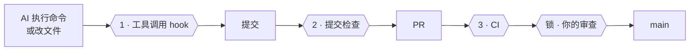
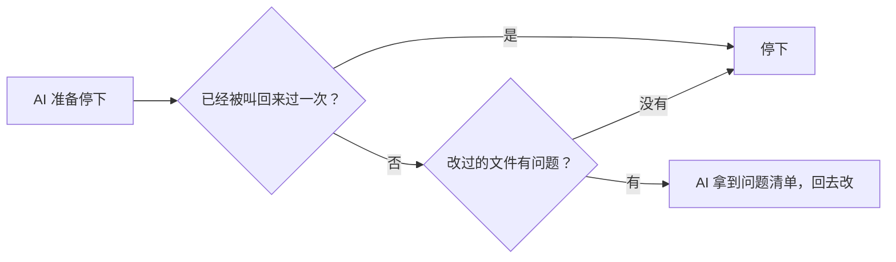
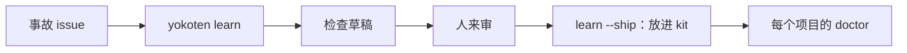

<!-- source: docs/guide.md -->
# yokoten 使用指南

[README](README.md) 是简短版。剩下的都在这里：yokoten 为什么要做、它怎么工作、有哪些规则和命令，还有它做不到的事。

## 一条赛道

**可以把它想成一条赛道。** AI 编程助手是一辆快车，yokoten 是它跑的那条赛道。护栏让一次失误不至于变成翻车，这是「守桥」；路线告诉你下一个弯怎么过，一次一关，这是「带路」；而每一次事故都会让所有赛道更安全：一个项目吃过的亏，会变成所有项目的检查，这就是「横展」。

## 先认识几个词

- **会话**：和 AI 编程助手（比如 Claude Code）的一次对话。
- **hook**：AI 工具在固定时刻自动运行的小程序。yokoten 加了三个：一个在每条命令、每次改
  文件之前运行（可以拦下来），一个在 AI 说完这一轮、准备停下时运行，一个在每次会话开头运行。
- **提交检查**：每次 git 提交前运行的检查（`.githooks/pre-commit`）。
- **CI**：GitHub 在每个 PR 上自动跑的检查。
- **规则集（ruleset）**：GitHub 上保护分支或 tag 的设置，比如「没有审查不能合并」。
- **主人、lead、worker**：主人就是你；lead 是跟你对话的那个 AI 会话；worker 是 lead 为某一个
  任务另开的会话。详见[像带团队一样管 agent](#像带团队一样管-agent)。
- **退出码**：命令结束时交回的一个数字。0 表示一切正常。脚本和 AI 靠它判断结果。
  详见[退出码](#退出码)。
- **JSON**：一种给程序读的纯文本数据格式。加上 `--json` 就输出这种格式。

## 名字的来历

「横展」（yokoten）是丰田车间里的说法：一条产线找到了某个缺陷的对策，不光这条线改，
所有可能出同样问题的产线都要跟着改。yokoten 把这件事搬到你的项目上：一个项目踩过的坑，
它会提醒别的项目先填上。

## 要解决的问题

你带着 AI 做一个项目，做了几个月，踩过不少坑：AI 为了让测试通过，直接把测试改了；
一个 PR 合并时带进了没人审过的提交；服务器地址被写进了仓库里的文件。每踩一次坑，你就加一条
规则、一个 hook、一项检查，这个项目越来越稳。

可是一开新项目，或者回到老项目，这些全都不在。这些经验只留在那个仓库里，和你的脑子里。
你忘了提，AI 就一切从头来。

yokoten 把这些经验写成规则，再配上会自己跑的检查：

- **每条规则都说得出为什么。** 一共 12 条核心规则。每条都写明为什么要有它：是真出过事，
  还是事还没出、先看到了风险；也写明由哪项检查守着。没有检查的规则只是愿望。
- **守卫自己会跑。** AI 要执行坏命令，工具调用 hook 先拦下；hook 看不到的，提交检查来抓；
  有的提交绕过了前两道，CI 再跑一遍同样的检查，把它兜住。
- **不用你记着提醒。** 每次会话一开头先跑 `doctor`，告诉 AI 这个项目走到了第几关、
  下一步做什么。AI 会主动跟你提，你不用记。

## 装上的第一天，有什么不同

| AI 想做的事 | 没有 yokoten | 有 yokoten |
|---|---|---|
| 强推（force push），或者自己打 tag 发版 | 直接就做了 | 还没执行就被拦下，并告诉它为什么 |
| 测试不过，就去改测试 | 测试通过了，bug 还在 | 修 bug 时不许改测试 |
| 提交里带上你的邮箱、服务器 IP、所在城市 | 被公开出去 | 提交被拦下；报告只指出哪个文件第几行，不把内容打出来 |
| 在 issue 或 PR 里贴出你的邮箱或令牌 | 被公开出去 | 发出去之前就被拦下，并告诉它要改什么 |
| 开 PR | 用你的账号开，权限和你一样大 | 用 bot 账号开；你不点头，什么都合不进去 |
| 换到另一个项目 | 一切从头来 | 看出这个项目缺什么，问你要不要补上 |

这些保护一装上就开着，人人都有：不用回答问题，也不用改文件。能改变它的每个设置，都能改回默认。[记录 0014](../../records/0014-safe-by-default.md) 写了 yokoten 哪些事自己做、哪些先问你、哪些绝不做。

## 守桥：五条保护

同样的五条保护，从第一天起就对每个人、每个 agent 生效。不需要 `yokoten init`，也不需要改任何设置。

1. **别丢工作**：不许 force push，不许 hard reset，不许删 `.git` 或历史。
2. **别泄密**：提交或发帖里不许有密钥、令牌、邮箱地址或主目录路径。
3. **别替你发布**：不许打 tag、发 release、发布软件包，也不许把仓库改成公开。
4. **别运行没读过的网上代码**：不许把下载内容直接管道给 shell。
5. **别拆掉守桥**：不许关闭检查或 hook；worker 不许改 CI 或规则，lead 的改动要经过你的审阅。

它拦下动作时，总是显示同样的四个部分：

```
yokoten stopped this: creating the tag v1.2.0 [release]
Why: A tag publishes a release, and only you decide when to release.
Do instead: If the owner asked for this, they run `git tag v1.2.0` themselves.
More: https://github.com/yokoten-labs/yokoten/blob/main/docs/guide.md#the-safeguard
```

第一行点名被拦下的 tag、文件或分支，以及规则。`Why` 说明可能出什么问题。`Do instead`
给出安全的做法，不会读代码的人也能照着说。`More` 链接到规则全文。第五条保护里的改动
只有主人能做；agent 要请主人来改。

## 三道检查，一把锁



| | 什么时候跑 | 拦下什么 |
|-|-----------|---------|
| **1** | 每次工具调用之前 | 推 tag、强制推送、跳过检查；修复任务里改测试；worker 改规则；项目禁用的程序；不合标题规则的 issue 或 PR 标题；agent 用 `gh` 发的 issue、PR、评论或发布说明里有个人信息或密钥；取消或删除一次 Actions 运行 |
| **1b** | Claude Code 的 AI 准备结束这一轮时 | 改过的文件里有没有个人信息、密钥，有没有改了不该改的文件（和提交检查一样）。有问题就把它叫回来改一次 |
| **2** | 每次提交 | hook 看不到的：用 `sed` 或脚本改的文件、个人信息、超过 7 项的文件夹 |
| **3** | 每个 PR | 关掉 hook 做出来的提交 |
| **锁** | 服务器上 | 没经过你审查的合并、直接推 `main`、不是你打的发版 tag |

## 会话里看到的是什么

项目还没用上 yokoten 时，会话一开始，AI 会看到：

```
yokoten: stage 1 of 5, safety net. Next: no AGENTS.md, so the agents have no written rules here; `yokoten init` adds one.
Why: an agent follows the rules it can read, and only those.
Tell the user in plain words, one step at a time, and offer to do it (as-is, lighter, or not now with a reason).
```

会话里一次只说一步：在第几关、下一步做什么、为什么要做。第几关不存在哪里，每次都是看项目
里有哪些文件现算的。你说过「暂不」的步骤会跳过。顺序只是建议：后面关里的步骤提前做了，也算
做完。所有步骤都做完了，或者都说了「暂不」，会话里就只有一行，告诉你路走完了。
某个文件这里没有、但默认分支上有，提示会写明是默认分支上的，不再让你 `init`。
Claude Code 压缩上下文之后，会话只会再听到变了的提示。
每个会话听过什么，记在 `~/.config/yokoten/sessions/` 里，超过 7 天的文件会被删掉。

AI 会用你的语言跟你讲。yokoten 自己的提示用英文写，因为 AI 读英文最不容易出错。

`yokoten doctor` 会列出整条路。每一步标成 done（做完了）、next（下一步）、to do（还没做）、
not now（暂不，后面跟着你给的原因）或者 can't check（这里查不了）。yokoten 还查不了的步骤
先不列出来：

| 关 | 步骤 |
|---|---|
| **1 · 安全网** | `rules`、`tool-hook`、`commit-check`、`runtime`、`tests`（有测试命令，CI 会跑） |
| **2 · 先开 issue，再走 PR** | `remote`（仓库已经在托管平台上，而且这个仓库有分支推上去了）、`ci`（CI 跑 `check`，或者用了 yokoten 的 Action）、`issues`（没有 todo 文件）、`templates`、`labels`（标准标签都在）、`milestone`（有一个没关的里程碑）、`no-build-output`（`dist/`、`build/`、`out/` 里没有提交的文件，也没有编译出来的二进制文件） |
| **3 · 发版** | `changelog`、`titles`（CI 跑 `check --pr`；用 Action 的话，要在 PR 上跑，而且没设 `pr-check: false`） |
| **4 · 带一支 AI 团队** | `codeowners`、`bot`、`skills`、`review`（合并到默认分支前要有一个人批准） |
| **5 · 公开** | `security-files`（安全说明、Dependabot、许可证）、`protection`（默认分支和 `v*` tag 上的规则集）、`merge-settings`（只许 squash 合并，合并后自动删分支）、`security-settings`（secret scanning、push protection、私下报告漏洞、Dependabot 提醒） |

后三步是服务器上的设置。完整的 `doctor` 用 `gh api` 去读，只读不改。
没装 `gh`、没登录、没网，或者远程仓库不在 GitHub 上，这三步就标 can't check，绝不会算作做完。
会话开头不联网，所以那里这三步总是 can't check。

**别的托管平台。** doctor 从 `origin` 远程仓库看出托管平台。在 GitHub 上，服务器设置照上面的办法读。
在 Gitea 上，在 `yokoten.json` 里写 `"host": "gitea"`，并把 bot 用户的令牌放进 `GITEA_TOKEN`；doctor 会通过
Gitea 的 API 读取分支和标签保护、标签、里程碑和忘记的分支。`gitea.com` 不用写这个键。在 GitLab 这类别的平台上，
核心照常工作：规则、守卫、提交检查都一样。只有平台自己才判断得了的
步骤，是 `tests`、`ci`、`labels`、`milestone`、`titles`、`codeowners`、`bot`、`review`，以及那三步
服务器设置。这些步骤在那里都标 **can't check**，并写明它在问什么，你可以自己动手设好。
它们不会卡住关卡。自建服务器的名字从不打印，doctor 一律叫它 "this host"。

第 2 关的 `labels` 和 `milestone` 也这样读。标准标签是 `bug`、`feat`、`docs`、`refactor`、`ci`、
`owner`、`incident`、`good first issue`、`hotfix`、`security`，还有三个 tier 标签 `tier A`、`tier B`、`tier C`。
`init` 会告诉你缺哪些，`init --github --yes` 帮你加上。

第 4 关的 `review` 也这样读服务器。默认分支的规则集（或者分支保护）要求至少一个批准，这一步就算做完。
GitHub 不让你批准自己开的 PR，所以让 bot 来开 PR，你来批准、合并。
设置方法：编辑默认分支上的规则集，在“Require a pull request”里把“Required approvals”设成 1。
另外，Settings → Actions → General 里的“Allow GitHub Actions to create and approve pull requests”要一直关着。
它要是开着，bot 推一个 workflow 就能批准它自己开的 PR，所以 `review` 不算做完。
批准设好以后，合并的人不是写代码的人，OpenSSF Scorecard 应该会把每次改动算作审过。
这是我们从 Scorecard 文档里读到的，还没在真正跑一次 Scorecard 时验证过。
免费账号的私有仓库没有规则集，这时 `review` 标 can't check，等到第 5 关仓库公开时再做。
它不标 not now，因为 not now 只留给你自己做的决定。

`init --github --yes` 还会把 `yokoten.json` 里 "areas" 列的模块各建一个标签，统一用灰色。
模块不超过 8 个才建：再多，标签就太乱了，你常用的那几个自己手动建就好。已有的模块标签原样保留，yokoten 也从来不删。

看板可有可无。`init --github --yes --board` 会建一个和仓库同名的看板，并关联到仓库，
Status 字段设成 Todo、In progress、In review、Done 四项。建看板要 gh 的令牌带 `project` 权限；
没有的话，init 就跳过看板，并告诉你跑 `gh auth refresh -s project`。再跑一次，它按名字找到这个看板，不会再建。
看板的视图和自动规则，API 设不了。所以只要仓库关联了看板，完整的 `doctor` 就会把这些列成"手动设置"的几行，
提醒你去点。这几行不会让 doctor 报错。

如果某一步对应外部的标准，`yokoten doctor` 会在步骤名后面写出来，比如 `ci (Scorecard: CI-Tests)`。
会话开头那三行不写。

为什么这样分，见[决定记录 0004](../../records/0004-the-road.md)。

这个仓库自己也在走这条路，每一关你都能直接看它怎么运转：

| 关 | 学会什么 | 在这里看 |
|---|---|---|
| **1 · 安全网** | AI 要读的规则，以及规则管不住时拦下它的检查 | [AGENTS.md](../../../AGENTS.md) |
| **2 · 先开 issue，再走 PR** | 每次改动先开 issue 说清为什么；CI 通过了才合并；用标签、里程碑（milestone）和看板管起来 | [issue](https://github.com/yokoten-labs/yokoten/issues?q=is%3Aissue)、[PR](https://github.com/yokoten-labs/yokoten/pulls?q=is%3Apr)、[看板](https://github.com/orgs/yokoten-labs/projects/1) |
| **3 · 发版** | 写明改了什么、为什么改的提交信息；CHANGELOG；每次发版一个版本号 | [CHANGELOG.md](../../../CHANGELOG.md) |
| **4 · 带一支 AI 团队** | bot 开 PR，worker 领任务，reviewer 审查；最后拍板的永远是你 | [像带团队一样管 agent](#像带团队一样管-agent) |
| **5 · 公开** | 把全部提交历史查一遍，看有没有漏出隐私；打开安全设置；保护 `main` 分支 | [安全说明](../../../.github/SECURITY.md) |

AI 想推送发版 tag 时，会看到：

```
yokoten: git push --tags pushes tags. Only the owner decides when to release. If the owner asked for this, they start a new session with `YOKOTEN_RELEASE_APPROVAL=1 claude` (or your agent's command); do not look for another way.
  docs: https://github.com/yokoten-labs/yokoten/blob/main/docs/guide.md#the-core-rules
```

提示里写的是启动当前这个 agent 的命令：`codex`、`gemini`、`agy`，或者
`dsh tui --patch .dsh/yokoten.patch.yml`。Copilot CLI 发来的调用和 Claude Code 一模一样，分不出来，
所以这条提示会加一句 "or your agent's command"。Muse Code 跑钩子时只留下几个环境变量，`YOKOTEN_ROLE`
就传不过去；也没见过它把 `YOKOTEN_RELEASE_APPROVAL` 传给钩子。所以在 Muse Code 里，提示会让主人
到 Muse Code 外面去发版。Gemini CLI 如果开了严格的环境变量清理，这个变量会被删掉，主人就要到
Gemini CLI 外面去发。

（提示用英文写，因为 AI 读英文最不容易出错。）

每条提示都是同样的三段：**出了什么事**（what）、**为什么要紧**（why）、**怎么改**（fix，
一条命令或者一处改动）。问题出在某个文件里时，开头先写位置：`文件:行号:`。查到问题时，
只说是哪一类，不说内容：密钥、私有词表里的词，都不会打印出来。如果指南里有一节专门讲这条
规则，提示最后会另起一行，给出那一节的链接：`docs: <链接>`。

想知道某条规则为什么存在，就跑 `yokoten explain <id>`。id 就是规则或步骤的名字，比如
`secret`、`commit-check`。不写 id，或者写了一个不存在的，它会把所有 id 列出来。

```
$ yokoten explain force-push
force-push: no plain force push (core rule 7).
Why: a plain force push can throw away work that someone else pushed.
Check: the tool-call guard stops `git push --force`, `-f` and a `+ref`; `--force-with-lease` passes; a branch ruleset on the server is the lock.
Docs: https://github.com/yokoten-labs/yokoten/blob/main/docs/guide.md#the-core-rules
```

### 只在这台机器上的活

停电、死机、硬盘坏了，只存在这台机器上的东西就没了。所以 `doctor` 会把这些列出来，
每一条都附上能把它保住的那条命令：

| 提醒 | 意思 | 命令 |
|---|---|---|
| `uncommitted-changes` | 某个 worktree 里有改了没提交的文件：几个，最早的改了多久 | 在那里 `git add -A`、`git commit`，再推上去 |
| `unpushed-commits` | 某个分支上有远端没有的提交，或者游离的 HEAD 上有哪个分支都没收着的提交 | `git push`；分支在远端还没有自己的同名分支时，用 `git push -u origin <分支>`；游离的 HEAD 先 `git switch -c <名字>` |
| `stashes` | 有 stash。stash 从来不会被推上去 | `git stash branch <名字>`，再推上去 |
| `stale-index-lock` | 死机留下了一个 `index.lock`，仓库里也没有 git 在跑 | 用 `rm` 删掉它 |
| `repo-on-tmpfs` | 仓库在 tmpfs 上，一重启就清空 | 先 `git push --all origin`，再在不会被清空的地方重新 clone 一份 |
| `repo-in-temp-folder` | 仓库在临时文件夹里，系统重启时可能会清掉 | 先 `git push --all origin`，再在不会被清空的地方重新 clone 一份 |
| `finished-worktree` | 某个 worktree 没有改动，而且分支已经合并、远端分支已经没了，或者游离的 HEAD 已经在默认分支里 | `git worktree remove <路径>`，分支还留着 |
| `missing-worktree` | git 还记着某个 worktree，可它的文件夹已经没了 | `git worktree prune` |

提交了但没推，东西还是只在这台机器上。从 `origin/main` 拉出来的分支会跟踪 main，
所以它的提交要推到它自己的分支，绝不推到 main。

squash 合并不会在分支历史里留下痕迹，所以远端分支没了，也算作已合并。
有未提交改动的 worktree，doctor 不会说它可以删。
拉出来以后一次都没动过的分支或游离 HEAD 是新的，不算已合并。

遇到 `index.lock` 时，doctor 会看有没有 git 进程正在这个仓库里干活。Linux 上能看到每个进程
在哪个文件夹；macOS 和 Windows 上看不到，所以只要有 git 进程在跑，就说「判断不了」。
这时 doctor 绝不会叫你删这个文件。凭据缓存这类一直挂着的 git 辅助进程不算。
tmpfs 是读 `/proc/mounts` 判断的，所以只在 Linux 上查。

临时文件夹指系统自己的那个（`TMPDIR`，Windows 上是 `%TEMP%`）和 `/tmp`。
WSL 重启时会清空 `/tmp`，哪怕它不是 tmpfs。想多查几个文件夹，就写进 `YOKOTEN_TEMP_DIRS`，
分隔方式和 `PATH` 一样。设成空的就不查了。

仓库本身放在这种地方，总会单独提一条，因为这是仓库放错了地方。
worktree 放在这里，只有里面有会丢的东西时才提，而且就写在那条提醒里，比如：
「../w 有 3 个没提交的文件，最早的改了 2 天，而且它在临时文件夹（/tmp）里，系统重启时可能会清掉」。
里面没有会丢的东西的 worktree，完整的 `doctor` 只用一行说一共有几个，会话开头不提。

这些都只是提醒，不会让 `doctor` 失败。doctor 在这里只读：不改文件、不动引用、不碰 worktree，
跑 git 时也关掉了可选的锁。路径都按相对仓库的写法显示，或者从 `~` 开始写。

会话开头只说有风险的，最多三条。没提交的改动要放了一个小时以上才提，
因为手上正在做的活不会忘。该收拾的 worktree 留给完整的 `doctor` 去说。
临时文件夹里有两个以上 worktree 存着会丢的东西时，先用一行说一共有几个。

会话开头在这件事上最多花一秒，免得磁盘缓存是冷的时候干等。时间到了，
就把已经读到的说出来，再加一句「doctor 提前停了」。完整的 `doctor` 不限时间。

## 四层

| 层 | 管什么 | 怎么装 |
|----|--------|--------|
| **机器** | 技能、agent 定义、两个用户级 hook，每台电脑都一样 | `yokoten install`，或者 Claude Code 插件 |
| **项目** | 规则、提交检查、工具调用 hook、CI、issue 和 PR 模板、Dependabot（每月一个 PR）、安全说明 | `yokoten init`；老项目再用 `yokoten` 技能 |
| **服务器** | 分支和 tag 规则集、squash 合并、代码负责人、权限受限的 bot、几个安全开关 | 由仓库主人设置一次；`doctor` 会列出步骤 |
| **规则** | `AGENTS.md`：12 条核心规则，加上项目自己的规则 | 每条规则都写明由哪项检查守着 |

老项目不是一张白纸，有些习惯比 yokoten 的还好。所以 `yokoten` 技能会跟你一条一条过，每条
做法都由你定：**照搬**、**减量**（说清去掉了哪部分），或者**暂不**（写明原因，以及什么
时候再看）。「暂不」会写进 `yokoten.json`，`doctor` 就不再追问。

### 先拿一份草稿

`yokoten adopt` 会在你们开始过之前先把这张表填个初稿。它读项目里的文件，逐条写出项目现在的
情况：**已有**、**没有**、**部分有**（项目有自己的做法，比如用 husky 管提交 hook，或者
有 CI 但没跑 yokoten），或者**不清楚**（这一步在这里查不了，比如服务器上的设置，要跑
`yokoten doctor` 才看得到）。然后让模型给每一条提一个建议，附一句理由。

- 模型只拿到这些简短的情况说明，拿不到文件内容。
- 发出去之前，yokoten 先对要发的内容做一遍隐私检查。查到问题就什么都不发。
- 没有 key、调用失败、或者模型的回答不合格式时，改用固定规则出草稿：已有或没有的，照搬；
  部分有的，减量；不清楚的，先用 `doctor` 查一下，再照搬。输出会写明是谁出的草稿。
- `adopt` 不改任何文件。每一条最后还是你来定。
- 部分有的那几条，跑 `init` 也不会被冲掉：它会让 `CLAUDE.md` 引入 `AGENTS.md`，也会把
  提交检查加进 husky 的 `pre-commit`。

用的是 Meta 的模型 API，走它兼容 OpenAI 的接口（`https://api.meta.ai/v1`，模型是
`muse-spark-1.3`）。把 key 设到 `LLAMA_API_KEY` 或 `MODEL_API_KEY` 里。想换成别家兼容 OpenAI 的接口和模型，设 `LLAMA_API_BASE` 和 `LLAMA_MODEL`。

## 支持哪些 agent

yokoten 能管住九种 AI 编程 agent，它们守的是同一套规矩。下表是唯一的名单，也写明每种覆盖得怎么样。表里写“是”的，
都真跑过：在一个用完就删的仓库里让 agent 执行 `git push --tags`，守卫把它拦了下来。“没有完整跑过”的意思是：
agent 列在这里，但还没有确认它的守卫能端到端拦住。光看文档不算数。这张表由
`src/agents/runtimes/runtime.ts` 里的运行时契约和上面带日期的实跑记录生成。两者不一致时测试会失败。

| Agent | 钩子写在哪（`init` 负责写） | 怎么拦 | 能力（改写 · 收尾 · 信任 · 失败 · 角色） | 真跑过吗 | 要注意 |
|---|---|---|---|---|---|
| Claude Code | `.claude/settings.json`：PreToolUse 和 Stop | 退出码 2，理由写在 stderr | 是 · 是 · 是 · 拦下 · 是 | 是，2026-10-19：无界面模式，模型用 DeepSeek 的 `deepseek-flash` | 无 |
| GitHub Copilot CLI | 也是 `.claude/settings.json`：Copilot 会读这个文件 | 退出码 2，理由同时以 JSON 写到 stdout | 否 · 是 · 是 · 放行 · 是 | 是，2026-10-19：Copilot CLI 1.0.98，`copilot -p`，模型 `gpt-6-luna`（Auto 自动选的） | 要先信任这个文件夹，才跑仓库钩子：在那里运行 `yokoten trust`。没信任就一声不吭地跳过。钩子超时的话，这次调用会放行 |
| Antigravity CLI（`agy`） | `.agents/hooks.json`：名叫 `yokoten` 的那一项，PreToolUse | 在 stdout 输出 `{"decision": "deny"}` | 否 · 否 · 否 · 拦下 · 是 | 是，2026-10-19：agy 1.4.2，`agy -p`，模型 `gemini-3.8-flash-high` | 还没有收尾检查。`.yokoten/` 不在的话，每次调用都会被拒：agy 出错时一律拦下 |
| Codex CLI | `.codex/hooks.json`：PreToolUse 和 Stop | 退出码 2，理由写在 stderr | 否 · 是 · 是 · 拦下 · 是 | 是，2026-10-19：Codex 0.163.0，`codex exec`，模型用 DeepSeek 的 `deepseek-flash` | 要先信任这个文件夹，再信任这两个钩子，才会跑：在那里运行 `yokoten trust`。没信任的钩子，`codex exec` 一声不吭地跳过 |
| Muse Code | `.muse/hooks.json`：PreToolUse 和 Stop | 退出码 2，理由写在 stderr | 否 · 是 · 是 · 放行 · 否 | 是，2026-10-19：Muse Code 1.4.10，`muse exec --trust-workspace`，模型 `muse-spark-1.3-contributor` | 要先信任这个文件夹，才跑钩子：运行 `yokoten trust`。Muse 不把 `YOKOTEN_ROLE` 传给钩子，所以在 Muse 里每个会话都当成 lead。也没见过它传 `YOKOTEN_RELEASE_APPROVAL`，所以发版要到 Muse 外面去。钩子出错或超时的话，这次调用会放行 |
| DeepSeek Harness（`dsh`） | `.dsh/hooks.json`：PreToolUse；再用 `.dsh/yokoten.patch.yml` 让 dsh 加载它 | 退出码 2，理由写在 stderr | 否 · 否 · 否 · 放行 · 是 | 是，2026-10-20：dsh 0.2.1-rc.2，`dsh headless --patch .dsh/yokoten.patch.yml`，DeepSeek 的默认模型 | 钩子要靠一个桥接插件才会跑，每个 profile 都得自己装，见 [DeepSeek Harness](#deepseek-harness)。没装插件或启动时没带 patch，dsh 一个钩子都不跑，也不提醒。Windows 上还管不住（#332）。还没有收尾检查 |
| Grok CLI（`grok`） | `.grok/hooks/yokoten.json`：PreToolUse 和 Stop | 在 stdout 输出 `permissionDecision: "deny"`，退出码 2 | 是 · 是 · 是 · 拦下 · 是 | 是，2026-10-20：Grok CLI 1.0.52，`grok -p --trust --always-approve`，默认模型 | 要先信任这个文件夹，才跑项目钩子：在那里运行 `yokoten trust`。没信任就一声不吭地跳过。它也会跑 `.claude/settings.json` 里的钩子，所以一次调用可能查两遍，这是有意的 |
| Gemini CLI | `.gemini/settings.json`：BeforeTool 和 AfterAgent | 退出码 2，理由写在 stderr | 否 · 是 · 是 · 拦下 · 否 | 没有完整跑过：个人 Google 账号 2026-06-18 起不能再登录，要付费 API key 或企业授权 | 谷歌给个人用户的 agent 现在是 Antigravity CLI |
| OpenCode | `.opencode/plugins/yokoten.ts`：OpenCode 2 的 permission `evaluate`，以及 OpenCode 1 的 `tool.execute.before` | OpenCode 2 把 `effect` 设为 deny；OpenCode 1 抛出理由 | 否 · 否 · 否 · 拦下 · 否 | 是，2026-10-23：OpenCode 2.1.4，`opencode-go/deepseek-v4.1-flash`，插件就是 `init` 写的那份 | 没有收尾检查。守卫失败或超时就拒绝这次调用。不是只读、又读不出命令或路径时，也拒绝。子 agent 的调用没有完整跑过 |
| 其他 agent | 无 | `AGENTS.md` 里的规则；还有提交检查，不管是谁提交的，坏提交都会被拦下 | — | | |
>
用户级的钩子由 `install` 写：会话开头的带路提示，加上命令守卫。它们写进
`~/.claude/settings.json`；有 `~/.codex`、`~/.gemini` 文件夹的话，也写进
`~/.codex/hooks.json` 和 `~/.gemini/settings.json`。有 Muse 的配置文件夹的话，Muse Code 两个都装，写进
`~/.config/muse/settings.json`（设了 `$XDG_CONFIG_HOME` 就写进 `$XDG_CONFIG_HOME/muse/settings.json`）。有 `~/.grok` 的话，Grok CLI 只装命令守卫，写进
`~/.grok/hooks/yokoten.json`：会话开头钩子的输出，Grok 只给你看，不给 agent 看。有 `~/.gemini/config` 的话，Antigravity CLI 只装命令守卫，写进 `~/.gemini/config/hooks.json`。有 `~/.copilot` 的话，Copilot CLI 也装命令守卫，写进 `~/.copilot/hooks/yokoten.json`。两者都还没有收尾检查：agy 的 Stop 事件没有重入信号，Copilot 的钩子超时后会放行调用。有 `~/.config/opencode` 的话，OpenCode 只装命令守卫，写进 `~/.config/opencode/plugins/yokoten.ts`。Grok 的信任检查关掉时（设了 `GROK_FOLDER_TRUST=0`，或者 `~/.grok/config.toml` 里写了 `[folder_trust] enabled = false`），`doctor` 把每个文件夹都当成已信任。在 Codex 里，`apply_patch` 要改哪些
文件，守卫都会查，在 shell 里跑的也查。

每个工具都要你先信任，项目钩子才会跑：

- **Claude Code**：在你信任的文件夹里跑项目钩子。
- **Copilot CLI**：也是在你信任的文件夹里才跑。用 `copilot -p` 时，要设
  `COPILOT_ALLOW_ALL=true`，只有正好写成 `true` 才会顺带信任当前文件夹。只加
  `--allow-all-tools` 不行，钩子不会跑。
- **Antigravity CLI**：我们用 `agy -p` 跑的时候，文件夹不在它的信任列表里，`.agents/hooks.json`
  照样跑了。它跑钩子时，工作目录是 `.agents` 文件夹。网上的指南说
  `--dangerously-skip-permissions` 会跳过钩子；但在 agy 1.4.2 里，加了这个参数钩子照样跑。
  两种说法都别指望。
- **Codex**：项目要先设成信任，项目钩子才会跑。然后在 `/hooks` 里逐个批准，或者在文件夹里运行
  `yokoten trust`。Codex 记的是命令本身，命令一改，就得重新批准；`yokoten trust` 会写进新的哈希。
- **Muse Code**：工作区要先设成信任，才会跑 `.muse/hooks.json`；没信任就一声不吭地跳过。
  用 `muse exec` 时，加 `--trust-workspace` 就是这一次信任当前文件夹。项目里
  `.agents/skills` 下的技能，也要信任以后才读。在工位外面，Muse Code 会读
  `~/.claude/CLAUDE.md`，并把这个文件发给 Muse 的模型。把 Muse 放进工位里跑，你的主目录
  就会藏起来。那个文件在的时候，`doctor` 会告诉你。工位里仍能看见这个文件时，`doctor`
  会说主目录还看得见，这个工位需要处理。
- **Grok CLI**：文件夹要先设成信任，才跑 `.grok/hooks/`；没信任就一声不吭地跳过。在文件夹里运行
  `yokoten trust`，或者在这里的会话里输入 `/hooks-trust`。`yokoten trust` 只写 Grok 自己的信任文件，只针对这个文件夹。信任以后，
  Grok 也会跑 `.claude/settings.json` 里的钩子，所以一次调用可能查两遍。这是有意的：
  Grok 自己的钩子可能被跳过，比如文件夹没信任，或者仓库提交了一个空的钩子文件。这时
  Claude Code 的钩子照样守着。多查一遍大约多花 0.1 秒。
- **Gemini CLI**：文件夹要先设成信任，项目钩子才会跑。要在仓库根目录启动 Gemini：它只读
  启动时所在文件夹里的 `.gemini/settings.json`。新加或改过的钩子，第一次跑之前它会提醒你一次。

`init` 会给每个工具打印一句话，告诉你怎么信任这个文件夹。之后 `doctor` 去读各个工具
自己记信任的文件（只读），哪个工具还没信任这个文件夹，就提醒你：

| 工具 | 信任记在哪 | 怎样才算信任了 |
|---|---|---|
| Copilot CLI | `~/.copilot/config.json` 里的 `trustedFolders`（设了 `$COPILOT_HOME` 就在那里） | 这个文件夹本身，或者它的上级文件夹 |
| Codex | `~/.codex/config.toml`（设了 `$CODEX_HOME` 就在那里）里的 `[projects]` 和 `[hooks.state]` | 仓库文件夹本身，一个字都不能差；每个钩子也要按现在的内容信任过 |
| Muse Code | `~/.config/muse/trust.json`（设了 `$XDG_CONFIG_HOME` 就是 `$XDG_CONFIG_HOME/muse/trust.json`） | 仓库文件夹本身，一个字都不能差 |
| Grok CLI | `~/.grok/trusted_folders.toml`（设了 `$GROK_HOME` 就在那里）里的 `[folders."<文件夹>"]`，`trusted = true` | 仓库文件夹本身，一个字都不能差 |

只有这个工具的主目录在（`~/.copilot`、`~/.codex`、`~/.config/muse`、`~/.grok`），`doctor` 才查它。
主目录在、文件却没有或读不了时，`doctor` 会说 "can't check"（查不了），不会说 ok。

worker 靠 `YOKOTEN_ROLE=worker` 认出来。在 Codex 里，子 agent 的 `agent_type` 带 worker
字样的，也算 worker。Copilot CLI、Antigravity CLI 和 DeepSeek Harness 调钩子时不说是哪种子 agent，只看
`YOKOTEN_ROLE`。Gemini CLI 开了严格的环境变量清理后，钩子里拿不到 `YOKOTEN_ROLE`。
这时 yokoten 在 Gemini CLI 里分不出谁是 worker：每个会话都当成 lead，只有 lead 能改的
文件，worker 改了也拦不住。Muse Code 跑钩子时只留下几个环境变量，`YOKOTEN_ROLE` 不在其中，
所以在 Muse Code 里也一样：每个会话都当成 lead。Grok CLI 会把 `YOKOTEN_ROLE` 传给钩子；子 agent 的
`subagentType` 带 worker 字样的，也算 worker。服务器上的锁照样有效：代码负责人，还有一个
改不了 CI 的 bot。

取消或删除一次 Actions 运行，lead 和 worker 都会被拦住。
守卫会拦 `gh run cancel` 和 `gh run delete`。用 `gh api` 或 `yokoten bot` 做同样的事，也会被拦住。
`gh run rerun`、`view`、`list` 和 `watch` 仍然放行。请仓库主人在 Actions 页面上取消或删除。
`repositories/<id>` 和 `repos/<owner>/<repo>` 是同一种路径。
路径里的 `.` 和 `..` 会先化简，再拿来比对。
路径里的词不分大小写，所以 `Actions` 和 `Cancel` 也算同一次调用。
`gh api` 里连写的短选项会被拦住。一个短选项自己带着值，例如 `-XDELETE`，仍然放行。
方法或路径来自 shell 变量，而且可能指向一次运行时，会被拦住。
`repos/` 或 `repositories/` 后面只有一个变量，而且方法不是 GET，也会被拦住。
`gh run` 的子命令如果来自 shell，会被拦住。
`gh` 必须写出它自己的命令名。`gh extension install`、`upgrade`、`exec` 和 `browse` 会被拦住。
`exec` 会运行已经装好的扩展。`browse` 可以装上一个扩展。
`gh config set aliases` 会被拦住。`gh alias list` 和 `gh extension list` 仍然放行。
`gh alias set` 和 `gh alias import` 对 lead 和 worker 都拦住。别名要仓库主人自己加上。

worker 用 shell 写只有 lead 能改的文件，守卫也会拦，跟拦编辑一样（#402）。它看这些写法：
重定向（`>`、`>>`、`>|`、`&>`），`sed -i`、`perl -i`、`tee`、`cp`、`mv`、`install`、`ln`、
`dd of=`、`truncate`、`rm`，还有 git 的 `checkout`、`restore`、`rm`、`mv` 和 `apply`。
重定向的文件名加了引号，或者跟前面的词连在一起（`echo x>"AGENTS.md"`），也照样算。
`git apply` 时，守卫会读补丁，看它改哪些文件，但只读不超过 1 MB 的普通文件；别的补丁文件
一律拦下 worker。worker 的 `git commit` 如果会提交这类文件，也会被拦。原因是提交检查只能从
`YOKOTEN_ROLE` 知道谁是 worker，而 Claude Code 的子 agent（比如 `yokoten:worker`）没有这个
变量。`cat`、`grep` 这种只读不写的命令照常放行。跟拦编辑一样，只在用了 yokoten 的仓库（有
`yokoten.json`）里才拦。如果任务本来就要改这类文件，lead 启动 worker 时加上
`YOKOTEN_LEAD_ONLY_OK=AGENTS.md,.github/workflows/ci.yml`：从仓库根目录写起的路径，用逗号
隔开，带 `*` 的按通配符算。只写一个 `*` 就是放行所有只有 lead 能改的文件。守卫和提交检查
都会放行这些路径。子 agent 跟 lead 用同一套环境变量，所以这种任务要交给单独开的会话。会话
开始时，带 `YOKOTEN_ROLE=worker` 的会话会听到 `doctor` 说 "this session is a worker:
lead-only files are guarded"。单独开的 worker 会话没看到这句话，就是没设这个变量。子 agent
不会开新会话，所以听不到这句话。

### DeepSeek Harness

DeepSeek Harness（`dsh`）靠一个桥接插件来跑 Claude Code 格式的命令钩子。这个插件不在 dsh
的安装包里。`init` 只写钩子文件和启动用的 patch，剩下的步骤打印出来让你自己做。它什么都不装，
也不碰 `~/.dsh`。

1. 给你用的每个 profile（`tui`、`headless`、`web`）装上桥接插件，再装它依赖的协议包。
   `dsh plugin add` 要用 `pnpm`，得先装好。少了协议包，插件就加载不了钩子。

   ```sh
   dsh plugin --profile tui add @deepseek-ai/dsh-hooks-claude-code@0.2.1-rc.2
   dsh plugin --profile tui add @deepseek-ai/dsh-hook-protocol@0.2.1-rc.2
   ```

2. 在仓库根目录启动 dsh，`--patch` 紧跟在 profile 名字后面：

   ```sh
   dsh tui --patch .dsh/yokoten.patch.yml
   dsh headless --patch .dsh/yokoten.patch.yml --json "<任务>"
   ```

   patch 里写的 `.dsh/hooks.json` 是相对路径，dsh 从启动时所在的文件夹去找。在别的文件夹启动，
   或者启动时没带 patch，dsh 就一个钩子都不跑。
   `.dsh/yokoten.patch.yml` 归 yokoten 管，每次 `init` 都会整个重写。你自己的配置请写到别的文件里。

dsh 认工具名时要一字不差，而且是小写，所以钩子的 matcher 写的是 `bash|pwsh|edit|write`。
`pwsh` 是 dsh 在 Windows 上用的 shell，先写进去，留给以后用；现在 Windows 上还管不住。
在 Windows 上，dsh 用 PowerShell 来跑钩子，可 yokoten 的守卫是一条 POSIX shell 命令，PowerShell
跑不了。插件把这种失败当成“放行”，所以每次调用都会直接通过。在 Windows 上，`doctor` 和 `init`
都会照实说（#332）。
这里没有收尾检查：插件的 Stop 事件没有防死循环的机制。`doctor` 会查这两个文件，也会去
`${DSH_HOME:-~/.dsh}/profiles` 里看两个包装了没有；找不到 dsh 的目录，就说 can't check。
插件出了问题也不吭声，直接放行，所以文件都在也说明不了什么。要确认守卫真的在跑，只能真拦一次：
在一个用完就删的仓库里让 dsh 执行 `git push --tags`，看它被拒。

### 让 Claude Code 或 Codex 用 DeepSeek 的模型

守卫装在 agent 里，跟用哪个模型无关。所以 Claude Code 和 Codex 换成 DeepSeek 的模型，
规矩还是一样。上表里这两次都用的是 `deepseek-flash`。

Claude Code 走 DeepSeek 兼容 Anthropic 的接口：

```sh
export CLAUDE_CONFIG_DIR=~/.config/claude-deepseek   # 一个没登录 claude.ai 的配置文件夹
export ANTHROPIC_BASE_URL=https://api.deepseek.com/anthropic
export ANTHROPIC_API_KEY=<你的 DeepSeek key>
export ANTHROPIC_MODEL=deepseek-flash
claude
```

一定要单独设 `CLAUDE_CONFIG_DIR`。配置文件夹里要是登录过 claude.ai，Claude Code 发出去的
是那个账号的令牌，不是你的 key。DeepSeek 每次都回 401，Claude Code 不提示，一直重试到
超时，看起来就像卡住了。也别用 `--bare`：它会跳过钩子，守卫就不跑了。

Codex 走 DeepSeek 兼容 OpenAI 的接口。把下面这段写进 `$CODEX_HOME/config.toml`
（默认是 `~/.codex/config.toml`），再设好 `DEEPSEEK_API_KEY`：

```toml
model = "deepseek-flash"
model_provider = "deepseek"

[model_providers.deepseek]
name = "DeepSeek"
base_url = "https://api.deepseek.com"
env_key = "DEEPSEEK_API_KEY"
wire_api = "responses"
```

Codex 0.163.0 已经不接受 `wire_api = "chat"`。它会提示找不到 `deepseek-flash` 的模型信息，
但照样能跑。

## 安装和命令

需要 Node 22.23.4 或更高版本（用 Node 24 要 24.22.1 起，用 Node 26 要 26.12.1 起）：它能直接运行 TypeScript，不用先编译。
22.18 到 22.23.3 也能跑 TypeScript，但请别再用：这几个版本有安全漏洞，Node 在 2026 年 10 月 21 日已经修好了
（[官方公告](https://nodejs.org/en/blog/vulnerability/october-2026-security-releases)）。所以 npm 会警告，完整的 `doctor` 也会在 `machine:` 下提醒。没有任何依赖。
装法有两种：一种是 Claude Code 插件，一种是 `install` 命令（从 npm 跑，或者从 clone
下来的仓库跑）。选一种就行，别两种都装。yokoten 写进去的 hook 命令要在 POSIX shell 里跑，
Windows 上请用 Git Bash。

也有人只装了技能：`npx skills add yokoten-labs/yokoten` 只复制技能。技能只是给 agent 的
说明，真正拦住命令的是守卫。所以只装技能等于没有守卫：要跑 `npx yokoten install`，或者用插件，
守卫才会打开。

### 装哪个版本

有三个发布通道。Stable 是稳妥的默认选择。

| 通道 | 插件 | npm | 装到的是什么 | 适合谁 |
|---|---|---|---|---|
| Stable | `yokoten` | `latest` | 最新的正式发布标签，例如 v0.1.0，带更新日志 | 所有人 |
| Beta | `yokoten-beta` | `next` | 最新的预发布标签，例如 v0.2.0-beta.1 | 想早点用新功能、出了问题愿意报告的人 |
| Dev | `yokoten-dev` | 无 | 默认分支，每个合并的 pull request | 贡献者，以及我们自己的测试 |

`/plugin install yokoten@yokoten` 装的是 Stable。Beta 用 `yokoten-beta@yokoten`，Dev 用
`yokoten-dev@yokoten`。只装一个通道，不要同时装几个。要换通道，先运行
`/plugin uninstall yokoten@yokoten`，再装另一个名字。在终端里，`claude plugin uninstall`
和 `claude plugin install` 也一样。`doctor` 会在输出的最上面写出通道和版本。

预发布版可能比正式版先出问题。Dev 每次合并都会变，而且没有更新日志。

### 用 Claude Code 插件装

在 Claude Code 里输入：

```text
/plugin marketplace add yokoten-labs/yokoten
/plugin install yokoten@yokoten
```

第一条把这个仓库加成插件市场，第二条打开插件页面，选「Install for you」（给自己装，
所有项目都能用）。不进 Claude Code 也行，在终端里先跑
`claude plugin marketplace add yokoten-labs/yokoten`，再跑 `claude plugin install yokoten@yokoten`。

插件就是这个仓库本身。它用的文件和 `install` 复制的是同一份，所以两种装法不会越走越不一样：

| 插件带来的 | 来自 |
|---|---|
| 技能：`/yokoten:dispatch`、`/yokoten:inspect`、`/yokoten:merge`、`/yokoten:rca`、`/yokoten:record`、`/yokoten:release`、`/yokoten:yokoten` | `kit/user/skills/` |
| agent：`yokoten:worker`、`yokoten:reviewer`、`yokoten:verifier` | `kit/user/agents/` |
| `/yokoten:init`、`/yokoten:doctor` 和 `/yokoten:update`：直接用插件里的 yokoten 跑这几个命令 | `kit/plugin/skills/` |
| 会话开头跑 `doctor` 的 hook 和命令守卫，跟 `install` 加的两个一样 | `.claude-plugin/plugin.json` |

命令守卫在哪个文件夹都会跑，所以只管命令，只有一个例外：AI 改的文件要是在一个装了 yokoten 的
仓库里（有 `yokoten.json`），不管会话是从哪个文件夹开的，都按那个仓库管文件的规则来查。
所以 worker 就算在会话文件夹外面的 worktree 里干活，也改不了只有 lead 能改的文件。

Claude Code 用 `node` 直接跑插件里的 `.ts` 文件。之所以能跑，是因为插件不放在
`node_modules` 下面（Node 不处理 `node_modules` 里的 TypeScript）。想更新，就打开 `/plugin`，
在 **Installed** 里选 yokoten，点 **Update now**。别人做的插件市场默认不自动更新，要自己打开。在终端里跑
`claude plugin update yokoten@yokoten` 也一样；Beta 或 Dev 要用 `yokoten-beta@yokoten` 或
`yokoten-dev@yokoten`。下一次工具调用会跑更新后的守卫。还带着旧 hook 命令的会话需要重启一次。
会话还在跑的时候，要是旧的插件文件夹被删掉了，这次工具调用会被拒绝，并提示你重启。插件要是比跑 `doctor`
的这份 yokoten 旧，`doctor` 会提醒你。

插件只管 Claude Code。它不会帮你建私有词表文件：`doctor` 会告诉你文件在哪，你自己建。
插件在你的用户设置里开着的时候，`doctor` 就把它的 hook 和技能算作已经装好。

插件和 `install` 二选一，别两个都用：两个都在的话，守卫和会话开头的 doctor 会跑两遍，
每个技能也会出现两次，`doctor` 会提醒你。想从 `install` 换成插件，就跑 `yokoten uninstall`。
它会删掉 `install` 写的东西，`~/.config/yokoten` 留着不动。

### 用 npx 装

用 Codex CLI、Gemini CLI，或者不想用插件，就这样装：

```sh
cd your-project
npx yokoten             # 一次就好：装好缺的东西，再看看走到哪一关
```

在任何项目里再运行一次，它只做还缺的部分。想一步一步来的话：

```sh
npx yokoten install      # 这台电脑：技能、agent、hook
npx yokoten init         # 这个项目：只加文件，不覆盖
npx yokoten doctor       # 看看走到哪一关，下一步做什么
```

`npx` 会先把包下载下来再运行。这个包没有任何依赖。`install` 和 `init` 会把 yokoten
的运行文件从包里拷出来，一份放到 `~/.local/share/yokoten`，一份放到项目的 `.yokoten/`。
hook 跑的是这两份拷贝，所以不用联网，也不用再经过 `npx`。

npm 上的包跑的是编译好的 JavaScript，因为 Node 不处理 `node_modules` 里的 TypeScript。
仓库本身还是不用编译，只有 `npm pack` 打包的时候才生成 `dist/`
（见[记录 0008](../../records/0008-npm-package.md)，英文）。

发布到 npm 是主人的事，跟打发版 tag 一样。tag 一推上去，发布 workflow 就开始跑：先跑检查，
然后发布那一步停下来，等主人在 `release` 环境里点批准，批准了才发到 npm。整个过程不存任何
npm token（见[记录 0009](../../records/0009-release-environment.md)，英文）。只有第一个版本例外，
由主人手动发布：npm 上还没有这个包的时候，没法设置信任哪个 workflow。第一个版本发布之前，先
[从 clone 下来的仓库装](#从-clone-下来的仓库装)。

### 从 clone 下来的仓库装

命令一样，只是从 clone 下来的仓库跑。npm 上还没有第一个版本的时候，就用这种装法：

```sh
git clone https://github.com/yokoten-labs/yokoten
node yokoten/bin/yokoten.ts install      # 这台电脑：技能、agent、hook
cd your-project
node ~/.local/share/yokoten/bin/yokoten.ts init     # 这个项目：只加文件，不覆盖
node ~/.local/share/yokoten/bin/yokoten.ts doctor   # 看看走到哪一关，下一步做什么
```

yokoten 的提示里写的都是 `yokoten init`、`yokoten doctor`。所以 `install` 会在
`~/.local/bin` 放一个小小的 `yokoten` 启动脚本（Windows 上是 `yokoten.cmd`）。大多数电脑的
PATH 里本来就有这个文件夹，所以新开一个终端，`yokoten` 就能用了。这个脚本跑的是
`bin/yokoten.mjs`，跟钩子用的是同一个入口，启动更快。旧版装的启动脚本，下次 `install` 会直接改写。

要是 PATH 里没有 `~/.local/bin`，`install` 会问你一次：
`Add ~/.local/bin to your PATH in ~/.bashrc? [Y/n]`（用 zsh 的话是 `~/.zshrc`）。你答应了，
它就往这个文件里加下面这一行；不答应，它就把这一行打出来，你自己加：

```sh
export PATH="$HOME/.local/bin:$PATH" # added by yokoten
```

只有你答应了，yokoten 才会改你的 shell 配置文件。没人在终端前的时候（管道、hook、CI 里），
它不问，也不改。`~/.local/bin/yokoten` 要是你自己的文件，不是 yokoten 写的，它就不动，
并告诉你是哪个文件。`uninstall` 会删掉启动脚本和带标记的那一行。PATH 里没有一个
`yokoten` 跑的是装好的这一份时，`doctor` 会提醒你。

这些命令（包括上面 npx 那几条）在 [docs/facts.json](../../facts.json) 里还有一份，网站读的是那份，所以改命令的时候两边都要改。

### 当成 GitHub Action 用

GitHub 上的任何仓库，加一个 workflow 文件，就能在 CI 里跑 yokoten 的检查。仓库里不用装
任何东西，数据也不会离开这次 CI：不用令牌，不连外面的服务。

```yaml
# .github/workflows/yokoten.yml
name: yokoten
on:
  pull_request:
    # 有了 edited、labeled、milestoned，改完标题或标签，check --pr 会再跑一遍。
    types: [opened, edited, synchronize, reopened, labeled, unlabeled, milestoned, demilestoned]
  push:
    branches: [main]
permissions:
  contents: read
jobs:
  yokoten:
    runs-on: ubuntu-latest
    timeout-minutes: 10
    steps:
      - uses: actions/checkout@3d3c42e5aac5ba805825da76410c181273ba90b1 # v7.0.1
        with:
          fetch-depth: 0
          persist-credentials: false
      - uses: yokoten-labs/yokoten@<完整的 commit SHA>
```

这个 action 先装好 Node，再跑 `check`；如果是 PR，还会接着跑 `check --pr`。查出来的问题
会标在 PR 页面上，跟 yokoten 自己的 CI 一样。

它认这三种事件：

- **`push`**：跑 `check`。
- **`pull_request`**：先跑 `check`，再跑 `check --pr`。
- **`issues`**：先跑 `check`，再跑 `check --issue` 查 issue 标题。要在 `on:` 下面加上
  `issues: types: [opened, edited]` 才会触发。

`pull_request_target` 拉下来的是目标分支，不是 PR 本身的代码，所以 action 不跑
`check --pr`，只留一条提示：PR 检查要用 `pull_request` 触发，不是 `pull_request_target`。

- **版本要钉死。** 写完整的 commit SHA。写 `@main` 这种分支名，哪天内容变了你都不知道。
  等发布了正式版本，也可以写版本标签。
- **checkout** 要加 `fetch-depth: 0`。`check --pr` 要比较 PR 的起点和最新提交，两个都得拉下来。
- **权限**只要 `contents: read`。这个 action 不要令牌。
- **参数**有三个：`pr-check`（默认 `true`）、`issue-check`（默认 `true`）和 `node-version`
  （默认 `^22.23.4`，也就是第一个带 2026 年 10 月安全修复的 Node 22）。不想查 PR 的格式，就写 `pr-check: false`；不想查 issue 标题，
  就写 `issue-check: false`。
- **Node**：action 装的 Node，这个 job 后面的步骤也会用到。

`check --pr` 按核心规则第 8 条检查 PR。还没按这条规则走的仓库，可以先写 `pr-check: false`。
Dependabot 开的 PR 只查标题，其他几条只提醒、不算失败，因为它的正文是 Dependabot 自己写的。
kit 里 `init` 放的 `check` workflow 先跑项目里 `.yokoten/` 的那份：它和提交钩子用的是同一个
yokoten，检查也一样。然后才跑这个 action，钉在第一个正式版本的 commit 上，这样改了 `.yokoten/`
的 PR 也得过一份它改不了的检查；Dependabot 会把这个 pin 更新到新版本。kit 的 `pr` 和
`issue` workflow 跑项目里 `.yokoten/` 的那份。

### 命令

`init` 会把 yokoten 运行要用的文件复制到项目的 `.yokoten/` 里。把它一起提交：这样不联网、
不全局安装，hook 和 CI 也能跑。

项目原来的设置，`init` 会保住。`AGENTS.md` 里没有 `## This project` 的，`init` 把核心规则加在最上面，
原来的内容整个挪到 `## This project` 下面，里面的标题各降一级，别的一个字不改。`init` 会打印它挪了哪些标题。
如果 git 里有原来那个文件，`init` 会打印把它找回来的命令；没有的话，就留一份副本在
`AGENTS.md.before-yokoten`。YAML 头信息（front matter）仍在最顶上。`AGENTS.md` 是链接的，就原样不动。有 `CLAUDE.md` 的，它在文件末尾加一行 `@AGENTS.md`：有
`CLAUDE.md` 时，Claude Code 只通过这一行才会读 `AGENTS.md`。`.claude/CLAUDE.md` 也算：
根目录没有 `CLAUDE.md` 的话，就在它末尾加 `@../AGENTS.md`。用 husky 或者别的
`core.hooksPath` 的，它不换掉那个目录，而是把提交检查加进那里的 `pre-commit`。项目自己的
hook 一行都不删，`init` 也会说改了哪个文件。git 自己提交合并时跑的是 `pre-merge-commit`，不是
`pre-commit`，所以 `init` 在那里也放同样的检查（`.githooks/pre-merge-commit`，用 husky 的是
`.husky/pre-merge-commit`）。项目自己写的 `.githooks/pre-commit` 也会加上检查。`.husky/` 下的
文件，文件权限不动：husky 9 是用 `sh` 去跑它们的。

有的仓库在 `.git/hooks` 里也有自己的 hook，可能是 lefthook 或 pre-commit 框架装的，也可能是
手写的。git 改成从 `.githooks` 找 hook 以后，这些 hook 全都不跑了。所以 `init` 写的
`.githooks/pre-commit` 和 `.githooks/pre-merge-commit` 先跑检查，再去跑原来那个 hook；别的有执行
权限的 hook，比如 `commit-msg`、`pre-push`，`init` 也在 `.githooks` 里各写一个文件，只管去跑原来
那个。参数和标准输入都原样传过去。原来的 hook 留在 `.git/hooks` 里不动，`init` 会一个个说保留了
哪些。没有执行权限的 hook，git 现在本来就不跑，所以 `init` 照常设好，并告诉你怎么留住它。要是接
不上（提交 hook 来自全局的 `core.hooksPath`，或者项目自己的 `.githooks` 文件把检查写在 `if` 里，
或者它和原来的 hook 都要读标准输入），`init` 就不设 `core.hooksPath`，并告诉你该怎么做。设了全局
`core.hooksPath` 的话，`.git/hooks` 里的文件本来就没跑过，`init` 不管它们。这样的 hook 会被丢掉的
时候，`doctor` 不会把提交检查算作做完。项目自己的 workflow，`init` 会原样留着，`doctor` 会告诉
你该往里加哪一步。

`init` 还会在 `.github/workflows/` 里放三个 workflow：`yokoten.yml`（跑提交检查；一个 lint
job 用 actionlint 和 zizmor 查 workflow 本身；还有一个 `ci` job，设成必过的检查就只要设它）、
`pr.yml` 和 `issue.yml`。每个 action 都固定到某一次提交，每个 job 都有超时，checkout 不留
token。在 `yokoten.yml` 里，同一个 PR 推了新提交，还在跑的那次会取消。推送到 `main`
不会取消运行：每一次提交都单独测一遍。`pr.yml` 什么都不取消。
它的几次运行开始的顺序不固定，所以每一次都用这个 job 的 token，去读 PR 现在的标题、正文、标签和
里程碑。重跑也是再读一遍现在的。你自己的测试，加成 `yokoten.yml` 里的一个 job，再把它写进 `ci`
的 `needs`。

`yokoten.yml` 和 `pr.yml` 还会在 `merge_group` 上跑，这样合并队列跑的必过检查和 PR 的一样。合并队列
的一次运行里没有 PR：`yokoten.yml` 把每个 job 都完整跑一遍，`pr` 的 job 跳过，跳过在队列里算作通
过。去仓库设置里打开合并队列。`issue.yml` 从不在那里跑：issue 不是合并且要过的检查。

`yokoten.yml` 里有个 `changes` job，会看 PR 改了哪些文件。每个文件都在 `docs/` 或 `changes/` 下，或者是
`README.md`、`CHANGELOG.md`，这个 PR 就算只改文档。你自己的 job 可以跳过只改文档的 PR；`ci` 上面的
注释写了要加的两行。`ci` 把这种跳过算作通过。提交检查和 lint job 一直会跑。往 main 推送时，所有 job 都跑。
读不到文件列表的 PR 也是所有 job 都跑，并给一条警告。yokoten 自己的 CI 里，只改文档的 PR 把测试只跑一遍（Ubuntu、Node 24），跳过 `typecheck` 和 Action 的 job。

如果项目里已经有这几个 workflow，`init` 会先看你有没有改过。kit 记着自己写出过的每一个版本。
文件和其中一个一模一样（换行是 Windows 的也算），就说明你没改过，`init` 会把它换成最新版，
并告诉你换了哪个。`init` 从来不提交，所以想要回旧文件，用 `git restore <文件>` 就行。
你改过的文件原样保留；`init` 和完整的 `doctor` 会给出一条命令，让你对比它和 kit 最新版的区别。
同一个 kit 版本，`doctor` 只提醒一次。符号链接也原样保留：`init` 从不顺着链接去写。

另外还在 `.github/` 里放三个文件，默认设置就是安全的：

- `dependabot.yml`：自动更新 CI 用到的 action，还有 `init` 在项目里找到的包（npm、cargo、pip、
  Go 等，看根目录和下一层文件夹）。每种一个月只开一个 PR；新版本发布满一周才会用。
  已经有这个文件的话，`init` 不动它，只告诉你哪些包它还没管。
- `SECURITY.md`：告诉别人发现漏洞要私下报告，不要发公开 issue。要让私下报告能用，得在仓库
  设置里打开 private vulnerability reporting（私下报告漏洞）。`doctor` 会把它和其他安全开关
  一起列出来。
- `CODEOWNERS`：默认只许 lead 改的那些路径，都写上主人：`AGENTS.md`、`yokoten.json`、
  `.yokoten/`、hook、agent 配置和 `.github/`。守卫在本机拦住 worker，这个文件在服务器上拦住
  同样的改动。主人取自 GitHub 上的 `origin` 远程仓库；没有的话，文件里先放一个占位符，
  `doctor` 会提醒你换成自己的 GitHub 用户名。GitHub 不认组织当主人，所以 `gh` 查出这个账号是
  组织时，`init` 也写占位符，并提醒你换成一个人，或者 `@组织/团队`。完整的 `doctor` 发现文件里
  只写了组织，也会提醒你。要真正起作用，得在分支保护里打开
  「Require review from Code Owners」（需要 code owner 审查）。项目里本来就有 CODEOWNERS 的
  （放在 `.github/`、根目录或 `docs/`），原样保留。

| 命令 | 做什么 |
|------|--------|
| `install` | 把技能装进 `~/.claude/skills` 和 `~/.agents/skills`，agent 装进 `~/.claude/agents`，加上会话开头的 `doctor` hook 和用户级命令守卫，再建一个空的私有词表。这两个 hook 给 Claude Code 装一份；已经有 `~/.codex` 或 `~/.gemini` 文件夹的话，Codex 和 Gemini CLI 也各装一份。它还会把这台电脑上能找到的私有词加进词表，并设好 git 的 mailmap。见「隐私」 |
| `init [dir]` | 把这套做法放进一个项目。只加文件；已有的文件保留，并告诉你保留了哪些。kit 的 workflow 你没改过的，会换成最新版。它还会用 `gh` 看一眼 GitHub，告诉你要补哪些标准标签和里程碑，但不会去改 GitHub。没装 `gh`、没登录，或者远程仓库不在 GitHub 上，就说一声跳过了 |
| `init --github --yes [--remove-default-labels] [--board]` | 补上缺的标准标签；没有打开的里程碑时，建一个叫 "First release" 的；要是已经有一个关掉的里程碑叫这个名字，就叫 "Next release"。关掉的里程碑不会被重新打开。已有的标准标签，颜色和说明改成标准的。`yokoten.json` 里的模块不超过 8 个时，每个模块建一个灰色标签。再跑一次什么也不会变。GitHub 自带的、不在这套里的标签（`question`、`wontfix` 等），只有加上 `--remove-default-labels` 才会删。加 `--board` 还会建一个关联到仓库的看板，要 gh 的令牌带 `project` 权限 |
| `init --no-ci` | 不用 CI：在 `yokoten.json` 的 `"notNow"` 里记下 `"ci"`，不写 workflow，也不写 Dependabot 配置；这些文件如果还是 kit 原样，就删掉。私有仓库的 Actions 按分钟收费，用这个省下来 |
| `trust [dir] [--undo]` | 给这台电脑上装了的 agent 打开 yokoten 的守卫：按它们各自的写法，只写 yokoten 自己的钩子需要的信任，支持 Codex、Grok CLI、Copilot CLI 和 Muse Code。这条命令由人在终端里跑；管道里什么都不写。只有 yokoten 自己的钩子在、而且项目的 Codex 沙箱是安全的，它才信任这个文件夹，因为信任文件夹会让项目自己的沙箱设置生效。在终端里跑 `init` 时会问一次；没有终端就什么都不写，只告诉你这条命令。`--undo` 只删 yokoten 写进去的条目，你后来改过的会留着 |
| `update [dir] [--write]` | 看看这个版本的 yokoten 会怎么改项目 `AGENTS.md` 里的核心规则。加上 `--write` 才真的替换；「This project」那部分原样保留。见[更新规则](#更新规则) |
| `doctor [--session] [--json]` | 整条路：每一关、每一步，加上这台电脑还缺什么。`--session` 只说下一步，会话开头用。完整的 doctor 还会拿一条无关紧要的命令把守卫跑一次，报告 `guard: 90 ms per command (60 ms CPU)`：一次调用的墙钟时间和 CPU 时间（用户态加内核态）；会话开头不跑。再加 `--agent gemini`，就按 Gemini CLI 读得懂的 JSON 输出 |
| `adopt [--json]` | 给老项目的采用表出一份草稿：项目现在做到了哪些，每一步建议怎么定。`--json` 输出每一行的数据。不改任何文件 |
| `check [--staged] [--json]` | 检查目录层级、隐私和只有 lead 能改的文件；`--staged` 只查下一次提交。提交里不能有构建产物和二进制文件。`changes/` 里的文件按 `changelog` 的读法检查，格式不对，提交时就拦下。什么都没暂存时，`--staged` 提醒一句，算通过。查整个目录时，落后于英文的译文会给一条提醒，见[翻译](#翻译) |
| `check --pr` | 在 CI 里检查 PR：标题格式、第一行的 `tier:`、三个小节、关联的 issue、需要时的变更文件、milestone 和标签；最后一行写明做出这个 PR 的每个 AI 和模型：`🤖 Made with <agent> (<model>)`，可写一个或多个逗号分隔的组合；审阅的 AI 也可以写上：`🤖 Made with worker <X> (<模型>), reviewed by <Y> (<模型>) and <Z> (<模型>), lead Claude Code (<模型>)`（一个或两个审阅者，最多两个）。见下面的「更新日志」。改到 CODEOWNERS 里列出的文件，必须写 `tier: A`。这一行会和分支上的 desk 状态文件核对：行里没写出的 desk，或审阅者与写作者同属一个厂商，都算问题。改动的文档里句子太长、改动的代码里名字难读、改动超过 400 行，都只提醒，不算失败。`Made with` 里的模型和 worker 状态文件不一致时也只提醒，而且只在有 worker 工作副本的机器上检查：CI 看不到那个文件 |
| `check --pr <number>` | 同样的检查，但通过 `gh` 读这个编号的 PR，没有 CI 的仓库合并前自己跑 |
| `check --issue` | 在 CI 里检查 issue 的标题，见下面的「issue 标题」 |
| `check --anchor [--repo <owner/name>]` | 每个已经过去的 UTC 日，拿事件日志最后一行的哈希去 Sigstore Rekor 里对；对不上就点名是哪一天。发到 Rekor 的只有那 64 个十六进制字符，日志的行、路径和名字都不出这台电脑。`--repo` 指定给它签名的仓库的锚定工作流 |
| `ci-health [--repo <owner/name>] [--dry-run]` | 读最近 200 次 Actions 运行和打开的 PR 的检查，然后更新一个固定的 issue「CI health」。`--dry-run` 只打印报告，什么都不写 |
| `provenance <ref> [--json]` | 给一个提交，或一个范围里的每个提交，写明写的人、审的人、批准的人、等级和 issue；从 squash 后的提交信息和宿主上最新的 Approve 读。`--json` 输出记录。见[来源记录](../standard.md#来源) |
| `borrowed [--dry-run] [--json]` | 通过 `gh` 把 `src/borrowed/` 里的每个文件和上游默认分支对比，每个有变化的来源开一个 issue。安全修复会在标题里点出来。`--dry-run` 只显示报告，不开 issue；`--json` 以数据形式输出报告。见[借来的代码](#借来的代码) |
| `marks allow <mark> --here` | 让词表里的一个词只在这个仓库放行，不需要 yokoten.json。放行记在这台电脑上，不写进仓库。`--remove` 撤回。见「隐私」 |
| `redact` | 从标准输入读文字，把你的信息换成占位符再输出：`<owner>`、`<email>`、`<host>`、`<mark>`。命令守卫会让有风险的命令先过一遍它。见「隐私」 |
| `anchor [--json]` | 列出这个检出里记录的锚点，最新的在前。worker 的检查通过、工作区干净时记录一个。锚点是一个提交：用 `git switch -c try-2 <commit>` 回去，什么都不会被重置或删除。见下面的「停止检查」 |
| `changelog [--write]` | 列出 `changes/` 里的文件会往 `[Unreleased]` 下面加哪些条目。加上 `--write` 就真的写进 `CHANGELOG.md`，再删掉这些文件；发版前跑。见下面的「更新日志」 |
| `mcp [dir] [--command "<command>"] [--json]` | 启动 `.mcp.json`、`.vscode/mcp.json` 或 `mcp.json` 里的每个 stdio 服务器，按各个客户端的要求检查它的工具：schema、名字、注解、数量、结果格式和多余的 stdout。`--command` 检查没有配置条目的服务器；`--json` 输出检查结果。Windows 的提醒不会让它失败。见英文指南的「Shipping an MCP server that works in every agent」 |
| `learn <issue> [--write]` | 从一个事故 issue 起草一条检查，留给人来审。加上 `--write` 才把文件写进 `lessons/`。见下面的「从事故里学」 |
| `learn --ship <id>` | 在 yokoten 里用：把审过的教训搬进 `kit/lessons/` 下的一个分组，以后用这份 yokoten 跑 `doctor`，每个项目都会查它。还有 `TODO(reviewer)` 没填，或者它的测试没过，就不让搬 |
| `learn --export <id> [--out <file>]` | 把审过的教训写成一个小的 JSON 文件，带着事故和阳性对照，不含私人细节。加 `--out` 写进文件，不加就打印出来 |
| `learn --import <file> [--write]` | 显示另一个项目来的教训文件。加 `--write` 才把它放进 `lessons/` 等审。跑 `learn --ship` 之前什么都不运行 |
| `learn --upstream "<发生了什么>" [--area <name>] [--fix <idea>]` | 记下 yokoten 自己的一个毛病，项目和你本人的信息都先藏掉。`--list` 列出这些记录，`--done <id>` 删掉一条。见下面的「问题出在 yokoten 自己身上」 |
| `check --history` | 对所有分支的每一个提交做隐私检查。私有仓库公开之前跑一遍。浅克隆看不到旧的提交，所以它不扫描、直接报错；在 CI 里要拉下全部历史（`fetch-depth: 0`）。文件里查到问题时，写的是加进这个文件的那次提交，和那次提交里的路径：`文件 @ <提交>`。`git replace` 藏不住提交，它照样读原来的提交；有 grafts 文件时同样不扫描、直接报错。 |
| `pr sync` | 每次合并之后，把每个打开的 PR 更新到它的基础分支：合并基础分支，只解决两种机械冲突（两边在同一处各加了一整块，或两边改了同一个 import 列表），每次合并（干净合并或解决冲突后）都先运行 typecheck 和改动文件对应的测试，然后以 bot 的身份推送。其他冲突会停下，并打印文件、冲突块和一份派活说明。每行报告会写明实际合并的基础分支；打开的 PR 列表最多 100 条，截断时会说明。它从不强制推送、从不 rebase，也不在 GitHub 上解决冲突。每次合并后都要跑。 |
| `hook [--agent <name>] [--commands-only] [--denial <mode>] [--json] [--protocol]` | 工具调用守卫，从标准输入读一次工具调用：默认读 Claude Code 的 PreToolUse；加 `--agent codex` 读 Codex 的 PreToolUse，加 `--agent gemini` 读 Gemini CLI 的 BeforeTool，加 `--agent antigravity` 读 Antigravity CLI 的 PreToolUse，加 `--agent muse` 读 Muse Code 的 PreToolUse，加 `--agent deepseek-harness` 读 DeepSeek Harness 的 PreToolUse，加 `--agent grok` 读 Grok CLI 的 PreToolUse。加 `--denial exit2` 时，拒绝仍以退出码 2 和标准错误上的原因返回，供只看退出码的宿主使用。加 `--protocol` 时，任何工具都能发送守卫协议并读取回答，见[守卫协议](../../records/0039-the-guard-protocol.md) |
| `hook --stop [--agent <name>]` | 收尾检查。从标准输入读这一轮结束的事件，检查改过的文件：默认读 Claude Code 的 Stop；加 `--agent codex` 读 Codex 的 Stop，加 `--agent gemini` 读 Gemini CLI 的 AfterAgent，加 `--agent grok` 读 Grok CLI 的 Stop。见[收尾检查](#收尾检查) |
| `test [--heavy] [--print] [-- <runner words>]` | 轻量地跑测试，给和别的工作共用的机器用（#461）：用 `nice -n 10` 跑 `node --test`（Windows 上不用 nice），`--test-concurrency` 最多取核数的一半、每 1 GB 空闲内存最多 1 个，至少为 1。`--` 后面的词交给测试运行器：测试文件，或者它自己的选项。默认就是开着的。`YOKOTEN_LIGHT_TESTS=0` 对每次调用关掉，`--heavy` 只关这一次。`--print` 只显示命令和原因，不运行 |
| `stops [off \| on]` | 显示 `~/.config/yokoten/stops.jsonl` 这个拦截记录，以及 yokoten 还在不在写它。`off` 停止写入并删掉记录，`on` 重新开始。记录只留在这台电脑上。见[收尾检查](#收尾检查) |
| `explain [<id>] [--json]` | 讲一条规则或者路上的一步：它是什么、为什么要有、yokoten 怎么检查 |
| `worker mark <目录>` | 把 `<目录>` 这个 worktree 标成 worker 的。之后在这里干活的 agent，护栏一律当 worker 看待，哪怕它的运行环境没把 `YOKOTEN_ROLE` 传给钩子（比如 Muse Code）。worker 用常见的办法删这个标记，护栏都会拦下；`.git` 读不出来的时候，也照样当 worker。护栏只看命令文字，真正的锁是服务器，还有别把推送和机器人的凭据交给 worker。`git worktree remove <目录>` 会连同 worktree 一起删掉标记。给的是子目录时，它标的是所在的 worktree，并说出是哪个。普通的 clone（比如 desk）也能标，标记放在它自己的 `.git` 里（#672）。lead 在自己的检出里给 clone 打标记。主检出（lead 自己在里面干活的 clone，或者挂着 worktree 的那个）和子模块永远不会被标记。worker 不能打标记，也不能去掉标记 |
| `worker env [运行环境]` | 列出 yokoten 给 agent 准备环境变量时，会从这个 shell 留下哪些变量名，并数出去掉了几个。加上运行环境名，会把它自己的登录变量也算进去。从不显示值。`desk` 就用它启动 agent。见 [agent 拿到的环境变量](#agent-拿到的环境变量) |
| `msg send <收件人> [<文字>]`、`msg inbox`、`msg who`、`msg log` | 各家 agent 通过这台电脑上的文件互相发消息。只有 lead 能跑 `log`。见 [agent 之间发消息](#agent-之间发消息) |
| `desk <agent> <文件夹> [--name <名字>] [--read <路径>] [--host <主机>] [--marks] -- <命令>` | 把 worker 的 agent 放进一个围起来的工位里启动：只有它自己的克隆、自己的状态文件夹，除了模型的 API 不能上网。只有 lead 跑它。见 [工位](#工位) |
| `uninstall` | 撤掉 `install` 装的东西：带 yokoten 管理标记的技能和 agent、`~/.claude/settings.json` 里它加的两个 hook，还有 `~/.local/share/yokoten`。你自己的文件、别的设置和 `~/.config/yokoten`（密钥、私有词表）都留着；拦截记录会被删掉。再跑一次什么也不会变 |
| `bot -- <命令>` | 以 bot 的身份运行一条命令（`gh`、`git push`），用一小时有效的令牌，令牌不会打印出来。如果命令是 `gh issue` 或 `gh pr` 的 `create`、`edit`，并且带了标题，它会先按 CI 的规则检查标题；标题不合格就直接拒绝，什么都不会发出去。用 `gh api` 改 issue 或 PR 时，标题也照样检查。`gh pr create` 和 `gh pr edit` 如果带了 `--body` 或 `--body-file`，正文也会先过一遍：规则和 `check --pr` 里检查正文的那部分一样，看的是这个 PR 的分支改了哪些文件，以及基础分支上的 CODEOWNERS。正文不合格同样直接拒绝，什么都不发出去。正文最后一行不是 `🤖 Made with <agent> (<model>)`（可写一个或多个逗号分隔的组合）的同样直接拒绝：每个 PR 都要写明做出它的每个 AI 和模型。这一行可以加一段 `reviewed by <agent> (<模型>)`，或用 `and` 连起两个审阅者，最多两个。评论（`gh pr comment`、`gh issue comment`）、带正文的审查（`gh pr review --body`）和新建的 issue（`gh issue create --body`）也要带上这一行：最后一行不是 `Made with` 行的正文同样直接拒绝。带 `--attach` 的正文会被拒绝：上传的文件会落在 `Made with` 行之后。只改正文的编辑（`gh pr edit --body`、`gh issue edit --body`）保持原样。`gh pr create` 没给类型标签或 tier 标签时，bot 会自动补上：类型看标题（`fix` 补 `bug`），tier 看正文第一行的 `tier:`。`gh pr edit` 换了标题或正文时也会这样补，并在正文给出新 tier 时移除旧的 tier 标签。你自己给的标签保留不动。你给的 tier 标签和正文对不上，就直接拒绝，提示和 `check --pr` 一样。仓库里没有的标签，bot 会说一声然后不加；它从不新建标签。`gh pr create` 没带 `--milestone` 时，bot 会用第一个关联 issue（`Closes #N`、`Part of #N`）的里程碑；这些 issue 都没有里程碑，就直接拒绝，什么都不发出去，请自己加上 `--milestone`。gh 读不到那个 issue 时，PR 照发，不带里程碑，只留一条提示。它只运行 `gh` 和 `git`，所以 `env gh …`、`sh -c …` 这类写法会被拒绝；gh 的别名（alias）它不认，别名里的标题不会被检查。设置方法见 [server.md](../../server.md#3-the-bot-a-github-app) |
| `train [<pr>...] [--wait <秒>] [--next]` | 按给出的顺序，以 bot 的身份合并一批已批准、检查全绿的 PR；第一个需要人来处理的 PR 就让它停下。不给 PR 编号时，按冲突地图给出的顺序：先合并移动路径的改动，单独进行；再合并不与其他改动冲突的；然后合并被最多改动冲突的那个，最旧的优先。第一次合并之前先记下每个 PR 的基础分支，所以叠在被 squash 合并的分支上的 PR，会用它和那个分支真正共有的基础来合并。只涉及 import 行的冲突取并集；真正的冲突、测试失败、`check` 失败或缺少批准都会让列车停下。每次合并后的树先测试再推送；推送后的合并要等 CI 通过；`--wait` 设等多久，默认 1800 秒。`--next` 只说出下一个 PR 是哪个、为什么，不合并。只有 lead 能跑 |
| `board [--text] [--no-open] [--role name] [--vendor name]` | 只在这台电脑上开一个实时页面：按 issue 分组的 agent、选中的 agent、每个 PR 的状态，以及每个 agent 估算的 API 费用。在页面上，owner 还能启动和停掉 agent，看到在等什么。启动后自己在浏览器里打开页面，也打印链接（加 `--no-open` 就只打印），按 Ctrl-C 停掉。页面每 15 秒刷新一次。加 `--text` 就在终端里用纯文本打印 agent、PR、worktree 和用量；这时再用 `--role` 和 `--vendor`，只保留该角色或该厂商的用量行。见「团队看板」 |
| `conflicts [--json] [--rebuild <id>]` | 读取每个打开的 PR；没有代码托管时，读取每个本地分支。用平实的话说明哪些改动和 main 冲突、哪些改动互相冲突。它会说出只碰同一个文件的那几对，以及这一对里先合哪个。它不检出、不合并。结果放在 git 目录里，guard 不用跑 git 就能读到。加 `--json` 打印整张地图；加 `--rebuild` 提供在一个新 worktree 里重建某个改动的方案 |

每个命令后面加 `--help` 或 `-h`，就会打出它自己的说明：做什么、有哪些选项、一个例子。
`yokoten help <命令>` 打出的也一样，`yokoten --help` 列出所有命令，`yokoten version`（或者
`--version`、`-v`）打出版本号。看说明不会改任何东西，
退出码是 0。命令或选项打错了，yokoten 会提示最接近的那个，比如 `yokoten docter` 会问
你是不是想打 "doctor"。`bot --` 后面的词都交给要运行的命令，所以
`yokoten bot -- gh --help` 运行的是 `gh --help`。

`check`、`doctor`、`hook`、`explain`、`adopt` 都可以加 `--json`。加了以后，标准输出里只有 JSON，
别的什么都没有，方便 AI 和脚本读。出错时也一样：用法写错了或者程序出错，标准输出是
`{ command, ok: false, error }`，退出码是 1，错误信息照样打在标准错误里。每条结果的字段都一样：`id`、`what`、`why`、`fix`；
指南里讲到这条规则的，再加 `docs`（链接）；问题出在文件里的，再加 `file` 和 `line`。
拿 `id` 去跑 `yokoten explain` 就能看到详细说明。任何字段里都不会有隐私内容。

- `check --json`：`{ check, ok, findings, notes }`。`check` 是 `tree`、`staged`、`history`、
  `pr` 或 `issue`，说明查的是哪一种。`notes` 只是提醒，不会让检查失败。CI 这次跑的不是
  PR 或 issue 时，`check --pr` 和 `check --issue` 直接算通过，多一个 `skipped` 写明原因。
- `doctor --json`：`{ version, ok, selfTest, repo, stage, stages, next, findings, steps,
  notes, server, lessons }`。教训查出来的问题放在 `notes` 里，第一次见到的教训带 `isNew: true`。加 `--session` 时只给下一步、私有词表缺失的提醒，以及核心规则落后时的 `core-rules`；有只在这台机器上的活，或者会话刚听到的某一课查出的问题时，放在 `notes` 里。
- `hook --json`：拦下时是 `{ blocked: true, finding }`，放行时是 `{ blocked: false, toolCall: true }`；
  标准输入读到的不是工具调用时，是 `{ blocked: false, toolCall: false }`。AI 工具本身不用它：
  它们按各自的 hook 协议，看退出码，再从标准错误读原因。
- `hook --stop --json`：`{ blocked, stop, findings }`。`stop_hook_active` 为真，或者检查本身出错时，
  多一个 `skipped` 写明原因。读到的不是 Stop 事件时，是 `{ blocked: false, stop: false }`。
- `explain --json`：`{ found, id, kind, what, why, check, docs, stage, standard }`。id 不存在时是
  `{ id, found: false, ids }`，退出码 1；没写 id 时是 `{ ids }`，退出码 0。

输出的规矩只有一条：结果写到标准输出（stdout），问题、拒绝和出错写到标准错误（stderr）。
不认识的选项会直接拒绝，不会悄悄忽略。

`init`、`update`、`doctor`、`check`、`adopt` 和 `bot` 都要在 git 仓库里跑。不在仓库里，
它们会直说，什么文件都不写，退出码是 1。`init <dir>` 碰到不存在的文件夹也会拒绝。
`doctor --session` 在仓库外不出声，免得打扰在别的文件夹里开的会话。

CI 没过，不用再翻日志找原因。`check` 在 GitHub Actions 里跑的时候，每个问题都会标在 PR
改动的那一行上；任务摘要（job summary）里也会列出来：在哪、哪条规则、出了什么问题、
为什么、怎么改。规则名可以点，点开就是指南里讲它的那一节。
只是提醒的，显示成黄色警告，不会让检查失败。和平时的输出一样，这里只说问题在哪，
不会把查到的内容打出来。

### 退出码

| 退出码 | 意思 |
|------|------|
| 0 | 一切正常。路线图上还没做的步骤只是待办，不算问题，`doctor` 照样给 0。`doctor --session` 永远是 0，保证会话总能开始 |
| 1 | 查出了问题：`check` 查出的，或者 `doctor` 查出的（自检失败，或者 core-rules、tree、本机这几项标着 MISSING）、id 不存在（`explain`）、命令用法不对，或者 yokoten 自己出错 |
| 2 | hook 拦下了这次工具调用，或者收尾检查把 AI 叫回来了，原因在标准错误里 |

这几个数字定下来就不改。yokoten 自己出错时给 1。可是三个 AI 工具都只认 2 才拦，守卫一崩，
调用就放过去了。所以 `init`、`install` 和插件写的工具调用 hook 会把别的退出码都改成 2：
守卫崩了、内存爆了、被杀掉了，这次调用都会被拒绝，标准错误里有一行
`` yokoten's guard failed (exit N), so the command is refused; run `yokoten doctor` ``。
标准错误里只有这一行，node 自己的报错和 shell 打的「Killed」都不显示。
有两种情况还是 1：运行时的文件夹没了，或者 AI 工具的 PATH 里找不到 `node`。这时 hook
说一行提示就放行，免得每次工具调用都被拦住，你还能跑 `yokoten doctor` 看是怎么回事。
收尾检查和会话开头的 doctor 照旧，出错就原样交出去。

AI 工具还有一条：hook 跑得比它的超时还久，工具就直接放行。所以守卫读一次调用超过 5 秒
（可以用 `YOKOTEN_GUARD_DEADLINE_MS` 改，最多 30 秒），或者读的时候出错，都会拒绝这次
调用，给 2（`unreadable-command`）。

### 本机提示

有些毛病出在电脑上：它一来，所有 AI 会话都停了，AI 自己却看不见。
完整的 `doctor` 把它们列在 `machine:` 下面，都是提示，不影响退出码。
查哪些、为什么这样查，见[记录 0012](../../records/0012-machine-checks.md)（英文）。

- **disk-space**：放仓库的那块盘快满了。盘一满，所有会话都会停。剩下不到 20 GB、
  而且不到整块盘的 10% 时，doctor 才提醒。想换个线，就设 `YOKOTEN_MIN_FREE_GB`；
  设成 `0` 就不提醒。会话开头也会说这一条。
- **host-disk**，只在 WSL 2 里查：装着 Linux 磁盘文件的那块 Windows 盘。在 WSL 里用 `df`
  看到的是磁盘文件的大小，不是那块 Windows 盘还剩多少。完整的 `doctor` 用 `reg.exe`
  找到那块盘再去读，最多等 3 秒。读到的结果存在 `~/.config/yokoten/machine.json`。
  会话开头不跑任何程序，只在上次读到的偏少、而且不超过 7 天时再说一遍。想重新读，就跑
  `yokoten doctor`。没有 `WSL_DISTRO_NAME` 时（比如用 `sudo` 跑），doctor 找不到那块盘，
  就不提它。虚拟机的磁盘文件只会变大；在虚拟机
  里删文件，Windows 盘上一点空间也空不出来。所以提示会说：先把工作备份到另一块盘，再清理
  Windows 盘，或者照[微软的说明](https://learn.microsoft.com/windows/wsl/disk-space)把磁盘
  文件压小、搬走。yokoten 不推荐 WSL 的稀疏模式（sparse），因为 WSL 自己把它标成了不安全。

- **agent-temp-dir**：Claude Code 的临时文件夹 `claude-<uid>` 归了别的用户。这个文件夹
  放在 `CLAUDE_CODE_TMPDIR` 里；没设的话放在 `TMPDIR` 里，默认是 `/tmp`。
  常见的情况是重启以后，某个 root 进程先把它建了出来。这时 Claude Code 会拒绝启动。
  提示里会给出 `sudo rm -rf '<文件夹>'`（路径带引号），你自己跑；doctor 从来不删东西。
- **leftover-temp-folders**：临时文件夹里有放了超过一天的 `yokoten-*` 文件夹。它们是跑测试
  剩下的，攒到几千个就会把盘占满。完整的 `doctor` 只数个数，不算大小，所以很快。提示里会给出
  一条 `find ... -exec rm -rf` 命令，只删超过一天的那些，你自己跑；doctor 从来不删东西。
- **node-security**：跑 yokoten 的 Node 没有 2026 年 10 月 21 日的安全修复。版本比所在系列的修复版
  （22.23.4、24.22.1、26.12.1）旧，就有已知漏洞；23、25 和 22 以下的系列已经不再修漏洞，所以不支持。
  提示会告诉你该装哪个版本。只有完整的 `doctor` 会看，也从不算失败。

### 出了问题怎么办

**AI 工具打不开。** 它打不开，也就没法告诉你为什么。在项目里开一个终端，跑
`npx yokoten doctor`，看 `machine:` 下面那几行。最常见的是盘满了，或者临时文件夹归了
root。每条提示都写着修好它的命令。

### 收尾检查

工具调用 hook 只看命令。AI 用 `sed` 或脚本改了文件，它看不到。提交检查看得到，但要等到
提交的时候。收尾检查更早：AI 说完这一轮、准备停下时就跑。在 Claude Code 和 Codex 里是
Stop 事件，在 Gemini CLI 里是 AfterAgent。



- 只查改过的文件：已暂存的、没暂存的，还有 git 没忽略的新文件。用的是 `check --staged`
  那一套：个人信息、密钥、不该改的文件。
- 只叫回来一次。叫回来以后 AI 工具会把 `stop_hook_active` 设成真，下次停下就一定放行，
  不会来回打转。
- 不读历史，不联网。
- yokoten 自己出错时直接放行，只在标准错误里写一行。
- 有个新文件你想留着、不想被查，就把它写进 `.gitignore`，或者写进 `yokoten.json` 的
  `privacy.skip`。
- yokoten 读不了的 `.yokoten-agent.json` 保持原样，收尾检查会说明原因。

每次拦截也会写进这台电脑上的一份记录。工具调用守卫拦下一次调用，或者收尾检查把 agent 叫回来时，
yokoten 往 `~/.config/yokoten/stops.jsonl` 写一行：UTC 时间、运行环境、角色、规则，还有结果
（`refused`；worker 试满次数后放行的 `allowed once`；守卫读不出这次调用的 `no answer`）。
命令只在隐私检查把它遮好之后才写，而且只写第一行；改文件的调用不写路径，也不写文件内容。
记录只留在这台电脑上，yokoten 不会发到任何地方。超过 5 MB 时先删最旧的行。`yokoten stops off`
停止写入并删掉记录，`yokoten stops on` 重新开始；`yokoten uninstall` 也会删掉它。

`init` 会把它写进 `.claude/settings.json`、`.codex/hooks.json` 和 `.gemini/settings.json`。
`install` 不在用户级加它：它要读文件，所以由
每个项目自己打开，跟工具调用 hook 里管文件的规则一样。

提交检查不让你提交 `dist/`、`build/`、`out/` 文件夹里的文件，也不让你提交二进制文件。
这些文件每次构建都会重新生成，二进制文件审查的人也看不懂。图片和字体（`png`、`jpg`、`gif`、
`webp`、`svg`、`ico`、`woff`、`woff2`）可以提交。某个文件确实要留在仓库里，就在 `yokoten.json`
里写上它的路径（可以用通配符）：`"allowBuild": ["docs/manual.pdf"]`。

### 禁用的命令

项目对技术栈的约定，比如「不用 Python」「不用 yarn」，agent 干到一半很容易就忘了。只写在
AGENTS.md 里，它就只是个愿望。把这些程序写进 `yokoten.json`，每个配上原因，工具调用守卫就会替你守住：

```json
"commands": {
  "block": {
    "python": "this project is TypeScript only",
    "python3": "this project is TypeScript only"
  }
}
```

这样一来，不管是 lead 还是哪个 worker，只要命令里运行了 `python3`，守卫都会拦下来。提示里会写
是哪个程序、你写的原因，并让 agent 改用项目自己的技术栈。

- 守卫只看每条命令真正运行的程序，按名字认：`/usr/bin/python3` 和 `python3.exe` 都算 `python3`。
- 命令的每一段都会查：`a && b`、`a | b`、`a; b`、`$(...)`，还有交给 shell 运行的字符串：
  `bash -c '...'`、`ssh host '...'`、`flock file -c '...'`。
- 前面加了变量或重定向、套了一层或者放在流程语句里也藏不住：`X=1 python3`；`2>/dev/null python3`；
  `env`、`sudo`、`nice`、`timeout`、`xargs`、`setsid`、`stdbuf` 这类启动器；`if`、`for`、`while`、`!` 后面的命令；
  `find -exec` 运行的程序；`env -S` 里的字符串。
- 只是参数里出现这个名字的不拦：`echo python`、`cat python.md`、`pythonic`，
  还有 `case` 里的匹配项，比如 `python3)`。
  `command -v python3` 也不拦，它只是查程序在哪儿，并不运行。
- 名字里不能带路径，也不能有空格。`commands` 写错了格式，跟 [yokoten.json](#yokotenjson)
  里别的设置写错一样，算配置错误；守卫这时不拦任何程序，但会说一声，核心检查照常运行。

守卫读的是命令的文字。脚本、`make` 目标、npm 脚本或者 shell 函数在里面运行的程序，它看不到。
想拦哪个版本就写哪个：`python3.12` 不算 `python3`。

### yokoten.json

项目的设置都写在仓库根目录的 `yokoten.json` 里。每一项都可以不写。不写的项、写成 `null`
的项，或者整个文件不存在，都按默认值来。

| 设置 | 该怎么写 | 默认值 |
|------|----------|--------|
| `layout` | `{ "maxEntries": 7, "exempt": ["docs/records"] }`：一个大于 0 的整数，加一串文件夹或通配符 | 7，没有例外的文件夹 |
| `tests` | 一串通配符 | `*.test.*`、`*.spec.*`、`*_test.go`、`test/**`、`tests/**` |
| `leadOnly` | 一串通配符 | 规则、agent 配置、钩子和 CI |
| `privacy` | `{ "allow": [], "skip": [], "utc": true, "output": "run" }`：两串文字，一个 true 或 false，再加 `"run"` 或 `"stop"` | 跳过锁文件，要求 UTC，照常跑 |
| `notNow` | 每个步骤名配一个原因：`{ "ci": "no remote yet" }` | 没有 |
| `allowBuild` | 一串通配符 | 没有 |
| `areas` | 一串单词 | 任何小写单词都行 |
| `translations` | `{ "fail": true }` | `false` |
| `commands` | `{ "block": { "<程序>": "<原因>" } }` | 不拦任何程序 |

yokoten 拿这张表统一检查每一项：

- 某一项格式不对，比如 `"leadOnly": "x"`，就是配置错误。`check` 和 `doctor` 退出码是 1，
  提示里会把写错的每一项都列出来，并说明应该怎么写，跑一次就能看全。
- 工具调用钩子遇到这种情况，这一项就用默认值，在 stderr 上用一行字说明，核心检查照常运行。
  如果只是对象里的某个字段写错了，比如 `layout.maxEntries`，就只有这个字段用默认值。
  `commands` 写错了，整个禁用列表都不算。
- `yokoten.json` 本身写坏了，不是合法的 JSON，或者最外层不是一个 JSON 对象，`check` 和
  `doctor` 也会报配置错误；钩子这时全部按默认设置干活，用一行字说明，核心检查照常运行。
- yokoten 不认识的设置项，`check` 只给一条提醒，不算错误。这样给新版 yokoten 写的配置，
  在旧版上也能用。对象里不认识的字段也一样只给提醒，比如 `"commands": { "blok": ... }`。

### issue 标题

issue 标题先写改哪一块，再写要做什么。这样一排 issue 看下来，就像以后要合进来的一排提交。

- 任务：`模块: 动词开头的短语`，比如 `doctor: add the review step`。
- 事故（incident）：`模块: 看到的现象`，比如 `check: misses a key in a JSON file`。写你看到了什么，
  别写打算怎么修。
- 最多 60 个字符，结尾不加句号，标题里不写 `#N`，要提别的 issue 就写在正文里。
- 模块名全小写，一个词；要用几个词就用连字符连起来。

`init` 会加上 `.github/workflows/issue.yml`。有人开 issue 或改 issue 时，它跑一次
`check --issue`。它只读不写：不会去 issue 下面留言，也不会帮你改标题。跑红了，作者自己改标题就行。

agent 起的标题在发出去之前就查。在有 `yokoten.json` 的仓库里，用 `gh issue create|edit` 或
`gh pr create|edit` 带标题时，不管是直接用 gh 还是经过 `yokoten bot`，工具调用守卫都跑同一套检查。
标题不对，命令就被拦下，CI 不会看到它。用户级的 hook 不查标题：别的项目有自己的规则。

默认任何小写的模块名都能过。想限定只用哪几个，就在 `yokoten.json` 里列出来：
`"areas": ["doctor", "check", "docs"]`。列了以后，PR 标题 `type(area): summary` 里的模块名也只能用这几个。

### 更新日志

PR 改了用户能感觉到的东西，就加一个小文件：`changes/<issue>-<slug>.md`，不去改
`CHANGELOG.md`。要是每个 PR 都往同一个文件的开头加一行，合进去一个，别的 PR 就全冲突了。
每个 PR 各写各的文件，就不会冲突。

文件就是普通的 Markdown。第 1 行写分类：Added、Changed、Deprecated、Removed、Fixed、Security
或 Internal。第 2 行空着。从第 3 行开始写条目，写成它在更新日志里该有的样子。前面的 `- `
会自动加上。一个文件里写好几条也可以。条目里不能有标题；文件直接放在 `changes/` 下面，
不要放进子文件夹，也不要用链接。

```markdown
Fixed

`doctor` no longer stops when the repo has no remote (#42).
```

`yokoten changelog` 只把这些文件会加什么列出来，不写任何东西。发版前跑
`yokoten changelog --write`：每一条放进 `[Unreleased]` 里对应的分类下面，用过的文件删掉。
已经发布的版本它不碰。有文件格式不对，它会说是哪个文件、错在哪，一个字都不写。

`check --pr` 把 `changes/` 里新加的文件当成这个 PR 的更新日志，还会检查格式。直接改
`CHANGELOG.md` 也照样能过，还没换过来的项目不受影响。`check` 也用同样的读法检查 `changes/`
里的文件，`check --staged` 查暂存的那些。这样格式不对的文件在提交时就被 git 钩子拦下，不用等到
CI。暂存的变更文件里有太长的句子，它也会提醒。还没加进 git 的变更文件也算，跟 `changelog` 一样。`init` 会加上 `changes/README.md`，
里面有格式说明。`changes/` 里的文件可以超过 7 个，因为每次发版都会清空。

### 翻译

英文是原文，译文跟着英文走。英文改了，译文就落后了，可往往没人发现。所以每个译文文件的第 1 行
都写明它是从哪个英文文件翻的，用 HTML 注释写，GitHub 上看不到。

```markdown
<!-- source: docs/guide.md -->
```

路径是英文文件的路径，从仓库根目录算起。只有相对路径才算：像
`<!-- source: https://example.com/post -->` 这样注明出处的注释，或者写的是绝对路径，
`check` 都不管。这一行写一次就行，以后不用再改。改英文时，把译文也一起改了，放在同一个
commit 或同一个 PR 里。

`check` 会读每个 Markdown 和 HTML 文件的第 1 行，然后看当前分支的提交（只沿第一个父提交
往回找，找到加进译文的那次提交为止）。有一个提交改了英文、没改译文，译文就落后一个 commit。
只有后面一个只改译文的提交，才算跟上。英文和译文一起改的提交没问题，但它盖不住前面只改英文
的提交。所以一个 PR 只改了英文，另一个 PR 两个都改了，不管谁先合，前一个都会被提醒。译文改了
哪一行都算。

为什么不在这一行记下英文的版本？那样的话，每个改英文的 PR 都得改这一行，两个这样的 PR
一定会在这一行上冲突。这一行不变，几个 PR 同时改，也只会各改各翻的那几段。

代价有两个。一是只改译文的提交，算作跟上了它前面所有的英文改动。在译文里改个错字，可能就把
一处没人翻的英文改动盖过去了。所以改错字之前先跑一下 `check`，如果它说译文落后，先把译文
补上。二是用 squash 合并时，只改英文的 PR 会一直被提醒，直到有一个只改译文的提交。就算后面
的 PR 改自己那部分时顺手把它也翻了，提醒也还在。想消掉提醒，就单开一个只改译文的 PR。

工作区里还没提交的改动也这样算：只改了译文，就当作更晚的改动；只改了英文，译文算落后；两个
都改了，就和一个两个都改的提交一样。

译文落后时，`check` 给一条 `translation-behind` 提醒：落后了几个 commit，怎么看英文改了
什么（`git diff <commit> HEAD -- docs/guide.md`）。提醒不会让 CI 失败。想让它失败，就在
`yokoten.json` 里写 `"translations": { "fail": true }`。

旧的写法在第 1 行还多写了英文的 blob：
`<!-- source: docs/guide.md blob 3b18e512dba79e4c8300dd08aeb37f8e728b8dad -->`。
`check` 照样认。blob 和英文对得上，就算最新；对不上，就按上面的提交来判断。blob 随时可以删掉。

浅克隆里只有最近的几个提交。这些提交够用时，`check` 照常判断；看到的只改英文的提交，就报
「至少」落后几个 commit。不够用时，`check` 整次运行只给一条提醒，说有几份译文没检查，
不会每个文件都报一条。就算设了 `"fail": true`，这条提醒也不会让 CI 失败。`check` 从不
fetch。CI 里 checkout 时设 `fetch-depth: 0`，kit 里的 `yokoten.yml` 已经设好了。

### 借来的代码

记录 0024 说明 yokoten 什么时候可以复制别的项目的代码。复制来的一小块叫**轮子**。轮子
放在 `src/borrowed/`，永远不作为依赖。它很小：只放我们需要的那部分。轮子里不是本项目
自己的代码，所以读者必须能看出它从哪来。

只在宽松许可证下复制：MIT、BSD-2-Clause、BSD-3-Clause、ISC 或 Apache-2.0。其他许可证
走净室路线：一个 agent 只写代码做什么，另一个没看过源码的 agent 根据这份说明写代码。

每个轮子开头都有一段注释文件头，放在任何代码之前：

```ts
// source: https://github.com/example/upstream/blob/3f2a1c9d0e8b7a6f5e4d3c2b1a0f9e8d7c6b5a4f/src/thing.ts
// commit: 3f2a1c9d0e8b7a6f5e4d3c2b1a0f9e8d7c6b5a4f
// license: MIT
// copyright: Copyright (c) 2026 Example Authors
// changes: renamed readThing to parseThing
```

| 字段 | 是否必需 | 内容 |
|------|----------|------|
| `source` | 总是 | 上游文件的网址，形如 `github.com/<owner>/<repo>/blob/...` |
| `commit` | 总是 | 取代码时上游提交的完整 40 位 sha |
| `license` | 总是 | SPDX 名称：`MIT`、`BSD-2-Clause`、`BSD-3-Clause`、`ISC` 或 `Apache-2.0` |
| `copyright` | 总是 | 上游的版权声明，逐字保留 |
| `notice` | Apache-2.0 | 上游的 NOTICE 文本 |
| `changes` | 否 | 我们改了什么，让读者分得清我们的修改和上游的代码 |

每个字段占一行：`// 字段: 值`。文件头必须在最前面，在代码之前。只有第一段注释算数。
同一个字段写两次时，第一个值生效。

`yokoten check` 会读 `src/borrowed/` 里每个文件的文件头，既查整棵树，也查即将提交的
改动。每个缺失的字段都会报告，并给出文件和要补的那一行。文件头不对，提交就过不去。
来源不是网址，或者提交不是完整 sha，也会被拒绝。

五种之外的许可证会被拒绝，即使文件头是完整的。修改办法是
`use the clean-room road in record 0024`（走记录 0024 的净室路线）。检查不认识的许可证
名称也一样。

`borrowed` 工作流每周一运行 `yokoten borrowed`。对每个轮子，命令问 GitHub：上游默认分支
上，哪些提交改动过这个源文件。如果有晚于我们所取提交的提交，上游就变了。

命令**每个来源开一个 issue**，不是每个文件一个。它会先找已经提到这个来源的未关闭 issue，
所以之后的运行不会重复开。issue 里列出本地文件、我们取的提交，以及上游更新的提交。提交
说明里提到安全修复时，标题是 `check: take a borrowed security fix`；其他变化用
`check: review borrowed code upstream`。

主机回答不了的来源是一个缺口，不是通过。任务会说明是哪个来源，并以失败结束，免得有人
把沉默当成「上游没变」。只想看报告、不开 issue，运行 `yokoten borrowed --dry-run`。

上游修了 bug，就取新的提交：更新 `source` 和 `commit`，重新应用我们的 `changes`，让测试
通过。如果变化没有碰到我们用的那部分，在 issue 里说明并关闭它。不再用某个轮子时，删掉
那个文件。退路也是出路：这段代码很小，测试说明了它必须做什么（记录 0014）。

### 更新规则

yokoten 每学到一个教训，核心规则就会改。`yokoten install` 会更新你电脑上的技能和 agent。
项目里的 `AGENTS.md` 是你自己的文件，你不开口，它就不会变；有了 `## This project` 以后，`init` 也不会再去动它。

`doctor` 会拿 `AGENTS.md` 里 `## This project` 上面的部分，跟你正在用的 yokoten
自带的核心规则比。两边不一样，它就报 `core-rules`，会话开头也会提一句。

`yokoten update` 只把要改的地方列出来，不写任何东西：哪几节变了，每一行是加（`+`）
还是删（`-`）。跑 `yokoten update --write` 才会替换核心规则那部分。从 `## This project`
往下的内容一个字节都不动。

核心规则里你自己手改过的行，也会显示成 `-`，因为更新会把它换掉。所以先把你自己的规则
挪到 `## This project` 下面。要是文件里没有这个标题，yokoten 分不清哪些是核心规则、
哪些是你的，它会直接告诉你，不比也不写。

`AGENTS.md` 第一行记着核心规则是哪个版本的 kit 写的，比如 `<!-- yokoten kit 0.1.0 -->`。
这是一行注释，GitHub 上看不到。`init` 会写上它，`update --write` 会换成新版本号。
要是项目里的版本比你正在用的 yokoten 还新，`update` 会拒绝，什么都不写，免得把规则
退回旧版。这时 `doctor` 会让你升级 yokoten 本身，而不是去改项目。没有这一行的文件，
就只按内容比。

`.yokoten/` 里那份也带着 kit 的 `AGENTS.md`，还有 kit 里的课，所以 CI 和钩子里跑 `doctor`，比的就是项目
当初拷进来的那版 kit。想换成更新的规则，就用装好的 yokoten、插件或者 clone 下来的仓库跑
`update`。用它们再跑一次 `init`，`.yokoten/` 也会一起更新。直接用 `.yokoten/` 里那份跑 `init`，
那份会原样留着，不会更新。

装了 Claude Code 插件的话，直接用 `/yokoten:update`。它跑的是插件自己那份 yokoten，
先给你看要改什么，你点头了才写。

### 从事故里学

出了一次事故，就是学到了一课。`yokoten learn` 把这一课写成一条检查，最后每个项目都会跑它：



后面跟 issue 编号就行；别的仓库的 issue，就给它的网址。它用 `gh` 读 issue，走的是你自己的登录。
它不调用任何 AI 模型，草稿里的内容全部照着 issue 里的几节来填：

| 草稿里的字段 | 从哪来 |
|---|---|
| `id` | `incident-<编号>` |
| `what` | 标题里 `area: ` 后面那部分 |
| `why` | 「Why it matters」那一节。没有这一节，就先拿「Why it got through」顶上，再留一个 `TODO(reviewer)` 让人改写 |
| `fix` | 「Fix」那一节 |

issue 里没写的那一节，对应的字段就留一个 `TODO(reviewer)`，绝不替你瞎编。issue 的原文也会放进注释里，
审的人不用来回翻。

`yokoten learn 138` 只把草稿打出来，什么都不写。`yokoten learn 138 --write` 会在
`lessons/incident-138/` 里加两个文件：

- `lesson.ts`：这条检查要报的内容，外加一个空的 `findProblems`，检查本身要人来写。
- `lesson.test.ts`：一个「阳性对照」测试：故意喂给检查一个有问题的例子，要求它能抓到。

检查没写好之前，这个测试一直是红的，所以草稿自己永远过不了。`--write` 只加文件，
已经有的文件不会动。

`findProblems` 拿到的是一个仓库的文件夹，在哪里发现问题，就为那个地方报一条。它只读文件：
不联网，也不改任何东西。要写得快一点，因为每个项目跑 `doctor` 都会跑它。

审完了，就把这一课发出去。在 yokoten 的仓库里跑 `yokoten learn --ship incident-138`，
它会把这一课搬进一个编了号的分组，比如 `kit/lessons/1/incident-138/`。分组是为了让每个文件夹
最多 7 项：一个分组放 5 课，再留 2 个位置给下一层分组，新的一课放进第一个还有空位的分组。
然后在教训表 `kit/lessons/README.md` 里加一行：编号、放在哪个文件夹、出自哪个事故、哪个 yokoten 版本加的。只要还有 `TODO(reviewer)` 没填，或者测试没过，
它就不搬，什么都不动。yokoten 自己也有一个测试，对 kit 里的每一课都查这几条。
之所以做成命令而不是让人手动 `git mv`，是因为搬文件、加表格、跑测试要一次做完，不会只做一半。

项目跑的是哪份 yokoten 的 `doctor`，就查哪份 yokoten 里的课。每份 yokoten 只读自己的
`kit/lessons/`，不下载，也不同步。所以发出去以后，各处什么时候能查到这一课：

| 在项目里怎么跑 `doctor` | 什么时候有这一课 |
|---|---|
| 用刚发课的这份：`node path/to/yokoten/bin/yokoten.ts doctor` | 马上就有 |
| 用这台电脑装的：`yokoten doctor` | 在这份里跑一次 `node bin/yokoten.ts install` 以后 |
| 用项目自带的：`node .yokoten/bin/yokoten.ts doctor` | 用这份再跑一次 `init`，再把 `.yokoten/` 提交上去以后 |
| 别人用 npm 或插件装的 | 等 yokoten 发下一个版本，他们升级以后 |

`learn --ship` 跑完也会打出这几条。查到问题，就给一条提醒：

```
project:
  note    lesson incident-138: test/api.test.ts: a test calls a server on this machine and does not set NO_PROXY; set NO_PROXY and no_proxy to 127.0.0.1,localhost while the test runs, then put the old values back
```

项目里第一次跑完整的 `doctor` 碰到一课新的，会单独说一次，哪怕没查出问题：
`note    new lesson: incident-138 (<what>); doctor now runs it in this project`。
见过哪些课记在 `.git/yokoten/state.json` 里，这个文件不会被提交。

会话开头也会听到新的一课，只说一次，前提是它在这里查出了问题。就一行，还写明用哪条命令看在哪里：
``yokoten: a new lesson learned in another project found a problem here: <what>. Run
`yokoten doctor` to see where.`` 之后的会话，或者同一个会话压缩上下文之后，都不会再说。
每一课只在某一次会话开头跑一回，跑过没有也记在同一个文件里，所以以后的会话开头不花时间在这上面。
之后才出现的问题，留给完整的 `doctor` 去报。

提醒不会让 `doctor` 失败。某个项目不想查这一课，就在 `yokoten.json` 的 "notNow" 里写上它的编号和理由，
比如 `"notNow": { "incident-138": "a setup file sets it" }`。

**自己走一遍。** 在 yokoten 的仓库里跑 `node scripts/demo/loop.ts`，大约一秒就把整个流程走完：
出事故、起草稿、没审就发被拒、人来审、发进 kit，最后另一个项目的 `doctor` 给出提醒。
全程在临时文件夹里做，不联网（用的是假的 `gh`），做完就删。想留下来看看，加 `--keep`，
它会打出文件夹在哪里。换成真的事故也是这几条命令：在 clone 下来的 yokoten 里，用你自己的
issue，写你自己的检查。

### 问题出在 yokoten 自己身上

有时候毛病不在你的项目，而在 yokoten：守卫漏了一种情况，或者某句提示看不懂。在哪儿发现的，就在哪儿记一笔：

```
yokoten learn --upstream "the guard let git push --tags through" --area hook --fix "match the flag too"
```

这条记录存在你自己电脑上的 `~/.config/yokoten/upstream/`，不在任何仓库里。
`--area` 和 `--fix` 可以不写；不写 `--area`，就记成 `unknown`。存之前先清理一遍：

- 项目名换成 `<project>`，不管怎么写：`secret-proj`、`secret_proj`、`SecretProj`、`secretproj`
  都算。不到三个字母的名字不换，不然会误伤太多词；它要是能认出你，就把它加进私密标记
- 指向项目里的路径，开头换成 `<project>`，绕过软链接的也一样
- 你的主目录换成 `~`，一行字把路径截断了也一样
- 你的名字、邮箱、gh 登录名、Linux 和 Windows 的用户名、私有主机和私密标记换成占位符，跟 `yokoten redact` 一样；
  邮箱会变成 `<email>`

带着常见密钥格式的，不存：提交检查认得的 token、URL 里的密码、带值的 `password=`、`token=`、
`api_key=`、JWT，还有 OpenAI 的 key。清理完还带着 IP 地址或私密标记的，也不存。yokoten 只说是
哪一类，不会把内容打出来。整个过程不联网，什么都不往外发。没有主目录（HOME 是空的）就什么都不存。

在 yokoten 自己的仓库里，会话开头和 `doctor` 会说有几条在等：
`yokoten: 3 lessons from other projects wait to become issues: yokoten learn --upstream --list`。
别的仓库看不到这一行。每条开一个 issue，开完用 `yokoten learn --upstream --done <id>` 删掉。

### 设置

项目的设置写在仓库根目录的 `yokoten.json` 里，每一项都可以不写。列表类的设置，你写了
就整个换掉默认值，不会接在默认值后面。

| 键 | 默认值 | 管什么 |
|----|--------|--------|
| `layout.maxEntries` | `7` | 一个文件夹最多放几项（第 10 条核心规则） |
| `layout.exempt` | 无 | 可以超过上限的文件夹，见[可以变多的文件夹](#可以变多的文件夹) |
| `tests` | `*.test.*`、`*.spec.*`、`*_test.go`、`test/**`、`tests/**` | 哪些算测试文件，修复任务不能改 |
| `leadOnly` | 规则、agent 配置、`.githooks/**`、`.github/**`、项目里那份 yokoten 副本 `.yokoten/**`、`.yokotenignore` | worker 不能改的文件 |
| `privacy.allow` | 无 | 隐私检查放行的原样字符串，比如公开的客服邮箱，或者私密词表里这个项目自己的名字 |
| `privacy.skip` | 各种 lock 文件 | 隐私检查不读的文件 |
| `privacy.utc` | `true` | 提交时间必须用 UTC |
| `privacy.output` | `"run"` | 在 Claude Code 以外的 agent 里，会打印账号信息的命令照常跑；设成 `"stop"` 就拦下，告诉 agent 过滤后的命令 |
| `notNow` | 无 | 暂时不做的步骤，用 `doctor` 里的名字，每条写上原因：`{ "ci": "no remote yet" }` |
| `allowBuild` | 无 | 提交检查放行的构建产物和二进制文件 |
| `areas` | 不限 | 标题里能用的模块名，见 [issue 标题](#issue-标题) |
| `translations.fail` | `false` | 译文落后于原文时，检查直接失败 |

#### 可以变多的文件夹

第 10 条核心规则说，一个文件夹最多放 7 项。有两种文件夹可以超过，`changes/` 也一直可以：

- **一项一项往下记的日志**，比如 `docs/records`。每条加进去就留着。
- **测试用的第三方样例文件**，沿用上游的文件名，旁边放着它的 `NOTICE`。测试、`NOTICE`
  和给上游报的 bug 都靠文件名找文件。再分文件夹，查一个文件、从上游更新一次都更麻烦。

这样的文件夹要一个一个手写进 `layout.exempt`。每一项是从根目录起的路径，或者一个通配符。
通配符里，`*` 代表一层文件夹，`**` 代表任意多层，零层也行；别的字符都按原样匹配。
Rust 的 workspace 里，一条就能管到每个 crate：

```json
{ "layout": { "exempt": ["docs/records", "crates/*/tests/data"] } }
```

哪条通配符一个文件夹都没对上，`check` 和 `doctor` 会提醒一句，过时的条目就看得见了。

环境变量：

| 变量 | 管什么 |
|------|--------|
| `YOKOTEN_ROLE=worker` | 这个会话是 worker，不能改只有 lead 能改的文件 |
| `YOKOTEN_LEAD_ONLY_OK` | lead 允许这个 worker 改的那几个文件，从仓库根目录写起，用逗号隔开。见[支持哪些 agent](#支持哪些-agent) |
| `YOKOTEN_FIX_TASK=1` | 这个会话是修复任务，不能改测试文件 |
| `YOKOTEN_RELEASE_APPROVAL=1` | 主人允许这个会话发版。没见过 Muse Code 把它传给钩子 |
| `YOKOTEN_PRIVATE_MARKS` | 再加一个私有词表文件。里面的词跟 `~/.config/yokoten/private-marks` 里的合在一起用，不会顶替它。见「隐私」 |
| `YOKOTEN_MIN_FREE_GB` | 盘上剩的空间少于这么多 GB 时，`doctor` 提醒；`0` 就不提醒。见[本机提示](#本机提示) |
| `YOKOTEN_BOT_APP_ID`、`YOKOTEN_BOT_KEY`、`YOKOTEN_BOT_INSTALLATION` | bot 的设置，也可以写成 `~/.config/yokoten/keys.env` 里的几行。见 [server.md](../../server.md#3-the-bot-a-github-app) |
| `YOKOTEN_GITHUB_API` | 换一个 GitHub API 地址，比如自建的 GitHub Enterprise Server |
| `YOKOTEN_PR_LIVE=1` | `check --pr` 用 `GITHUB_TOKEN` 去读 PR 现在的标题、正文、标签和里程碑，不读触发时留下的事件文件。读不到这些就失败。kit 里的 `pr.yml` 会设上它 |
| `LLAMA_API_KEY` 或 `MODEL_API_KEY`、`LLAMA_API_BASE`、`LLAMA_MODEL` | `adopt` 用的模型，见[先拿一份草稿](#先拿一份草稿) |


## 核心规则

完整的表格和每条的来由在 [`kit/project/AGENTS.md`](../../../kit/project/AGENTS.md)。

1. 所有工作从 issue 开始，不用 todo 文件。
2. 没有 PR、CI 没过，什么都进不了 `main`。
3. 只有仓库主人能打 tag、发版。主人随口说一句「合吧」「ship it」，不算同意发版。
4. 修复任务只改代码，不改测试（`YOKOTEN_FIX_TASK=1`）。
5. worker 不改只有 lead 能改的文件：规则、agent 配置、hook、CI。
6. 不许跳过提交检查。查看 core.hooksPath 没问题。换成别的 hooks 文件夹也行，前提是那里的 pre-commit 是能直接执行的 shell 脚本，单独一行跑 `yokoten check`，检查没过就停下提交（用 husky 的项目，`yokoten init` 会帮你加上）。改设置要写出设置名，不能用 `git config --edit`，也不能新加 include 去读别的配置文件。用 shell 去写 `.git/config`、`.git/commondir`、`.git/hooks` 或 `.githooks` 也不行：重定向、`cp`、`mv`、`tee`、`sed -i`、`rm`、`chmod`、`ln`、`install`、`truncate`、`patch`、`awk -i inplace`、`ed`、`vim`、`tar -x -C`、`unzip -d`、`find -delete` 都算。路径里有通配符、可能对上这些文件的（比如 `.git/conf*`）也算。给 git 或 shell 设 `GIT_CONFIG_GLOBAL`、`GIT_CONFIG_SYSTEM`、`GIT_CONFIG_COUNT`、`GIT_CONFIG_KEY_n`、`GIT_CONFIG_VALUE_n` 也不行，在整行里设也不行。只是读这些文件没问题；`mkdir .githooks`、别的仓库里的文件（比如 `/tmp/x/.git`），还有 lead 用 `git checkout` 或 `git restore` 拿回提交过的 hook，也都可以。一条命令临时改一个设置，用 `git -c <名字>=<值>`；改 hook 用编辑工具或者 `yokoten init`。
7. 不用普通的强制推送，不对共享分支做 rebase。
8. 用 squash 合并。一个 PR 只做一件事；零碎的小改动攒成一批再提。
9. 审查和测试的，必须是最终合并的那个提交。
10. 每个文件夹最多 7 项。
11. 仓库里，以及 yokoten 打印出来的内容里，都不能有任何能指向某个人的信息，也不能有密钥。
12. 决定只写一次并保留下来；事实直接替换；时间一律用 UTC。

## 起名字

读代码时，最先看到的是名字，看得最多的也是名字。名字起得好，读的人不用往回翻，就知道它装的是什么。
有一项研究请 72 位开发者在代码里找错：名字是完整单词时，他们比看单个字母或缩写快了大约 19%。

yokoten 自己的代码守五条规矩。为什么这么定、参考了哪些资料，写在[记录 0006](../../records/0006-names.md)。

1. 用完整的英文单词。缩写只用人人都认识的：`id`、`url`、`pr`、`ci`、`env`、`config`、`repo`、`dir`、`json`、`html`。不要从单词中间删字母。
2. 一个名字最多 4 个词。不限字符数：一限字符，大家就会去缩写。
3. 只有 10 行之内就用完、也不导出给别的文件的名字，才能用单个字母。`_` 只留给用不到的参数。
4. 变量和函数用 `camelCase`，类型用 `PascalCase`。`CONSTANT_CASE` 只给写在文件开头、不会变的值。缩写词当成普通单词来写：`loadHttpUrl`。
5. 函数名用动词开头。表示「是或否」的值，用 `is`、`has` 或 `can` 开头。同一个东西，在哪个文件里都叫同一个名字。

| 别这么写 | 这么写 | 原因 |
|---|---|---|
| `r`，30 行以后还在用 | `result` | 读到第 30 行，早就忘了 `r` 是什么。 |
| `cfgMgr` | `configManager` | 单词中间删了字母，读的人只能猜。 |
| `processTheUserInputDataNow` | `parseInput` | 6 个词，其中 process、data、now 都没多说什么。 |
| `_count` | `count` | 前面的 `_` 没有任何意思。 |
| 函数里的 `MAX_TRIES` | `maxTries` | `CONSTANT_CASE` 的意思是「整个文件里都不变」。 |
| `loadHTTPURL` | `loadHttpUrl` | 两个缩写连在一起，分不清哪里断开。 |
| `valid` | `isValid` | 看到 `is` 就知道它只有「是」和「否」两种值。 |
| `user()` | `loadUser()` | 动词说清楚这个函数要做什么。 |

名字也不是越长越好。一眼就能看完的地方，短名字反而清楚：三行的循环里写 `for (const n of numbers)` 就很好。
名字用到的地方离得越远，就越要说清楚。

`test/repo/architecture.test.ts` 会检查第 2、3 条，还有函数里的 `CONSTANT_CASE`。每处不合格都会写明该怎么改：

```
src/rules/guards.ts:195: "i" is used for 101 lines. A reader must scroll back to learn what it holds. Name what it is, e.g. "index".
```

别的项目里，`check --pr` 也会提醒两种名字：单个字母却用到很远的地方，或者超过 4 个词。它只看 PR 在 TypeScript 和 JavaScript 文件里新加的行。只是提醒，CI 不会因此失败。

第 1 条和第 5 条要靠人判断，所以交给审查的人来看。

## 像带团队一样管 agent

这套做法把 AI 当成产线上的员工：每个人分工清楚，权限也有限。

- **主人**（你）决定做什么、什么时候发布。只有你能批准硬线、打发版 tag、改仓库设置。区域
  lead 可以批准自己区域里的 PR（记录 0026）。
- **lead** 是和你对话的那个会话。它做计划、拆任务、做审查，通过 **bot** 开 PR，从不用你的
  账号。
- **worker** 是 lead 为单个任务启动的会话，各自在自己的 worktree 里，带着
  `YOKOTEN_ROLE=worker`。它改代码、交报告，从不推送。如果是修复任务，还会带上
  `YOKOTEN_FIX_TASK=1`，这时守卫和提交检查都不让它改测试文件。
- **bot** 是装在仓库上的 GitHub App，负责开 PR。就算给了它 Workflows 权限，改 CI 的 PR
  也会经 CODEOWNERS 交给你审；发版要在受保护的 `release` 环境里等你批准。规则集要求你审查，
  所以它开的 PR，你不点头就合不进去。

这套方法靠七个技能来做。`dispatch` 给 worker 派活。`inspect` 分三轮审查某一个具体提交。
`rca` 找根因，加检查，再推广到其他项目。`record` 把决定写下来。`release` 定下一个版本号，并准备更新日志。
tag 由主人来打。`merge` 只通过 bot 合并，新提交不是 UTC 就停下。`yokoten` 采用这套做法。
三个 agent 干活：`worker`、`reviewer`（只读）、`verifier`（只跑不修）。

### 谁来审什么

风险越大，越要主人来看。PR 第一行的 tier 说的是：改错了有多难收回（记录 0004）。

| tier | 什么样的改动 | 谁来审 |
|------|--------------|--------|
| C | 日常小改：文档、措辞、样式 | lead 审 |
| B | 普通改动：其他代码，带测试 | 另一家厂商的 agent 审，lead 批准 |
| A | 改错了很难收回：CODEOWNERS 里的文件，或让规则变松的改动 | 主人审；既不是硬线、也没让规则变松的路径，另一个厂商的区域 lead 可以批准 |

在 yokoten 自己的仓库里，`.github/CODEOWNERS` 只列出改错了很难收回的文件：核心规则、CODEOWNERS、
会发版或用到密钥的 CI、bot 的令牌、能关掉保护的配置和 `package.json`（记录 0037）。
不是每个文件都列。新项目跑 `init` 时，会按只许 lead 改的路径写好一份。仓库打开「需要 code owner 审查」以后，PR 一改到这些文件，GitHub
就会请主人来审。

`check --pr` 把这两件事接起来。PR 改到 CODEOWNERS 里的文件，第一行却不是 `tier: A`，
检查就不通过。改了哪些路径，决定 tier 最低是多少。作者可以把 tier 往高了写，不能往低了写。

检查读的是目标分支（base）上的 CODEOWNERS，不是 PR 自己改过的那份。这样 PR 没法靠改这个
文件来给自己降级。本地跑、没有 base 的时候，读工作区里的文件，提示里会说读的是哪一份。
没有 CODEOWNERS 文件，就不查。

### 区域 lead 在自己区域里批准

记录 [0026](../../records/0026-the-owner-is-the-board.md) 把非硬线路径的锁从你的 code owner
审查移到 yokoten 的合并检查。区域 lead 用 GitHub 审查来批准。审查正文的最后一行写明 lead、
它的厂商和模型：

```text
Approved by area lead Grok (xAI, Grok 4.7)
```

GitHub 会记下这次审查针对的提交。之后又有新提交，就要重新审查。检查从 `Made with` 行读出
写代码的厂商；同一个厂商的 lead 批准不算。`.github/CODEOWNERS` 列出的文件，以及放松规则的
改动，仍然要你批准。在差异 tier 检查（#697）完成之前，改动一个已经存在的测试算放松规则；
新增测试不算。

这里不改任何仓库设置。你准备好以后，按这个顺序做。

1. **确认 `.github/CODEOWNERS` 只列硬线。** 这个仓库已经是这样了（记录 0037）：核心规则、
   `.github/CODEOWNERS` 本身、会发版或用到密钥的 CI、bot 的令牌、能关掉保护的配置和
   `package.json`。不是硬线的路径就删掉；删掉的路径就由区域 lead 批准。
2. **保留一个必需批准。** lead 的审查就是 GitHub 审查，所以「Required approvals」保持 1。
   不要让 GitHub Actions 批准 PR。
3. **保留必需的 CI 检查。** 分支规则集仍要要求跑 `yokoten check --pr` 的那个 CI 检查。
   bot 的合并检查是第二道锁：在 `gh pr merge` 之前读 lead 的批准。
4. **硬线安全以后，关掉「Require review from Code Owners」。** 做完第 1 步，这个设置只列
   硬线，开着也只会找你审这些。关掉它，其余路径就交给 bot 的检查。

`yokoten doctor` 现在仍期望 code owner 审查。在它学会新锁之前，这一步会提醒你。合并被拒时，
提示会说明原因和下一步：换一个厂商的 lead、请人在 head 上重新审查，或者硬线、放松规则的改动
去找主人。

审的人靠标签找 tier，所以 `check --pr` 也看标签。一个 PR 要有一个类型标签和一个 tier 标签。
类型标签可以直接用标题里的类型（`feat`、`fix`、`docs`、`refactor`、`ci` 等），也可以用常见的叫法：
`fix` 可以叫 `bug`、`hotfix` 或 `incident`，`feat` 可以叫 `feature` 或 `enhancement`，`docs` 可以叫
`documentation`。tier 标签是 `tier A`、`tier B` 或 `tier C`，写成 `tier: B` 也行，而且要跟正文第一行的
`tier:` 一样。少了哪个、哪个不对，各报一条，每条都说怎么改。

服务器怎么设置，一步一步写在 [`docs/server.md`](../../server.md)。

### 在 PR 上会看到的审查机器人

审查机器人会在你开 PR 之后读这个 PR。它把评论发在 PR 页面上。你可能会看到改动的讲解、
风险等级、合并前检查清单，还有修改建议。有的机器人能直接把这些修改推上去。

分两种：

- **商业的。** 机器人是闭源的。公司替你运行，你的代码会发到公司的服务器。很多对公开仓库
  免费，对私有仓库收费。
- **开源的。** 你自己运行，用你自己的模型 API 密钥。模型用的 token 由你向模型厂商付费，
  代码留在你自己的机器上。

价格、许可证和数据的去向会变。本指南不推荐任何一款机器人。打开它之前，先读它自己的页面。
机器人的评论里一般有链接。

yokoten 在 PR 之前工作，在你这台机器上：

- 守卫拦住危险的命令、密钥和个人信息；
- `inspect` skill 在你的 agent 会话里审查改动，不额外花钱；
- 检查和合并规则拦住你没有批准的合并或发版。

审查机器人在 PR 之后工作。两者配合得很好。机器人看到 PR；yokoten 看到写出这个 PR 的会话。

刚开始不需要审查机器人。yokoten 自己的审查就够了。团队想在 PR 页面上多一个读者时，再加
一个机器人。`doctor` 从不叫你装一个：它只说 yokoten 自己的下一步。

yokoten 在 PR 页面上的结果，只来自它自己的检查。它不重复别的机器人的结论，也不再审一遍
代码（#91）。

### 工位

工位就是给一个 worker 围起来的一块地方，不管是哪家的 agent，都一样（#637）。lead 用一条命令
把 worker 的 agent 放进去：

```sh
git clone ../yokoten ../desks/42
yokoten desk claude-code ../desks/42 -- claude -p "$(cat brief.md)"
```

围栏只有一套规矩，每个系统用自己的办法做到：

| 规矩 | 工位里是什么样 |
|---|---|
| 写 | 只能写工位文件夹（包括 `.git`，所以 worker 能提交）和工位给这个 agent 的状态文件夹。`.git/config` 和 `.git/hooks` 只能读 |
| 读 | agent 看得到的其他东西都只能读 |
| 别的项目 | 看不到。你的主目录和工位的上一级文件夹都藏起来了。Linux 上 `/run` 也藏起来：那里的 socket 能通到外面，在 WSL2 里还有一个能直接启动 Windows 程序。Node、agent 程序和 yokoten 会重新放进来，只能读 |
| 你自己的 agent 状态 | 看不到。你的 `~/.claude`、`~/.codex`、`~/.grok` 和 Muse 的文件夹都藏起来：设置、钩子、记忆、MCP 配置、历史记录、会话，一样都不带进来 |
| 子进程 | 能跑，管道也能用，所以测试可以启动程序 |
| 网络 | 命令自己上不了网。外面的代理只放行 agent 的 API 主机。工位里的任何命令也能用这个代理，所以命令也连得到这些主机 |
| 环境变量 | `YOKOTEN_ROLE=worker`、`TZ=UTC`。你 shell 里的 token 和密钥都不带进来（见 [agent 拿到的环境变量](#agent-拿到的环境变量)） |
| 团队 | 团队文件夹只能读，只有这个 agent 自己的发件箱能写（见 [agent 之间发消息](#agent-之间发消息)） |

工位必须是单独 `git clone` 出来的。worktree 的 git 文件夹在另一个检出里，工位会把它藏起来，
所以 worktree 不行，命令会拒绝。

**工位自己的状态文件夹。** 每个工位在旁边有一个给 agent 用的状态文件夹：`<工位>.state/<agent>`。
工位用 agent 自己认的变量把它指到这里。从你那里只复制登录文件。你的登录文件更新了，下次启动时
会再复制一次。删工位的时候，把这个文件夹一起删掉。

| agent | `<agent>` | 用哪个变量指到状态文件夹 | 复制的登录文件 | API 主机 | 在工位里跑的命令 |
|---|---|---|---|---|---|
| Claude Code | `claude-code` | `CLAUDE_CONFIG_DIR` | `.credentials.json` | `api.anthropic.com`，还有续登录用的 `platform.claude.com` | `claude -p "<任务说明>"` |
| Codex，以及通过 Codex 用 DeepSeek | `codex` | `CODEX_HOME` | `auth.json` | `api.openai.com`、`api.deepseek.com` | `codex exec --sandbox danger-full-access "<任务说明>"` |
| Grok | `grok` | `GROK_HOME` | `auth.json` | `api.x.ai` | `grok -p "<任务说明>"` |
| Muse Code | `muse` | `XDG_CONFIG_HOME`、`XDG_DATA_HOME` | `muse/auth.json` | `api.meta.ai` | `muse exec "<任务说明>"` |

- **Claude Code** 到 `platform.claude.com` 续登录。用 `claude setup-token` 拿的 token 放在
  `CLAUDE_CODE_OAUTH_TOKEN` 里，或者用 API key，就不用续，它们会作为登录变量传进去。
- **Codex** 在工位里要用 `--sandbox danger-full-access`。它自己的 `workspace-write` 沙箱会把
  `.git` 设成只读，还会挡住测试要用的管道。工位本身就是围栏，用不着它那一层。你的 `config.toml`
  不带进来：模型提供方用命令里的 `-c` 给。用 ChatGPT 登录的话，还要加 `--host chatgpt.com,auth.openai.com`。
- **Grok**：如果 `--sandbox` 挡住了提交或测试，在工位里把它关掉。
- **加主机**：`--host <主机>` 让 agent 多连一个 API 主机（443 端口）。几个主机用逗号隔开。
- **加文件**：`--read <路径>` 多放一个路径进来，只能读。会露出主目录、藏起来的文件夹或你自己 agent
  状态的路径，命令会拒绝。

**代理。** 四个 agent 的程序里都认 `HTTPS_PROXY`。工位会把 `HTTPS_PROXY`、`HTTP_PROXY`、
`ALL_PROXY` 的大写和小写都设好，还设 `NODE_USE_ENV_PROXY=1`，这样 Node 自带的 `fetch` 也走代理。
代理只接受 `CONNECT`，只放行名单上的主机，从不看传的内容。它同时最多开 64 条通道，一条通道 10 分钟
没动静就关掉。它拒绝了哪个主机，工位结束时会说出来。

**在外面审。** 工位里的东西是 worker 写的，要当成不可信的。检查之前，别在工位里跑 git 或别的命令。
先把分支取到你自己的检出里，再在那里审：

```sh
git fetch ../desks/42 HEAD:refs/desks/42
git diff main refs/desks/42
```

工位里的 `.git/config` 和 `.git/hooks` 只能读，worker 没法在那里埋钩子或别名。upstream 之类的
设置，在启动工位之前从外面设好。

**提交检查和你的私有词表。** 提交检查要读你的私有词表。agent 能读这个文件，就能把它打印出来。
所以工位默认把它藏起来，工位里的检查看不到你的词。在词表改成存哈希之前（#665），请你自己在工位
外面检查：在你自己的检出里切到取回来的分支，跑 `yokoten check`，它会查整个目录树。
`--marks` 会把这个文件放进工位，只能读。只有你放心让它看到这些词的 agent，才这样用。

**系统。**

- **Linux 和 WSL2**：用 `bwrap`（bubblewrap）。用 `sudo apt install bubblewrap` 安装。工位有自己的
  空网络，里面有个小桥，把 agent 连代理的请求转给外面的代理。
- **macOS**：用系统自带的 `sandbox-exec`，每个工位现写一份规则。规则从「全部不许」开始，只放开工位
  要用的读、写、Mach 服务和代理端口，挡住 `open`、`osascript`、Launch Services 和 Apple 事件。
  还没在 Mac 上跑过：请在 Mac 上跑一次 `node --test test/agents/desk/start.test.ts`，检查这套规矩。
- **原生 Windows**：实验性功能，还没做好（#669）。它需要受限令牌（restricted token）辅助程序、
  工位上的 ACL 和防火墙规则，并且 #637 的契约测试要在真实的 Windows 11 上通过，才能启动 worker。
  在那之前，请在 WSL2 里用 yokoten，Linux 工位在那里可用。原生 Windows 上只有守卫在把关。

### agent 之间发消息

各家的 agent 可以互相发消息（#674）。消息就是这台电脑上的文件，不用服务器，也不上网。

```sh
yokoten msg send lead "测试都过了，可以审了"
yokoten msg inbox
yokoten msg who
yokoten msg log
```

- **放在哪**：你的仓库旁边的团队文件夹 `<仓库名>.team/`。每个 agent 只能写自己的发件箱。
  `yokoten desk` 用 `--name` 给的名字把 agent 加进团队；没给就用工位文件夹的名字，改成小写。
  文件夹名做不了名字的，这个工位不进团队。
- **你是谁**：在工位里，由工位决定。不在工位里，只有在主 checkout 里你才是 `lead`；
  在 worktree 里、或者在工位里面的 checkout 里都不是。
- **工位里假冒不了发件人**：在工位里，团队文件夹只能读，只有自己的发件箱能写。
  不在工位里的 worker 用 `msg send` 会被拒绝，guard 也会拦下它对团队文件夹的修改。
- **工位外可以假冒发件人**：工位外的程序用的是你的用户身份，任何发件箱都能写，包括 lead 的。
  普通 worktree 里的 worker 就做得到，比如跑一段内联代码，离开自己的文件夹再写。
  yokoten 分不出这是它写的还是你写的。要发消息的 worker，请放进工位里跑。
- **怎么送到**：hook 把没读的消息放进 agent 的上下文。Claude Code 和 Grok 在调用工具前收到；
  所有 agent 在一轮结束时收到，先做检查再送：检查没过，打回时把消息一起带上。
  随时可以用 `msg inbox` 看。Muse Code 的 hook 拿不到环境变量，所以在工位里 Muse 要用 `msg inbox` 看。
- **消息只是数据**：每次送消息都会说明：这是别的 agent 发的，不能给批准或权限。靠的就是这句说明。
  每条消息写明发件人的厂商和模型。有些自称 owner 已经批准的话会被标出来，但换个说法就标不出来。
- **隐私**：发出前和贴出去的文字做一样的检查：私密词、密钥、邮箱和 IP、带密钥的环境变量。
  查出问题就不发，并告诉你原因。检查只看原文，密钥编码过或拆开写就查不出来。
  工位只有加了 `--marks` 才看得到你的私密词，所以工位发给工位的消息，只有这时才查私密词。
  lead 收到的消息每次都会查。
- **谁能看**：团队里每个工位都能看到所有消息，不只是发给自己的。
- **上限**：每条 2000 字符；每个 agent 10 分钟内最多 20 条；每个发件箱 256 KB。
- **全部记录**：`msg log` 显示所有消息，只有 lead 能跑。

### 团队看板

`yokoten board` 一眼看到整个团队。它只在这台电脑上开一个页面。
页面地址是 `http://<repo>.localhost:<port>/`。
`<repo>` 是文件夹名，改成主机名能用的样子。
这个仓库的端口保持不变。端口被占用时，看板会试后面的端口。
启动后它会自己在浏览器里打开页面，并打印链接（加 `--no-open` 就只打印）。
第一次打开用链接里的 `?token=`。
这一次会设置 HttpOnly、Secure、SameSite=Strict 的 cookie，然后打开没有口令的地址。
之后的访问用这个 cookie。只有能看到终端的人能打开页面。错误的主机名会被拒绝。

Chrome 和 Edge 可以把看板安装成自己的窗口。
在浏览器菜单里选「安装」。
装好之后，看板打开时不再带着浏览器的标签页。

页面有两栏。顶栏的铃铛是「等你处理」，就在 Live 旁边。
左栏按角色列出 agent。点一个，中间就显示它。手机宽度下，负责人那一栏会藏起来，左栏还在。
每家 vendor 只用一个名字：Claude、Grok、Muse、DeepSeek。
Codex 用 DeepSeek 模型时，也显示为 DeepSeek。
中间像聊天一样，实时显示选中的 agent 自己的会话。它说的话是正文。每个工具是下面的一行短字。
连续的工具超过三步就折起来，点开才看其余的。时间只在每条消息上出现一次。
每种日志都先变成同一种内容：agent 的话、一个工具步骤、步骤的结果、失败的步骤。
工具名共用一套：Bash、Read、Edit、Write、Search、Web、Agent、Other。
新加一家厂商，只写一个读取器，别的都不用改。
看板能读 Claude、Grok、Muse 和 Codex 的日志。DeepSeek 走 Codex 的日志。
找不到日志时，中间照旧显示它写的 `doing` 步骤。
选中负责人时，中间改成最近 24 小时的时间线。

底栏数空闲的座位。
每家 vendor 显示在忙的 agent 数和空闲座位数。
在主目录的 `.git/yokoten-seats.json` 里，用 JSON 写每家 vendor 的座位数。
例如 `{"claude": 2, "grok": 4}` 是 Claude 两个座位、Grok 四个。
也可以写运行时名，比如 `claude-code`。
没有 agent 在忙的 vendor，座位全算空闲。
没有这个文件时，底栏改数空闲的 agent。

铃铛上的数字在 0 时是灰色，大于 0 时是橙色。点一下，列表在铃铛下面打开。
每一行写清是什么、哪个 PR 或 issue、过了多久，并有一个「在这里处理」链接。
按 Esc、点外面，或再点铃铛，列表就关上。同一个 PR 或 issue 只占一行。
页面开着的时候，这一行也会去掉：PR 已在最新提交上 Approve，或这个 PR、issue 已合并或已关闭。
超过一天的一行会写明。来了新的一行，数字会闪一下。评审还没结束的 PR 不进这个列表。
右栏已经去掉，会话因此更宽。PR 仍在 `yokoten board --text` 和 `/data` 里。
页面每 15 秒刷新一次，按 Ctrl-C 停掉。
agent 一打开页面就能看到。PR 和 issue 由 gh 在后台读，同一时间只读一次。
第一次读完之前，这两个列表显示「正在读取 GitHub…」。
哪次没读到，页面就留着上一次的列表，并写明是什么时候读的。

负责人那一栏是一张小办公桌。一行字写它正在做什么。
手机上点铃铛就能看到这张办公桌。
最多三件等你决定的事。每件带上负责人的建议，和几个一个词的答案。
最后一行是负责人最近一句话的第一句。点一下就能看剩下的。

选中负责人，中间就是最近 24 小时的时间线。
一行是一个 agent，或一个还没人接的 issue。
横条从开始画到现在，做完了就画到结束。颜色是这家 vendor 的。还在做的时候，横条会轻轻呼吸。
一行上写它在等什么，比如「在 #697 之后」。

负责人把「正在做」和这些决定写进主目录 `.git/yokoten-lead-desk.json`。
文件里有 `now`、`decisions` 和 `updated`。每条决定有问题、建议和答案。
看板像读状态文件一样读它。文件坏了就当没有。文字和会话一样先遮住。

`yokoten board --text` 在终端里用纯文本打印 agent、PR 和 worktree。

`yokoten board --text` 在有事等你时打印「等你处理」：绿灯且最新提交还没 Approve 的 tier A PR、
被 guard 拦住的命令、agent 的提问。每一行写清种类、agent、它的分工、
等了多久、一句话原因，以及去哪里处理。这个列表是只读的：
agent 发的任何请求都清不掉它。没事可做时会说没事。

owner 通过看板启动 agent：把一个打开的 issue、一个 vendor、一个 model 发到
`/agents/start`。看板会建 `.worktrees/<issue>`，像 `yokoten worker mark` 一样标成 worker
的（这样丢掉 `YOKOTEN_ROLE` 的 runtime 也是 worker），再用这家 vendor 自己的
headless 命令启动，带上 `YOKOTEN_ROLE=worker`，和 dispatch skill 一样。model 走
各家自己的 flag（`--model`）；DeepSeek Harness 没有这个 flag，model 只留在 brief
里当名字。启动前，看板检查这家 vendor 的 guard 钩子能在那个 worktree 里跑起来，
跑不起来就用一句话说明原因，拒绝启动（先信任这个文件夹，或跑 `yokoten init`）。
启动的任务显示在 `/data` 里，通过 `/agents/stop` 停掉。停掉会保留
worktree 和里面的提交。自己退出来的进程算停掉：名额放出来，之后再 Stop 会说
已经停了。

限制（limits）说同时能跑几个 agent（默认三个），以及一个 model 能跑几个。
超了就用一句话说明原因，拒绝启动。

`yokoten board --text` 也打印看板启动的任务。

安全：第一次访问会设置一个 HttpOnly Secure cookie，改动还要带页面的 Origin。看板只停自己启动的进程。
每次启动和停止都记到仓库根目录的 `.yokoten-board.log`。每个 agent 都过 guard，
push 和合并只走 bot。没有 Approve 也没有 Merge 按钮：那些留在 host 那边，归 owner。

agent 会自己出现在看板上。在这个仓库、它的某个 worktree，或者一个 desk（`yokoten desk`）里
打开 agent，yokoten 的钩子就会把它的状态写进那个目录根部的 `.yokoten-agent.json`。
每家 vendor 都一样：

- 会话一开始，写上 `vendor`、`model`、`role`（主目录里是 `lead`，worker 是 `engineer`，
  和 guard 用同一条规则判断）、`worktree`、`state: working`，还有 `started`。
  `started` 只写一次，时间线上的横条才不会挪动。Grok 没有会话开始的钩子，
  由它的第一次调用来写。
- 每次放行的工具调用会更新 `doing` 和 `updated`，最多每 5 秒写一次。
- 被拦下的调用会写上 `blocked`。下一次放行的调用会清掉它，看板上的那一行还留着。
- 结束时写上 `state`：worker 是 `done`，并带上 `checks`；负责人是 `waiting`。

钩子只在有 `yokoten.json` 的仓库里写这个文件。worker 从不写主目录里的那份：那份是负责人的。
第一次写的时候，会把这个文件加进仓库自己的 `.git/info/exclude`，所以 `git status` 里永远看不到它。
desk 是普通的 clone，`git worktree list` 列不出来，所以 `yokoten desk` 会把它记在仓库的 git 目录里，
看板也就能显示它。

agent 也可以自己写这个文件，比如 `task`、`question` 或 `link`；钩子不碰它没设的字段。
删掉这个文件就离开。格式是公开的，别的工具也可以读。一个 worktree 一个文件。

| 字段 | 意思 |
|------|------|
| `name` | agent 的名字。没写就用 worktree 的文件夹名 |
| `vendor` | 跑的是哪家的 agent，比如 `claude-code` |
| `task` | 在做什么任务，比如 `issue 601`。页面按这里写的 issue 给 agent 分组 |
| `role` | agent 的分工：`engineer`（开发）、`reviewer`（评审）或 `verifier`（验证），这样一个 issue 的整条线都能看到 |
| `worktree` | 在哪个 worktree 干活 |
| `doing` | 现在在干什么，一句话 |
| `updated` | 上次写这个文件的时间，比如 `2026-10-22T10:00:00Z`。看板会换算成多久以前 |
| `started` | 这件事什么时候开始的，比如 `2026-10-22T08:00:00Z`。没写就用文件的创建时间，再没有就用 `updated` |
| `blocked` | 需要决定的 guard 拦截，一句话，会进「等你处理」 |
| `question` | 问 owner 的一句话，会进「等你处理」 |
| `link` | 去哪里处理，只认 http(s)，别的只当纯文本显示 |

每个字段都是文本，每个字段都可以不写。不是 JSON 对象的文件会被跳过。`role` 只认 `engineer`、`reviewer`、`verifier` 这三个词，别的值会被忽略。`blocked` 或 `question` 进了「等你处理」，只要这个 agent 还在，就会一直显示：文件里不写了也清不掉，只有离开才会消失。

页面从 `/data` 读 JSON 数据。这就是看板的接口，页面只是其中一种展示。

## 隐私

第 11 条规则有检查守着。CI 和每次提交都会扫个人邮箱和 IP 地址。在你自己的电脑上，它还会读
`~/.config/yokoten/private-marks`，里面是你的名字、所在城市、域名、服务器名。这个文件放在
仓库外面，因为「不能公开的东西」这张清单本身也不能公开。查到问题时只报文件和行号，不会把
词表里的词打印出来。报告会说是哪一类词，比如 `matches your git name (a private mark yokoten added by itself)`，
或者 `matches a word you added to your private marks`。后面的修复提示告诉你怎么改这个词：
yokoten 自己加的那一类用 `yokoten marks off git-name`，你自己加的词用 `yokoten marks remove`。

`YOKOTEN_PRIVATE_MARKS` 指向第二个词表文件。检查两个文件都读，里面的词都算。所以这个设置只能多加词，
不能少。`~/.config/yokoten/private-marks` 在但读不了时，不管这个设置怎么写，检查都会失败。
`yokoten marks add` 和 `install` 还是写进你家目录里的那个文件。
这台电脑的放行文件（见下文）只从 `~/.config/yokoten` 读，不会去读这个设置所指文件旁边的。

agent 也不能换家目录。`HOME=/tmp/x git commit` 会让提交检查去别的文件夹找词表，找不到，就放行了。
所以给 git、gh、yokoten，或者给会跑它们的 shell、`eval` 设 `HOME` 或 `USERPROFILE`（大小写都算），守卫都会拦，
写在 `env` 或 `sudo` 后面也一样。在整行里设也拦：`export`、`declare`、`read`、`printf -v`、`for` 循环、
`${HOME:=x}`。给别的程序设就放行：`HOME=$(mktemp -d) npm test` 是让测试别碰你的文件。只是读 `$HOME` 没问题。

只有字母和空格的词，比如名字或城市，按整个单词查。前后紧挨着别的字母时，才不算查到：`sam` 能在
`hi Sam`、`sam_dev`、`@sam`、`sam97` 里查到，在 `sample` 里查不到。反斜杠转义（如 `\n`）、URL 编码的
`%2F`、`%5C`、`%20`，以及小写字母变大写（`githubSam`、`SamDev`），也都算词的边界。较长的词，
各个单词之间可以有空格、`-`、`_`、`.`，也可以什么都没有，所以 `sam example` 能在 `sam-example` 和
`samexample` 里查到。`redact` 藏词用同样的规则。别的词，比如域名、地址、数字，在哪儿都查，
就算在单词里面。名字用的文字要是会把词或助词连在名字上，也一样在哪儿都查：中文、日文、韩文、泰文、
阿拉伯文、希伯来文。

项目自己的公开邮箱，比如自家域名下的 `support@`，也会被查出来，yokoten 不会自己放行。如果
这个邮箱本来就是公开的，把它加进 yokoten.json 的 `privacy.allow`。

这个词表是整台电脑共用的，所以私有项目的名字也该写进去。可这个项目自己的仓库总要用到自己的
名字：在它的 yokoten.json 里，把名字加进 `privacy.allow` 就行。`privacy.allow` 里有一项和词表
里的词一模一样（不管大小写），这个词就放行；只是其中一段、或者更长的字符串，都不算。放行只在
这个仓库里有效，`check`、提交钩子和 `gh` 发帖前的检查都放行；别的仓库照样拦。`doctor` 会说这个
项目放行了你几个词，只报个数，不说是哪几个。

没有 yokoten.json 的仓库也能这样放行，不想公开和 yokoten 有关系的仓库也一样。在那个仓库里运行
`yokoten marks allow <mark> --here` 就行。放行记在这台电脑上，就在
`~/.config/yokoten/private-marks-allow.json` 里，只对这一个仓库有效，认的是它的 `origin` 远程地址（主机加路径）。
仓库里什么都不写。没有 `origin` 的仓库用不了这种放行，可以改用 `privacy.allow`。远程地址改了名，
就算另一个仓库，这个词又会被拦。不是默认端口的，端口也算名字的一部分；本地路径认它指向的文件夹。
`git@host:path` 和 `https://host/path` 算同一个仓库，各大代码托管平台也是这么认的。

yokoten 拿不准发帖或推送会去哪里时，一个词也不放行，`doctor` 会说原因。这些情况都算拿不准：
除了 `origin` 还有别的远程；gh 设了自己的默认仓库（`gh repo set-default`）；设了
`remote.pushDefault` 或 `branch.*.pushRemote`；`origin` 的拉取和推送地址（按 git 的 `insteadOf`
改写之后）指向不同的仓库；或者有两条记录都对得上。`gh` 发帖可能发到别的仓库时，这里的放行和
`privacy.allow` 都不算：带 `-R` 或 `--repo`、带 issue 或 PR 的网址、设了 `GH_REPO` 或 `GH_HOST`、
还有所有 `gh api` 和 `gh gist`。发帖还必须是这一行里唯一的命令：前面不能加环境变量、`env`、
`sudo`，也不能有管道或 `$(…)`。heredoc 最多一个，结束词要写成单引号里的名字，比如 `<<'EOF'`。前面只允许一个 `cd`，而且要留在同一个仓库里。这一行里有别的
东西，就可能改了 gh 发到哪里，所以这条帖子按全部词表检查。`doctor` 会说放行是从哪来的：这台电脑，还是 `privacy.allow`。只有词表里有的词
才能放行。想撤回，运行 `yokoten marks allow --remove <mark> --here`。

有些文件本来就要写你的账号名。所以 yokoten 自动加进词表的 forge 登录名，在这几处不算问题：
CODEOWNERS 里的负责人、`.github/` 里的 `@` 提及、`package.json` 或插件清单里的 author、owner
这类字段，还有 LICENSE 的版权行。别的地方照样会查出来。你自己写进词表的词，在哪里都会查。

IP 只查 IPv4，内网地址（比如 `10.x`、`192.168.x`）也算；IPv6 不查。本机地址和专门留给文档用的
几段地址（`192.0.2.0/24` 等三段）不算。浏览器的版本号（比如 `Chrome/120.0.0.0`）不算 IP，
`logo@2x.png` 这种高清图的文件名也不算邮箱。不过写在 `http://` 后面或者路径里（比如 `api/`
后面）的 IP 照样会查出来。

这个检查也会查密钥：GitHub、npm、Slack、Stripe、Google、OpenAI 和 Anthropic 的 token，
AWS 的 access key id，还有 PEM 私钥。你环境变量里名字像密钥的那些变量，它们的真实值也会查。
每一条都标着有多确定：`sure`（确定）会让检查失败，`likely`（像）和 `unknown`（说不准）只提醒。
查到了只说是哪一种密钥，不会把密钥本身打印出来。光删掉不够，git 历史里还留着，得去把它作废，
换一个新的。

查错了的话，在那一行写个注释，开头是 `yokoten-ignore secret: 为什么没问题`。不是密钥的，把 `secret` 换成那条的规则名。
也可以在 `.yokotenignore` 里写一行 `secret: 为什么没问题`。忽略掉的那条还会列出来；不写理由的忽略本身算失败。

`sure` 的密钥和私有词表里的词，不能在那一行忽略，只能写进 `.yokotenignore`，而这个文件只有
lead 能改。PR 上，`yokoten check --pr` 会把这个 PR 新加的每一条忽略都显示成一条提示，审的人
一眼就能看到。

agent 用 `gh` 发文字之前，工具调用守卫也跑同一套检查。直接用 gh 或经过 `yokoten bot -- gh` 都算：

- `gh issue` 的 `create`、`comment`、`edit`、`close`；`gh pr` 的 `create`、`comment`、
  `edit`、`review`、`merge`、`close`；`gh release` 的 `create`、`edit`。
- `--title`、`--body`、`--notes`、`--subject` 里的文字，还有关闭时 `--comment` 的文字。
- `--body-file`、`--notes-file`、`-F` 指向的文件，前面有 `cd` 也跟着找。检查在命令运行前做，
  所以同一条命令里才写的文件，检查时还不存在。只认一种写法：整条命令就是
  `cat > body.md <<'EOF' && gh … --body-file body.md`，后面跟正文和 `EOF`。路径要简单、两边一样，
  结束标记是用单引号括起来的名字，这样 shell 会原样保留正文。这时查正文，原来就有这个文件的话也一起查。
  heredoc 的结束标记里有 `\` 加换行的，直接拒绝。

  别的写法里，只有整条命令是简单的一行时，才读已经在磁盘上的文件：词之间只用 `;` 或 `&&` 连接。
  引号外面不能有 `\`、`$`、反引号、`<`、`>`、`|`、单个 `&`、`(`、`)`、`[`、`{`、`}`、`#`、`*`、`?`；
  `"…"` 里面不能有 `$`、反引号、`\`、`!`。只有一条 `gh … --body-file - < body.md` 也可以。
  以 `~` 开头的词只能是 `cd` 的文件夹或文件路径，而且只能是单独一个 `~` 或以 `~/` 开头，不加引号。
  `cd` 之后，路径里有 `..` 的文件不读。
  gh 旁边的每条命令都必须是下面这些不写文件的命令之一：

  - `true`、`:`、`echo`、`popd`；没有以 `-v` 开头的参数的 `printf`；不带 `-v` 的 `test`、`[`。
  - 只带 `-e`、`-u`、`+e`、`+u`（可以单写，也可以连写，比如 `-eu`）和 `-o pipefail`、`+o pipefail` 的 `set`。
    什么都不带的 `set` 不算。
  - 只跟一个文件夹的 `cd`、`pushd`。
  - 普通赋值，但不能给 shell 自己用的名字赋值，比如 `PATH`、`HOME`、`PS4`。
  - 只设 `GH_REPO`、`GH_HOST`、`NODE_USE_ENV_PROXY` 和 `TZ=UTC` 的 `export` 或命令前缀。
  - 不带 `--web`、`-w` 的 `gh pr|issue|repo|run view|list|checks`。
  - `git rev-parse`、`git config --get <名字>`、`git remote get-url`。
  - 经过 `yokoten bot --` 的上面这些命令。

  不是这样的话，找不到文件、或者文件可能被改，都会拦下命令：请先用一条命令写好文件，
  下一条命令再发，并写完整路径。
- 从标准输入来的正文：heredoc、`<<<`、`< 文件`。
- `gh api` 的字段和 `--input`，只在会写东西的调用里查：POST、PATCH、PUT，或 GraphQL 的
  mutation。搜索、GraphQL 查询这类只读的调用直接放行。

查到问题就拦下命令，修法和提交检查一样。公开的地址加进 `privacy.allow`。命令运行时才拼出来的
文字它看不到：`$(cat notes.md)`、变量、别的程序用管道传进来的内容。文件最多读 1 MB，更大的放行。
它只看命令，不看你的 shell：shell 配置文件里包住 `cd`、`echo` 的函数或别名，它看不到。
`gh api` 的某个选项后面跟着一个像选项的词（比如 `-H -f`），正文照样会查（#659）。

gh 的令牌不给任何 agent 看，lead 和 worker 都一样（#659、#668）。拿到令牌，`curl` 或脚本就能
直接调 GitHub，绕开上面所有规则。gh 和 `yokoten bot` 自己会用令牌，不用看到它。所以对每个
agent，守卫都拦下这些：

- 会打印令牌的 gh 命令：`gh auth token`、`gh auth status --show-token`（`-t`）、
  `gh auth git-credential`、`gh config get oauth_token`。
- 存登录信息的地方：`git credential fill`、凭据助手的 `get`（如 `git credential-manager get`）、
  `git -c credential.…`、`~/.git-credentials`、gh 的 `hosts.yml`、
  `security find-…-password -w`、`secret-tool lookup`。
- 令牌的变量：`$GH_TOKEN`、`$GITHUB_TOKEN`、`$GH_ENTERPRISE_TOKEN`、`$GITHUB_ENTERPRISE_TOKEN`，
  PowerShell 的 `$env:GH_TOKEN` 和 cmd 的 `%GH_TOKEN%` 也算；命令里写了这些名字的 `node`、
  `python`、`jq` 等会跑代码的程序也拦。要在帖子里写这个名字，用正文文件；要搜它，去掉 `$`。
- `GIT_TRACE_REDACT=0`：它会让 git 的跟踪日志打印出令牌。
- bot 的 git 不能带 `-c`，也不能在环境变量里加 git 设置（`GIT_CONFIG_*`）。bot 自己也会去掉
  分页器、编辑器、浏览器、ssh、askpass 这些程序和跟踪、调试设置，分页一律用 `cat`。

`gh auth status`、`gh pr view`、`curl https://example.com` 照常放行。

`gh workflow disable` 对每个 agent 也一律拦下：工作流关掉以后，所有 PR 都不再跑它的检查。
只有 owner 能关。

### agent 读到的东西

上面的检查管的是仓库里的内容。agent 还会读命令的输出，这些输出会进对话记录、发给模型，发出去
就收不回来了。所以有些命令跑之前，yokoten 先把你的信息藏起来。

- **`yokoten redact`**：从标准输入读文字，换成占位符再输出。它会藏起密钥（`<secret>`）、个人
  邮箱（`<email>`）、git 的 user.name 和 Linux、Windows 的用户名（`<owner>`）、主目录（`~`）、
  私有远程仓库的主机名（`<host>`），还有私有
  词表里的词。像域名的词换成 `<host>`，其他的换成 `<mark>`。查词的办法和上面的检查一样。没有私有
  词表也能用，这时只藏邮箱、密钥这类格式和 git 知道的信息。它要是启动不了、读不了词表，会用
  一行字说明，然后原样输出：绝不会让命令停下来。
- **在 Claude Code 里，守卫会过滤单纯的读命令。** 下面这些命令会打印账号信息：`git log`、`git show`、
  `git shortlog <revision>`、`git blame`、`git for-each-ref`（不管带什么格式），`git cat-file -p`；`git remote -v`、
  `get-url`、`show`；`git config --list`，以及读 `user.*`、`remote.*`；`gh auth status`；用 `gh`
  以 GET 查访问量和账号；`npm whoami`；`wrangler whoami`。整条命令只有其中一条、前后没有别的东西
  时，守卫会把它改成 `set -o pipefail # yokoten-redact`，再接
  `( <命令> ) 2>&1 | { <node> <yokoten> redact || cat; }`，退出码还是原命令的。命令里有 `&&`、
  `;`、管道、重定向、`$(...)`、`sudo` 这类前缀，或者会写文件的选项，就不改，照原样跑。
- **别的 agent 照常跑命令。** 它们的 hook 改不了命令。`doctor` 和会话开头会说一次。想在那边
  直接拦下这类命令，就在 `yokoten.json` 里设 `"privacy": { "output": "stop" }`，守卫会拦下命令，
  告诉 agent 过滤后的命令怎么写。
- **让 git 自己先藏。** `install` 会把 git 全局的 `mailmap.file` 指向
  `~/.config/yokoten/mailmap`，这个文件不在任何仓库里。之后 `git log` 和 `git show` 会把你的
  邮箱显示成 `owner`。文件已经有了的话，`install` 只补缺的行。你要是设了自己的
  `mailmap.file`，`install` 不动它，只告诉你要加哪几行。
- **词表自己补。** `install` 和 `doctor` 会把这台电脑知道的信息加进词表：git 的名字（`user.name`，
  地址、`your name` 这样的占位符、`test` 这样大家都在用的名字除外）、git 的邮箱（noreply 邮箱除外）、
  `gh` 登录的账号、私有远程仓库的主机名。git 名字要是就是你的登录名，只加一次，按登录名加。
  只往后加，从不打印具体的词。和登录名不同，git 名字在 LICENSE 的一行和作者字段里也会被查出来：
  真名可以藏在 noreply 邮箱和 mailmap 后面。词表里只要有一个词，不管哪一类，
  `private-marks` 检查就是 ok；只有词表里一个词也没有，才算缺。另外 `doctor` 会把它找不到的类别
  列成一条可选的提示，比如所在城市、域名。这些只有你自己能加；git 里没有真名的话，真名也要你自己加。
- **想自己管：`yokoten marks`。** 单独运行，只按类别数一数你有多少个词，不显示词本身。
  `yokoten marks add` 加一个你自己的词：在终端里敲（不会显示出来），或者用管道传进去。
  绝不写在命令行上，因为 shell 的历史会留着它。`yokoten marks remove` 用同样的办法删一个。
  `yokoten marks off git-name`（或 `git-email`、`forge-login`）让 `install` 不再加这一类，
  并把它为这一类加过的词删掉。这个选择记在 `~/.config/yokoten/machine.json` 里。想改回默认，
  运行 `yokoten marks on git-name`，名字会重新加上。你自己加的词，它从不动。

套上去的命令要用 bash 跑。在 Windows 上，请在 Git Bash 或 WSL 里用 agent；PowerShell 没有
`pipefail`。

老实说，下面这些藏不住：

- **会改东西或往外发的命令。** `git push`、`fetch`、`pull`、`clone`，还有 `wrangler deploy`、
  `login`，都照原样跑。push 出错时可能会露出私有主机名。改写它们会让不弹确认的 worker 卡住。
- **agent 读的文件。** `cat CODEOWNERS`，或者 agent 自己的读文件工具，看到的就是文件原样。
- **环境变量。** `env` 和 `printenv` 不过滤：它们会打印各种密钥。别在 agent 会话里跑。
- **浏览器页面和截图。** 别把账号页面当文字读给 agent。

hook 不可能认得所有命令。输出里露出了你的信息，就开一个事故 issue，再给那条命令在
`ACCOUNT_PRINTERS`（`src/rules/guards.ts`）里加一行。

### agent 拿到的环境变量

你的 shell 里可能有 token 和密钥。agent 看得到，就能把它们打印出来、拿去推送，或者发出去。
所以 yokoten 有一个函数，专门给 agent 准备一份干净的环境变量，所有运行环境都用它（#613）。
这个函数现在就有，`yokoten worker env` 可以看它的结果。

`yokoten desk` 就用这份环境变量启动 agent（见 [工位](#工位)）。用别的办法启动的 agent，拿到的是
启动它的会话的全部环境变量。所以 lead 的会话要从不带 token 的 shell 里启动。

这个函数留下什么、去掉什么：

- **留下**每个程序都要用的变量：`PATH`、`HOME`、`LANG`、`LANGUAGE`、`LC_*`、`TERM`、
  `COLORTERM`、`TZ`、`TMPDIR`、`TEMP`、`TMP`、`USER`、`LOGNAME`、`SHELL`，还有
  `XDG_CONFIG_HOME`、`XDG_DATA_HOME`、`XDG_CACHE_HOME`、`XDG_STATE_HOME`、`XDG_RUNTIME_DIR`。
  Windows 上还留 `SystemRoot`、`USERPROFILE`、`APPDATA`、`PATHEXT`、`ComSpec` 这一类。
- **留下让护栏更严的 `YOKOTEN_*`：** `YOKOTEN_ROLE`、`YOKOTEN_FIX_TASK`、`YOKOTEN_PRIVATE_MARKS`
  和几个设置项。机器人的密钥和 app id、`YOKOTEN_RELEASE_APPROVAL`、`YOKOTEN_LEAD_ONLY_OK`
  不会从你的 shell 带过去，要给的话由 lead 专门给。
- **其余变量一律去掉。** 名字里带 `TOKEN`、`SECRET`、`KEY`、`PASSWORD`、`AUTH`、
  `CREDENTIAL`、`PRIVATE` 的也去掉。只有两个例外：`YOKOTEN_PRIVATE_MARKS`（它只是个路径），
  和运行环境自己的登录变量。
- **值长得像密钥的也去掉：** GitHub、GitLab、Hugging Face、AWS、Google、Slack、JWT、
  `sk-` 开头的密钥、私钥，还有带密码的 URL。超过 32 KiB 的值太长，来不及查，也去掉。
- **厂商自己的登录变量：** 每个运行环境的文件里写明它家的登录变量，比如 Claude Code 的
  `ANTHROPIC_API_KEY`。只有这个运行环境的 agent 拿得到。通用的凭据永远不算登录变量：
  `GH_TOKEN`、`GITHUB_TOKEN`、AWS 的密钥，以及 Gemini CLI 那边的 `GOOGLE_API_KEY` 和
  `GOOGLE_APPLICATION_CREDENTIALS`。用 Vertex AI 的话，要由 lead 专门把它们传过去。

想看 agent 会从你的 shell 拿到哪些变量，就跑 `yokoten worker env`；加上运行环境名，比如
`yokoten worker env claude-code`，会把它的登录变量也算进去。它只列名字、数去掉了几个，
从不显示值。

### 时区

每个提交还会记下提交时间和你的时区，而时区能大致看出你住在哪里。所以提交检查要求用 UTC：
`init` 会给 agent 会话设好 `TZ=UTC`，你自己提交时，它会告诉你怎么设。

## 做不到的事

如实说明：

- **守卫只看命令文本。** 它看得懂 bash 的写法（引号、heredoc、`bash -c`、`$(...)` 这类替换），
  看不准会跑什么就拦下。但把命令拆开再拼起来，还是能绕过。它防的是失误和走样，不是一把锁。真正
  的锁在服务器上：分支保护、代码负责人，以及一个没有发版权限、改不了 CI 的 bot。worker 用
  shell 写只有 lead 能改的文件，只有命令里写明了这个文件才拦得住：路径来自变量或标准输入
  （`xargs rm`、`find -exec`、`git apply < x.patch`），或者是脚本自己去写，都拦不住。写
  `.git/config` 或 `.githooks` 也一样；先 `cd` 到守卫看不出的文件夹再写（`cd "$x" && echo >> config`），也拦不住。
  git、gh、yokoten、shell 以外的程序，拿着换过的家目录再去跑 git，也拦不住：npm 脚本、`make` 目标、shell 函数
  （`HOME=/tmp/x npm run commit`）。间接写的变量名（`export $name=x`）也拦不住。
- **gh 的令牌只在普通命令里藏得住。** 先写进文件再运行的脚本，守卫不读。脚本自己去读 gh 的文件
  或系统钥匙串，或者把变量名拆开再拼，还是能拿到令牌。打印全部环境变量的程序（`env`、`printenv`、
  `set`、`/proc/self/environ`）也一样：拦它们会坏掉太多东西。你以前设好的别名，守卫也不看。这样
  agent 就能绕开守卫调 GitHub。根本办法是 agent 的环境里根本没有令牌：worker 用一个完全没有令牌的
  工位（#637）；lead 这边，锁还是在服务器上：分支保护，以及一个没有合并、发版权限的令牌。
- **服务器设置只能读 GitHub 的。** 换成别的代码托管平台，只有平台自己才判断得了的步骤会标 can't check，并写明各自在问什么（见[会话里看到的是什么](#会话里看到的是什么)）。bot 的权限 `doctor` 还查不了。
- **先支持 Claude Code。** agent 按 Claude Code 的格式写。技能用的是公开
  的 SKILL.md 格式，所以 `install` 也会把它们放进 `~/.agents/skills`，Codex、Gemini CLI、
  Copilot、Cursor 这些 AI 会去那里找。工具调用守卫在 Copilot CLI、Antigravity CLI、Codex、Muse Code、
  DeepSeek Harness 和 Gemini CLI 里也能用，哪些真跑过、拦下过，见[支持哪些 agent](#支持哪些-agent)（#30）。
  这些 agent 的钩子，`doctor` 只说在不在，不算作缺少：项目不一定用它们。有 `~/.codex` 或
  `~/.gemini` 文件夹时，用户级的 hook 也照这样报告。规则就是普通的 `AGENTS.md`：项目里没有
  `CLAUDE.md` 时 Claude Code 会直接读它，大多数别的 AI 也读，Muse Code
  也读。
- **DeepSeek Harness 在 Windows 上还管不住。** dsh 在那里用 PowerShell 跑钩子，而守卫是一条
  POSIX shell 命令（#332）。另外，守卫只看 `bash`、`pwsh`、`edit` 和 `write` 这四个工具。
  如果 profile 里装了 dsh 的可选工具 `str_replace_editor`，或者试验中的 `terminal_send`，
  用它们改文件、往 shell 里输命令，都没人查。

## 故意没带过来的

这些做法也出自那几个项目，在那里也管用。可放进一套通用的工具里，花的力气比省下的多：检查每个提交的
类型是否和改动的文件对得上；在合并队列里逐字节重放合并；给 todo 文件分门别类的目录；
978 行的规则文件；把签过名的发版结论提交进仓库；把受控英语写作规范当硬性规则（后来带回了一个轻量版，只做提醒、不卡 CI，见
[记录 0005](../../records/0005-plain-english.md)）。一条做法
要在不止一个项目里证明过值得，才能进来。


## 现状

版本 0.1。背后的决定记录在 [`docs/records/`](../../records/)。工作用 issue 跟踪；参与开发
yokoten 本身的规则在 [`AGENTS.md`](../../../AGENTS.md)。

### 往哪里去

梦想：人人都能像好团队那样做软件。软件开发是一整圈：计划、开发、测试、审查、发版、维护，
也就是 SDLC。yokoten 带你在自己的项目里亲手走一遍，一次一关。

| 阶段 | 名字 | 意思 | 现在 |
|---|---|---|---|
| 1 | **守桥** | AI agent 做危险操作之前就被拦下：force push、改测试让它通过、泄露隐私 | ✅ 已完成 |
| 2 | **带路** | 新手跟着 `doctor` 走完五关，一次只做一件事；agent 读懂老项目，起草接入 yokoten 的方案 | 🚧 正在做，黑客松前后 |
| 3 | **任何工具，任何平台** | Claude Code、Codex、Gemini CLI 和 Muse Code 守同一套规则；GitHub、Gitea、GitLab 都能用 | 下一步 |
| 4 | **完整的循环** | 从一份简短的方案开始，到开发、测试、审查、发版、维护，整个 SDLC 每一步都有人带路 | 之后 |
| 5 | **横展** | 一个项目学到的教训，变成一条检查；这条检查推广到所有项目。一个人学到的，大家都能用上 | 目标 |

近期要做的事在 [M0](https://github.com/yokoten-labs/yokoten/milestone/1) 和 [M1](https://github.com/yokoten-labs/yokoten/milestone/2) 里，[看板](https://github.com/orgs/yokoten-labs/projects/1)上能看到今天在做什么。
