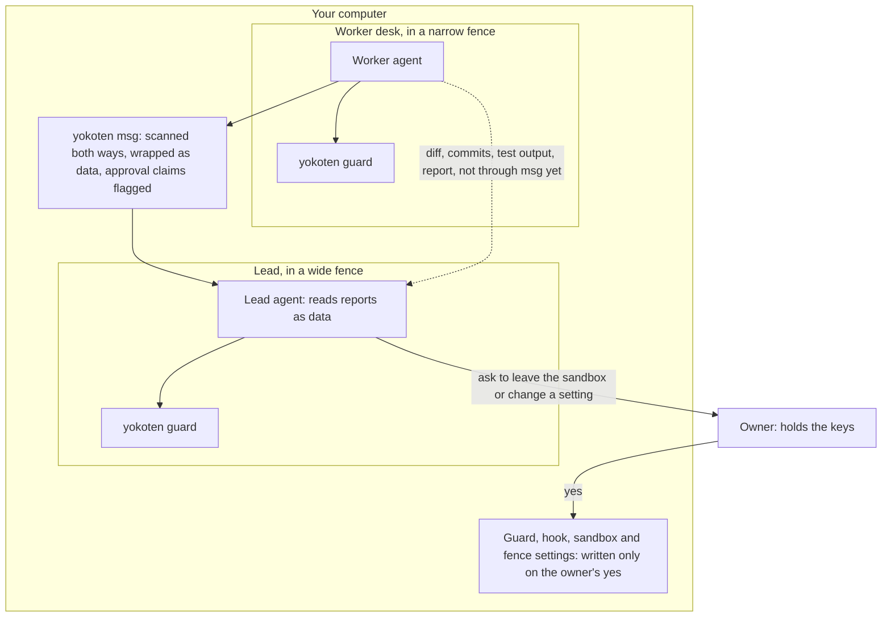

# 0054 One set of rules for every agent; the owner holds the keys

Status: accepted
Date: 2026-10-28 (UTC)

## Context

On 2026-10-28 the owner asked how yokoten's sandbox relates to each agent's own sandbox:
does yokoten contain the agents, or is it contained by them? The answer, read from the
source on that day, has three layers:

| Layer | Whose | Where it lives |
|---|---|---|
| Desk fence | yokoten | `yokoten desk` starts it around a worker: sandbox-runtime (`srt` 0.0.81, bubblewrap on Linux and WSL2, Seatbelt on macOS). Only the desk folder is writable; the network goes through an allowlist proxy. Native Windows has none, so a desk there does not start. |
| Guard | yokoten | A hook in each agent's own config: `.claude/settings.json`, `.codex/`, `.gemini/settings.json`, `.grok/`, `.muse/hooks.json`, `.agents/` (Antigravity), and plugins for OpenCode and DeepSeek Harness. |
| Agent's own sandbox | each vendor | `sandbox.enabled` in `.claude/settings.json`; `sandbox_mode = "workspace-write"` in `.codex/config.toml`; `security.disableYoloMode` in `.gemini/settings.json`; a profile in `.grok/sandbox.toml`. |

So on a desk, yokoten contains the agent: the fence is outside the agent's process. Inside
the agent, yokoten is contained: the agent calls the guard before each tool call. The lead
has no fence, only the guard and its own sandbox.

The ways out, on that day:

| Way out | State |
|---|---|
| A worker edits its sandbox or hook settings | stopped (`leadOnly`) |
| One Bash call asks to run outside Claude Code's sandbox | no rule (issue #1163) |
| A launch that skips approvals | Antigravity skips the hooks; the others not checked (issue #1163) |
| DeepSeek Harness with its hooks file missing | runs with no guard, without a word |
| Native Windows | no desk (it refuses to start); a session there has the guard alone |

The owner's objection: if the lead can escape, the desk fence means nothing. It is half
right. Most incidents are careless, not hostile, and the fence keeps a careless worker in
its desk. But a worker that read a hostile repo can hide an instruction in its report, the
lead reads the report, and the lead has no fence. And the lead can edit the very settings
it is judged by: it holds the keys.

What other tools do (a search on 2026-10-28): each vendor ships its own sandbox and hooks;
Docker Sandboxes (`sbx`) runs one microVM per agent, for several vendors; StrongDM Leash
(Apache-2.0) checks file, network and process calls against Cedar rules from a side
container; cc-safety-net is one hook for many CLIs; orchestrators such as Orca run teams.
None we found keeps the lead under the same rules with the keys in a person's hands, or
treats worker reports as untrusted.

## Decision

1. **yokoten governs every agent, the lead included.** The owner authorises yokoten;
   yokoten holds the rules for all agents. The roles differ: the lead talks to the owner,
   plans and reads reports; a worker does one task and reports to the lead. A role is set
   by the environment at start (`YOKOTEN_ROLE`), not by the vendor.
2. **The owner holds the keys.** A change to the guard (its hooks), the agent's sandbox or the fence settings
   becomes a proposed change that the owner approves before it is written. Leaving the
   sandbox needs the owner's yes, for the lead too. A lead started without its sandbox is
   said in one line at session start and shown by `doctor`. Worker reports are read as
   data, not instructions. (issue #1163)
   How the owner writes: the lead drafts the change, yokoten shows it in one plain line
   with a before/after, and the owner approves in a terminal outside the fence, which
   writes the file. In the goal below, those files are read-only inside the lead's fence,
   so the key is out of the agent's reach, not just forbidden. The lead has no fence
   yet, so today the owner's yes is the only stop.
3. **Who decides what, in three layers.** "The owner" is whoever owns the machine and the
   project: every user holds their own keys.

   | Layer | Who decides | What a user does |
   |---|---|---|
   | Floor (never allowed: rewriting others' pushes, wiping home) | yokoten's maintainers, in code | nothing; it can't be changed |
   | Defaults | yokoten's maintainers, shipped in each release | nothing |
   | Local overrides | each user, with their own keys | may tighten; may loosen on their own machine only, with their own yes |

   A user's overrides sit on top of the release, like `extends: recommended`: an update
   brings the new defaults for every key the user did not override. `doctor` shows which
   rules a user has loosened. An override many users make is the signal for a new default:
   that is 横展, a local fix spread to every line. Nothing is collected without the user
   choosing to share it.

   The defaults change through a proposal (an issue, open to anyone), public discussion,
   and a maintainer decision written as a record. Votes are a signal, not the decision: a
   vote rewards what is popular, not what is safe, and a few new accounts could swing it.
   The MIT licence lets anyone fork the code; the name yokoten stays with the releases that
   keep its floor.
4. **The fence can be swapped, never removed.** `auto` (srt), `srt`, `sbx` or `leash`;
   only the owner switches it; a fence that can't start means the desk does not start,
   as on native Windows today.
   The core stays zero-dependency: yokoten runs the fence as a program. (issue #1164)
5. **What yokoten is.** Like Kubernetes, which does not make containers but decides who
   may deploy what; like a factory's management system, which buys its machines and owns
   the standards, the inspection, the release and the spread of a fix to every line
   (横展). The agents and the fence are bought parts; the rules and the keys are ours.
6. **CEL still waits.** This positioning points towards policy expressions like
   Kubernetes admission policies, but record 0039 stands: adopt CEL when a rule outgrows
   the config, or when users may write their own rules (to decide in the P4 review).

The goal, drawn:

`yokoten msg` (issue #674) already guards its own channel. Its wrapper is a note to the
model, not a lock, and the other channels reach the lead without it. So the owner-held keys
are the real stop.

## Options not taken

- **Fence the workers only, trust the lead.** Simple, but the lead holds the keys and reads
  every worker's output, so one hostile repo can reach the whole machine through it.
- **Put the lead in the fence now.** The lead needs tokens, pushes and every desk; the fence
  would be wide and the work is unknown. Studied later, not promised.
- **Build our own isolation.** Docker and StrongDM already do it better; yokoten plugs into
  them instead (the owner's "nourish each other" rule).
- **Adopt CEL now.** The rules still fit the config; record 0039's costs still hold.

## Consequences

- Easier: one sentence says what yokoten is, and the site's "what it stops" cards can add
  "stops a sandbox escape" once issue #1163 ships a real screen.
- Harder: the owner approves more often. Approvals must stay rare and plain, or they get
  clicked through.
- To check: every runtime's skip-approvals launch mode, each with a test or a recorded run;
  the DeepSeek Harness fail-open case gets its own issue.
