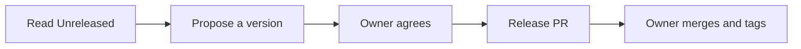

<!-- managed by yokoten; `yokoten install` updates this file, and keeps your edits -->

> **Skills-only copy?** `npx skills add` copies the skills alone: no guard and no session
> doctor. When `yokoten` is not on PATH and the Claude Code plugin is not enabled, say one
> line. Then carry on: "This copy has the skills only; run `npx yokoten install` to add the guard."

# Prepare a release

The owner decides when to release, and only the owner creates the tag (core rule 3).
Your job is to make that one step easy: propose the version, and prepare the
changelog and the channel refs in a pull request.

There are three channels (#632). The marketplace in `.claude-plugin/marketplace.json`
points each plugin at a git ref:

| Channel | Plugin | Ref | npm tag |
|---|---|---|---|
| Stable | `yokoten` | the latest release tag, such as `v0.1.0` | `latest` |
| Beta | `yokoten-beta` | the latest pre-release tag, or the release when it is newer | `next` |
| Dev | `yokoten-dev` | `main`, every merged pull request | none |



## 1. Read what changed

If the project has a `changes/` folder, run `yokoten changelog --write` first. It moves
each change file under `[Unreleased]` in `CHANGELOG.md` and deletes the files. If it
reports a bad file, fix that file and run it again.

Open `CHANGELOG.md` and read the `[Unreleased]` section. If it is empty, there is
nothing to release. Tell the user and stop.

Compare it with the merged pull requests since the last tag:
`git log --oneline "$(git describe --tags --abbrev=0)"..HEAD`. With no tag yet, read
the whole log. A `feat:` or `fix:` commit with no changelog entry is a gap. Add the
line before you go on.

## 2. Pick the next version

A release version is `MAJOR.MINOR.PATCH`. Find the change with the most effect, then use
this table.

| The biggest change | 1.0 or later | Before 1.0 |
|---|---|---|
| Something users rely on now works differently or is gone (Removed, or a Changed line that breaks) | MAJOR: 1.4.2 to 2.0.0 | MINOR: 0.4.2 to 0.5.0 |
| Something new, and nothing breaks (Added, Deprecated) | MINOR: 1.4.2 to 1.5.0 | MINOR: 0.4.2 to 0.5.0 |
| Only fixes (Fixed, Security) | PATCH: 1.4.2 to 1.4.3 | PATCH: 0.4.2 to 0.4.3 |

Before 1.0, a minor bump may break things. Write each break in the changelog under
Changed or Removed, and say what users must do.

Go to 1.0.0 when people depend on the project and you will keep its behaviour
stable. The owner makes that decision.

A first release with no tag yet is usually `0.1.0`.

A pre-release version adds `-beta.N` to the release it leads to, such as
`0.2.0-beta.1`. Start N at 1 and count up for each new beta. A pre-release is for
features that are ready to test. Do not make one from a broken `main`.

## 3. Ask the owner

Tell the owner the version and the one line that decided it. Say whether it is a
release or a pre-release. Wait for a yes that names the version or says "release".
The owner can choose a different version.

A general "merge", "ship it" or "go ahead" is not that yes, and does not approve the
release (core rule 3). Only an answer that names the version or says "release",
"publish" or "tag" does.

## 4. Prepare the release pull request

1. Run `yokoten changelog --write` if step 1 did not, so no change file is left behind.
   In `CHANGELOG.md`, add `## [X.Y.Z] - YYYY-MM-DD` (today, UTC) under `[Unreleased]`.
   Move the lines below it. Leave `[Unreleased]` empty.
   For a pre-release, add `## [X.Y.Z-beta.N] - YYYY-MM-DD` and copy the lines under it.
   Keep the `[Unreleased]` lines as they are, so the stable release still has them.
2. Set the version in the project's version file, such as `package.json`.
3. Update `.claude-plugin/marketplace.json`. A release sets the `yokoten` and
   `yokoten-beta` refs to `vX.Y.Z`. A pre-release sets only the `yokoten-beta` ref, to
   `vX.Y.Z-beta.N`. Leave the `yokoten-dev` ref as `main`.
4. Open a pull request titled `chore: release vX.Y.Z`, or
   `chore: release vX.Y.Z-beta.N` for a pre-release.
5. In the body, say which channels move. A pre-release moves Beta only.

## 5. Read the project's release docs

Before you write the owner's steps, read the project's release docs. Look for
`docs/server.md`, `docs/releases.md`, or a file `CONTRIBUTING.md` names. Read the
release workflow, such as `.github/workflows/release.yml`, and any record it points to.

The project's docs win over this skill. If they differ, say so in one line and follow
the docs.

## 6. Write the owner's checklist

After the owner merges the release pull request, write the steps in order. Give the
command for each step.

First read `name` in `package.json`, then ask the registry for the latest version:
`npm view <name> version`. "E404" means no version is on the registry yet.

Say in the first line of the checklist which release docs you read.

- The tag: `git tag -a vX.Y.Z -m "<name> X.Y.Z" && git push origin vX.Y.Z`. For a
  pre-release, the tag is `vX.Y.Z-beta.N`. A release goes to npm `latest`; a
  pre-release goes to npm `next`.
- The checks: wait for the `verify` job to pass.

For a package **already on the registry**, the tag starts the release workflow. The
`publish` job waits for the owner's approval in the `release` environment. The owner
approves it on the run page (**Review deployments**).

### The first release

`npm view` finds no version. npm can add a trusted publisher only to a package that
already exists. So your checklist must include a publish by hand:

1. Push the tag and wait for the `verify` job to pass.
2. Reject the waiting `publish` job on the run page.
3. In a clean clone of the tag, run `npm ci` and `npm publish --access public`.
   The owner is logged in to npm with two-factor authentication.
4. On npmjs.com, open the package's **Settings**. Under **Publishing access**, choose
   "Require two-factor authentication and disallow bypass 2fa tokens". Then click
   **Update Package Settings**.
5. Do not add the trusted publisher now. npm expires it after 2 days with no publish.
   The owner adds it just before the next release, under **Trusted Publisher**, then
   **GitHub Actions**. Name the repository, the workflow file and the environment.

### Taking a tag back

Give these forms to the owner. Never run them yourself.

```sh
git tag -d vX.Y.Z
git push origin --delete vX.Y.Z
```

Never use `:refs/tags/vX.Y.Z`. Its words do not say what it does.

## Try the beginner road

Before you ask the owner to release, have a weak model walk the beginner road.
Use Haiku or Sonnet, at medium effort. The guard is the same for every AI.
You record that the road was walked. You leave the guard the same for every model.

## Do not

- Create, push or delete a tag. The choice is the owner's, and the tool guard stops a tag push.
- Publish a package or create a host release. These are release actions too.
- Point Stable at a pre-release tag, or publish one to npm `latest`.
- Start a release when the owner has not asked for one.
